# DM guide

This guide is for the DM who runs RaccoonVTT for their table. It walks you through building maps and running fights: what each tool does, when you would reach for it, and how the tools work together in a real session. It covers the parts of the app a DM uses for maps and combat. For a complete list of everything the app can do, see [FEATURES.md](../FEATURES.md), and for every keyboard shortcut, press `?` in the app.

You can read this guide inside the app as well. Open the **Menu** and choose **DM guide** to open it in a new tab. Each panel the guide covers also ends with a small **Guide** link that takes you straight to the section about that panel.

The app does a lot, and you don't need most of it on day one. Read the [Quick start](#quick-start), run a session with just those tools, and come back for the rest when you want it.

## Contents

- [Where things are](#where-things-are)
- [Quick start](#quick-start)
- [Use what helps your table](#use-what-helps-your-table)
- Making maps
  - [Scenes](#scenes)
  - [Starter art](#starter-art)
  - [Pasting a picture](#pasting-a-picture)
  - [Lining up the grid](#lining-up-the-grid)
  - [Hex grids](#hex-grids)
  - [The map builder](#the-map-builder)
  - [Walls and doors](#walls-and-doors)
  - [Heights and stairs](#heights-and-stairs)
  - [The isometric view](#the-isometric-view)
  - [Difficult ground](#difficult-ground)
  - [Light and party vision](#light-and-party-vision)
  - [Fog](#fog)
  - [Map phases, imports and exports](#map-phases-imports-and-exports)
- Running fights
  - [Monsters](#monsters)
  - [Encounters](#encounters)
  - [Tokens](#tokens)
  - [HP, damage and conditions](#hp-damage-and-conditions)
  - [Initiative](#initiative)
  - [Dice](#dice)
  - [Asking for rolls](#asking-for-rolls)
  - [Areas](#areas)
  - [The group save](#the-group-save)
  - [Uses and Legendary Actions](#uses-and-legendary-actions)
  - [Alerts during a fight](#alerts-during-a-fight)
  - [Measuring and movement](#measuring-and-movement)
  - [Mounts, familiars and dragging](#mounts-familiars-and-dragging)
  - [Traps](#traps)
- Deeper tools
  - [Outliner](#outliner)
  - [DM panel](#dm-panel)
  - [Characters and their stat blocks](#characters-and-their-stat-blocks)
  - [Companions](#companions)
  - [Ping, Look here and pins](#ping-look-here-and-pins)
  - [The table display](#the-table-display)
  - [The Log and its history](#the-log-and-its-history)
  - [Room settings for fights and maps](#room-settings-for-fights-and-maps)
  - [Undo, Redo and Setup history](#undo-redo-and-setup-history)
- Scenarios
  - [A forest road ambush](#a-forest-road-ambush)
  - [A dungeon crawl in the dark](#a-dungeon-crawl-in-the-dark)
  - [A fight across heights](#a-fight-across-heights)
  - [A boss with Legendary Actions](#a-boss-with-legendary-actions)
  - [Spirit Guardians and a summoned companion](#spirit-guardians-and-a-summoned-companion)
  - [The party travels between scenes](#the-party-travels-between-scenes)
  - [A secret door and a reveal](#a-secret-door-and-a-reveal)
  - [A pit at the crypt's door](#a-pit-at-the-crypts-door)
- Reference
  - [Shortcuts](#shortcuts)

## Where things are

The screen has three main parts: the **map** in the middle, the **toolbar** under it, and the **panels**, where most of the app's controls live. Where the panels appear depends on the size of your screen.

**On a computer** (a window 900 px wide or more), the panels are tabs in a side panel on the right. Each tab shows its panel's icon, and its name when you point at it or reach it with the keyboard: the person in a circle is Token, the crossed swords Initiative, the d20 Dice and the scroll the Log. The tabs you use most come first, as many as fit, and **More** lists the rest, grouped under **In play** and **Prepare**, each with its icon. A panel you open from More shows its icon on More, with its name beside it where there is room. On a tablet, or a phone held sideways, the panel's name also shows above it whenever the tabs show its icon alone. When you want more room for the map, press **Hide panels**, the last button in the row of tabs (or the `S` key), and bring the side panel back with **Panels** in the toolbar. **Two panels**, at the top of the More list, splits the side panel so you can see two panels at once, which is handy for keeping Initiative open above a token's stats.

Above the tabs sits the party bar, which shows your players' characters with their HP. Press **Party** to fold it down to a single line: the characters' names and HP in a strip that scrolls sideways when they don't all fit, followed by **Ask** for [asking the party for a roll](#asking-for-rolls).

**On a phone**, press **Panels** in the toolbar to see the list of panels. Each one opens as a sheet that slides up from the bottom. The short handle at the top of the sheet shows that it moves with your finger, and it fills with your color and stretches as you pull, fully when a slow release would move the sheet. Swipe the sheet down to close it, from its header at any time or from anywhere on it once it is scrolled to the top. Swipe it up from its header to give it the whole screen, and a short swipe down brings it back to its usual height. A sheet that holds something you have typed and not yet sent or saved, such as a chat message, springs back instead of closing, so a stray swipe never loses your words. You can choose how the handle looks, from a raccoon's ringed tail to a plain pill, under **Sheet handle** in **This device**. On a tablet held upright, the sheet keeps to the width of a dialog and sits in the middle of the screen. To save room, your setup tools (Add token, Pin, Trap, Map builder and Line up grid) are tucked behind **Setup** in the toolbar.

When you type on a phone, whatever you are typing in rises to sit just above the on-screen keyboard, with the buttons that go with it, so the HP entry keeps its **Apply** in view and a sheet's field never hides behind the keys. Everything goes back where it was once the keyboard closes.

**The toolbar** holds eleven tools. On a computer, each one has a key:

- **Select** (`V`), **Ruler** (`R`), **Area** (`A`), **Fog** (`F`), **Draw** (`D`) and **Ping** (`P`).
- Your setup tools: **Add token** (`T`), **Pin** (`M`), **Trap** (`X`), **Map builder** (`B`) and **Line up grid** (`G`).

When you pick a tool, its options appear in a row just above the toolbar, and anything that doesn't fit in the row waits behind **⋯** (More options). If the row is in your way, tap the tool you are using again to hide its options. The tool stays in use, and another tap brings the options back. Above the row, a line tells you what the tool is doing or what it found. While the app is still working something out, such as a long walk or a search for a map's grid, that line says so in muted words beside a small spinner, such as "Finding the way…", and keeps its place, so nothing on the map jumps when the answer comes. Something that didn't work, such as "No grid found.", reads in the warning color.

**Buttons tell you their keys.** You don't have to learn the keys from a list. On a computer, rest the pointer on a button, and its name appears with its key, such as **Fog (F)**, **Change the view (I)** or a token's **Hidden (H)**. A few buttons carry the key in their own words: the View menu's **Turn left (Q)** and **Turn right (E)**, **Show the shortcuts (?)** in **This device**, and the Outliner's **Search the scene (/)**. If you move a key to another one in the shortcut list, the buttons name your key instead. A phone or a tablet shows no keys, since it has nothing to press them on, until you press a key on a keyboard joined to it. From then on it names them all, just as a computer does.

**The top bar** holds **Undo** (`Ctrl+Z`) and **Redo** (`Ctrl+Shift+Z`), the two curved arrows (with Cmd in place of Ctrl on a Mac), which take back your own play and board changes one at a time and put them back again (saved definitions have their own history in the Menu, see [Undo, Redo and Setup history](#undo-redo-and-setup-history)). Beside them, **View** chooses whether your device shows the map from straight above or tilted, in the [isometric view](#the-isometric-view), and **Fit the map to the screen** (four corners, or the `0` key) brings the map back when you have panned or zoomed it out of sight. On a computer, the last button in the top bar is **Full screen** (`W`), which gives the whole screen to the room. Press it or `W` again to leave. If the window is too narrow for the button, **This device** in the Menu has the same switch, and that is also where you find it on a tablet or an Android phone.

**The Menu** panel holds the X-card, **Copy player link**, **Members**, **Setup history**, **Room settings**, **This device**, **DM guide**, **About** and **Leave room**. When the top bar is too crowded for the View button, it waits here as a **View** row instead.

These are the panels a DM uses most for maps and fights:

- Under **In play**: **Token**, **Initiative**, **Dice**, **Log**, **Journal**, **Areas**, **DM** and **Scenes**. On a phone, **Party** is here too.
- Under **Prepare**: **Monsters**, **Encounters**, **Characters**, **Outliner** and **Library**.

## Quick start

This section gets you through a first session with only a handful of tools: one map, a few monsters and one fight.

### Before the session

1. On the Home page, fill in **Room name** and **Your name**. The app suggests a **Player password**, which you can keep or replace with your own (8 characters or more). Then press **Create room**.
2. The app now shows your DM link. Save it somewhere safe, because it is your way back into the room as the DM from a new device. Tick **I saved my DM link** and press **Continue to the room**.
3. Open **Scenes** to add your map. Under **New scene**, pick **Map image**, then **Choose a map image**, then **Upload and create**. On a square scene, a file name that includes the map's size, such as `crypt_30x20.jpg`, sets its scale. Without that size, or on a hex scene, the app opens the **Line up grid** tool (`G`) so you can match its grid to the one on the map (see [Lining up the grid](#lining-up-the-grid)). No map of your own yet? Press **From starter packs** instead and pick one of the maps that come with the app (see [Starter art](#starter-art)).
4. Open **Monsters** and search for a monster, such as `goblin`. Tap it, set **How many**, and tick **Hidden from players** if the monsters are lying in wait. Press **Place on the map**, then tap the map where they go.
5. Send your players the link: open the **Menu** and choose **Copy player link**. The link carries the password, so players join without typing it. Players can make their own characters in the **Characters** panel (new rooms allow this), or you can make them yourself with **New character** there.

### At the table

1. Put the party on the map. In **Characters**, open a character, press **Place a token**, and tap the map. Players can also place their own tokens on the scene they are on.
2. A map image starts covered in fog, so at first your players see nothing. Pick the **Fog** tool and reveal what the party can see (see [Fog](#fog)).
3. In **Scenes**, press **Move players** on your scene if the players aren't there already. The scene the players are on is marked **Players here**.
4. When the fight begins, open **Initiative** and, under **Start a fight with**, press **Everyone here**. Players set their own Initiative. Press **Auto Initiative** to roll for the monsters, then press **Start**.
5. Press **Next** (or the `N` key) at the end of each turn. When a creature takes damage, tap its token to open its action bar, type the damage with a minus sign, such as `-7`, in its HP entry, and press **Apply**. **Conditions**, in the same bar, adds Prone, Frightened and the rest.
6. You can reveal a hidden monster yourself with **Hidden** in its action bar. Or you can leave it to the app: the room setting "Reveal hidden combatants on their turn", which is on by default, makes a hidden monster appear on its own when its turn comes.
7. When the fight is over, press **End the fight** in Initiative, and tap it again to confirm.

If you make a mistake along the way, **Undo** takes back what you did at the table or on the board, even a whole encounter you dropped on the map. Changes to a saved stat block, a scene's settings or the room's settings are taken back in **Setup history** instead, in the Menu (see [Undo, Redo and Setup history](#undo-redo-and-setup-history)).

## Use what helps your table

The most important rule at any table is that everyone has fun, you included. The app is there to add to your game, never to get in its way. If a part of it doesn't help your table, or you would rather not use it, leave it out. That holds for good, not only while you learn the basics. A session that uses only a few of the tools is still a good session.

None of the parts below is needed to run a good session. Each one is there for the day you want it, if that day comes.

- **The map builder.** A map image is all you need. Build a map when you want walls, doors and heights that the app knows about, so they can block movement and sight.
- **Party vision and light.** Fog that you reveal by hand works perfectly well on its own. Party vision goes a step further: the app works out everything the party's creatures can see, by their senses and the light, and shows that shared view to every player. It needs walls to block that sight, so it pairs with a built or imported map. Sight for each player goes one step further again, for a table that enjoys keeping secrets from one another, and most tables never need it.
- **The isometric view and hex grids.** The flat map from above is all you need, on squares. Isometric is there for the maps where height matters, and hexes for the maps drawn on them.
- **Encounters.** Placing monsters straight from the Monsters panel works fine. Encounters let you prepare fights ahead of time and check them against the XP budget.
- **Roll requests, the group save and roll options.** Your players can roll their own dice and tell you the total.
- **Uses and class resources.** You can count a dragon's Legendary Actions or a barbarian's Rage on paper, as you always have. The cards that come up at the start of a turn only ask: nothing happens unless someone answers them.
- **Areas.** Areas earn their place the first time someone casts Fireball, but you can leave reminders, height and the group save until you need them.
- **Traps.** A hidden monster or a line in your notes can stand in for a trap. The Trap tool earns its place once you want a pressure plate that goes off by itself when a token walks onto it.
- **Attach.** Until someone rides into battle, you can move a horse and its rider one after the other. Attaching them saves the second drag, and the app then runs the mount's turn by the mounted combat rules.
- **The walking ruler and difficult ground.** Dragging a token already counts the rubble you painted and, while **Walls and ledges block players' moves** is on, walks it around walls. Mark more difficult ground, or measure a walk before anyone moves, when your maps call for it.
- **Map phases, Universal VTT imports, the Outliner, the table display, pins, handouts and companions.** Each is easy to pick up once the basics feel familiar, whenever you want it.

# Making maps

This part covers everything you do to get a map ready before the players see it: scenes, the starter art that comes with the app, the grid, the map builder, walls, heights, difficult ground, light and fog. Read it while you prepare a session, and come back to a section when you want a map to do something new. Traps are part of preparing a map too, but they matter most once they go off, so they have their own section under [Running fights](#traps).

## Scenes

A scene is one map, together with its image or build, its grid, its fog and the tokens on it. A room can hold up to 50 scenes. The **Scenes** panel (DM only) lists them, makes new ones, and holds the settings of the scene you are viewing.

Each row tells you whether the scene has a map image, its size and whether its fog is on, such as "Map, 30 × 20, fog on", or "Grid, 30 × 20, fog off" for a scene with no image. The size is in squares, or on a hex scene in the whole hexes it holds, such as "30 × 22 hexes", the same count its **Size and view** settings give.

**Viewing a scene and moving the players.** Tapping a scene's row shows that scene to you alone. The players stay where they are, so you can prepare the next scene while they play this one. When you are ready to bring them along, press **Move players** under the scene's row. Every player is sent there, and that row is then marked **Players here**.

Moving the players moves their view, not their tokens. Once they arrive, place the party's tokens on the new scene with **Place a token** in Characters, or let the players place their own. Before the move goes through, the app warns you if the players would see the whole map (because fog is off) or nothing at all (because party vision is on and no character there can see).

### Making a scene

Under **New scene**, pick the kind of scene you want:

- **Battle mat**: a blank grid with a background color. On squares, set **Squares across** and **Squares down** (30 × 20 by default, up to 200 each). On hexes, the same numbers are **Across** and **Down** under **Size in 5 ft steps**, with the distance taken from your room's setting. They measure the scene's width and height, and the line below tells you how many whole hexes fit inside.
- **Map image**: pick an image (JPEG, PNG, WebP, GIF or AVIF, up to 32 MB) and press **Upload and create**. If you leave the name blank, the scene takes its name from the file. The scene is sized to the whole squares the image covers. To reuse an image already in the room, choose it under **Or use a map already in this room** instead, or press **From starter packs** to start from one of the maps that come with the app (see [Starter art](#starter-art)).
- **Builder**: an empty 40 × 30 scene that opens the map builder straight away.
- **From a Universal VTT file**: see [Map phases, imports and exports](#map-phases-imports-and-exports).

On a square scene, a map's file name can tell the app its scale. Name the file `crypt_30x20.jpg`, for example, and the scene comes out 30 by 20 squares. Without a size in the name, the app guesses about 30 squares along the image's long side and opens **Line up grid** (`G`) so you can correct the guess. On a hex scene, the file name does not set the scale. Line up grid opens so you can check a grid the app found or fit one yourself.

Every kind but the Universal VTT file has a **Grid** row: **Squares**, **Hex rows** or **Hex columns**. A Battle mat or a Map image starts on your room's choice (see [Hex grids](#hex-grids)), and the row changes it for the one scene you are making. A Builder scene and a starter map start on squares whatever the room says, because the builder's tools and the starter art are drawn on squares. You can still pick hexes for them in the row. A Builder scene then reminds you that painted ground needs squares, and a starter map drops its measured square grid and opens **Line up grid**. A Universal VTT file always makes a square scene, and its summary says so when your room starts new scenes on hexes.

### What players see on new scenes

Every new scene has to start somewhere: under fog for the party to explore, under fog for you to reveal by hand, or in plain view. Your room makes that choice for you, so you don't have to set up each scene. In the Menu, open **Room settings** and find **New scenes** at the end. **Players see on new scenes** is **Explore**, **Reveal by hand** or **Everything** (see [Light and party vision](#light-and-party-vision) for what each one means), and a new room starts on Explore. A room made before this setting existed shows **As before** until you pick one, which keeps the old starts: maps and builder scenes under fog, battle mats without. Once you pick, As before goes away.

Two exceptions keep things sensible. A map image or a starter map starts on Reveal by hand even when the room says Explore, because a fresh image has no walls yet, and party vision would show the players the whole picture at once. The form tells you why. And the battle mat a new room comes with starts on Everything, so players who join see the mat rather than darkness.

For one scene, the new scene form has its own **Players see** row under the name. It starts on the room's choice, so most of the time you leave it alone, but you can pick any of the three. The fourth option, **Like** followed by the name of the scene on your screen, copies that scene's setup instead: its fog, its party vision with the light and Sight, and whether walls stop players' moves. The line under it says what it will copy, such as "Explore, Dark, Per player, players' moves blocked". So when the party goes down a stair to the next level of the same dark dungeon, make the new level with the first one on your screen, pick **Like**, and it starts exactly as dark. The new scene still gets the automatic walls that suit its kind, so a map image keeps walls around floor only, whatever the scene you copy uses. Like copies the scene as it is when the new one is made, after the upload. If that scene is deleted while your map uploads, the new scene starts on your room's choice instead, and a message says so.

### A scene's settings

Below the scene list (**All scenes**) and **New scene**, the panel shows the settings of the scene on your screen, under **This scene**. The **Scene name** comes first, and players can see it. Everything else sits in four groups, each holding the settings that do one job, so the ones you need are always together:

- **What players see**: **Players see**, **Light** and **Sight**, who lends the party sight, the fog and party vision switches folded under them, and **Use these settings on other scenes…**. Everything that decides what this scene shows your players is here. See [Light and party vision](#light-and-party-vision).
- **Map image and grid**: the **Map image** (**Add a map image**, **Replace map image** and **Remove map image**), then its **Map phases** once the scene has an image (see [Map phases, imports and exports](#map-phases-imports-and-exports)), then the grid: **Grid lines**, **Grid color**, **Opacity** and **Line width**, then **Grid shape** (see [Hex grids](#hex-grids)), plus, on a map image, **Line up the grid**, **Find the grid** and **Or count the squares**.
- **Walls and movement**: **Walls and ledges block players' moves**, which is on for new scenes. While it is on, a player's token walks around walls, closed doors and ledges the party has seen, and stops only where there is no way around. Your own moves are never stopped. See [When walls stop a move](#when-walls-stop-a-move). Then **Automatic walls**, **Open the builder** and **Clear the build**.
- **Size and view**: **Size in squares**, the **Background**, the **Starting view** and the **Suggested view**. **Save current view**, under Starting view, saves the way the map is framed on your screen right now as the view the scene opens with for everyone. **Suggested view** is **Top-down** or **Isometric**: see [The isometric view](#the-isometric-view).

At the end come **Export as image** and **Delete scene**.

Tap a group's name to fold it away, and tap it again to open it. A folded group tells you what it holds at the end of its row, so you can read a scene at a glance without opening anything: What players see shows its choice and the light, such as "Explore · Dark", Map image and grid whether the scene has an image and what grid it uses, Walls and movement whether walls block players' moves, and Size and view the scene's size. On a narrow phone with a large interface size, that line moves under the group's name. On a phone, only What players see starts open, so the settings you reach for during play sit right under the scene's name, and the setup groups wait until you need them. On a computer every group starts open. Each group then stays the way you left it on that device, on every scene and the next time you open the room. Folding a group never interrupts anything in it: an image still uploading carries on, and squares you typed but haven't applied are still there when you open it again.

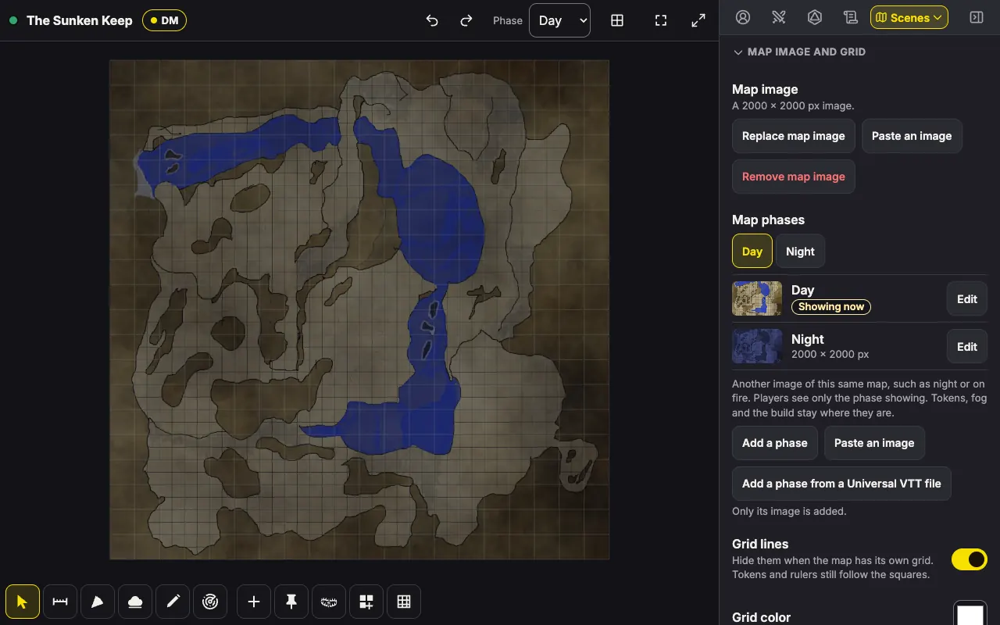

Players can see a scene's name, so don't name a scene after a surprise. And if you replace the map image of the scene the players are on, they see the new image as soon as it uploads, so the app asks you to confirm first.

**Copying and organizing scenes.** Each scene's **⋯** menu (More for the scene) holds **Duplicate…**, **Move to folder…**, **Update thumbnail** and **Delete**. Delete asks you to tap twice: the first tap turns the row red and reads "Tap again to delete", and tapping anywhere else cancels it. It takes the scene's tokens, drawings, build and fog with it, and a room's last scene cannot be deleted. You can't delete the scene your players are on, either: move them somewhere else first, and the scene is yours to remove. Until then, its Delete reads "Move the players to another scene first." An **Undo setup** or **Redo setup** that would take the scene away says the same. A duplicate always copies the map, its phases and the build, and lets you choose what else comes along: **Monsters, NPCs and objects** (on to begin with), **Player characters**, **Fog**, and **Drawings and placed areas**. Folders fold away with a tap, and players never see your folders or thumbnails. To change the order of the list, press **Reorder** at the top and move scenes and folders up or down.

Feet per square and the rule for diagonals aren't scene settings: they apply to the whole room. You'll find them under **Menu**, **Room settings**, **Grid and distance**.

## Starter art

You don't need any art of your own to get started. The app comes with **starter packs**: sets of openly licensed art, each made by one artist or project in one style, with maps to play on, tokens and portraits for monsters and characters, pictures to show as handouts, and props for the map builder. Every work in them was released by its author under a license that lets your table use it, and the app keeps each work's credit with it.

- **Maps**: Dyson Logos maps (29 hand-inked maps of inns, caves, dungeons, temples, castles, towns and more), Scarlet Heroes maps (5), Index Card Dungeons (10 small dungeons, each drawn on an index card) and a painted Cavern Battlemap.
- **Tokens and portraits**: Illustrated Bestiary (60 monsters in color), Cute Heroes and Monsters (64), Dungeon Crawl Stone Soup monsters (61, in pixel art), Lemurs Fantasy Portraits (58), Fantasy RPG Portraits (25), Flare Hero Portraits (10), and Historical art's people and creatures.
- **Handouts**: the Illustrated Bestiary, the three portrait packs, and Historical art (47 museum pictures of people, creatures, places, items and documents).
- **Map builder stamps**: Warlock's Gauntlet (40 ruins, wrecks, bones and trees), Poly Haven props (41 pieces of furniture and gear seen from above) and Flat greyscale props (50).

**Where to find it.** Starter art has a place of its own wherever you choose art, so it never gets mixed up with the images you have uploaded yourself:

- In the image picker, for a token, a character's portrait or a monster's token image, open the **Starter** tab.
- In the **Scenes** panel, under **New scene** and **Map image**, press **From starter packs**.
- In the **DM** panel, under **Show a handout**, press **From starter packs**.
- In the map builder's **Stamp** mode, press **Choose a stamp** and open the **Starter** tab.

Each place shows only the packs that suit it, sorted by pack and then by category inside the pack: Dyson's maps by Taverns and inns, Caves or Crypts and tombs, for example, and the Bestiary by Dragons, Undead and so on. The search box looks through names, categories and tags across all the packs on show, so `owlbear`, `crypt` or `elf` takes you straight to what you're after. Tap a picture to see its name, its pack, its author and its license, then press **Use**.

**How a pick joins the room.** When you use a map, a token or a handout, the app copies that picture into your room's library together with its credit, and then carries on just as it would after an upload of your own: a token picture opens in the crop editor, a map becomes a new scene, and a handout is ready to show. From then on it is one of the room's images like any other. It goes into your backups, and it travels with the room if you move it to another server.

Stamps work differently. A starter stamp isn't copied into the room at all: the builder places it straight from the app, the same way it places the stamps that come with the app.

**It doesn't use your storage.** Each room can store only so much, but pictures from the starter packs don't count toward that limit, however many you pick. In the **Library**, they sit after your own images in a folded group called **From starter packs**, so your own maps and tokens stay easy to find. The list of maps under **New scene** and the pictures in **Show a handout** work the same way: your own come first, and the picks follow under their own heading. You can delete a pick you no longer need, just like any other image, and pick it again later if you want it back.

**Maps with a grid.** Most of Dyson's maps and the painted cavern have a grid drawn on them, and for 22 of them the app already knows exactly where it lies. A scene made from one of those starts lined up on its grid, so you can skip [Lining up the grid](#lining-up-the-grid) entirely. For a few more, the app knows how big the squares are but not where they start, so the scene opens on **Line up grid** with the box already the right size, and all you need to do is move it onto the drawn squares. The Scarlet Heroes maps, the Index Card Dungeons and three of Dyson's maps have no drawn grid, so they open on **Line up grid**, just as a map of your own would. Ink maps are black lines on white paper, where the app's usual white grid lines would disappear, so their scenes start with a dark grid instead. The Index Card Dungeons are meant for exploring rather than for fighting square by square, so they work best as a map the party moves across.

**Credits.** A picked image keeps its credit, which you can read in the Library's viewer and in the token panel: who made it, its license, the credit line its author asks for where there is one (such as "Cartography by Dyson Logos"), and what was changed. That is usually only its size and file format, or for the ink maps, a reduction to four shades of gray that keeps every line sharp. The About page credits every pack. If you share a starter map or picture beyond your table, keep its credit with it, since that is what its license asks of you.

Players get the **Starter** tab too, in the image picker for their own characters' tokens, so a player without a portrait can pick one. Maps, handouts and stamps stay yours.

## Pasting a picture

You don't need to save a picture to your computer before you use it. Copy it (on a web page, right-click it and choose **Copy image**, or press and hold it on a phone), then paste it wherever the app asks for an image: in the image picker, in **New scene**, a scene's **Map image** and phases, **Show a handout** and the stamp picker. Press Ctrl+V (Cmd+V on a Mac), or press **Paste an image** (**Paste from the clipboard** in the image picker). A pasted picture goes exactly where a chosen file would: a map is searched for its grid, a token picture opens in the crop editor, and a handout is ready to show.

A phone may ask your permission the first time, or show its own small **Paste** button for you to tap. If it won't let the app read the clipboard, press and hold in the box that appears and tap **Paste** there.

On a computer you can also just press Ctrl+V over the map, and the app asks what the picture is for: a new scene, the selected token's picture, a stamp or a handout. Nothing uploads until you choose. A scene's **Map image** and **Add a phase** take Ctrl+V only while one of their own buttons has focus, and on the players' scene only after you've confirmed, so a stray Ctrl+V never replaces the map your players are looking at. Their **Paste an image** buttons work whenever their other buttons do.

## Lining up the grid

Many map images come with a grid already drawn on them. Lining up the grid makes the app's squares match the drawn ones, so that tokens, rulers and areas land where the art says they should.

This section is about squares. On a hex scene the box and a few of the options differ, and the last paragraphs of [Hex grids](#hex-grids) cover them.

1. Pick **Line up grid** in the toolbar (behind **Setup** on a phone), or press **Line up the grid** in the scene's **Map image and grid** settings. When you create a map scene whose file name doesn't give its size, the tool opens on its own.
2. Drag a box over 3 by 3 squares of the art. To adjust it, drag inside the box to move it, or drag a corner to resize it. You can also tap elsewhere on the map to move the box to the squares you tapped. As you work, the app draws the grid the box would make across the whole map, so you can check that it lines up everywhere, not just inside the box.
3. For the last pixel of accuracy, use **Nudge**. It moves the box, or makes its squares smaller or larger, one pixel at a time.
4. Press **Apply**. The app saves the grid and confirms it with a message such as "Grid saved at 70 px per square."

**Apply** only becomes available when there is something to save: either the box differs from the grid the scene already has, or **Resize scene** (below) would change the scene's size. A new scene starts with the app's guess already saved and sized to fit, so if that guess lines up with the art, there is nothing to apply: just pick another tool and carry on.

Two more options wait under **⋯**. **Resize scene** (on by default) makes Apply also resize the scene to the squares the map covers. **Grid lines** turns the app's own grid lines on or off. Turn them off for art that has a grid of its own. Tokens and rulers still follow the squares either way.

**Counting the squares instead.** If the art's squares run all the way to the edges of the image, you can skip the box and simply type the count. In the scene's **Map image and grid** settings, under **Or count the squares**, enter how many squares the image has across and down, then press **Apply**.

> [!NOTE]
> When applying a grid also changes the scene's size, the app saves the two changes as separate steps in **Setup history** (Menu), since a scene's size and grid are settings. The first **Undo setup** takes back the resize, and a second one takes back the grid.

**Letting the app find the grid.** Often you won't need the box at all. When a square scene's map file name gives no size, or whenever you upload a map for a hex scene, the app looks for a grid drawn on the map while it uploads. If it's sure of what it found, the scene starts lined up, and Line up grid opens to tell you so, such as "Found a grid of 70 px squares.", with **Use default** to go back to the first guess and the scene's earlier size. If it's less sure, it only places the box on those squares for you to check and **Apply**. On a phone, a large map can take a little longer: the scene opens, and Line up grid says it's still looking until it has an answer. **Find the grid**, in the tool's options or the scene's **Map image and grid** settings, looks again whenever you like, and **Undo setup** in **Setup history** (Menu) takes back a grid it applied. If you'd rather not wait for it, just carry on: pressing **Apply** or moving the box stops the search, so it never overwrites what you've done. And if the scene itself changes while it's looking, say someone sets its grid on another device, a grid it then finds isn't applied, and Line up grid tells you so.

**Squares or hexes.** You never have to tell the app which kind of grid a map has, because every search looks for squares, hex rows and hex columns at once. Hexes drawn with heavy lines are found too, even on very large maps. When the app is sure of a grid of the other shape, the scene changes shape to match in the same step. Upload a hex map in a room that starts new scenes on squares, for example, and its scene starts on hexes, lined up, with a line such as "Found hex rows of 70.4 px. The grid is hex rows now." **Undo setup** in **Setup history** takes the find back, shape and all, and right after an upload **Use default** puts back both the first guess and the shape the scene started with. Once something stands on the new grid that the old one can't keep, such as heights painted on its hexes, Use default leaves the scene as it is and says why.

Sometimes the scene can't change shape at all, because painted ground, walls or traps already stand on its squares, or because it came with its own grid from a Universal VTT file. Line up grid then tells you what it found and why the scene kept its shape. When the app is less sure, the box only goes on the scene's own grid, and if the other shape looks more likely, the line says so ("These lines may be hex columns of 70.4 px. Change Grid shape to use them."). Change **Grid shape**, and the box moves onto those lines. A map that shows both shapes, such as a square grid drawn over hexagonal floor tiles, never changes shape by itself: the box goes on the scene's own grid, and the line names both sizes.

**A new image for a scene.** When you replace a scene's map image, the new one is searched too. If it has the same proportions as the old one, the scene keeps its grid, scaled to the new image, since you may have lined the old grid up by hand. A grid found on it that differs is only placed as the box in Line up grid, for you to check and **Apply**. Even a grid of the other shape doesn't change the scene's shape here: the line names it, and changing **Grid shape** brings its box. A map that also shows the other shape gets a line naming both sizes, as described above. Uploading the same file again changes nothing at all. On a scene from a Universal VTT file, which came with an exact grid of its own, any search only places the box, so you can compare the two before you **Apply**.

## Hex grids

Most tables play on squares, and a new room does too. If your maps are drawn on hexes, a scene can use them instead. A scene's grid is **Squares**, **Hex rows** or **Hex columns**. Hex rows have pointed tops, so each row of hexes runs straight across the map. Hex columns have flat tops, so each column runs straight down. Pick the one that matches the art, since the two don't line up with each other.

Nearly everything in this guide works on a hex scene too, from walls, stairs and the walking ruler to traps and mounts, counted in hexes instead of squares. Where a tool works a little differently on hexes, its own section says how, and the few things that stay on squares are listed at the end of this section.

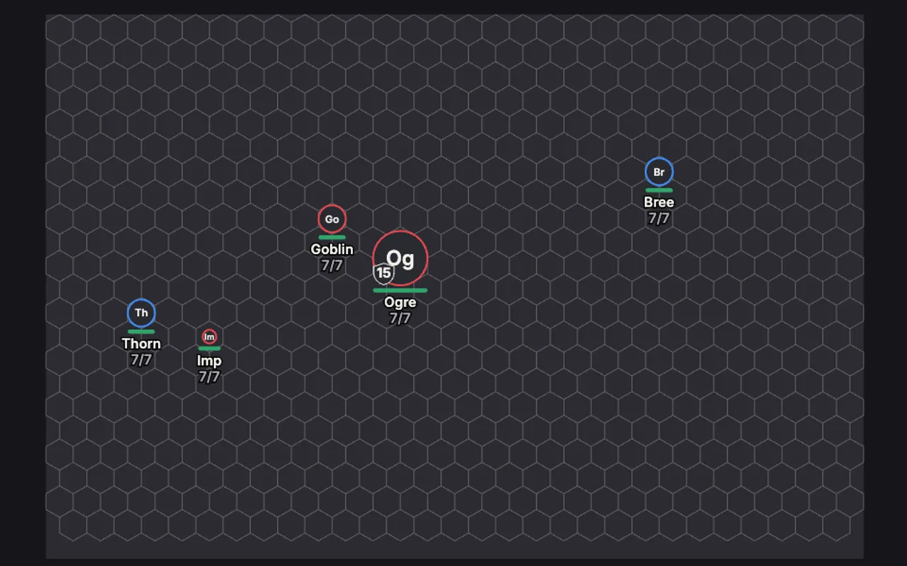

**Choosing a shape.** There are three places, from the widest to the narrowest:

- **Grid on new scenes**, in **Menu**, **Room settings**, **Grid and distance**, is the shape a new Battle mat or Map image starts with. It is **Squares** in every room until you change it, so nothing changes for a table that never touches it. Set it once if you prefer hexes, and you won't have to change each new scene. It looks and works just like a scene's own Grid shape.
- The **Grid** row in **New scene** changes the shape for the one scene you are making.
- **Grid shape**, in a scene's **Map image and grid** settings, changes a scene that already exists. A map scene that changes shape opens **Line up grid**, because the art's cells are another shape now. On a small phone with a large interface size, the three shapes stand one under another instead of sharing a row, so each name stays whole.

For a map image you often don't need to choose at all. The app looks for squares and hexes alike when you upload one, and a map drawn on hexes starts its scene on hexes by itself (see [Lining up the grid](#lining-up-the-grid)). Scenes you made before hex grids came to the app stay squares, and a duplicate keeps the shape of the scene it copies.

A scene won't change shape while it holds something laid out on its own cells, which the other grid can't keep: painted ground, walls and doors on squares, heights, stairs, difficult ground, traps, a squeezing creature, or a Builder room reveal waiting in the fog draft. The choice is off, and the reason sits right under it. Remove those first, or leave the scene as it is. Walls and doors drawn on a hex scene don't hold it back, since they keep their place on any grid. A scene made from a Universal VTT file came with its own square grid, so its shape can't change either.

**How a hex scene plays.** The distance from one hex center to the next is the room's feet per square, so a hex is one cell across its flat sides and nothing else about the scene's size or units changes. Everything snaps to a hex, and the rules count in hexes:

- **Every hex is one step.** Hexes have no diagonals, so **Diagonal moves** in Room settings counts only height on a hex scene. Moving 4 hexes is 20 ft at 5 ft per hex. The ruler's line reads "every hex 5 ft". It adds "height 5-10-5" or "height by true distance" when you choose one of those rules instead of the default. Range rings outline the hexes within reach.
- **Sizes take hexes.** Tiny, Small and Medium creatures take 1 hex. A Large creature takes 3 hexes, a Huge creature 7 and a Gargantuan creature 12, as the Dungeon Master's Guide's table for hexes says. The ogre in the picture stands on three hexes. A selected token shows the outline of all its hexes, and the distance between two creatures is the fewest steps between any hex of one and any hex of the other.
- **Placing and moving** work as they do on squares. A token dropped between hexes lands on the nearest one, and **Add token**, a duplicate and a companion look for a free hex nearby. The arrow keys move the selected token one hex. On hex rows, Left and Right go along the row, and Up and Down zigzag so a run of presses keeps to one column. On hex columns it is the other way around.
- **Areas** keep their true shape and count each hex they cover by the room's rule under **Which squares an area covers**. Room settings say "square or hex" while your room has a hex scene or starts new ones on hexes. An **Emanation** is the one exception. It covers every hex within its size in steps of the creature's hexes, so a 15 ft emanation reaches 3 hexes out from a Medium creature, and it always agrees with the ruler. A free point snaps to a hex corner or center, a placed area moves by whole hex steps, and its rotation snaps to 30° instead of 45°.
- **Fog and party vision** work as they do on squares. A creature stays hidden while every part of its hexes is under fog, and appears as soon as any part of one is revealed. Walls, closed doors and raised ground block sight on a hex scene just as they do on squares, and a creature standing across a wall shows only on the side where its middle is, so nobody spots it from the far side.
- **Export as image** draws the hex lines at a whole number of pixels per hex, and names the file for hexes (see [Map phases, imports and exports](#map-phases-imports-and-exports)).

**Building and moving on hexes.** Everything you build on squares works on hexes too, hex by hex, except painted ground. In the builder, **Walls/doors** draws wall lines from corner to corner, which [Walls and doors](#walls-and-doors) describes. **Difficult ground**, **Erase** and **Heights/stairs** work by whole hexes, and a stair points up toward one of its hex's six sides (see [Heights and stairs](#heights-and-stairs)). Lights, stamps and labels go anywhere, as they do on squares. While **Walls and ledges block players' moves** is on, creatures walk around walls and use stairs to cross ledges. They can squeeze through narrow corridors, ride, carry and drag, and set off traps drawn in hexes, pits included. The **Walking** ruler counts hexes, and **Builder room** in the Fog tool reveals a room closed in by wall lines. Each of these has a few lines for hexes in its own section.

**What stays square.** A few things stay on squares for good: painted ground and rooms, pillars, automatic walls, **Or count the squares**, the Universal VTT import and the `WxH` file name of an export. Wherever you would reach for one of them on a hex scene, the app says so in plain words. In the builder, the line above the options reads "On hexes the builder draws wall lines, paints heights and stairs, marks difficult ground, and places lights, stamps and labels. Painted ground needs squares." If a map needs those, make it on squares.

**Lining up a hex map.** The box in **Line up grid** is made for hexes. Drag a box over 3 hexes across, which holds 7 hexes, and fine-tune it by its corners. The box keeps the shape of 7 hexes as you drag, resize or nudge it. The app draws the hexes it would make across the whole map, so you can check that they line up everywhere. The option reads **px per hex**, and **Or count the squares** gives way to a line saying counting works on squares, so use the box. **Find the grid** works on a hex scene as on any other: it looks for squares and hexes alike, and when it finds the other shape it can change the scene's shape to match, as [Lining up the grid](#lining-up-the-grid) describes.

**The size of a hex scene.** In a hex scene's **Size and view** settings, **Size in 5 ft steps** takes **Across** and **Down**, and a line under them says how many hexes that holds, such as 30 hexes across and 22 rows down. The folded group and the scene's row in the scene list give the same count, such as "30 × 22 hexes".

## The map builder

The **Map builder** tool (`B`, behind **Setup** on a phone) lets you paint a map square by square: floors, walls and doors, heights, labels, lights and stamps. What sets a built map apart from a picture is that the app knows what each part of it is. Walls block movement, sight and areas, doors can be opened, closed and locked, and raised ground counts for movement, sight and areas. You can build a whole map from scratch, or build over a map image to show the app where the walls and cliffs in the art are.

Open the builder from the toolbar, or with **Open the builder** in the scene's **Walls and movement** settings. Then use **Builder mode** to choose what a tap or a drag does. Each mode has its own icon, on its tile in the picker, and on the Builder mode chip too where the row has room for it:

- **Brush**: drag to paint. **Terrain** picks a floor (Stone, Wood, Grass, Dirt or Cave) or a terrain (Water, Difficult, Rubble, Pit, Pillar or Stairs), and **Brush size** sets the brush from 1 to 10 squares across, with − and +.
- **Rectangle room**: drag from one corner of the room to the opposite one.
- **Shape room**: tap each corner in turn, then tap the first corner again (or press **Close room**) to finish the room. **Undo corner** takes back the last corner you placed.
- **Erase**: drag across squares to clear them completely, along with any floor, walls, doors, windows, heights, stairs, labels, stamps and lights on them. **Brush size** sets how wide it clears, as for the Brush. **Erase area** clears a whole rectangle at once.
- **Walls/doors**: see [Walls and doors](#walls-and-doors).
- **Heights/stairs**: see [Heights and stairs](#heights-and-stairs).
- **Difficult ground**: see [Difficult ground](#difficult-ground).
- **Label**: type the text, then tap the map to place it. **Label size** is S, M or L. To change a label later, tap it in this mode to edit or delete it, or drag it to move it. Tapping a label with the Select tool opens it too.
- **Lights**: see [Light and party vision](#light-and-party-vision).
- **Stamp**: press **Choose a stamp** to pick one of the 46 pictures that come with the app (trees, bushes, rocks, campfires, furniture, barrels and more) or any token image in the room's library, then tap the map to place it. The picker's **Starter** tab holds 131 more props from the starter packs, such as ruins, boats, benches, tables, crates and treasure (see [Starter art](#starter-art)). Drag a placed stamp to move it, and use its handles to turn and resize it. While a stamp is picked, the row offers **Tint**, **Flip**, **Bring to front**, **Duplicate**, **DM only** (to hide it from players), **Delete** and **Done**. With **Snap** on, a stamp turns in 15° steps and moves in half squares, and with it off, it follows your finger freely.

The **Undo** and **Redo** buttons in the builder's row are the same undo as everywhere else, with one step for each stroke or room. **Clear build**, under **⋯**, removes the whole build, including any walls and lights that came from an import.

**On a hex scene** the builder works by hexes, with one exception: painted ground needs squares. Pick **Brush**, **Rectangle room** or **Shape room** there, and the line above the options says so instead of painting. **Erase** clears whole hexes. A brush of 1 clears one hex, each step up adds a ring of hexes around it, and **Erase area** takes every hex whose middle lies in the box you drag. Walls, doors and windows go with a hex when their middle lies in it.

**Rooms that touch merge** into one floor, with no wall between them. To keep two rooms apart, leave a gap between them and join them with a corridor, or draw a wall or a door along the edge they share.

A scene can hold up to 100 lights, 500 stamps and 500 labels, and it can be at most 200 by 200 squares.

## Walls and doors

**Automatic walls.** As you paint, walls go up on their own around what you have painted, so you rarely need to draw walls by hand. The scene's **Automatic walls** setting (in **Scenes**, under **Walls and movement**) decides where they go:

- **Around every painted cell**: a wall wherever painted ground meets unpainted ground. This is the default for battle mats and builder scenes.
- **Around floor only**: only floors (stone, wood, grass, dirt and cave) get walls. Use it when you paint water, rubble or pits over a map image and don't want them walled in. This is the default for map image scenes.
- **Off**: no automatic walls, only the walls and doors you draw yourself. This is the default for a Universal VTT import, which brings its own walls.

**Drawing walls, doors and windows.** Pick **Walls/doors**, then choose what to draw under **Edge**:

- **Wall** or **Window**: tap the edge of a square, or drag along a grid line to draw a run of them. Tap one again to take it off. Windows block movement and areas but not sight, so creatures can see through them.
- **Door**: tap an edge for a closed door, or drag along several edges for a wide one. Tapping a door steps it through closed, open and locked.
- **Secret door**: pick **Hidden** (players see a wall) or **Found** (players see a door), then tap an edge.
- **No wall**: tap or drag along an automatic wall to take it away and leave an opening.
- **Remove**: takes off the walls, doors, windows and No wall marks you drew. Where an automatic wall belongs, it comes back once you remove what you drew there.

**Wall lines on a hex scene.** A hex scene has no square edges to follow and no automatic walls, so every wall there is one you draw as a wall line. Pick **Walls/doors** and choose **Wall**, **Door**, **Secret door** or **Window** under **Edge**, then tap the points of the wall one after another. Each tap lands on the nearest hex corner. Press **Done** to put the line down, or tap its first point again to close it into a room. **Undo point** takes back the last point, and **Cancel** drops the line. For one straight wall, drag from one end to the other instead. A long run is cut into pieces for you, at most 8 hexes each. To trace walls in the art that don't follow the hexes, turn off **Snap**, and the points go exactly where you tap. With **Door** chosen and no line started, a tap on a door steps it through closed, open and locked, and **Remove** takes a wall, door or window off with a tap. Players open a door from a hex beside it, just as they do from a square beside one.

**During play**, you open and lock doors with the **Select** tool. Tap a door, and a small pill names it ("Locked door", "Closed secret door, hidden") and offers **Open** or **Close**, **Lock** or **Unlock**, and on a secret door, **Mark found** or **Hide**.

Players can open and close unlocked doors themselves, as long as their token can reach the door: within 5 ft, with a clear line to it. They tap the door, or press **Open door** in their token's action bar. A locked door answers "It's locked."

Who opens a door matters when a trap is set on it. A door opened from a token's action bar is opened by that token. When you tap a door, the token you had selected opens it, so to have the goblin open it, select the goblin and then tap the door. With nothing selected, you open it from afar and set off no trap. A player's tap opens it with their selected token when it can reach the door, or else with their nearest token that can.

Here is what blocks what:

- Walls, and closed or locked doors, block movement, sight and areas.
- Windows block movement and areas, but not sight.
- Pillars block movement and sight, but not areas.
- A secret door that hasn't been found is a wall to players, even when it stands open.

Walls and doors shape movement while the scene's **Walls and ledges block players' moves** setting is on. Drop a token on the far side of a wall, and it looks for a way around, through an open door if there is one. With that setting off, walks ignore walls, closed doors and ledges. With it on, a player's token can't pass through a wall at all. [When walls stop a move](#when-walls-stop-a-move) explains what happens then, and what a player can do about it.

## Heights and stairs

Heights let you raise or lower the ground, for a hill, a watchtower or a pit, and stairs are how walking creatures get from one level to another. To paint them, pick **Heights/stairs** in the builder. **Paint** chooses between **Height** and **Stairs**, and **Brush** paints 1, 2 or 3 squares at a time, or a rectangle with **Area**.

- **Height**: set the height with **5 ft lower** and **5 ft higher** (hold a button to step quickly), anywhere from 20 ft down to 100 ft up, then drag to paint it. **Ground (clears)** paints the ground back to 0. Tokens standing on ground you repaint rise or sink with it.
- **Stairs**: **Stairs point** sets which way the stairs climb. **Auto** points each stair toward its one higher neighbor, or you can pick an arrow yourself. Where Auto can't tell which way is up, a "?" shows when you zoom in: pick an arrow and paint over that stair again. The Stairs terrain from the Brush counts as a stair too.

**On a hex scene** heights and stairs work just as they do on squares, painted by hexes. The brush covers 1 hex, a hex and the six around it, or two hexes out, and **Area** takes the hexes in a box you drag. **Stairs point** offers **Auto** and six arrows, one for each side of a hex: on hex rows they run from east round to north-east, and on hex columns from south round to south-west. A stair climbs toward the side its arrow points to and comes down through the side straight across from it, while its other four sides are ledges, just as a square stair's sides are.

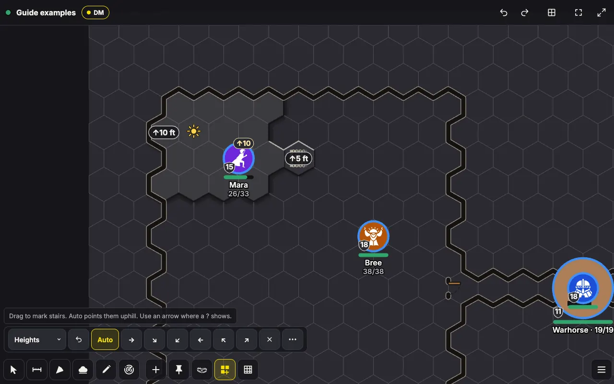

While this mode is open, each raised or lowered area shows its height in a pill, such as "↑10 ft". During play, tap the ground with **Select** to see its height for a few seconds ("↑10 ft", or "Stairs · ↑5 ft" on a stair). Raised ground is also drawn lighter and casts a shadow, so the shape of the land shows at a glance.

Heights change play in several ways:

- With **Walls and ledges block players' moves** on, a walking token can cross a ledge only by a stair. A token dropped on top of a rise walks up by the stairs on its own, as long as the party has seen them. A flying token above the ledge passes over it.
- A creature can see over a ledge that is no higher than its eyes. A creature in a pit can't see out.
- A token you place, drop or duplicate on raised ground stands on top of it.
- Rulers, distances and areas all count the height.

You can paint heights over a map image too, so the cliff drawn in the art can become a real cliff. A light you place stands 5 ft above the ground under it, raised ground included, on squares and hexes alike, so a lantern set on a watchtower shines from the tower's top. A pit trap opens on hexes just as it does on squares (see [Pits](#pits)).

## The isometric view

Heights are easier to read when you can see them. The isometric view tilts the map so that the ground runs away from you at an angle, and everything on it stands up: creatures become standees on their rings, walls rise in stone, doors in wood and windows as panes, and raised ground stands as blocks with the builder's textures while pits sink into the floor. A flier hangs at its height over a shadow on the ground beneath it. Nothing about the game changes. Distances, moves, areas and what each player can see are exactly what they are in the ordinary top-down view, so you and your players can each use whichever view suits you.

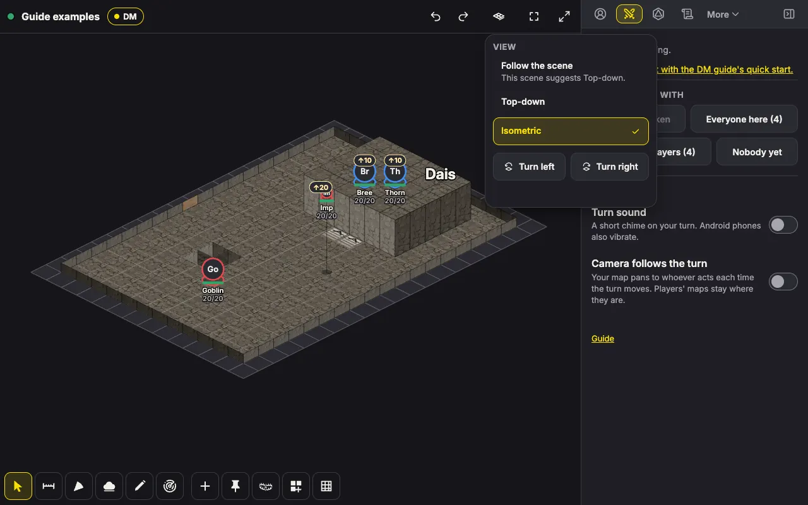

**Choosing a view.** Each device chooses for itself. Press the **View** button in the top bar, beside **Fit**. Its menu offers **Follow the scene**, **Top-down** and **Isometric**. A choice holds for the whole room, every scene, until you pick **Follow the scene** again, and it is kept on that device alone, so choosing Isometric on your laptop changes nothing on your players' phones. On the narrowest phones at a large interface size, or when a wide top bar is crowded, the View button moves into **Menu** as a **View** row, so Undo and Redo keep their place in the bar.

**Turning the map.** In Isometric, **Turn left** and **Turn right** in the same menu turn the map a quarter at a time, so a wall or a tall creature never hides what stands behind it for long. Each scene remembers its own turn. A creature hidden behind another can still be picked: tap the selected one again and the one behind it is selected instead.

**Suggesting a view for a scene.** In the Scenes panel, in the scene's **Size and view** settings, **Suggested view** sets the view that devices following the scene show. A cliff-side ambush might suggest Isometric, while a sprawling town map stays Top-down. Every device starts out following the scene, so a player who has never chosen sees what you suggest. A device that is in the middle of a drag, a pinch or a held ruler switches once the finger lifts, so the map never moves under anyone's hand.

**Tools that work top-down.** Four of your tools need the flat map, so while you use them your device shows Top-down and says why, and Isometric comes back as soon as you pick another tool: the **Map builder** (`B`), **Fog** (`F`), **Line up grid** (`G`) and **Trap** (`X`). Everything else, from Select and the Ruler to Areas and Ping, works in either view.

**Hex scenes.** Isometric works on hex rows and hex columns just as it does on squares. Each raised hex stands as a six-sided block with its three near sides showing, and each hex pit sinks, so a terrace, a sunken hollow or a stair climbing a ledge reads at a glance. A stair keeps its marks on its top, and a wall you draw along a hex side stands on the higher hex beside it. Creatures stand on the hexes they actually cover, so a goblin on a 10 ft terrace stands 10 ft up and an ogre across a ledge stands on its highest hex. Nothing about the game changes with the view: distances, sight and moves count the heights exactly as they do in Top-down, and a tap or a drag lands on the hex whose top or side you touched.

**Keys.** With a keyboard, the view has keys of its own:

- `I` switches between Top-down and Isometric.
- `Q` turns the map left, and `E` turns it right. In Top-down they say that turning needs the isometric view.
- The arrow keys move the selection one square by the screen, whichever way the map is turned: Up moves it toward the map's edge that faces up and to the right.

**What players see.** Isometric shows a player nothing more than Top-down does. Under the fog, nothing stands up: a creature, a wall or a label stands only where every bit of the ground under it is revealed to that player, and anything else lies flat under the fog as it always has. Raised ground works by the cell: a square or a hex rises once any part of it is revealed, its top still wearing the fog drawn on it, and ground wholly under fog stays flat. On your own device, a creature on ground your map shows as fogged draws dimmed, so you can tell at a glance what your map still hides under fog. On a scene where each player sees for themselves, ground the party has explored counts as revealed for this, just as your map draws it.

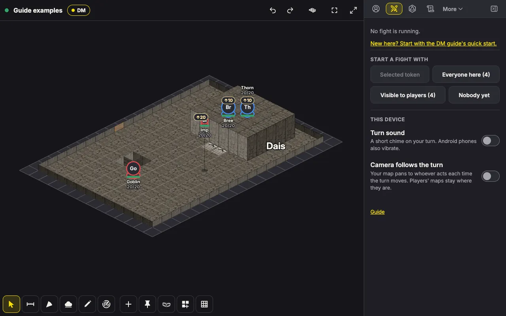

The table display has the same View choice in its own menu, kept apart from anyone's choice in the same browser. With **Follow the DM** on, a display follows the part of the map your device shows in either view.

## Difficult ground

Some ground is slow going: rubble, thick undergrowth, a slope of loose scree, the furniture of a crowded tavern. In the rules every foot of movement through difficult terrain costs 1 extra foot, so a square of it costs 10 ft to enter instead of 5 ft. The app counts this for you whenever a token is dragged or moved with the arrow keys, and the walking ruler counts it too (see [Measuring and movement](#measuring-and-movement)).

The **Difficult** and **Rubble** terrains from the Brush are difficult terrain. For anything else, pick **Difficult ground** in the builder and **Mark** squares with the brush (1, 2 or 3 squares) or a dragged **Area**. A mark goes over whatever is there, floor or map art, without changing it, and draws as a thin ochre hatch that lets the map show through. **Clear** takes marks off, and Erase takes them along with everything else. Players see the marks with the rest of the map. On a hex scene the marks go by hexes: the brush marks 1 hex, 7 or 19, and **Area** takes the hexes whose middles lie in the box you drag.

A few other things cost extra too, and the app counts them the same way:

- **Water** costs double for a creature without a Swim Speed.
- **Another creature's space** is difficult terrain, unless the creature is an ally or Tiny. On a scene where walls stop moves, a walk never passes through a creature it couldn't pass in the rules (one that isn't Incapacitated and is less than two sizes apart), but it can end there, and the label warns that it would. Where walls don't stop moves, nothing stops a walk, and such a space is just difficult terrain.
- **A Prone creature** crawls, so every foot costs 1 extra.
- **Areas** marked to slow movement, such as Web or Plant Growth (see [Areas that slow movement](#areas-that-slow-movement)).
- **Squeezing** through a space made for a smaller creature counts as difficult terrain, so every foot costs 1 extra, and a squeeze through rubble costs no more than the rubble does (see [When walls stop a move](#when-walls-stop-a-move)).
- **Dragging or carrying a creature** costs 1 extra foot per foot, unless the creature is Tiny or at least two sizes smaller than the one hauling it (see [Mounts, familiars and dragging](#mounts-familiars-and-dragging)).

Difficult terrain isn't cumulative: a square is difficult or it isn't. Plant Growth's 4 ft per foot replaces it rather than adding to it. The other costs do add up, though. Squeezing counts as difficult terrain, so it adds nothing to rubble, but it does add to dragging and crawling: a creature dragging a goblin through rubble pays 3 feet for every foot, and so does one dragging a goblin while it squeezes.

Whenever one of these makes a walk cost more, the label on the drag says what it was, such as "+10 ft for difficult terrain", "+25 ft for squeezing" or "+15 ft for dragging", so nobody has to wonder why a short walk used so much of a turn.

## Light and party vision

Each scene decides what your players see of it with one choice, **Players see**, at the top of the scene's **What players see** settings:

- **Explore**: players see what their characters see. Ground they have not seen stays dark, walls and all, and what they explored stays on their map as they last saw it (see [What players' maps hold](#what-players-maps-hold)). This is **party vision**: the app works out what the party can actually see, from each creature's senses, the walls and the light.
- **Reveal by hand**: players see what you reveal with the fog tool, and nothing else. See [Fog](#fog).
- **Everything**: players see the whole scene, with no fog at all.

A new scene starts on your room's choice, or on the one you pick as you make it (see [What players see on new scenes](#what-players-see-on-new-scenes)).

Under Players see sit the settings that fine-tune it:

- **Light**: **Bright** (lit everywhere, as by day), **Dim** or **Dark**. The light level matters only while party vision is on, so on Explore or Custom. On a map with phases, **Light with each map phase** under it lets each phase set the light, so switching to Night can make the scene dark (see [Map phases, imports and exports](#map-phases-imports-and-exports)).
- **Sight**: **Whole party**, the default, or **Per player**. Normally the party shares its sight and its map: every player sees everything any of the party's creatures can see, so when the rogue scouts ahead, the whole table sees what she finds. Per player lets each player see only through their own creatures' eyes and those of any creature that shares sight with the party, and remember only where those creatures have been (see [Sight for each player](#sight-for-each-player)).
- **Who lends the party sight**: the party's creatures on the scene, with their senses and lights. To add an allied NPC, so the party sees what it sees, turn on **Shares sight with the party** in the **Sight** section of its token's panel.
- **Fog and party vision**, a fold that holds the two switches Players see sets for you: **Fog** and **Party vision**. While it is folded, it tells you how both stand, such as "Fog on · Party vision on". You rarely need them. The one mix that no choice names, party vision on with fog off, shows as **Custom**: players then see the whole map, dimmed outside what their characters see, and the fold opens so you can see why.

**Senses.** Darkvision, Blindsight and Truesight come from each creature's senses (from its stat block, or from **Senses** in its Stats). Darkvision shows darkness in shades of gray.

**Lights** come from two places, the builder and tokens:

- In the builder's **Lights** mode, pick a light under **Light to place** and tap the map. Each light gives Bright Light out to one distance and Dim Light beyond it: a Candle is bright for 5 ft and dim to 10 ft, a Torch 20 ft and dim to 40, a Lamp 15 and 45, a Hooded Lantern 30 and 60, the Light cantrip 20 and 40, and the Daylight spell 60 and 120. Tap a placed light to change its reach, turn it **Lit** or **Out**, choose whether **Walls cast shadows**, give it a name, or delete it. Drag it to move it. Players see the light it gives, but never the light itself.
- A token can carry a light, which you set with **Light** in its action bar or **Sight** in its panel: a Candle, Torch, Lamp, Hooded Lantern, Light, or a Custom one. A scene lights up to 20 token lights.

**Checking what players see.** Your own map always stays fully lit, so you never lose track of anything in the dark. To see the scene as one player sees it, use [View as a player](#view-as-a-player). On a scene with party vision, **Party sight** in the DM panel shades what the party can't see on your own map instead, so you can keep working while you check.

The app speaks up in three cases where a change to what players see could surprise you:

- **Leaving Explore.** On Explore, players keep a map of what they explored. If you switch a scene they have explored to Reveal by hand or Everything, or turn off fog or party vision in the fold, the app asks first: "Players will see the build as it is now on everything they explored. Undo does not bring back what they remembered." Press **Change** to go ahead, or **Cancel** (or Escape) to leave things as they are. Switching **Sight** from **Per player** back to **Whole party** asks the same way when players have maps of their own there, since each player's map then joins the party's for good.
- **A map image with no walls.** Party vision looks through walls the map doesn't have, so on a plain map image Explore would show players the whole picture the moment a character looks around. When you choose Explore on a map image with nothing yet that blocks sight, the settings warn you: "This map has no walls yet, so party vision shows players all of it at once. Add walls first, or choose Reveal by hand." When you move the players to a scene with party vision, the app reminds you of the same thing if that scene is a map image, since it can't check another scene's walls from where you are.
- **A first map image.** When a scene on Everything with nothing built on it yet gets its first map image, it moves to Reveal by hand, so players see only what you reveal of the new picture. A scene you have already built on keeps its setting. On the scene the players are on, you choose as you pick the image: untick **Start it under fog, so they see only what you reveal** to keep it on Everything.

### Using one scene's settings on others

When you've set up one scene the way you like it, you can give other scenes the same setup in one step. At the end of What players see, press **Use these settings on other scenes…**. A sheet opens, titled for your scene ("Use Crypt's settings on…"), listing every other scene by folder. It copies **Players see**, **Light** and **Sight**. Movement and walls stay as they are on each scene.

Each scene's line says what players see there now, and what the copy would do there: "The players are here. They see the change at once." on the players' scene, "Players' remembered maps here reset." where a scene leaves Explore, and "Each player's own map here joins the party's." where it leaves Per player. Tick the scenes you want, or press **Select all**, then **Copy to 3 scenes**. The sheet says "Copied to 3 scenes." when it's done and clears the ticks, or says which scenes refused and why. One **Undo setup** in **Setup history** puts every scene's settings back, though not the maps players remembered.

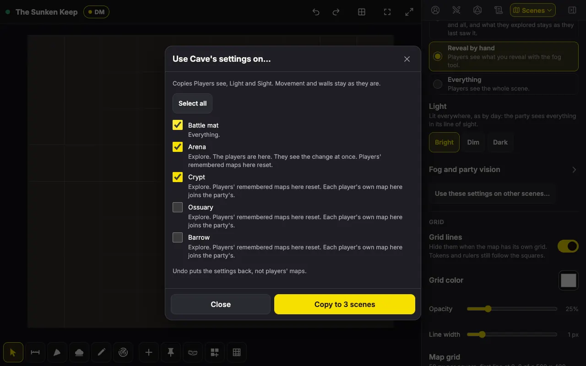

### Sight for each player

With **Sight** set to **Whole party**, the party shares its eyes and its map. Some tables want more mystery than that: the rogue who slips ahead should be the only one who sees the guard post, and it's up to her player what to tell the others. For that, set **Sight** to **Per player**. The row sits under **Light** and shows whenever party vision is on.

On a per-player scene, each player sees what their own creatures see: their character, its companions, and any creature you've given them to play. On top of that, every player sees through the creatures you've marked **Shares sight with the party**, such as a hireling carrying a lantern. Everything else stays dark for them, even where another player's character is looking. The party's own characters are still visible to everyone, so nobody loses track of their friends. But a goblin standing in Thorn's torchlight shows up only for Thorn's player, and so does its row in the Initiative order. While it acts, the other players see "Another creature's turn".

A creature that shares sight sees by any light, as every creature does, a character's torch included. So if your lantern-carrying hireling stands in the same hall as Thorn, it sees the goblin in Thorn's torchlight too, and so does every player. Keep such a creature somewhere of its own when you want each player's view to stay their own.

**Each player keeps their own map.** The ground a player's creatures have seen stays on that player's map, dimmed, just as explored ground does for the whole party, and ground seen by a creature that shares sight goes on everyone's map. So when Thorn explores the chapel, the ground stays unexplored on Bree's player's map, and a label or pin you put there reaches only the players whose maps show it. Your fog tools still work on everyone's map at once: a reveal shows ground to every player, **Add fog** makes every player forget the ground under it, and **Fog all** wipes every player's memory of the scene.

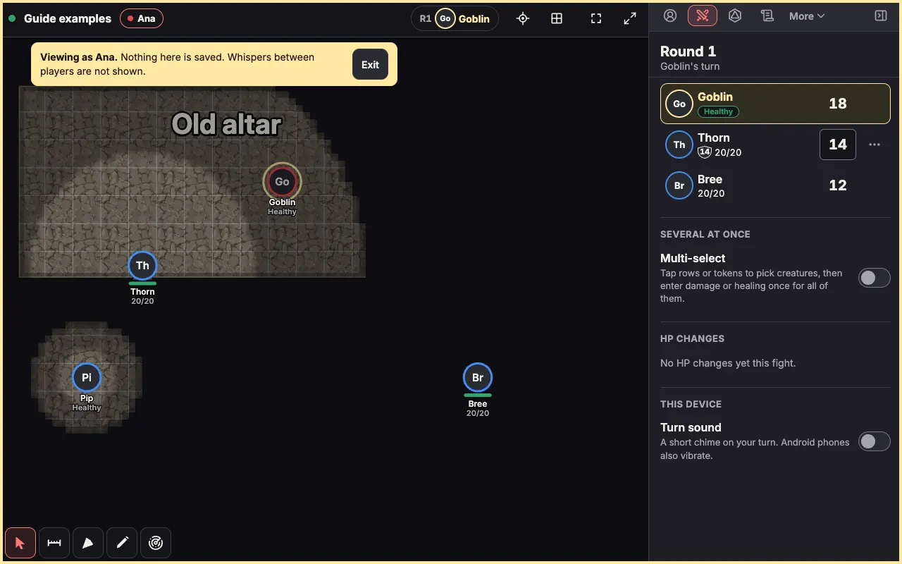

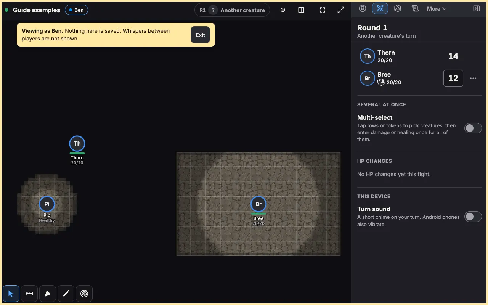

**Who sees for themselves.** Under the Sight row, the list **Who sees for themselves** names every player in the room. Up to 6 players on a scene can see and remember for themselves, each with a tick. A player gets a place, ticked, the first time they own a creature that can see on the scene, as long as fewer than 6 places are ticked. Anyone without a tick, and the table display, sees only what the creatures that share sight can see, and keeps only the map the whole party shares.

- Tick a player to give them a place. With 6 already ticked, the list asks you to untick someone first.
- Untick a player to take their place away. The app asks first, because they forget their map of this scene. Their row then says they see only what creatures that share sight see.
- Places are sticky. A player keeps theirs when their character falls unconscious or steps off the scene for a while. A player gets a place on their own only the first time they own a creature that can see there, and after that only your ticks change who holds one: exploring never moves a place from one player to another. So at a big table, where more than 6 players could see for themselves, decide who should and tick them yourself.

Under the list, **Who lends sight** shows each creature with its senses and light, and whose sight it adds to: "Lends its sight to Ana", "Lends its sight to Ana and Ben", or "Lends its sight to every player" for a creature that shares sight with the party.

**Changing your mind.** A new Sight setting takes effect at once, even in the middle of a fight. Switching to **Whole party** pools every player's map into the party's shared map, and it stays pooled: if you switch back to **Per player** later, each player starts from that pooled map. Switching the map to another phase, such as from Day to Night, or changing the light leaves Sight as it is.

**Checking what each player sees.** [View as a player](#view-as-a-player) shows you the scene as one player sees it, their own sight and map included, so it's the quickest way to check that a secret stays with the player who found it. The fastest way in is the player's own token: tap it and press **View as Ana**. **Party sight** still shades what no player can see on your own map.

**The table display** shows what a player without a place sees: only what the creatures that share sight see, on the map the whole party shares. If you want the TV to show more of a per-player scene, mark a creature that's with the party, such as a torch-bearing hireling, to share its sight.

**What players can still work out.** Per-player sight keeps creatures and ground private, but a few things stay shared, as they do on every scene. It's worth knowing them, so nothing surprises you:

- **Doors open for everyone, but each map shows the change in its own time.** A door is open or closed for everyone at once, and it stops everyone's moves the same way. What each map shows depends on who moved it. When Thorn opens a door, his player's map and the party's shared map show it open. Another player whose own map remembers that door keeps it as they last saw it until one of their creatures sees it. When you open or close a door yourself, only the players who can see it watch it swing. Every other player's map keeps the door as they last saw it, or shows nothing there at all if they never explored that wall. Secret doors work the same way: once you mark one found, a player sees a door there the next time their creatures look at that wall.
- **Areas and light pass through doors**, as they always do. If an aura reaches through a doorway, or a torch shines through it, a player who can see the far side can tell that the door is open. So can a player who watches a party member walk through it.
- **The room counts its changes.** When one player's creatures see new ground, the room records it as a change of its own. A player who watches the room's change numbers in the browser's developer tools could tell that someone's map just grew. It never says whose map, or where, and your own work out of the players' sight already gives the same small signal.
- **The rules everyone shares use only what everyone can see.** A creature that only some players can see counts as unseen for the rules that must give every player the same answer. A horse you control that a character rides shares no turn with its rider unless every player can see it, a trap your monster sets off goes off without the players noticing, and the corners of its path stay hidden. When that matters, make the creature always visible, or mark it to share its sight. What players see points it out for a mount.
- **Paths follow each player's own map.** When a player drags their own token, the path finds its way over the ground that player remembers, and past creatures only they can see. Other players see the corners of that path only where they know the ground too. A trap it sets off goes off for everyone, as it does whenever a party member walks into one.
- **Places go by who came first.** As **Who sees for themselves** describes, the 6 places go by the order in which players first owned a creature that could see there, and then by your ticks, never by what anyone has explored. A player who doesn't get a place learns only that the places are taken.

## Fog

A scene with fog on, which means one on Explore or Reveal by hand, starts fully covered. You see the fog as a translucent layer over the map, but players see nothing under it. Tokens, labels and stamps that stand fully under the fog never even reach their devices, and neither does anything you built there: floors, walls, doors, heights or stairs. The party's own characters are the exception: players always see those.

To reveal part of the map, or to cover it again:

1. Pick the **Fog** tool (`F`).
2. Under **Clear or add fog**, choose **Clear fog** to reveal or **Add fog** to hide.
3. Choose a **Shape**: **Rectangle** (drag), **Polygon** (tap the corners, then tap the first one to close it), **Brush** (drag, 5, 10 or 20 ft wide) or **Builder room** (tap a room made with the map builder to reveal all of it).
4. Your edits start as a private draft, drawn as dashed outlines that only you see. When you are ready, publish them with the button in the row: **Reveal to players**, **Fog for players** or **Show players the changes**, depending on whether the draft clears fog, adds it, or does both. Until then, **Undo** takes back your last edit to the draft, and **Discard** throws the whole draft away.

The draft lets you set up a reveal, check it, and show it all at once. If you would rather players see each edit as you make it, switch **When players see edits** from **Draft** (the default) to **Live**. Under **⋯**, **Fog all** and **Reveal all** cover or clear the whole scene for the players at once (tap twice to confirm).

**Builder room** fills everything joined to the room you tap, and only walls, windows and closed doors stop it. Close the doors between rooms first, or the reveal spills into the next room. On a hex scene it works the same way with the walls you drew as wall lines: tap inside a room, and the draft takes every hex you could walk to from there without crossing a wall, a window or a closed door. A secret door the players haven't found stops it too, open or shut, and where no wall closes the room in, it runs on to the edge of the map, so check the outline before you reveal it.

The button that publishes the draft counts your edits, such as **Reveal to players (2)**. Each rectangle, polygon, brush stroke or Builder room tap is one edit, however much ground it covers, so one **Undo** takes back a whole Builder room, even one as big as the map.

**With party vision on**, the players' fog also remembers what the party has explored. **Add fog** makes the players forget the ground under its shape, the map the party shares and, on a scene where each player sees for themselves, every player's own map too. The one exception is ground their creatures can see right now, which they explore again at once. **Fog all** makes them forget the whole scene, and what their map remembered of it. Undo brings back your own fog edits, but never the memory they erased: if you undo a Fog all, the ground you had revealed is revealed again, but anything the party had only explored stays fogged until the party sees it again or you reveal it.

### What players' maps hold

On a scene with fog on, a player's device holds only the part of the map the party has discovered: the ground the party has seen, and the ground you have revealed. A room nobody has seen never reaches their devices at all, not its floor, its walls, its doors, its labels or its stamps, so even a player who opens the browser's developer tools finds nothing of it. A corridor that runs on into the dark simply ends where their map ends, with no wall drawn across it. The map image itself still reaches players whole, so on a scene drawn from a picture, the fog is what keeps the picture hidden.

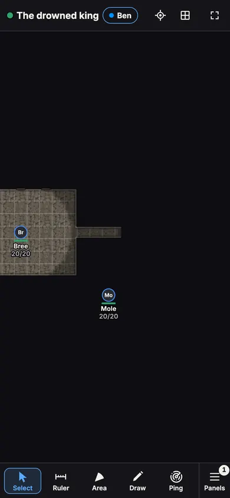

**Explored ground shows as the party last saw it.** With party vision on, ground the party has explored but can't see right now stays on their map the way it looked when they last saw it. So if you add a wall, take a door away, or let a monster open a door while the party is elsewhere, their map keeps the old version, and they find the change when they come back and see it. The moment they look again, their map shows the place as it is now. On a scene with fog but no party vision, the ground you have revealed always shows as it is now.

**Building where the party can see.** On ground the party can see, what you build shows on their map as you build it. Rooms you build around them show their outer walls straight away, and their insides stay empty on the players' map, because the party saw that ground empty, until someone looks in. While a stroke of the map builder touches ground the party can see, the builder's row says so: "The party can see where you are building, so they see it as you build. Build before players come here, or tap Fog all when done."

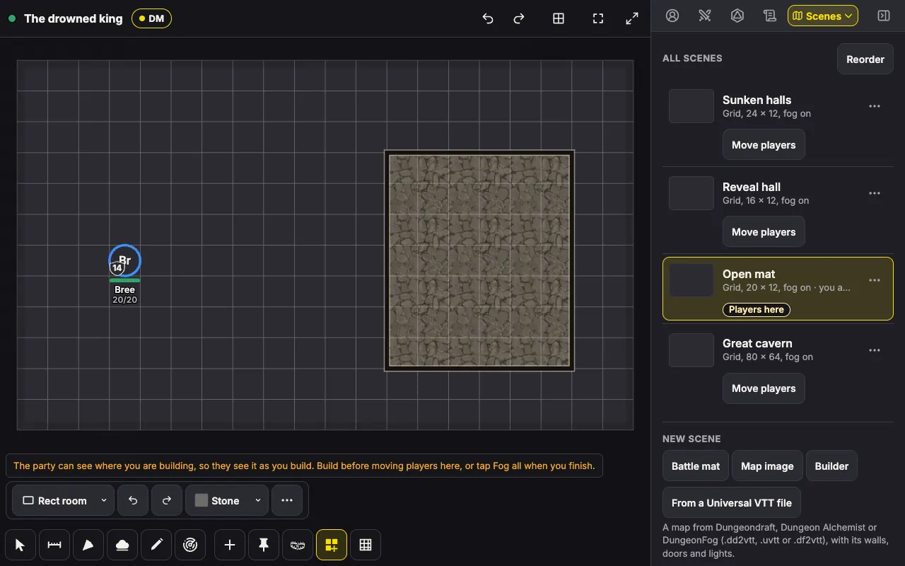

**Walking into the dark.** Players can still move their tokens onto ground they haven't seen, as they always could. If something stops a move there, the token stops at the last spot it could reach, and the note says only "Something blocks the way.", without saying what, since their map can't know. The note names what stopped the move only when the player can see it right now. A wall or a closed door right beside a square they can see is named, even with unexplored ground behind it, so a door in Bree's torchlight still says "A door is in the way. Tap it to open." A ledge is named only when they can see the ground on both sides of it, since its height says something about the far side. A wall in the dark, or a wall the party only remembers, which may have changed, gets the plain words. **Teleport here** still lands the token where it was dropped, and when nothing was named your log reads "Bree teleported past something they could not see." A wall the party remembers keeps stopping their moves even after you take it away, a one-square step into it as much as a longer drag, until they see that spot again. **Teleport here**, which tests no wall, gets past it too.

**How much a map remembers.** A player's map keeps a copy only of what has changed out of their sight since they saw it, but it can hold only so much. When a change you make would run past that, the app asks first: "Players' remembered map here will be forgotten. Go ahead?" **Go ahead** makes the change, and the ground it runs past goes back under the fog for the players, as if they had never seen it. Undo doesn't bring that back. **Cancel** leaves the change unmade. Undo and Redo ask the same in their own message, with **Forget and undo** or **Forget and redo**.

In the map builder, a rectangle room or a shape is asked about as a whole before any of it is built, so **Cancel** leaves none of it behind. A brush stroke is built as you paint, so the question comes at the point where it would run past, and **Cancel** stops the stroke there. While the app checks, the builder's line says *Checking players' remembered map…*, and the change shows once the answer is in. Until then the builder takes no other change: **Undo** drops the change being checked, while **Redo**, **Forget and undo** and **Forget and redo** do nothing, and their message stays until the check is done. If the connection drops while your **Go ahead** is on its way, the app tells you to check the map, since it can't know whether the change was made.

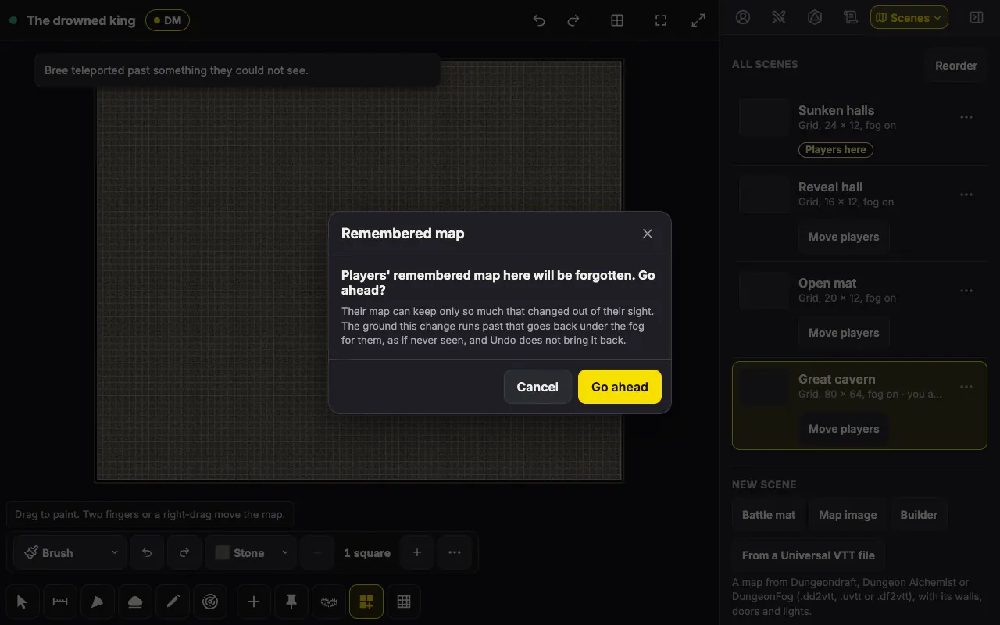

**Deleting an image.** If you delete an image from the Library that no stamp on any map uses any more, but that players' maps still show from before, it disappears from their maps too.

**Exporting what players see.** The player view of **Export as image** on a scene with fog on draws what the players' maps hold now, which the app asks the server for: only the ground they have discovered, as they remember it. That works even after you clear the build, since the players may still remember it, and when they have seen none of the scene the app says so instead of making an empty image.

## Map phases, imports and exports

**Map phases** are other images of the same map, such as the village at night, or the same village on fire. When you switch phases, the tokens, fog and build stay exactly where they are, and only the picture changes. Players only ever receive the phase that is showing. A map scene can have up to 8 phases, its first image included.

1. In the scene's **Map phases** section, press **Add a phase** and pick an image with the same shape as the map. The current image becomes the first phase, named "Day".
2. Once there are two or more phases, a row of chips switches between them with one tap. On a computer, the **Phase** menu in the top bar does the same.
3. **Edit** lets you rename a phase, move it in the list, or remove it.

A phase can also set the scene's light. Under **What players see**, **Light with each map phase** picks Bright, Dim, Dark or **Leave the light** for each phase, so switching to Night can make the scene dark. It won't turn party vision on by itself, though, and light matters only while party vision is on.

**Universal VTT files.** If you make maps in Dungeondraft, Dungeon Alchemist, Arkenforge or DungeonFog, you can bring in a whole map, walls, doors and lights included. Choose **From a Universal VTT file** under New scene and pick a `.dd2vtt`, `.uvtt` or `.df2vtt` file. The app reads the file and shows you what it found ("412 walls (380 on the grid, 32 free), 14 doors, 3 windows, 9 lights") before it makes anything. Then choose:

- **Objects block sight and movement** (offered when the file has objects).
- **Portals that don't block light import as** **Windows** or **Open doors**.
- **Players see**: **Explore**, **Reveal by hand**, **Everything** or **Like** the scene on your screen, starting on your room's choice for new scenes. An imported map brings its walls, so Explore works on it from the start.
- **Light, for party vision**: the app suggests Bright, Dim or Dark from the file and says why. Like sets it to the copied scene's light, and you can still change it.

**Maps that bring their own lights.** Some files carry lights with the map: torches, lamps, glowing crystals. When yours does, the import starts the scene dark on **Explore**, so those lights show the party what they reach and the rest stays in shadow, and the summary opens by telling you how many lights the map brings. If you'd rather keep the map lit, press **Keep it lit** beside that line. The scene then starts Bright, and **Players see** goes back to your room's choice. **Start it dark** changes your mind again. A daylit map, one whose file sets its ambient light at 70% or brighter, keeps its daylight, and a map whose art is already lit but brings no lights starts Bright.

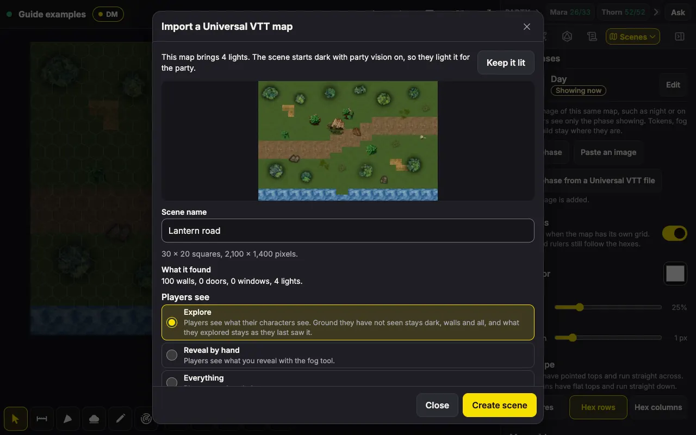

Press **Create scene** to make it, and keep the page open until the walls have been added. One **Undo setup** in **Setup history** takes the whole import back. An imported scene has **Automatic walls** off, since the file brings its own walls, and it is always on squares, since the file states its own square grid (see [Hex grids](#hex-grids)). Arkenforge draws each door as an outline, and the app brings it in as the one door on the wall. A light placed far outside the map is left out, and the summary says so, so the rest of the map still comes in. A phone can only take files up to 40 MB, so import large maps on a computer.

**Exporting a map.** **Export as image**, in the scene's settings, saves the map image and the build as a PNG file, without tokens, drawings or fog. Choose how many **Pixels per square** to draw, 50, 70 or 100, then the **Player view** or the **DM view**, and whether to include the **Grid**. On a hex scene the same choices read **Pixels per hex** and **Hex lines**. The player view draws secret doors that haven't been found as plain walls, and leaves out DM-only stamps and lock marks. On a scene with fog on, it draws only what the players' maps hold (see [What players' maps hold](#what-players-maps-hold)), and needs a connection to the server. Press **Make image**, then **Download**. The file name carries the grid size, such as `crypt-30x20-70px.png`, so this app and other VTTs can set the scale when you import the image later. A hex scene's file is named like `crypt-hex-70px.png` instead, since a size in squares would mislead.

# Running fights

This part covers what you use once the dice come out: monsters and encounters, tokens and their HP, Initiative, rolls, areas of effect, Legendary Actions and other uses, the alerts a fight raises, movement, mounts and dragging, and traps. Read the sections for the tools you plan to use before a session, and keep the guide open during play for the details.

## Monsters

The **Monsters** panel (DM only) holds the 330 monsters of the SRD 5.2.1, along with any your room has added. Use it to look up a stat block or to put monsters on the map.

**Finding a monster.** Type in **Search** (`goblin`, `undead`, `huge`), and your words are matched against each monster's name, type and size. You can add a challenge rating to the search as well: `cr 5` for one rating, `cr 1-5` or `cr 1/2-3` for a range, or `cr 10-` for 10 and up. **Filters** narrows the list further by challenge rating, creature type, **Legendary**, **Has a lair**, size, immunities, resistances, vulnerabilities, movement, senses and alignment.

Filters stay on for this room on this device, and the encounter builder shares them, so if a list looks shorter than it should, check whether a filter is still on. The SRD uses the 2024 names, so look for "Goblin Warrior", "Goblin Boss", "Bandit" or "Wolf".

**Placing monsters.** Tap a monster to open its page, then fill in its place card:

1. Set **How many** (1 to 20).
2. Keep **Average HP**, or untick it and type the **HP for each**. The app doesn't roll Hit Points for you.
3. Tick **Hidden from players** for an ambush. Players' devices never receive hidden tokens, so nobody can find them early.
4. For a monster with a lair, tick **In its lair** to give it the extra legendary uses and XP it has in its lair (see [In its lair](#in-its-lair)).
5. Press **Place on the map** (or **Place 4 on the map**), then tap the map. The copies spread out to the nearest free squares around your tap.

The copies are numbered for you: "Goblin Warrior 1", "Goblin Warrior 2" and so on. Each token placed is its own undo step.

**Your room's own monsters.** **New monster** opens the editor for a monster of your own. If the monster is in a book your group owns, **Paste a stat block** opens the editor with a box to paste its text into, and **Read the stat block** fills in the fields from it. It reads both the 2024 and 2014 layouts, and lists anything it had to guess ("No Initiative was given, so it is the Dexterity modifier."). Check the fields, then press **Save**. Room monsters stay in this room and its backups, and players never see their stat blocks. To start from an SRD monster instead, open its page and press **Copy to this room's monsters and edit**.

For a legendary monster, the editor looks for two names in particular. A trait named "Legendary Resistance (3/Day, or 4/Day in Lair)" sets its Legendary Resistance, and a first Legendary Action named "Legendary Action Uses: 3 (4 in Lair)" sets its Legendary Actions, so its tokens get the right number of uses. There is no separate section for lair actions.

**Token image.** Every SRD monster comes with a token picture of its own: an icon from game-icons.net on a disk colored by the monster's creature type, such as a wolf's head on brown for a beast or a skeleton on black for the undead, with dragons in their own colors. You can tell a pack of wolves from a band of goblins at a glance before you have chosen a single picture. On a monster's page, **Token image** shows that default with its credit, and **Change image** sets a picture of your own for this room, which every new token of that monster then starts with (the image picker's **Starter** tab is a good place to look). **Use the default icon** goes back to the default. To give the picture to the tokens already on the map too, press **Apply to N tokens on this scene**.

## Encounters

The **Encounters** panel (DM only) lets you prepare fights ahead of time: which monsters, how many, and how hard the fight will be for your party. Players never see your encounters, only the tokens you place from them.

1. Press **New encounter** and give it a name ("Ambush at the ford").
2. Search under **Add** (`goblin`, `cr 1-3`) and tap a monster's **+** once for each copy you want. Each line has a count you can change, and **Remove**. A monster with a lair also gets **In its lair** on its line (see [In its lair](#in-its-lair)).
3. Read the **XP budget**. It shows the **Low**, **Moderate** and **High** budgets for your party, outlines the one your encounter falls into, and sums it up: "This encounter: 1,250 XP · Moderate, 250 XP left". The party is the room's characters at their levels. To budget for a different group, such as a party with a guest, press **Edit the party** and set rows of "Characters" at "Their level".
4. Press **Save encounter**.

If you leave the editor with changes you haven't saved, it asks "Discard changes?" first.

**Placing an encounter.** Open the encounter, then use **Place on the map**:

- Tick **Hidden from players** to place the monsters unseen.
- If a fight is already running, **Add them to the fight** (on to begin with) gives them rows in the Initiative tracker, with identical monsters grouped to share one Initiative.
- Press **Place where I tap** and tap the map, or press **Place in the middle of the view**.

The monsters go on the scene you are viewing, with average HP and their monsters' images, the biggest closest to where you tapped. One undo takes them all off the map again. An encounter can hold up to 50 creatures of up to 20 kinds.

## Tokens

Tap a token with the **Select** tool to open its **action bar**, which holds what you do to a token most often during play. For everything else about it, open the **Token** panel.

On a computer, a tablet or a phone held sideways, the bar opens as a window at the bottom right of the map. You can drag it by its header to move it out of your way.

On a phone held upright, the bar rests as a strip across the foot of the map. It shows the token's name with its AC and HP under it, and one row of the controls you use most: the HP entry and **Apply**, with a **Use 9** chip once someone has rolled damage, then as many of **Conditions**, **Roll**, **Multi-select**, **Uses** and **Hidden** as fit. The sign before the HP field says what a plain number does, − for damage or + for healing, and a tap switches between them. To set the HP or add Temporary HP, pick **Set** or **Temp** in the expanded bar, or type the math, such as `=20` or `t5`. After Set or Temp, the sign shows = or T, and a tap on it goes back to −. The strip stays where it is while you pan, so you can bring any token into view above it, and when it opens it moves the map just far enough to keep its token in sight.

Press **Expand** (a chevron pointing up, with its name beside it where there is room) to grow the bar up the screen and show all of it, and **Collapse** to rest it again. **Conditions** and **Uses** in the strip open the whole bar with their list showing, and closing the list rests it again. On a screen too short for the bar to grow, the strip scrolls instead, and **Scroll for more** takes Expand's place.

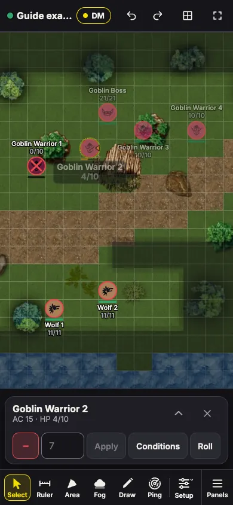

The fight's alert cards and the app's toasts stay above the strip and leave a band of map clear over it. When the cards would leave no band of map, they fold into their one row. Where the map above the strip is short, a new toast shows as one line over the top bar, and the alerts' row moves into the strip's header until the toast goes. Tap the toast's words to read the whole message.

The whole bar, as the window on a wider screen or the expanded bar on a phone, holds, from top to bottom:

- The token's AC, HP, Speed (after the footprints) and **PP** (Passive Perception), as the Token panel shows them, then its **HP entry**. For a monster or NPC, you also see its six saving throws and its resistances, immunities and vulnerabilities. Where the bar is short, **More stats** holds the rest.
- **Stat block**, which opens the creature's full stat block in the Token panel, and **Details**, which opens the Token panel. On a token a player owns, **View as Ana** sits beside them (see [View as a player](#view-as-a-player)).
- **Elevation**, with **−5** (or Page Down) and **+5** (or Page Up).
- **Doesn't count**, on a line of its own once the creature whose turn it is has moved (see [Measuring and movement](#measuring-and-movement)). Players also get **Undo move** there, and **Open door** or **Close door** when their token stands by a door.
- **Conditions**, **Hidden** (an eye struck through, which hides the token from players), **Multi-select**, **Roll** (the creature's roll options in the Dice panel), **Uses** (after a lightning bolt), **Light** and **Attach** (see [Mounts, familiars and dragging](#mounts-familiars-and-dragging)). **Uses** appears only for a creature with something to spend, such as Legendary Actions, a breath weapon that recharges or a character's Rage (see [Uses and Legendary Actions](#uses-and-legendary-actions)). **Light** appears on a scene with party vision, or while the token carries a light. Conditions and Uses open their lists inside the bar, just above these buttons, and a second tap closes them.
- **Size**, whose **−** and **+** step the creature one size smaller or larger, for Enlarge, Wild Shape or a polymorph.
- **Locked** (a padlock: once it is on, nobody can drag the token, you included), **Duplicate** (two pages and a plus) and **Delete** (a trash can, which asks "Sure?" before it deletes anything).

With a mouse, Hidden, Locked and Duplicate show only their icons, to keep the bar small. Hover over one, or reach it with Tab, and its name appears. On a touch screen they keep their words, since there is no hover to show them.

A few keys work on the selected tokens: `H` hides or shows them, `L` locks them, and Delete removes them (Ctrl+Z brings them back). The arrow keys move the selection one square at a time, or one hex on a hex scene.

**The Token panel** starts with the token's picture and name, and a line that says what it is and how big: "Monster, CR 1/4 · Small (5 ft)", say, or "Companion of Bree" for a companion, whose picture also wears a small portrait of its character. Press "Companion of Bree" to open Bree's page in **Characters**. Under that line, tags tell you at a glance when the token is **Hidden** (after an eye struck through), **Locked** (after a padlock) or has its **Name hidden**, and when it rides, carries or drags another. Under them sit its quick numbers, the ones you reach for most in a fight: AC, Speed, **PP** (Passive Perception), **Init** (its Initiative bonus), its elevation, and a link to its sheet. A creature a player owns has its **View as Ana** button in a row of its own under them (see [View as a player](#view-as-a-player)). A monster or NPC's stat block comes next. Folded, its row names the block, such as "Wolf, CR 1/4".

The rest of the panel is sorted into groups by what you use them for, each led by a small picture of its own, such as crossed swords for Combat. Each group folds as one, so you can keep open only what matters right now:

- **Combat**: **Hit Points**, **Conditions**, **Uses**, **Reaction**, **Range rings** (up to 4 circles, such as 30 and 120 ft, for checking reach and range at a glance) and **Rest**. **Uses** is the same list the action bar and the tracker row show, there whenever the creature has something to spend, with each count shown as pips (see [Uses and Legendary Actions](#uses-and-legendary-actions)). **Reaction** shows while the creature is in a fight and holds its **Reaction used** switch, the same one as in its tracker row.
- **Notes**: the token's notes (see below).
- **Position**: its elevation and facing, its **Attach** controls, as in its action bar, and **Sight**.
- **Image**: change, crop or remove the token's picture, and its other images.

The panel holds everything the action bar and the tracker row offer, each in the group where you'd look for it, so you can do it all from one place. A player sees the same: a player whose character a goblin is dragging finds **Let go** beside their character's name in the goblin's Position, even though the goblin isn't theirs.

A folded group sums up what it holds on its own line, such as "HP 3/7 · 2 conditions · Reaction used", so you can check on a creature without opening anything. Combat starts open, and your device remembers which groups you open and close. Folded at the foot of the panel are **Stats** (size, AC, Speeds, Initiative bonus, Passive Perception and senses, and for a legendary creature how many Legendary Actions it gets a round and Legendary Resistances a day), **Token settings** and **Owners**, then **Remove**. A player you've lent a character's token, but not the character, gets **Stats** with just its **Size**, as in its action bar.

**Token settings** holds the options only you can set:

- **Name**, and **Hide the name from players**, with a **Name players see** in its place ("Unknown creature").
- **Kind**: Player character, NPC, Monster, or Object or marker. **Ring**: ally, neutral or hostile, shown as the color of the ring around the token.
- **Layer**: Creatures, or Objects, which sit under creatures.
- **Players see HP as**: **Nothing**, **Healthy, Bloodied, Dying, Dead**, **A bar** or **Exact numbers**. Monsters start with the labels, so players get a feel for how a fight is going without seeing the numbers.
- **Hidden from players**, **Locked**, **Always visible, even under fog**, and **Height**, for a creature taller or shorter than its size suggests.
- **Make a companion**: see [Companions](#companions).
- **Duplicate**, which puts a copy beside the token and opens the panel on the copy.

**Remove** holds **Delete this token**. A companion's player gets **Dismiss** there instead, which asks once more before it takes the companion away.

**Notes** has three fields, each for a different audience: **For everyone** (read by every player who can see the token), **On the card** (for you and the token's owners) and **For DMs only**.

### Several tokens at once

When you want to move, damage or hide a whole group, select them all first. There are two ways:

- Press **Multi-select** in a token's action bar, then tap more tokens, or drag a box across empty map.
- With a mouse, hold Shift or Ctrl (Cmd on a Mac) and click to add a token, or hold Shift or Ctrl and drag across empty map to draw a box.

Drag any one of the selected tokens to move them all. The group gets an action bar of its own with one **HP entry** for all of them, **Conditions** and elevation, and for you, **Roll**, **Request a roll**, **Hidden**, **Locked**, **Start a fight** or **Add to the fight**, **More** (three dots, which hold the ring, size, layer, image, what players see, and owners), **Delete**, and **Clear** (a cross, which lets go of the group without changing anything). Each change to the group is one undo step. On a phone held upright, the group's bar rests as a strip at the foot of the map, like a single token's, with "4 selected" in its header. Press **Done** in the Multi-select bar when you are finished.

## HP, damage and conditions

**Changing HP.** Use the HP entry in a token's action bar, the Token panel's **Hit Points** section, or the Combat group on a character's page. Tapping a creature's tracker row opens its action bar. The initiative strip opens the tracker.

Choose **Damage** and enter `10 fire` or `10 fire + 4 cold`, then press **Apply**. Each part meets the creature's resistances, immunities and vulnerabilities before Temporary HP takes the hit. The preview looks like a sum on a small slip, outlined with a red stripe at the left. Each part has a small damage type icon, an amount, and its type in words. The original amounts and the results each line up by their last digit in separate columns, and the words wrap inside the slip on a phone. Untyped damage has a placeholder icon. When a defense changes an amount, the original is struck through beside the amount the creature takes. Later parts start with a plus, and two or more parts end with a bold total under a rule. Only defenses that changed the hit appear below a separate rule, under **Immune**, **Resists** or **Vulnerable**. Each type has the same small icon as its damage part, followed by any qualifier. Hidden defenses still apply when a player deals damage. Their preview keeps the incoming amounts and does not reveal those defenses. Players continue to see HP according to the creature's visibility setting.

Healing uses the same slip with a green stripe. Temporary HP and set HP use a muted stripe, with the change on one line.

The same damage summary appears below damage chips with a type or multiple parts, and in group saves. A single untyped damage chip stays on one line. Before you roll, a long formula wraps inside the preview. A negative rolled part counts as zero damage and never reduces another part. A successful save adds **Saved: half** or **Saved: no damage**, and Evasion is named when it applies. Each creature's damage override uses the same icons and amounts. Its comparison with the original damage appears only once that damage is known. If no damage was entered or the roll is still pending, **Clear override** removes the override without promising a calculated amount. With several creatures selected for one HP entry, the summary shows the incoming parts, then a short line for each creature whose visible defenses change the hit.

A plain `7` under **Damage**, or `-7` in any mode, deals 7 untyped damage. Choose **Heal** to heal a plain amount, **Set** to replace current HP, or **Temp** to give Temporary HP. You can also type `+5` to heal 5, `=20` to set HP to 20, or `t5` to give 5 Temporary HP. Math still works, so `-7-3` deals 10 damage. Type a rolled amount with a damage type in an HP entry. Use the Dice panel to roll dice first.

After someone rolls damage, a chip such as **Use 9 (Longsword damage)** appears by the entry. Tap it to fill in the newest roll, whether it was yours or a player's, then press **Apply**. The chip keeps each rolled amount and its type, including mixed damage, and the preview shows the breakdown. Editing the total clears that breakdown, so include the types yourself if the corrected damage should use them.

With several tokens selected on the map or in the tracker, the same entry applies to each creature using its own defenses. Two tokens linked to one character deal that character the damage once.

**Dropping to 0 HP.** When a monster or NPC reaches 0 HP, it dies, as long as the room setting "Monsters die at 0 HP" is on (it is by default). A player character at 0 HP falls Unconscious and starts making Death Saving Throws instead, and so do monsters and NPCs while that setting is off. If the damage left over after a creature drops to 0 is at least its maximum HP, it dies outright.

Damage to a creature already at 0 HP counts as a failed Death Saving Throw. For a Critical Hit, tick **Critical Hit (two failed Death Saves)**, which appears in the HP entry of a creature at 0 HP. A dead creature's action bar offers **Revive**, which brings it back with 1 HP, and while "Healing brings back the dead" is on, healing brings back the dead too. The Token panel's **Hit Points** section has **Revive**, **Stabilize** and **Mark dead**, along with the Death Save pips.

Every HP change during a fight goes into the fight's **HP changes** list, where you can take back any single change. See [Initiative](#initiative).

**Conditions.** **Conditions**, in the action bar, opens a grid of the 15 conditions of the 2024 rules and other common statuses: Concentrating, Hidden, Flying, Dodging, Raging, Blessed, Baned, Hasted, Hunter's Mark, Hexed, Heroic Inspiration, Surprised, Marked and Readied action. One tap adds a condition or removes it. Exhaustion goes on at level 1.

> [!NOTE]
> The **Hidden** status in this grid means the creature took the Hide action. It is not the same as **Hidden** in the action bar, which hides the token from players.

For more control over a condition, use **Add** in the **Conditions** section of the Token panel. Pick a condition to read its rules text, then set any of these:

- **Exhaustion level** (1 to 6), or a **Counter** for rounds or charges left, shown on the condition's icon.
- **Spell**, for Concentrating ("Concentrating: Bless").
- **Duration**: a number of rounds, or until the start or end of a chosen creature's next turn. Durations count down as Initiative moves, and everyone is told when one ends.
- **A Wisdom save at the end of each of its turns ends it**, with the save and its DC, for conditions such as Hold Person's. See [Alerts during a fight](#alerts-during-a-fight).
- **Hidden from players**: nobody but you sees the condition, not even the creature's owner, and the log shows it to you alone.
- **Custom status**: your own label, an icon of up to 2 characters or an emoji, and a color.

A creature can carry up to 32 conditions and statuses at once.

**Concentration.** When a concentrating creature takes damage, the app prompts a Constitution save with its DC (10 or half the damage, whichever is higher, up to 30). The prompt goes to whoever answers for the creature: its player, or you for a creature no player plays.

## Initiative

The **Initiative** panel runs the fight: who is in it, the order they act in, and the turns and rounds. Players see the order too, but never hidden creatures, monsters' dice or anything else they can't see. In a new room, they don't even see a monster's place in the order until its turn comes (see [What players see of the order](#what-players-see-of-the-order), below).

### Starting a fight

With no fight running, **Start a fight with** offers you a choice of who is in it:

- The selected token's name: just that token.
- **Everyone here (N)**: every creature on the scene, hidden ones included (their rows start hidden). Objects, the dead, and companions that act on their character's turn stay out. Companions that take their own turn come in.
- **Visible to players (N)**: the same, but without hidden tokens or anything under fog or out of the party's sight.
- **Nobody yet**: an empty fight to fill in later.

If you have two or more tokens selected on the map, their action bar also has **Start a fight**, or **Add to the fight** once a fight is running. While a fight runs, the panel's **Add to the fight** section offers the same three choices, so latecomers can join. Players add their own creatures with **Join the fight**.

### Initiative values

Each creature needs an Initiative value before the fight can sort them. There are several ways to fill them in:

- **Type it.** A row's box reads **Set** until it has a value. Tap it, type the number, and press Enter.
- **Roll one row.** **Roll +2** on a row rolls that creature's Initiative on the server. Players roll for their own rows, and you roll for the rows no player plays. Where a row is too narrow for the button, the roll waits in the row's **⋯** instead. Once a row has a value, its **⋯** offers "Roll again, replaces 17", so a stray tap can never reorder the fight.
- **Roll all the monsters.** **Auto Initiative (N)** rolls for every monster that still has no value. Above it, under **Auto Initiative**, you choose how monsters share rolls: **By creature** (identical monsters share one roll, which is the default), **One each** or **All at once**. **Re-roll monsters that have a value** rolls them all again. The dice show to you alone, and players see each visible monster's total once its place in the order is theirs to see.
- **One roll with Advantage, or in secret.** A row's **Roll** has the one-roll menu ([Dice](#dice)): hold it, right-click it, or press `Shift+F10` on it. **Auto Initiative** and a monster's **Roll Initiative**, in its **⋯** beside its modifier, have it too, for Advantage, Disadvantage or Normal on the dice they roll, and their dice always stay with you. Auto Initiative applies your pick before it groups the monsters, so creatures that now roll differently never share a die.
- **Type a batch.** **Type several values** opens one box per row, for initiatives rolled at the table. Enter moves you to the next box.
- **Skip the rolls.** **Monsters use Initiative scores** gives monsters 10 plus their Dexterity modifier instead of a roll.

Each roll is a d20 plus the creature's modifier, with Advantage or Disadvantage from its conditions (Invisible, Surprised or Incapacitated). The row shows an **Adv** or **Dis** badge as a reminder, which helps most when someone types in a roll made at the table. If a creature has Advantage from something the app doesn't track, such as a barbarian's Feral Instinct, set it by hand in the row's **⋯**, and the app's own rolls for that row follow it too.

The order runs from high to low. When a row's value ties with others, the app slots it in with player characters ahead of everyone else (monsters, NPCs and companions alike), then the higher Initiative bonus first, and leaves alone any order you have already set. Tied rows show a drag handle, and their **⋯** has **Move up** and **Move down** (an up and a down arrow), so you can settle a tie however your table likes without changing anyone's value.

### Running turns

1. Press **Start**. The first creature's row is tinted, and its token gets a turn marker.
2. Press **Next** (or `N`) at the end of each turn. If you move on too soon, **Previous** steps back, up to 20 turns.
3. The round count goes up each time the order wraps around to the top.

Each **Next** does a little bookkeeping for you. It clears **Reaction used** for the creature whose turn begins, refills its Legendary Actions and frees the ones it could take only once until this turn, counts down durations, reveals it if it was hidden (while the room setting for that is on), and raises save-ends reminders for the creature whose turn just ended. With "Skip defeated creatures" on, the dead are passed over.

Next also asks what the new turn needs. If the creature has a breath weapon to recharge, a Regeneration to apply or a death save to make, a card for each comes up for whoever answers for it, and, when the creature has something to spend, a turn card that lists it until the turn ends (see [Alerts during a fight](#alerts-during-a-fight)). Nothing happens by itself: the cards wait for an answer, and the next **Next** puts them away.

**Previous** takes back exactly what the last Next did: whose turn it is, the durations it counted down, the Reaction and Legendary Actions it gave back and a hidden creature it revealed. The turn's cards come back as they were left, results and all. What you changed yourself during the turn, such as a row you added, a value you typed or a condition you set, stays as you left it.

When a player's turn comes, they get "Your turn" and an **End turn** button. A strip under the top bar (or a chip in the top bar on a wide screen) shows everyone whose turn it is, and shows you alone who comes next. Tap it to open the tracker. If you'd like your map to pan to whoever is acting, turn on **Camera follows the turn**, in the Initiative panel's **This device** section.

**Hidden creatures in the order.** A hidden monster, such as one waiting in ambush, can be part of the fight from the start without giving itself away: its token and its row both stay hidden from the players. When the time comes, there are two ways to reveal it.

- **Let it reveal itself.** With "Reveal hidden combatants on their turn" on (the default), a hidden creature appears when its first turn comes, as long as the players could see it where it stands. That means it must be on revealed ground, and on a scene with party vision, in the party's sight. If it acts out of their view, players see "Another creature's turn" instead.
- **Reveal it yourself.** Turn off its **Hidden**, in its action bar, a group's bar or its Token panel, or with `H`. That shows its token and its row together, in one undo step.

Revealing a token early doesn't always reveal its row, though. The row still follows the room's **Initiative order players see** setting (described below), and in a new room, players see a monster's row only from its first turn on. So a monster you reveal early shows its token at once, but it joins the players' order on its turn. If you want the row to appear along with the token, set **Initiative order players see** to **Everyone**.

Sometimes you want the opposite: the token in plain sight, but its row kept out of the players' order. For that, turn on **Row hidden from players** in the row's **⋯**, which hides the row alone. The creature's owners still learn its turn once it moves on that turn, whoever moves it, since their app then counts how far it has gone.

### Rows and what they hold

Each row shows the creature's AC, HP and conditions, each condition as its own picture in a small chip, or as letters where it carries a number, such as "E2" for Exhaustion level 2. For a legendary monster, tags such as "LA 3/4" and "LR 2/4" tell you, and only you, how many Legendary Actions and Legendary Resistances it has left, and chips such as "Fire Breath used" or "Dominate Mind 1/2", on a line of their own under them, show what it has spent, up to three, then "+2 more".

Tap a row to select its token and open its action bar. Each row's **⋯** holds a few more controls for you. What belongs to the creature comes first, in the order you reach for it in a fight, then the row's own setup, and **Remove** last:

- **Revive**, for a dead creature, which brings it back with 1 HP.
- **Uses**, for a creature with something to spend. This is the same list as in its action bar and its Token panel (see [Uses and Legendary Actions](#uses-and-legendary-actions)).
- **Reaction used**, which clears at the start of the creature's turn.
- The Ready controls, for a creature that readies an action. Type its trigger ("if the door opens") and press **Ready**. The row and token show "Readied" until its next turn. Players see the trigger only for a creature a player plays, or when you turn on **Show the trigger to players**. When the trigger happens, **It fired: Reaction used** ends the readied action and marks the creature's Reaction as spent.
- **Stat block**, which opens the creature's stat block in the Token panel.
- "Roll again, replaces 22", once the row has a value (see [Initiative values](#initiative-values)).
- **Row hidden from players**, which keeps the row out of the players' order while its token stays in view, as described above.
- **In lair**, for a monster with a lair (see [In its lair](#in-its-lair)).
- The Initiative roll reminder, **Auto**, **Advantage** or **Disadvantage**, and the row's Initiative modifier.
- **Move up** and **Move down**, for a row that ties with others.
- **Remove**, which takes the creature out of the fight. Its token stays on the map.

**HP changes**, under the order, lists every HP change of the fight ("Goblin Warrior 2 takes 7 damage, 3/10 left."). **Undo** (a curved arrow) on a line takes back that one change, as long as the creature is still as that change left it (see [Undo, Redo and Setup history](#undo-redo-and-setup-history) for how this differs from the top bar's Undo). To damage or heal several creatures from the tracker, turn on **Multi-select** in the **Several at once** section and tap their rows (or their tokens). One HP entry then applies to all of them.

### What players see of the order

The room setting **Initiative order players see** (in Room settings, under Combat) decides which rows the players see before those creatures have acted. It is a way to keep the players from counting the monsters in the order before they know what they're facing. It has three choices:

- **Player characters, the rest on their turn**, the default in a new room. Players see the creatures players play from the start: their characters and their companions. A monster or NPC you lend a player shows from the start to that player alone, and to the others on its first turn. Every other creature, your NPCs and allies included, joins their order when its first turn comes, in its place, and stays there for the rest of the fight, whatever its value becomes. Until then, nothing of it reaches them: no row, no value, no count, and no Initiative roll, not even one you rolled with Secret off.
- **Player characters and allies, the rest on their turn**: the same, except that every creature with the Ally ring shows from the start.
- **Everyone**: the whole order from the start. Rooms made before the setting existed keep this one.

A few more details follow from this. A creature added mid-fight waits for its own turn, and a dead one that "Skip defeated creatures" passes over never shows at all. If you press **Previous** back past a creature's first turn, it leaves the players' order again. A row you hide with **Row hidden from players** stays out whichever choice you pick. In your own tracker, each row the players don't see yet is tagged **Secret until its turn**, beside an eye struck through, the same mark the app uses everywhere for what players can't see, and [View as a player](#view-as-a-player) shows you the order as they see it. Players never see who comes next, so the turn strip can't give a creature away.

On a scene where each player sees for themselves, the order also follows each player's own sight. A monster that only Thorn can see shows in his player's order alone, and while it acts the other players read "Another creature's turn" (see [Sight for each player](#sight-for-each-player)).

### Ending it

**Turn timer** (Off, or from 30 seconds to 10 minutes) counts each turn down for everyone, after a stopwatch in the round's header, and nudges whoever is acting. It never ends a turn on its own. To end the fight, press **End the fight** and tap it a second time to confirm. If you end it by mistake, Undo brings it back.

## Dice

Every roll in the app happens on the server, so everyone sees the same result and nobody can fake one. Players who prefer real dice can still roll at the table and type their totals wherever the app asks for one, unless you turn off **Players may type their roll totals** in Room settings. The **Dice** panel is open to everyone.

**Typing a roll.** Type a formula in the field and press **Roll** or Enter. A few examples of what it understands:

- `1d20+5`, a plain roll.
- `2d6+3 fire`: any words after the formula become its label.
- `4d6kh3` keeps the three highest dice, and `4d6dl1` drops the lowest.
- `d%` rolls percentile dice.
- `1d20+5 Stealth adv` rolls with Advantage.

The line under the field reads back the roll and its range before you roll it ("2d6+3, fire: 5 to 15"), so you can catch a typo. The quick dice add a die to the field, and the Up key steps back through the formulas you have rolled, newest first. The Down key steps forward again, to what you were typing.

Under the quick dice sits the **Next roll** row. **Adv** and **Dis** are joined into one control, because a roll takes one or the other, never both, and **Secret** stands on its own beside them, since it decides who sees the roll rather than how it is rolled. On a narrow phone with a larger interface size, Secret moves to a line of its own under the other two. All three apply to the next roll only, then turn themselves off. A secret roll shows in full to the DMs, while the other players read only "Dana rolled in secret." Your rolls for monsters start secret: with a monster selected, even a formula you type starts secret. With nothing selected, or a character selected, it starts in the open.

**One roll, another way.** Sometimes you want a single roll with Advantage, or a single roll in secret, without touching Next roll. Hold any roll button for half a second, right-click it with a mouse, or focus it and press `Shift+F10` or the `ContextMenu` key, and a short menu offers **Roll with Advantage**, **Roll with Disadvantage**, **Roll secretly** and **Roll normally**. Nothing rolls until you pick, and your pick rolls once, for that roll alone. The Adv, Dis and Secret you pressed under Next roll stay exactly as they were, waiting for your next ordinary roll. A plain tap, or `Enter` on the focused button, still rolls as it always did, so the menu is a shortcut and Next roll stays the way to do the same thing in plain sight. The line under Next roll reminds everyone: "Hold or right-click a roll button for one-roll options. Keyboard: Shift+F10."

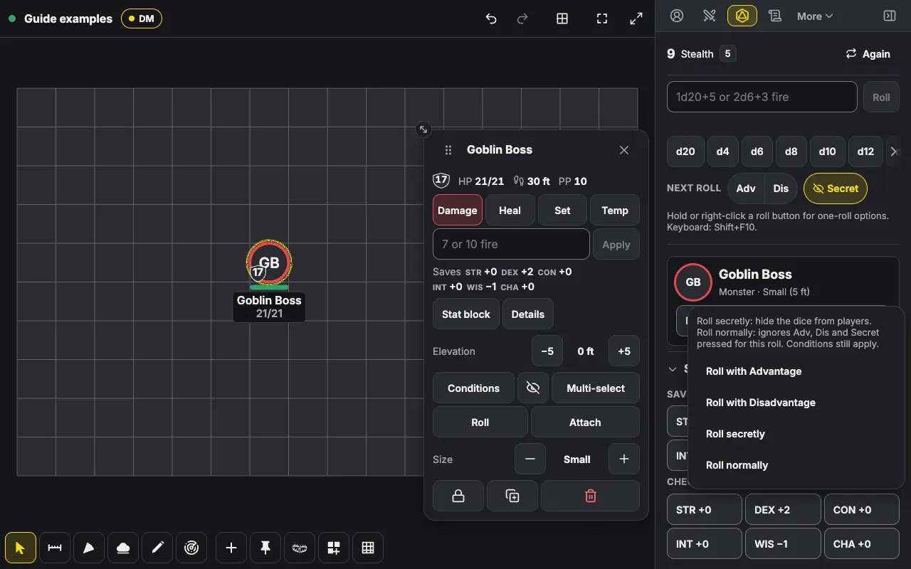

- **Roll with Advantage** and **Roll with Disadvantage** replace any Advantage or Disadvantage you pressed or typed for this roll, and keep a Secret you pressed. The creature's own still count: a Restrained monster's Dexterity save picked with Advantage cancels to a normal roll, and the result says so.
- **Roll secretly** hides the dice from players, as Secret does, and keeps an Adv or Dis you pressed. A player who picks it still sees their own roll, and so do you.
- **Roll normally** sets aside what you pressed or typed, and keeps the creature's effects and the roll's usual visibility, so a monster's roll stays secret even if you had turned Secret off.

Each line of help above the choices starts with the choice it explains, such as "Roll normally:", and one that starts "All choices:" holds for every choice. Damage, healing and other rolls with no d20 offer only **Roll secretly** and **Roll normally**. Where a roll's visibility is already settled, such as an answer to a request, a death save or **Again**, **Roll secretly** shows but can't be picked, and the menu says why. Inside the menu, the arrow keys, `Home` and `End` move between the choices, `Enter` rolls, and `Escape` closes it and puts you back on the button. A second press, right-click or hold on the same button closes it too, without rolling. With a screen reader, double-tap and hold the button to open the menu, and a plain double-tap still rolls.

A roll from the menu lands where any roll does. A card or a row that shows results keeps the words it always showed, and says Advantage, Disadvantage or Secret on top only where those words fit on its line. Where they don't, a screen reader still reads them. Auto Initiative marks a roll with its usual **Adv** or **Dis** badge.

The newest roll stays at the top of the panel with its dice, and **Again** rolls it once more. This line is the one place in the panel where a result appears, even for a roll you made from a creature's roll options further down, so the panel never grows under your finger as rolls land. An answer you send to a request and a Death Saving Throw show there too, without Again, since neither can be sent again as it was. On a narrow screen the line keeps the total and Again whole, shows as many dice as fit, and counts the rest as "+2". Tap the line to see the whole roll in Recent rolls. **Recent rolls** lists the rolls in the log, newest first, at the foot of the panel. Like the other groups in the panel, it folds away with a tap on its name, and while it is folded its row still names your newest roll, such as "Thorn 20 Longsword". Tapping the newest roll at the top opens the list again for the moment and scrolls to that roll, without changing how your device remembers it. Other people's rolls pop up as short notices while your Dice panel isn't on screen. To turn those off, open the Menu, then **This device**, and turn off **Show others' rolls as they happen**.

**Again** has the menu too, for a d20 roll: it repeats the formula you rolled with the mode you pick, without working out the creature's effects again, and keeps the roll's visibility. A repeat others can see is labelled "Repeated roll". A repeat of a roll with no d20, such as damage, has no menu.

**Dice you can watch.** When you roll from the Dice panel, the dice tumble out of the button or field you used and land in a band just under the newest roll, about a second after the server answers. The total appears as they land. The server has already decided the roll by then, so the dice only show what happened: they never change it, and everyone else reads your result in the log straight away. A Natural 20, or a Critical Hit, rings in your color as the die lands, and a Natural 1 is ringed in red. A big roll shows two rows of dice and counts the rest on a "+9" disc.

You never have to wait for them. Tap anywhere in the panel or press any key, and the dice clear and the result shows at once. The tap still does what you meant it to, so you can press **Again**, pick another roll or click into the field in the middle of a throw. Only your own rolls from the Dice panel are thrown. Other people's rolls, the tracker's **Roll**, rolls for several monsters at once and the group save show their results straight away. A notice of someone else's attack or save leads with a small d20 showing the die they rolled, and it rings for a Natural 20.

To choose how your dice look, open the Menu, then **This device**, and pick a set under **Dice**: Ivory, Obsidian, Ruby, Sapphire, Emerald, Amethyst, Gold or Steel. The choice stays on your device, and nobody else sees it. If you'd rather not see the dice at all, turn off **Roll animation** there, or turn on **Low power**, which skips them to save battery. With your device set to reduce motion, the dice appear already at rest and the result shows at once.

### Roll options

Rather than typing a monster's bonuses, let the app read them from its stat block. Select one token, or press **Roll** in its action bar, and the Dice panel shows that creature's rolls below a line that sets them apart from the formula field. When you open the panel from a token's **Roll**, it lands on the **Next roll** row, so you can press Advantage on the way to the attack.

First comes the creature's card: its picture, its name and a short line such as "Monster, CR 1 · Small (5 ft)", so you can see at a glance whose rolls these are. The card also holds what you reach for at the start of a fight or when a life is at stake:

- **Initiative**, which sets the creature's row in a running fight. Its tag tells you what a tap will do, and then any bonus or penalty it carries ("replaces 12 · −4").
- **Death Save**, while the creature is dying, at the top of the card.
- **Ask Thorn to roll**, for a creature a player plays (more on that below).

Under the card, the creature's options are sorted into groups that fold, in the order a stat block prints them. Tap a group's name to fold it or open it again. While a group is folded, its row gives a one-line summary, so you can often read what you need without opening it, such as a monster's saving throw bonuses.

- **Saves and checks**, each with its bonus. Conditions apply on their own, and the roll says so ("Dis: Restrained", "+1d4: Blessed", "Fails: Stunned").
- **Skills**, for the moments outside combat.
- Its **Traits**, **Actions**, **Bonus Actions**, **Reactions** and **Legendary Actions**. Each one reads the way a stat block prints it, such as "Scimitar +4 to hit, 1d6+2 Slashing", with its buttons on the line underneath: **Attack**, **Damage** and **Critical**. A natural 20 on the attack turns on **Critical** for the damage that follows, which then rolls by the room's **Critical Hit damage** rule (see [Room settings](#room-settings-for-fights-and-maps)). Riders such as **Sneak Attack** are chips you can add, and the line above names them with their dice. An action that calls for a saving throw reads like "DC 13 DEX, 2d6 Fire" and has a **Group save** button, which opens the [group save](#the-group-save). Multiattack appears as a note at the head of the actions: roll each attack it names in turn.
- An action that recharges shows **Recharge 5–6** and a **Used** switch, the same mark as in the creature's **Uses**. Rolling its damage or its group save marks it used, if it was ready. **Recharge** rolls 1d6 for it, and at the start of the monster's turn that roll also answers the recharge card.
- An action with uses per day reads "2/Day, 1 left" with **Use**. Only **Use** spends one, so rolling its damage again never does. Rolling a Legendary Action here spends nothing either: spend it in the creature's **Uses** (see [Uses and Legendary Actions](#uses-and-legendary-actions)).
- For a character with a stat block: its weapons and **Spells**, each save spell with its DC in its line ("DC 14 WIS"), **Spell save DC**, **Spell attack**, and a slot level for spells that scale, which you step with its minus and plus buttons on either side of "Level 2". When the spells span more than one level, they are sorted under **Cantrips**, **Level 1** and so on, as a character sheet lists them.

The groups that matter in a fight start open, and the rest start folded. On a computer, Saves and checks start open. On a phone, where room is tight, they start folded, one tap away. Skills and Traits start folded everywhere. Once you fold or open a group, your device remembers it, separately for characters, companions and monsters, so folding a monster's Saves and checks never folds them for a player's character. Viewing the room as a player never changes what your device remembers.

A group also opens on its own when it matters. When you ask a player for a save and their creature's Saves and checks are folded, that group opens once so the asked save is in view. If you fold it again while the ask waits, its row leads with the ask ("Asked: DEX save"), so you don't lose track of it.

Whenever someone rolls damage, its total appears in every HP entry as **Use 9**, so you can apply it with one tap.

Your players see the same panel for their own creatures. A player with more than one, such as a character and its companion, picks between them with tabs across the top of the card, each with the creature's picture and name, and the arrow keys move between those tabs too.

For a creature a player plays, **Ask Thorn to roll** (on by default) changes what a tap on a save or check does: instead of rolling it yourself, it opens [Request a roll](#asking-for-rolls) for that player. Turn it off when you would rather roll for them.

Every roll in a creature's options has the one-roll menu, from a save to a weapon's damage and **Initiative**. Two don't: **Recharge**, whose one roll has nothing to choose, and a save or check that asks the player while **Ask Thorn to roll** is on.

### Several creatures

With several tokens selected, the Dice panel offers rolls for the whole group. Its card shows up to three of their pictures, how many you have selected ("4 selected") and their names, and holds what acts on all of them together: an optional **DC**, **Initiative for the 4 in the fight**, and **Set up a group save** for when you want to fill in the save yourself.

Under the card, the rolls fold into groups, as they do for one creature:

- **Saves and checks**: one save or check for all of them. The buttons read simply "DEX" under the label "Saves for 4", so they stay on one line on any screen, but each is still named in full ("DEX save for 4") for screen readers and voice control.
- **Skills**, folded to start with.
- **Shared attacks**: an attack every selected monster has ("Scimitar for 4"), each rolled with that monster's own bonus against a **Target's AC**, followed by **Roll damage for 2 hits** for the ones that hit.

A shared attack keeps its result while you work. You can fold the group between the attack and its damage, or select another creature or let one go, and as long as two or more stay selected and they all still have that attack, the hits and **Roll damage** are waiting when you come back. While the group is folded, its row reminds you of them ("Scimitar: 2 hits"). Selecting fewer than two clears them, and so does selecting creatures that don't share the attack, even if you go back to ones that do.

A group save or check opens the [group save](#the-group-save) page, where monsters roll on the server and players are asked to roll. If you step back from that page, the panel shows a notice above the card that says how far it got, such as "Fire Breath's save: 2 waiting." or "Fireball's save: applied.", with **Open** to return to it. The notice stays until you close the page, with **Discard** or, once it is applied, **Done**.

The one-roll menu works on these rolls too. On a save, a check or a shared attack, a pick applies to the monsters' dice the server rolls in that tap, and the menu says so: "All choices: apply to server rolls only. Players choose their own modes." A player you ask still rolls their own way. **Roll damage for 2 hits** offers **Roll secretly** and **Roll normally**. **Initiative for the 4 in the fight** keeps its dice to you alone, so its menu offers Advantage, Disadvantage and Normal.

## Asking for rolls

**Request a roll** asks players for a saving throw or an ability check. Each player rolls it in the app, or types the total they rolled at the table while **Players may type their roll totals** is on.

There are three ways to open it:

- **Ask the party**, in the party bar. On a computer, the bar sits above the side panel's tabs, where the button reads **Ask** while the bar is folded. On a phone, the bar is the **Party** panel.
- **Request a roll**, in the action bar of several selected creatures.
- A save or check in one creature's roll options, while **Ask Thorn to roll** is on.

Then set up the request:

1. Pick what to roll: a **Save** or **Check** by ability, or a **Skill**. A skill starts at its usual ability, and **with** changes it. **Or a second choice** lets the creature pick between two, such as Athletics or Acrobatics to escape a grapple.
2. Type the **DC**, or pick a typical one for a check (from 5, Very easy, to 30, Nearly impossible), or leave it empty.
3. Check **Who rolls**. **Ask the party** starts with the characters on the players' scene.
4. Under **What players see**, choose whether **Players see the DC** and **Players see pass or fail**, turn on **Against a spell** (for Magic Resistance) if it applies, and add a note if you like ("against the poison").
5. Press **Send**. **Recent** keeps your last three requests, so you can send one again with one tap.

Each player gets a card with the question and rolls it with their bonus (conditions and Bless included), or types a total where typed totals are allowed. Your own live card, at the right of the map, counts the answers as they come in ("2 of 4 answered: 1 pass, 1 fail") and shows each roll. From it you can:

- **Roll +5** for a player who is still waiting, such as one who stepped away from the table. Your roll never replaces an answer that arrived first. Hold it, right-click it or press `Shift+F10` on it to roll with Advantage, Disadvantage or normally. The answer keeps the request's visibility, so **Roll secretly** shows but can't be picked. Your players have the same menu on their card's **Roll**.
- Mark **Pass** or **Fail** yourself, for a roll with no DC or to overrule one.
- Answer a player's ask, such as "Asks to reroll (Heroic Inspiration)", with **Allow** or **Keep**.
- **Reopen for one more answer**, **Close**, or **Close all answered**.

Only you and the creature's player see an answer. Up to 20 requests can be open at once.

## Areas

The **Area** tool (`A`) draws areas of effect: spells, breath weapons and auras. The **Areas** panel lists the ones placed on the scene. An area works out who is inside it, in three dimensions, and stops at walls, so you don't have to count squares by hand.

### Placing an area

1. Pick the **Area** tool. Type a spell in **Spell** (`fireball`) and pick it from the list. The spell sets the shape and size (a 20 ft Sphere for Fireball) and turns on any reminders it needs. For anything that isn't a spell, pick a **Shape** (Cone, Sphere, Cylinder, Cube, Line or Emanation) and set its **Size** in feet.
2. Tap where the area goes. Tapping on a token matters: a Cone, Line, Cube or Emanation tapped on a token is cast from that token, so a Cone starts at the caster's edge and an Emanation surrounds it. A Sphere or Cylinder tapped on a token is placed on that token.
3. Aim a Cone, Line or Cube by dragging anywhere on the map, or by its handle. **Rotation snap**, under **⋯**, picks 15°, 45° or **Free**, and **Aim up or down** tilts a Cone or Line.
4. Read the line above the options: "Fireball · In area (3): Goblin Warrior 1, Goblin Warrior 2, Thorn (ally)". This preview is yours alone unless you turn on **Shared**, so you can check who a spell would catch without showing your hand.
5. Press **Place**.

Under **⋯** (More area options) you will also find:

- **Elevation**, for an area placed at a free point.
- **Includes caster**, for a Cone, Cube, Line or Emanation. A Sphere or Cylinder always catches a caster inside it.
- **Moves with token**, for an Emanation.
- **Set caster**, **Reminders**, **Movement inside**, **Color** and **DM only**.

**Why the caster matters.** An area with a caster fills in the group save for you: the save's DC comes from the caster's spell save DC, and the damage from the caster's own spell. Your areas start with no caster. The easiest way to give one a caster is to cast a Cone, Line, Cube or Emanation from the caster's token. For a Sphere, press **Set caster** under **⋯**, then tap the caster's token. The hint then reads "Cast by Ivo.", and the row shows **From Ivo**, which you can tap to drop the caster or restore it.

> [!TIP]
> If the hint still reads "Tap the caster." after your tap, the tap only closed the **⋯** pop-up. Tap the token again.

### Placed areas

Placed areas stay on the map until you remove them. To change one, tap it with the Area tool, then:

- Drag it to move it. A Cone, Line or Cube cast from a creature turns around that creature instead.
- Change its **Size**, or turn on **Hidden** to hide it from players.
- Press **Save and damage** to open the [group save](#the-group-save) for everyone inside it.
- Press **Copy** (two pages and a plus) to start a new draft from it, **Delete** (a trash can) to remove it, or **Done** to let it go.

Under **⋯**, you can still change settings such as its aim, reminders and color. A placed area can't gain a caster or change its elevation, though. To change those, press **Copy**, fix the copy, place it, and delete the old one.

The **Areas** panel lists every area along with who is in it, kept up to date as creatures move, and offers **Edit**, **Save and damage** and **Delete** (a trash can) on each row. Only you and an area's owner can change it. Players see each other's areas, unless you turn off the room setting "Players see each other's areas".

Players don't get **Save and damage**. On their own area they get **Ask for saves** instead, which sends the spell to you as an ask (see [the group save](#the-group-save)). While the ask waits, the area reads "Saves asked", and its player can't move it, resize it or delete it, so what you resolve is what they cast. You can still move it yourself.

### Auras

An Emanation cast from a token with **Moves with token** on (the default) is attached to that token. It follows the token around, and its "In area" list updates as creatures move in and out. Spirit Guardians, a Paladin's aura and the like work this way. You can't drag an attached area, so move its token instead.

### Height

Every area is a shape in three dimensions, and every creature has a height that comes from its size. That means a 20 ft Fireball centered on the ground misses a Medium creature flying 25 ft up. The squares under the flier are still shaded, so trust the "In area" list, not the shading. To reach a flier, put the Sphere on its token, raise the **Elevation** before placing, or aim a Cone or Line upward. An area put down on a platform starts at the platform's height.

### Areas in Isometric

The [isometric view](#the-isometric-view) shows each area as the shape it really is. A Fireball rises from the floor as a ball, a Cone aimed upward climbs at its angle, Moonbeam stands as a tall column, and Spirit Guardians wraps its cleric and walks with them. Each shape is see-through, with a bright outline, so you can see at a glance what lies inside it. A bat flying inside a Fireball shows inside the ball, while one flying over it shows above. A shape also reaches down into a pit as far as it really goes. Every creature an area catches wears a ring in the area's color round its feet.

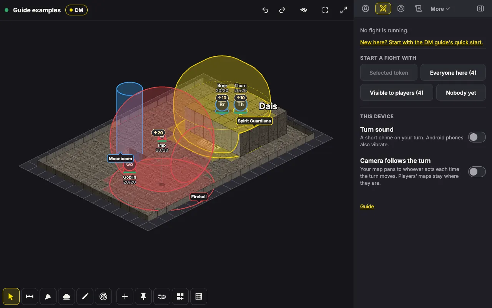

On a hex scene a shape meets the raised hexes along their own sides, so a Fireball beside a terrace is cut off by the terrace's hexes rather than by squares. The distances and who is caught stay exactly the rules' answers.

The shapes show exactly what the rules measure. When the flat shading in Top-down covers a creature's square but the creature isn't in the "In area" list, turn to Isometric: you will usually see that it stands under the Cone or above the Sphere.

Isometric never shows a player more than Top-down does. On a player's screen an area stands up only where every bit of the ground under it is revealed and in that player's sight right now. Over fog, or over ground the player only remembers, it lies flat as it does in Top-down. Your DM-only areas stand dimmed, with a dashed outline, and players never get them at all.

When many areas fill the screen, the ones nearest the middle stand up first, and "Building area shapes…" shows at the top of the map while the rest still lie flat. The same can happen the first time you turn the map to a new side. Once a side has been drawn, turning back to it is quick. While you aim an area with the Area tool, or drag a creature that carries an aura, the shape follows your finger in a simpler form and settles into place a moment after you let go.

### Reminders

An area can remind you when a creature enters it, starts its turn in it, or ends its turn in it. Turn these on with **Enters**, **Starts turn** and **Ends turn** under **⋯**, **Reminders**, and add **Once a turn** for spells that affect a creature only once per turn. Spirit Guardians, Moonbeam, Web, Spike Growth and other spell presets turn on the right reminders for you.

Reminders fire only while a fight's turns are running. Each one adds a line to the log ("Goblin Warrior 1 entered Spirit Guardians.", "Spirit Guardians moved onto Goblin Warrior 1.") and shows a notice on your screen. The area's owner and the creature's owner get the notice too, and players read the line only for what they could see. A reminder doesn't roll anything on its own: use **Save and damage** or the Dice panel for that.

### Areas that slow movement

**Movement inside**, under **⋯**, makes walking through an area cost more. **Difficult terrain** costs 1 extra foot for every foot, as Web, Grease, Spike Growth and Entangle do. **4 ft per foot** is Plant Growth's overgrowth. **Half Speed** halves the Speed of a creature standing in it, as Spirit Guardians does. When the area has a caster, **Only the caster's enemies** leaves out the caster and every creature on its side, as Spirit Guardians and Conjure Minor Elementals allow. Spell presets set all of this for you.

Players' routes count an area only as the players see it: a DM-only area never bends a player's walk. If the players can't see who cast an area, it slows everyone for them, so keep the caster in view or turn off **Only the caster's enemies** when that matters.

## The group save

The group save rolls one saving throw for many creatures at once and applies the damage and conditions to all of them in a single step, with a single undo. Start it from a placed area's **Save and damage**, or from a save action in the Dice panel's roll options.

When you start it from an area, the page fills itself in from the spell and its caster: "From Fireball: Dexterity save, DC 15 (Ivo's spell save DC), 8d6 Fire, half on a pass." Then work down the page:

1. Check **What they roll** (**Save**, **Check** or **No save**), the **Ability** and the **DC**. **Hide the monsters' rolls from players** is on by default. **What players see** sums up on one line whether players see the DC and the pass or fail, just as it does in Request a roll. Open it to change either. **Against a spell** gives creatures with Magic Resistance their Advantage.
2. Check the damage (`8d6 Fire`). **On a pass** is **Half** or **None**. **On a fail** can add up to three conditions, with how long they last and an optional save at the end of each turn.
3. Check the rows. Each creature in the area has one. Monsters roll on the server. Players' creatures are asked, so the player rolls on their own device, or you can press **Roll +3** for them. To change how a single row rolls, pick **Ask**, **Server** or **Type** (you type the total), or **Fails**, which is offered when a condition such as Stunned fails the roll outright. To decide a row yourself, pick **Fail**, **Pass** or **Skip**.
4. Press the roll button ("Roll 4 saves", or "Roll 2 saves and ask 2 players"). Each row shows its roll and result ("Fail vs DC 15"), along with its defenses: resistances and immunities from its stat block, **Evasion**, and **Use Legendary Resistance (2 left)** for a legendary monster that failed. Hold the button, right-click it or press `Shift+F10` on it for one roll with Advantage, Disadvantage, in secret or normally. The pick rolls the monsters this time only and never moves **Hide the monsters' rolls from players**, except on a page the pick itself just opened from **Saves for 4**, whose switch starts as the dice it sent. The players you ask still roll their own way.
5. In **Damage**, press **Roll** to roll the dice, type amounts such as `28 fire + 14 radiant`, or take a player's roll from **Rolled by someone else**. Once the saves are rolled, the damage folds into one line, and **Edit** opens it again. Each row shows the damage it takes after its save and defenses. The damage **Roll** has the one-roll menu with **Roll secretly** and **Roll normally**, except for a player's spell, whose damage stays in the open.
6. Press **Apply** ("Apply: 4 take damage"). Temporary HP and Concentration saves are handled for you, and the app confirms: "Applied to 4. Undo takes it all back." Press **Done** to close the page.

Tap a row's damage amount to change what that creature takes. A plain number is the final amount, with `0` preventing its damage. Typed damage such as `11 cold + 3 radiant` replaces that amount and applies the creature's defenses, without applying its save or Evasion again. **Back to 7**, where 7 is the worked-out amount, restores the shared damage and save choices. Clearing the field does the same. If the entry cannot be read, the field explains why and **Apply** waits for you to correct it.

With **No save** ("No save: everyone takes it"), **Apply** shows at once, for damage that everyone in the area simply takes. An open group save stays on your device through a reload, and the Dice panel's **Open** brings you back to it.

**When a player asks for saves.** Players can't run a group save, but they can ask you for one. A player who casts Fireball from an area they placed, or Hold Person on the creatures they selected, presses **Ask for saves** under the spell in their Dice panel, and usually rolls the damage in the same tap. You get a card above the roll requests: "Thorn asks for saves: Fireball, level 4", then their roll ("Thorn rolled 31 Fire"), then who it hits ("In the area: 4", which counts hidden creatures too, or "Targets: Goblin 1, Goblin 2").

Press **Open** to start the group save from it. The page fills itself in from the caster's stat block as you see it, never from anything the player sent, and their roll is already in the damage: "From Thorn's Fireball at level 4: Dexterity save, DC 15 (Thorn's spell save DC), 9d6 Fire, rolled 31 (Thorn's roll), half on a pass." From there it is an ordinary group save, and everything on it is yours to change. **Roll again** or a typed amount replaces their roll, and changing the **Slot level** refills the damage for the new level. If the ask is on a scene you aren't looking at, the button reads **Go to Crypt and open**.

**Apply** resolves the ask, and the caster's player sees "The DM resolved Fireball." When there is nothing to apply, the button reads **Close the ask** instead. Hold Person doesn't fill in Paralyzed for you yet, so add it under **On a fail** before you apply, or the button reads **Close the ask** even for the creatures that failed. **Discard** leaves the ask waiting with its card back. To turn an ask down without a group save, press **Dismiss** on its card.

If the player withdraws the ask while you have it open, the page says so and carries on as a plain group save. If another of your devices already resolved it, **Apply** stays off with the reason, so a spell never lands twice. **Discard** is the way out.

## Uses and Legendary Actions

Many creatures have something to spend in a fight that you would otherwise count on scrap paper: a dragon's Legendary Actions and Legendary Resistances, a breath weapon that recharges on a 5 or 6, an ability a creature can use only twice a day, a troll's Regeneration, or a barbarian's Rage. The app keeps all of these in one list, called **Uses**. For a monster or a companion it reads them from the stat block (2014 stat blocks included), and for a character the list holds its class resources (see [Class resources and rests](#class-resources-and-rests)).

### Where to find them

The same list shows in three places, so it is always close to whatever you are looking at:

- **Uses** in the creature's action bar, after a lightning bolt, which opens the list inside the bar.
- **Uses** near the top of the **⋯** of the creature's tracker row.
- The **Uses** section of the **Combat** group, in the creature's Token panel or on a character's page.

The action bar and the tracker row show **Uses** only for a creature with something to spend. A character's page and the Token panels of its tokens always show the Uses section, so you can add class resources before the character has any. Only you and the players who play or own a creature see its uses, so a player you lend a monster sees that monster's, but never those of your other monsters. Every use belongs to the whole room, so Fire Breath marked used on your phone shows as used on your computer too, and stays used after a reload.

### What the list holds

Here is the list of an adult red dragon in its lair, which has a little of everything. Each entry's name stands in bold, and its count stands at the right end of the same line as a row of pips, one filled for each use left. The pips are only there to read: the buttons under the name are what change the count.

- **Legendary Resistance**, with four pips, then **Use** and **Restore**. Spend one when the dragon fails a saving throw and chooses to succeed instead. The group save and the save cards offer it at the moment of the failure (see [The group save](#the-group-save) and [Alerts during a fight](#alerts-during-a-fight)), so you need this **Use** mostly for a save you rolled yourself.
- **Legendary Actions**, with four pips, then a button for each action by name, **Commanding Presence**, **Fiery Rays** and **Pounce**, and **Restore**. A tap spends the action. A button is off, and says why when you tap it, during the dragon's own turn ("After another creature's turn"), after it has taken an action that the stat block says it can't take again until its next turn ("Until the start of its next turn"), and when too few actions are left for one that costs more ("Needs 2"). An action with a cost in an older stat block reads like "Wing Attack (2)".
- **Fire Breath, Recharge 5–6**, with **Ready** where the pips would stand, and **Use**. Once the dragon breathes, the line reads **Used**, with **Roll recharge** and **Mark ready**.

Other creatures bring lines of their own. An ability with uses per day reads "Dominate Mind, 2/Day" with two pips, **Use** and **Restore**, and a troll's list says "Regeneration: 15 HP at the start of its turn". A character's class resources read like "Rage" with three pips, with **Use**, and a pool such as Lay on Hands asks how many points to spend. A count of more than 6 would make too long a row of pips for a phone, so it reads in words instead, at the right end of the line where the pips would stand, and so does a pool you spend by the point, such as Lay on Hands, at any size: "25 of 25". The spells a monster casts through its Spellcasting, such as the dragon's Fireball once a day, aren't listed, so count those as you always have.

**Restore** gives one back, which is handy when you tapped a Legendary Resistance too soon. On Legendary Actions, Legendary Resistance and an ability with uses per day it is always there, greyed out while the count is full, and it works during the creature's own turn too. On Legendary Actions it first gives back an action the creature can take only once a turn, such as Fiery Rays, so if you tapped Pounce by mistake after Fiery Rays, press **Undo** in the top bar instead: it takes back exactly your last use or restore. Restore is in the lists of the action bar, the tracker row and the Token panel, not on the turn card, and a used recharge comes back with **Mark ready** instead.

Each use writes a line in the log, such as "Adult Red Dragon used Fiery Rays (Legendary Action, 3 of 4 left)." Your players read what the creature did, "Adult Red Dragon used Fiery Rays, a Legendary Action.", but the count only for their own creatures.

### When uses come back

- **Legendary Actions** come back at the start of the creature's turn, together with any action it couldn't take again until then.
- **A recharge** comes back when its roll succeeds. At the start of the creature's turn, a card asks for the roll (see [Alerts during a fight](#alerts-during-a-fight)). You can also roll it at any time with **Roll recharge**, or with **Recharge** in the Dice panel, or skip the dice with **Mark ready**.
- **Legendary Resistances**, abilities with uses per day and a character's class resources come back with a rest, each by its own rule. Either rest also brings back a recharge ability that is still used, and one that recharges only after a rest, such as the cloaker's Phantasms (Recharge after a Short or Long Rest). Press **Short Rest** or **Long Rest** in the **Rest** section of the creature's Combat group (see [Class resources and rests](#class-resources-and-rests)).

A creature's turn can also leave something in its **Uses** for a while. If you skip its Regeneration or its death save, the skipped prompt stays in the list with **Reopen** until you press **Next**. So even after you have dismissed the turn's cards, you can still bring the prompt back, and a creature with nothing else to spend shows **Uses** just for this.

### In its lair

A monster with a lair, such as an adult dragon, is stronger at home: its stat block gives it more Legendary Actions and Legendary Resistances there, and it is worth more XP. To fight it in its lair, tick **In its lair** on its place card in **Monsters**, or on its line in an encounter. The monster then joins a fight with **In lair** on in its tracker row, whichever way you add it: from the tracker, or by selecting it with others and pressing **Start a fight** or **Add to the fight**.

**In lair**, in the row's **⋯**, also works on its own during a fight. It puts a "Lair" tag on the row, which players see too, and gives the monster its lair's Legendary Action and Legendary Resistance counts and XP. Turn it off, and the monster goes back to its own counts, though what it has already used stays used. The switch waits a moment while the monster's stat block loads, and if the stat block can't load, the switch stays off and offers a reload, so the counts never fall out of step with the stat block. The switch is there only for a monster whose stat block gives it a lair: more Legendary Actions or Legendary Resistances there, lair XP, or lair actions, which a stat block typed from an older book may list. For one with lair actions alone, the switch just adds the tag, a reminder that its lair acts too. A troll, or any creature with no stat block, has no lair, so its row has no switch.

## Alerts during a fight

Some moments in a fight need an answer from you, and the app shows them as cards stacked at the right of the map, under the top bar: roll requests, Concentration saves, save-ends reminders, a trap that went off, and the cards a creature's turn brings. Concentration and save-ends cards come first, then the cards a creature's turn brings, then roll requests and traps, then the short news, and the turn card, which lasts the whole turn, comes last. Where the screen is short, the cards fold into one row that names the most pressing one and how many more are waiting. Tap the row to see them all.

The cards keep out of the way of whatever you are working on. On a phone, a pane that opens from the bottom of the screen for a label, a pin, a light or a trap folds the cards into their row on the pane's top edge, so the pane's header and **Close** stay in reach. On a wider screen these panes open beside what they edit, to the left of the cards, and where the screen is too narrow for both, the cards fold into their row at the top right with the pane just under it. Tap the row, or close the pane, to bring the cards back.

Toasts, the short messages that come and go, such as another player's roll or a trap going off, are placed so that they never cover a card's buttons or a pane's **Close**: they start 8 px below all drawn cards, or under an open pane's header. When there is no room for a toast below the cards, it stays above them and the cards keep at least an 8 px gap below it. When more arrive than there is room for, older whispers and rolls make way first, since you can still read them in the log, while warnings and toasts with a button stay until their time runs out. If they still don't fit, they scroll, with the newest in view, so a trap's **Save and damage** is always there to press. A screen reader reads each toast once, when it arrives.

These cards wait for an answer:

- **Concentration save**: "Bree (Spirit Guardians) took damage. Constitution save, DC 11." with **Roll +5**, **Passed** and **Failed**. The result settles it ("Concentration holds" or "Concentration ended"). The card goes to the creature's player, or to you for a creature no player plays.
- **Save-ends**: at the end of a creature's turn, for a condition set to end with **A Wisdom save at the end of each of its turns ends it**: "Goblin Warrior 2 ended its turn Frightened. Wisdom save, DC 15, ends it." with **Roll +0**, **Passed**, **Failed** and **Dismiss**. For a player's creature on the players' scene, **Ask Thorn** asks its player to roll. A pass ends the condition. Players see which save ends it, but never its DC.
- **Legendary Resistance**: when a monster with uses left fails a roll on a Concentration or save-ends card, the card offers **Use Legendary Resistance (2 left)** or **Accept failure**.
- **A roll request** you sent, which counts the answers as they come in (see [Asking for rolls](#asking-for-rolls)).
- **A trap went off**: "Hidden Pit went off", with who set it off and who it hits, **Save and damage** and **Dismiss**. It comes in and out of fights alike, and stays until you settle it. See [Traps](#traps).

The **Roll** on a Concentration, save-ends or death save card has the one-roll menu for Advantage, Disadvantage or Normal: hold it, right-click it, or press `Shift+F10` on it. Who sees those dice is set by the creature, so **Roll secretly** shows but can't be picked. A recharge card's **Roll** has no menu, since its one roll has nothing to choose.

### A creature's turn

At the start of a creature's turn, whoever answers for it, its player or you for a creature no player plays, gets a card for each thing the turn asks. The cards come from the room itself, so your phone and your computer show the same ones, a reload brings them back, and the first answer from any device settles them.

- **Recharge**, for each ability marked used: "Fire Breath can recharge (5–6)." with **Roll**, **Mark ready** and **Dismiss**. The roll happens on the server, once, whichever device rolls first, and a **Recharge** roll from the Dice panel counts too. The card then says how it went, "Rolled 5: Fire Breath is ready." or "Rolled 2: Fire Breath stays used." A success clears the mark.
- **Regeneration**, while a regenerating creature is hurt: "Troll regenerates 15 HP." with **Apply**, **Skip** and **Dismiss**. A troll at 0 HP that is dying rather than dead reads "Troll is at 0 HP and regenerates 15 HP.", and **Apply** gets it up. If the damage it took since its last turn was Fire or Acid, the card adds "Recorded Fire damage may stop Regeneration." The app knows a hit's damage type when you enter typed damage such as `10 fire`, use a damage roll's **Use** chip, or apply a group save with typed damage. Only parts that deal damage after defenses count. A plain number overriding a group save row keeps that row's worked-out damage types. A plain number typed into the HP entry carries no type, so that damage isn't counted. Either way the choice stays yours, and **Apply** and **Skip** are both there.
- **Death save**, for a dying creature: "Thorn is dying. Death save: 1 success, 2 failures." with **Roll**, **Skip** and **Dismiss**. It goes to the character's player and to you, so either of you can roll it, and the first roll counts: "Rolled 14: a success." A monster gets one only while "Monsters die at 0 HP" is off. While a Regeneration card for the same creature waits, the death save reads "Waiting for Regeneration", since a troll that regenerates never needs the save.
- **The turn card**, for the whole of the turn: "Adult Red Dragon's turn" lists what the creature can spend, as its **Uses** does, with **Use** for its Legendary Resistance, its recharge and per-day abilities and a character's class resources. Its Legendary Actions show only their pips, with "After other creatures' turns" under them, since a monster takes them after another creature's turn. A creature that shares the turn, such as a controlled mount, gets a block of its own. A Regeneration or death save you skipped shows here with **Reopen**. On a phone, or where the card would not fit above the action bar, it folds to one row, "Adult Red Dragon's turn: 3 uses", led by a chevron. Press the row to open the card, and the chevron before the open card's title (**Collapse**) to fold it again.

**Dismiss** (the x on the turn card) hides a card on this device only, for this turn, so tidying your phone never answers the player's card. **Skip** answers for everyone. Nothing on these cards happens by itself: the next **Next** puts away whatever is left, and **Previous** brings the cards back as they were.

> [!TIP]
> While "Monsters die at 0 HP" is on, a troll at 0 HP counts as dead, and "Skip defeated creatures" passes over its turn, so its Regeneration never comes up. For a fight with a troll, turn off "Skip defeated creatures" in Room settings. The troll's turn then still comes, and while "Healing brings back the dead" is on, as it is by default, its card reads "Troll regenerates 15 HP and gets up." If the party burned it, the card's note reminds you, and **Skip** leaves it dead.

Two kinds of short news show among the cards too:

- **Time is up**: with a turn timer running, the device of whoever is acting gets a nudge. It never ends the turn. Its line starts with a stopwatch and stays until you press its x (**Dismiss**) or the turn changes.
- **An effect ended**: such as "Bless ended on Thorn." or how a Concentration save turned out. The line starts with the effect's own picture, as its chip on the map shows it, and has its x (**Dismiss**) too. It fades by itself after a few seconds.

## Measuring and movement

Most movement in a session is simply dragging tokens, and the app does the counting as you drag: how far the creature walks, what the ground costs it, and how much of its Speed is left. The Ruler measures without moving anything, either in a straight line for range or along the way a creature would actually walk.

### Moving a token

Drag a token and drop it where the creature goes. As you drag, the app draws the way it would walk, and when you know the creature's Speed, it colors the way by it: green within its Speed, yellow within a Dash, and red beyond that. A creature above the ground that has a Fly Speed is measured against that. Outside a fight every drag gets the colors. During a fight only the creature whose turn it is gets them, since that is the move the table is counting.

The token walks the cheapest way to where you drop it. While **Walls and ledges block players' moves** is on, a wall, a closed door or a ledge makes the line bend along the way the creature would walk, through an open door or up the stairs, with a dot at each corner. With that setting off, walks ignore those barriers. Either way, the line goes around a patch of rubble when that costs less than wading through it. The label at the end of the line reads what the walk costs, and under that, what cost extra.

In the picture, Mara is dragged from the hall to the far end of the corridor. A straight line would cut through the wall, so the walk bends at the corridor's mouth instead, and the two hatched squares of difficult ground in the corridor add 10 ft. With her 30 ft Speed, the 45 ft walk needs a Dash, so the line is yellow. [Difficult ground](#difficult-ground) lists everything that costs extra.

The label tells you a few more things:

- If the walk would end in another creature's space, the label says so in amber, since a creature can't willingly end its move there. Nothing stops the drop, so the ruling is yours.
- If the walk crosses a trap the players have found, the label warns them, such as "Crosses Hidden Pit". Your own drags warn you about every armed trap.
- On a big map, a long walk can take a moment to work out, and the label reads "Finding the way…" meanwhile. A drop made while it searches waits a moment and then lands, so a token never jumps somewhere you didn't expect.

**A drop says where, not how.** The app always takes the cheapest way. If a player wants their character to wade through the rubble rather than go around it, they drop it in the rubble first and then go on from there. Each drop is its own leg, so splitting a move this way costs nothing extra.

**Arrow keys and groups.** The arrow keys move the selected token one square at a time. They never walk around a wall, but they still count what they cross, so a step into rubble costs 10 ft. When you drag several tokens at once, they move in straight lines without looking for a way around, so drag the creature whose turn it is on its own when its movement matters.

### When walls stop a move

Each scene has a setting, **Walls and ledges block players' moves**, under **Walls and movement** in its settings, and it is on for every new scene. While it is on, a player's token can't pass through walls, closed doors, windows, pillars or ledges. It walks around them instead, and stops only when there is no way around that the party has seen. The token then holds at the last spot it could reach, and a note says why: "Stopped at a wall. There is no way around it that you have seen.", "Ledge in the way. No stairs you have seen lead there.", or, when the player can see a door in the way, "A door is in the way. Tap it to open." A step straight into a wall from where the token stands sends nothing at all, so the token stays in its square. When what stopped the move is something the player can't see right now, the note says only "Something blocks the way." (see [What players' maps hold](#what-players-maps-hold)).

On a hex scene walls stop moves in the same way, hex by hex. A step from one hex to the next is stopped by any wall that crosses the line between their middles, for every hex the creature takes up, and a creature can stand only where no wall runs between two of its hexes. So a Large creature needs a corridor two hexes wide to walk through at full size, and in a narrower one it squeezes, as described below.

From that note the player can press **Teleport here** to land where they dropped, for Misty Step and the like. A teleport doesn't count against the creature's Speed, and you get a notice and a log line whenever someone uses it.

A player's walk only ever uses ground the party has seen, so a route never leads a character through the dark to somewhere nobody knows about. Your own moves are never stopped: a monster you drop on the far side of a wall walks around it if there is a way, and goes straight through if there isn't. The one exception is a secret door the party hasn't found. It is a wall to every walk, yours included, so that the way a monster moves never gives the door away. To walk a monster through a secret passage, drop it at the door first and then go on.

**Squeezing.** The rules let a creature squeeze through a space big enough for a creature one size smaller, and the app does it for you. With **Walls and ledges block players' moves** on, drag a Large warhorse into a corridor 5 ft wide, and it squeezes to fit: on squares it takes one square there, and on hexes a squeezing Large creature takes one hex and a Huge one three. Every foot it moves while squeezed costs 1 extra foot, just as difficult terrain does, and the drag's label names it, such as "+25 ft for squeezing", or "+30 ft for difficult terrain and squeezing" where the walk crossed difficult terrain on the way as well. It stands up to its full size again where it stops with room enough. A creature squeezes only in a truly narrow space, so one walking beside a single wall in the open never does. On squares, a walk counts squeezing only while the movement setting is on. On hexes, a creature can still squeeze into a narrow space and pay that extra movement cost with the setting off.

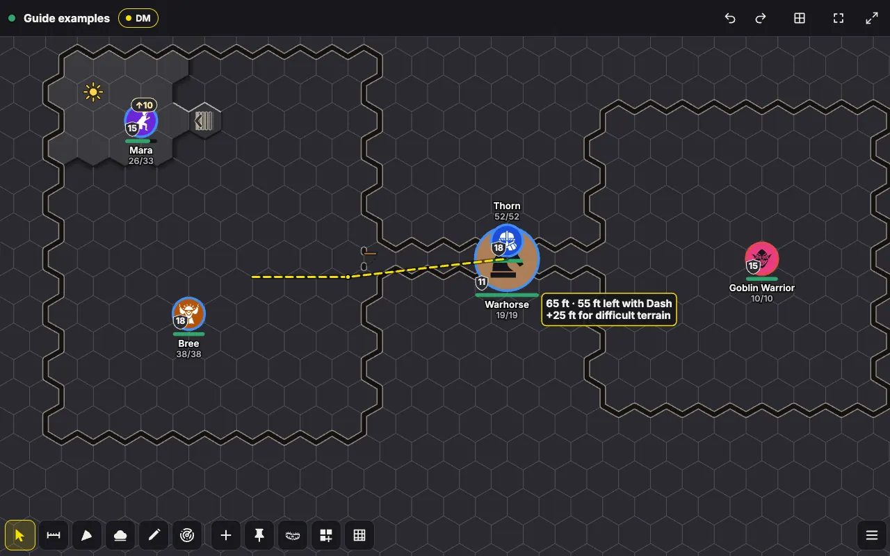

### Speed and the turn's path

During a fight, the app keeps track of where the creature whose turn it is has gone:

- Each drop adds a leg to the turn's path, which is drawn on the map with a ring where the turn began and bends where the walk went around something. "Moved 20 ft" totals the whole path, which helps the table judge Opportunity Attacks. The app doesn't detect those for you.
- When difficult terrain made the turn cost more than its distance, you and the creature's players read both, "Moved 15 ft, used 20 ft", and what is left of its Speed counts what it used. Other players see only "Moved".
- Inside Spirit Guardians, or any area set to Half Speed that affects it, a creature's Speed is halved, rounded down, so a 25 ft Speed becomes 12 ft. The label says "Half Speed in Spirit Guardians" while the drag would end inside, and the colors count the halved Speed at each step. Leaving the area gives the full Speed back, less what was used.
- **Doesn't count**, in the action bar, leaves the last leg out of the total, for a shove or a teleport.
- Players get **Undo move** for their own newest move. Your own moves are undone with **Undo** in the top bar. A player can't undo a move that a trap cut short or that showed them something, since the trap has already happened (see [Traps](#traps)).

### The Ruler

**The Ruler** (`R`): drag to measure, and tap to add waypoints along the way. It shows the total and each leg ("35 ft (15 ft + 20 ft)"). Double-tap, or press **Keep**, to leave a ruler on the map, and remove kept rulers from the **Kept rulers** list. Your ruler is private until you turn on **Shared**, and Shared turns itself off each time you pick the Ruler again, so measuring to a hidden monster never gives it away. Players' rulers show to everyone, in each player's color. A point on raised ground stands on that ground, so the distance counts the height.

**The walking ruler.** A straight line is the right measure for a spell's range, but not for how far a creature has to walk to get somewhere. For that, pick **Walking** instead of **Straight** in the Ruler's options. Your device remembers the choice. On a narrow phone the two fold into one button that reads **Line** or **Walk**, and a tap on it offers both. A walking ruler measures how far the creature it starts on would walk to each point, or a Medium creature when you start on empty ground. It counts difficult terrain and, while **Walls and ledges block players' moves** is on, goes around walls, through open doors and up stairs, just as dragging the creature there would. The total reads "Walking 40 ft", with what cost extra under it when anything did, such as "+10 ft for difficult terrain" or "+20 ft for squeezing". A leg with no way through draws in red and reads "No way through". On your own ruler it runs straight through the wall, as your own drop would, while a player's ruler, or one you share, stops at the wall, as a player's drag would. Started on the rider of a controlled mount, it measures the mount's walk, since that is how the rider moves. On a hex scene it steps from hex to hex in the same way, counting every hex as 5 ft and a hex walked while squeezing as 10 ft.

A walking ruler leaves out other creatures, since they will have moved by the time anyone walks there, and it reads no Swim Speed or crawling, since a ruler has no turn. A shared or kept walking ruler reads the same on every screen, using only what the players have seen. Your own ruler, before you share it, uses everything you know, which makes it the one for planning a monster's route.

Distances between tokens are measured from edge to edge and include height. The room's **Diagonal moves** setting decides how diagonals count. The default, every square 5 ft, is the 2024 rule.

## Mounts, familiars and dragging

Some tokens should go wherever another one goes: a knight on her warhorse, a familiar on a wizard's shoulder, a torch in a fighter's hand, travelers riding in a cart, or a goblin hauled along by the fighter who grappled it. **Attach** links two tokens so that one moves with the other, and the app then follows the rules that go with each kind of link: what it costs to get on a mount, when a mount takes its turn, and how much slower a creature moves while it drags another.

### Attaching

Select the token that gets on, or the one that will carry or drag, and press **Attach** in its action bar. On a computer the list opens as a pop-up beside the button, and on a phone it slides up from the bottom. It shows every token within 5 feet that the selected one can ride, carry or drag, nearest first, each as a sentence that says what will happen:

- **Ride Warhorse** puts a creature on a mount at least one size larger than itself.
- **Perch on Bree** puts a Tiny creature on another creature, the way a familiar sits on a shoulder. A perch is not a mount, so it costs no movement and never shares a turn.
- **Carry Torch** puts an object on the selected token, and **Get on Cart** puts the selected creature on an object. **Carry Kobold** lets a creature carry a smaller one that it has grappled.
- **Drag Goblin 2** pulls a creature along beside the one dragging it.

**Controlled or independent.** Ride asks one more question, **Controlled** or **Independent**, with a line under the two saying what the chosen one means. A controlled mount, such as a horse trained for battle, moves on its rider's turn as the rider directs it. An independent mount keeps its own turn and goes where it pleases, with its rider along for the ride. Controlled is the default, and you can change it later in the rider's Token panel.

Your list reaches further than your players' lists do: tokens up to 30 feet away appear under **Farther away**, so you can seat your NPCs on their mounts while you set up a scene. A player can drag a creature only when they could move it anyway, or once you have marked it Grappled, and their list tells them so when it is empty. Attach never adds or removes a condition itself, so mark Grappled when the grapple lands, and take it off again when the creature breaks free.

### Moving together

Drag the holder, and everything it carries comes along: the warhorse takes its rider, the cart its passengers, the fighter her torch, and anything those carry in turn. A token on a holder rises and falls with it, so a rider stays in the saddle of a flying mount. A dragged creature walks beside its holder on its own ground, tied to it by a thin dashed line, and comes loose if it ends up out of reach.

Dragging the rider of a controlled mount moves the mount, since that is how the rider steers. The same goes for a rider that covers its whole mount, such as a Small rider on a Medium mastiff, which moves the mount when you drag it and gets off with **Get off**. Any other carried token can be dragged on its own to take it off: drop the torch somewhere else and it has been thrown, or pull the grappled goblin away and it is free. A carried token dropped back on its holder just takes a new seat there. When the holder stands on the ground, a creature dragged off it walks from the ground beside it, as if it had stepped down first, so an independent mount's rider who slides off, or a passenger climbing out of a cart, is measured and priced from the ground rather than from the saddle. From there it walks on its own feet: it crosses the step under a mount that straddles two heights, but it can't step off a cliff at the mount's side or climb a ledge beyond it. Off a holder in the air, such as a flying mount, the walk starts from the seat.

A press in the middle of a holder always takes the holder, so a fighter loaded with a lamp, an owl and a chest still drags as one. To pick up one of the small things she carries, press it nearer her edge.

**Walls.** On a map where walls stop players' moves, a holder's drag looks for a way wide enough for every creature it drags beside it, so a fighter towing a goblin at her side takes the double door rather than the narrow one. Where there is no such way, the drag reads "No way through", the group stops where the holder, or a creature it drags, would meet a wall, and the note names the one that can't follow ("Goblin can't follow through there."). Riders and carried things need no room of their own, since they travel on the holder.

**Narrow corridors.** A mount that [squeezes](#when-walls-stop-a-move) through a narrow corridor keeps its rider. While the mount squeezes, the rider sits on the squares or hexes it squeezes onto, the one nearest its seat, so the rider's torch and its sight go through the corridor with it. Where the mount stands up to its full size again, the rider settles back into a seat of its own. **Get off** from a squeezed mount steps into the corridor beside it. The same goes for a cart's passengers and anything else a holder carries.

**On a hex scene** riding, carrying and dragging work as they do on squares, counted in hexes. A rider sits on one of its mount's hexes, the one nearest where it stood, so a Large horse has three seats to choose from. Attach reaches 5 ft, which on hexes is the ring of hexes around the creature, and a move that takes a rider off its mount's hexes lets go. **Get off** sets the rider down on a free hex beside the mount, trying the ring of hexes nearest it first.

A teleport leaves a dragged creature behind, since nothing walks beside a creature that blinks across the room. Moving a token to another scene takes everything it carries along with it.

### Getting off and letting go

A carried token's action bar shows **Get off** for a creature, **Put down** for an object and **Let go** for a dragged creature. Get off puts the creature on a free spot beside its holder, and when there is none, the button is greyed out with "No room to get off." under it. Put down and Let go leave the token where it stands.

The holder's bar lists what it carries and drags, such as "Carrying Bree, Torch" and "Dragging Goblin 2", with **Let go** or **Put down** beside each one, and the carried token's bar names its holder as the Token panel does, such as "Riding Warhorse". A tap on a name there selects that token, which helps when a rider hides its mount or a familiar is too small to tap. A carried creature keeps **Attach** too, so a rider can still pick up a torch or drag a grappled foe, though its list offers only Carry and Drag. To switch mounts, get off first. Players can take back a mistaken Ride, Get off, Put down or Let go with **Undo move**, like any move.

### Mounted combat

The app follows the 2024 rules for mounted combat, and takes care of the bookkeeping that makes it awkward at a table.

- **Getting on or off** a mount on the rider's turn costs half the rider's Speed, and players can mount only on their own turn. A rider who slides off by dragging pays the same as one who presses Get off.
- **A controlled mount takes its rider's Initiative.** When a creature mounts a controlled mount, the mount's Initiative changes to match the rider's, and its row moves to just after the rider's. From then on the mount moves and acts on its rider's turn: its moves count against its own Speed, the movement pill counts the mount's path, with the rider's own movement under it ("Mara: 5 ft, used 15 ft"), and the mount gets its Reaction back when its rider's turn starts. The rows move and the mount shares the turn only for a ride your players can see: on the players' scene, with the rider and the mount both in their view, and the rider's row in their order. Anywhere else, such as on a scene you are still preparing, the order stays as it stands, and the mount keeps its own turn. This also applies when the rider's row belongs to its character rather than to a token.
- **The mount's own row** stays in the tracker, dimmed, so effects that count its turns still tick there, but it has no movement of its own that round. If the mount had already taken its turn this round, the tracker passes over its row until the next round. When the mount's own row is the one acting as a rider mounts it, its row stays put, and its **⋯** offers **End turn and move after Mara**. This ends the turn in the original order, then moves the mount after its rider. Nobody between them loses a turn, and the mount's completed row is passed over for the rest of that round.
- **The tracker** tags the rider's row "Riding Warhorse 2" and the mount's row "Controlled by Mara", with the three actions a controlled mount may take: Dash, Disengage or Dodge.
- **An independent mount** keeps its own place in the order, and carries its rider along on its own turn.

Here is how that plays out in the picture. On her turn, Mara stands beside a warhorse, presses **Attach**, and picks **Ride Warhorse 2** with **Controlled**. Getting on costs half her 30 ft Speed, and the horse's row moves up to just after hers. Now a drag of Mara moves the horse, at the horse's own 60 ft Speed, here 30 ft up onto the rise, and the pill on its path counts the horse's movement, with "Mara: 5 ft, used 15 ft" under it for her step into the saddle. When you press **Next** at the end of Mara's turn, the horse's own row comes up dimmed, since its turn this round went to carrying her, so press **Next** again to move on.

If a rider, or the mount under it, is knocked Prone or Unconscious, you get a reminder that the rider may fall off, with the DC 10 Dexterity save and **Ask for the save** for a player's rider. The app never decides this for you, and nothing falls off by itself.

### Dragging and carrying creatures

Dragging or carrying a creature costs an extra foot for every foot moved, just as difficult terrain does, unless the creature is Tiny or at least two sizes smaller than the one hauling it. The drag's label says so, such as "+15 ft for dragging", and the cost adds to difficult terrain rather than replacing it, so hauling a goblin through rubble costs 3 feet for every foot.

### Secrets stay secret

A hidden token you attach stays hidden: the imp on the villain's shoulder, the assassin hiding in the cart. Your players never learn it's there, not from how the group moves, what a move costs, or why a move was refused. One thing does show, as it would at a real table: a torch held by an invisible creature floats along wherever the creature goes. A rider you hide never shares its mount's turn either, so the tracker gives nothing away.

A token carries at most 8 others, a chain of carried tokens is at most 3 deep, and a group moves at most 20 tokens.

## Traps

A trap is something you build on the map and keep hidden: a pressure plate in a corridor, a trip wire across a doorway, a door that shoots a needle when it opens. When a creature it is set for walks onto it, crosses it or opens its door, the trap goes off by itself, as the SRD's rules for traps describe, and the app tells you what happened so you can resolve it with your table.

### Building a trap

Pick the **Trap** tool. On a computer it sits among your setup tools, after Pin. On a phone it is behind **Setup**. Its key is `X`.

The tool's options choose what your next trap starts from:

- **Start from** offers **Blank**, **Alarm** and the example traps of the SRD: Collapsing Roof, Falling Net, Fire-Casting Statue, Hidden Pit, Poisoned Darts, Poisoned Needle, Rolling Stone and Spiked Pit. **Alarm** does nothing your players can see. It only tells you when someone crosses it, which suits an Alarm spell or a creaking floorboard.
- **Party level** picks the SRD's column for an example trap (levels 1–4, 5–10, 11–16 or 17–20), which sets its save DC, its damage and the depth of its pit.
- **Zone** chooses the trap's shape: **Squares**, a **Trip wire** or a **Door**. An example trap picks its own, and you can change it.

Then draw it on the map. For squares, drag across them, or tap to place the trap at its own size: a Hidden Pit or Spiked Pit covers 2 by 2 squares from the one you tap, and Blank or Alarm a single square. For a trip wire, drag from one end to the other: the ends snap to square corners and the middles of square edges, and a wire is at most 20 squares long. For a door, tap the door. The new trap's pane opens at once, and its first line says where the trap started, such as "From Hidden Pit, levels 1–4".

On a hex scene the zone reads **Hexes** instead of Squares: drag across the hexes the trap covers, or tap to place it at its own size, so a Hidden Pit takes 2 by 2 hexes. A trip wire's ends snap to hex corners, and a door trap takes the hex on each side of its door. The trap goes off by the hexes a creature stands on as it walks, its pane and its hints count in hexes, and a pit opens there just as it does on squares.

An example trap is a good place to start even when you have something else in mind, since it comes with its checks, its save and its damage already filled in. For a pit just inside the crypt chamber's door, as in the picture below, pick **Hidden Pit** at your party's level and tap the first square inside the door. The pit covers the 2 by 2 squares anyone coming in must cross, and all that is left to change is the name and the line your players read, if you want them different.

### The trap pane

The pane holds everything about the trap, in sections that fold to one line each, so you can read the whole trap at a glance and open only what you want to change. Every change is saved as you make it. On a computer the pane opens over the map, beside the trap, and on a phone it slides up from the bottom. Either way it makes room for the fight's alerts as [Alerts during a fight](#alerts-during-a-fight) describes, and a trap that goes off while the pane is open shows its toast just under the pane's header. On a small phone held sideways at a large interface size, where the pane wouldn't fit under the top bar, it covers the top bar until you close it.

1. **Name**: what your players see once they find it.
2. **Goes off when**: a creature steps onto it, starts or ends its turn on it, or steps off it. A trap has to go off one way at least, so the last one stays ticked. **Add squares** grows a trap of squares with more rectangles. **Who** sets it off: **Party**, **Others** or **Any**, with a line underneath that says which creatures that means (the section's summary spells it out, such as "by party creatures"). **Small or larger only** lets the cat walk over the plate, and **Only creatures on the floor** leaves out fliers, burrowers and riders.
3. **Afterwards**: turn on **Arms again at the start of the next turn** for a trap that resets, or leave it off for one that goes off once. **Uses left** limits how many more times it can go off, and an empty box means no limit. Then whether it stops the creature where it goes off, and whether it marks itself found when the players see it go off. A trap of squares can also open a pit as deep as you choose.
4. **Hits**: the creature that set it off, everyone on the trap, everyone in squares you draw, or everyone in an area, which you place with the Area tool's shapes and save into the trap.
5. **Save and damage**: the group save's fields: a save and its DC, half or none on a pass, damage, and conditions on a fail with how long they last. If the damage dice don't read as a formula, a line under them says so and the trap keeps its last good dice.
6. **Players read**: the line your players see when it goes off, such as "The floor gives way!", and a sound to go with it. A silent trap has no line.
7. **It also**: up to eight things it does to the map. Press **Add an effect**, then tap a door to close, open or lock it, a light to put it out or light it, or a hidden creature or stamp to reveal it. This is how a trap drops a portcullis or springs an ambush.
8. **Finding and disarming**: the checks that find it, such as "Wisdom (Perception) DC 15: the pressure plate", whether to hint when a creature's Passive Perception would notice it, and how it is disarmed.
9. **DM note**: anything you want in front of you when it goes off.

While the pane is open, the squares or the area the trap hits are drawn faintly on the map, so you can check that they cover what you meant. When a section asks for something on the map, such as **Add squares**, the squares a trap hits, or **Add an effect**, the pane steps aside and the Trap tool's options say what to tap. Drag across squares or tap one, or tap the door, light, creature or stamp, then press **Done**. Outside that, a tap on the map away from the open trap closes its pane.

At the foot of the pane, **Armed** and **Found** show the trap's state, and you can change either by hand. **Ask to search** and **Ask to disarm** send a roll request for the trap's checks to the creatures you have selected, or to the whole party. **Set it off** sets the trap off now, by the creatures you have selected or else by those standing on it, for when a character prods the plate with a pole. **Delete** asks for a second tap.

On your map, an armed trap is hatched in red with its name over it, a sprung one turns grey, a disarmed one keeps a grey dashed outline, and an eye marks one the players have found. Zoom far out, to where creatures' names disappear, and traps lose their names too, keeping just their icons, so a crowded map stays readable. Tap a trap with the Trap tool to open its pane again, or find it under **Traps** in the Outliner. A scene holds up to 50 traps.

> [!TIP]
> Build your traps on a scene the players aren't on yet, or while their screens are blacked out. Traps go off by themselves only on the players' scene, and never during a blackout.

### When a trap goes off

A trap goes off when a creature it is set for walks onto it or across its wire, lands on it from the height controls, opens its door, or starts or ends its turn on it. Each trap goes off at most once a move, at the point where the creature first reaches it, so a rogue who dashes across three plates sets off the nearest one first.

If the trap stops creatures, the creature stops where it set the trap off, and anything it carries stops with it. A creature that can't stand on that exact spot, such as a Large creature halfway onto a square, stops at the next spot along its walk where it can. When the player's screen didn't know the trap was there, they see the token settle back to that spot as the server answers. A pit decides where a creature stops a little differently, so that it can fall in (see [Pits](#pits)).

You get a toast, such as "Hidden Pit went off: Thorn.", and a card among your alerts that stays until you deal with it. The card says who set the trap off, who it hits, what it did ("Opened the pit.") and anything it could not do, with your note under them.

- **Save and damage** opens the group save on the creatures the trap hits, as they stood when it went off, already filled with its save, DC and damage. Ask for the saves or roll them as usual, then press **Apply**, which also settles the card. If everyone passes and the trap would change nothing, as when the whole party slips out from under a Falling Net, the button reads **Settle: it changes no one**, and pressing it clears the card all the same. A trap with conditions and no save shows **Apply** instead.
- **Dismiss** sets the card aside without applying anything, for when the dice or the story go another way.

**When you're on another scene.** If you're preparing another scene when a trap goes off on the players' scene, the toast names the scene instead of the creatures, "Hidden Pit went off on Crypt.", and still plays the trap's sound. Press **Show** to go there. Once the scene opens, the toast comes again with the creatures' names and **Save and damage**, and the card waits among your alerts. The Passive Perception hint below works the same way.

Your players read the trap's line in their log, "Thorn: The floor gives way!", and Thorn's player also gets it as a toast, with the trap's sound. A request for a save names the trap only "Trap" until the players have found it, so the name in your notes never gives anything away.

A player can't take back a move with **Undo move** once a trap cut it short or changed something they can see: its line, its outline, a door, a creature it reveals, a pit, or a light within the party's sight. The trap happened, and stepping back would let them walk around it, so **Undo move** leaves their bar for that move, and an undo pressed before the server answered says to ask you. A silent trap nobody has found that stops a creature right where it was going shows nothing, and neither does one whose effects your players can't see, such as a light lit far from the party or a creature revealed under fog. Those moves can still be undone, and the trap's record stays with you. Your own **Undo** can still take the move back, trap and all, if you decide it shouldn't have happened.

**When the players saw nothing.** A creature your players can't see may wander onto a trap during a player's move, such as an invisible imp riding along with the party. The trap then stays armed for the players, since nothing happened that they could see, and your toast ends "The players saw nothing." Its card offers **Do its effects**, to let the trap go off for real, doors, lights, pit and line included, and **Mark sprung**, to count it as spent without showing anything. A hidden creature you move yourself sets a trap off at once, doors and all, but your players read no line.

### Found traps, searching and disarming

Once the players know about a trap, mark it **Found** in its pane, or from the hint's toast below. Unless you turned it off, a trap also marks itself found when the players see it go off. Your players then see the trap's name and its outline, hatched in a warning color, and "Disarmed" once you disarm it, but never whether it is still armed, its DC or what it does. Like yours, their map drops a trap's name when zoomed far out. When a player drags a token across a found trap that is not disarmed, the drag's label warns them: "Crosses Hidden Pit". Your own drags warn you about every armed trap.

To let the players look for traps, open the trap's pane and press **Ask to search**. It asks the selected creatures, or the party, for the trap's find check. **Ask to disarm** does the same with its disarm check. When they succeed, turn off **Armed**, and the trap is disarmed.

**The Passive Perception hint.** When a trap's hint is on, and a party creature ends a walk within 10 feet of it while nobody has found it, and its Passive Perception meets the trap's Perception DC, you get a toast: "Thorn's Passive Perception (16) would notice the pressure plate of Poisoned Darts (DC 15)." with **Mark found**. The app never marks the trap found by itself, so you decide whether to tell the player, and how. It hints once for each trap, until you change the trap's checks. The example traps that have a Perception check start with the hint on. When you add a Perception check yourself, tick **Hint when a creature's Passive Perception would notice it** under **Finding and disarming** as well.

### Pits

A trap of squares can open a pit, as the Hidden Pit and the Spiked Pit do. When it goes off, its squares sink to the pit's floor, and every creature standing on them falls with them, along with whatever it carries.

A creature falls in only when it stands wholly over the opening, so a pit that stops creatures holds a walker at the first spot along its walk where it fits inside the pit, rather than where it first touched the edge. A Large warhorse walking across a pit 10 feet on a side doesn't stop when its front half reaches the edge. It stops once it stands wholly over the opening, and falls to the bottom with its rider. A creature too big for the opening, such as a Huge giant at that same pit, or one whose walk only clips a corner or ends before it is wholly over, never stands wholly over it. It stops at the first spot where it can stand, and stays at the rim while the pit opens beside it.

A creature being dragged along stays on its own ground, and comes loose if its holder falls out of reach. The pit stays open: it is now ground like any you paint, so walking into and out of it follows the usual rules for heights and ledges. Arming the trap again doesn't close it, but your **Undo** of the move that opened it does. Once the pit is open, its pane reads "Opened" with the depth of its floor, and its depth can no longer be changed.

# Deeper tools

This part covers the tools that help a long campaign run smoothly: the Outliner, the DM panel, characters' stat blocks, companions, pins, the table display and the room's settings. Read a section when you want what it offers. None of it is needed for a first session.

## Outliner

The **Outliner** (DM only) lists everything on the scene you are viewing, along with what the players get of each thing. It is the place to find one token in a crowd, check what is still hidden, and track down things you have lost. The `/` key opens it with the search ready to type in.

- Everything is sorted into groups that fold: **Creatures and objects**, **Map** (stamps, labels, pins and lights), **Areas**, **Drawings**, **Doors** (windows too) and **Traps**. The chips at the top show one group at a time.
- Each row says what the players get of it: **Hidden**, **Under fog**, **Out of the party's sight**, **DM only**, **Only Pat** (only that one player gets it, such as a pin linked to a page only Pat can read), **Secret door, hidden** or **Secret door, found**. A trap's row reads **Hidden** until the players have found it and **Found** after, with **Armed**, **Sprung** or **Disarmed** under its name. On a scene you are preparing, the rows read as they will once the players move there, so you can check a scene before anyone arrives.
- **Search the scene** filters the list as you type. Every word must match a row's name or the line under it, so `companion` finds every companion and `secret` finds secret doors. The marks themselves aren't searched, so use the chips and scan the marks to find, say, everything under fog.
- Tap a row to find it on the map. A token is selected, with its action bar open. A label, pin, stamp, light or trap opens in its tool. A drawing, door or window flashes so you can spot it.

A companion whose character has no token on this scene reads **Away from Bree**, which is how you find companions left behind when the party moves on. See [The party travels between scenes](#the-party-travels-between-scenes).

## DM panel

The **DM** panel holds the tools that act on your players' screens.

- **Handouts**: **Show a handout** shows an image or a PDF as a popup, to **Everyone** or to **Chosen players**. Pick **From the library** or **Upload a file**, or press **From starter packs** to choose one of the pictures that come with the app (see [Starter art](#starter-art)). Give it a **Title** (a starter picture fills in its own name if you haven't typed one), then press **Show**. For a PDF, the app asks which pages to include (up to 100). **Showing now** lists what is up, with **Hide** to take a handout down for everyone.
- **Players' screens**:
  - **Follow me**: the players' maps follow yours as you pan and zoom, until you turn it off.
  - **Bring everyone here**: moves every player's map to what you see right now, once.
  - **Black out players' screens**: players see only black and "The DM has paused the game." Use it for a break, or to set up a reveal out of sight. While it is on, your top bar reads "Players see black".
- **Check their view**: **View as a player** and **Party sight**, described just below.
- **Player link**: **Show the player link** shows the link and its QR code, for players at the table to scan.
- **Table display**: see [The table display](#the-table-display).

Follow me and Bring everyone here move the players only while you are looking at the players' scene, and the panel tells you when you aren't.

### View as a player

Sooner or later you'll want to know exactly what a player can see: whether the fog really hides the vault, whether Mara's torch reaches the goblin, or what Ben can see of a scene where each player sees for themselves. **View as a player** shows you the scene as that player sees it, fog, party vision and their own map included, and nothing they can't see. It is drawn on your own device and isn't a mirror of their phone: the preview keeps its own framing of the map and its own panels, so it shows what they can see, not where they are looking right now. It always shows the players' scene, whichever scene you are on, so you can check on the table while you prepare the next map.

There are two ways in. The quickest is a creature the player owns: their character, a creature you lent them, or their companion. Tap it, and its action bar has **View as** and the player's name, such as **View as Pat**, with an eye in a frame, right beside **Stat block** and **Details** (on a phone, scroll or expand the bar to reach it). The same button sits at the top of the creature's Token panel, in a row of its own under the quick numbers, the same place a character's page keeps **Place a token**. When several players own the creature, the button reads **View as a player** and opens a short list of them to choose from. In the Token panel's **Owners** group, each player has the same eye beside their name, so you can see what any player can see of this creature, owner or not. Monsters and NPCs that no player owns don't have the button, and your players never see any of it.

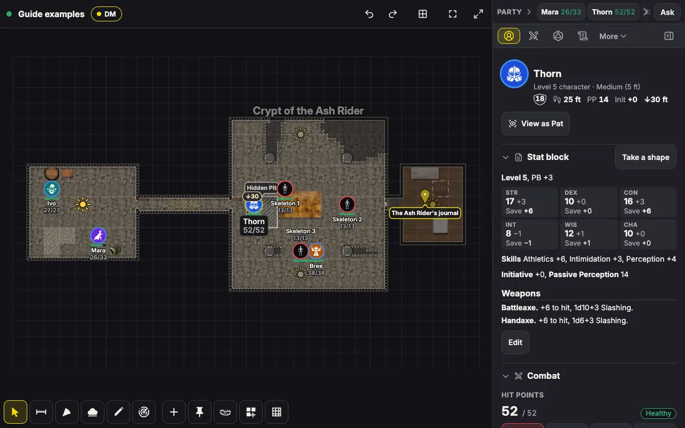

The other way is the DM panel's **Check their view**, for a player who has no token on the scene: pick them under **View as a player** and press **View**.

While you look, a line at the top reads "Viewing as Ana. Nothing here is saved. Whispers between players are not shown." Until their view arrives, it says it is loading. If it can't load, it says so, and **Try again** asks for their view once more. The whispers players send each other stay private, so you can look in without reading the notes they passed. **Exit**, or Escape, brings you back to the button you pressed.

**Party sight**, under View as a player in the DM panel, does something different. On a scene with party vision it shades what the party can't see on your own map, so you keep working with everything in view and still know at a glance what lies in the dark for them.

## Characters and their stat blocks

The **Characters** panel lists the party. A character belongs to the room rather than to one map, so its HP and conditions follow its tokens to every scene. A monster token is different: each one is its own copy.

- **New character** takes a name, size, max HP, AC, Speed, Initiative bonus, Passive Perception, and who plays it (**Played by**). While "Players can create their own characters" is on, each player can also make up to 3 of their own.
- To put a character on the scene you are viewing, open it, press **Place a token**, and tap the map.
- Tap a character to open its page. It reads like the Token panel: the picture, name, level and size, the quick numbers and **Place a token**, then the stat block, then **Combat** and **Companions**, open, and **Notes**, **Image**, **Stats** and **Played by**, folded until you need them. Your device remembers which ones you open. At the foot of the page, **Delete Thorn** (after a trash can) deletes the character with its tokens, its companions and its place in a fight. The line above it says what will go, and it takes a second tap ("Tap again to delete"). The chevron before the character's name at the top of the panel (**Back to Characters**) returns to the list. A player who plays a single character goes straight to its page, until they go back to the list. The list then stays until they leave the room or reload the page.

**Stat blocks.** A character can have a stat block of its own: its level, ability scores, save and skill proficiencies, spellcasting, defenses, and its weapons, spells and other rolls, with riders such as Sneak Attack. A stat block makes the rest of the app smarter about that character. The Dice panel offers its rolls, roll requests know its bonuses, and the group save knows its resistances and Evasion. The block stays between you and the character's own players: only you and those players see it, and only you and they get **Add a stat block**, **Edit**, **Take a shape** and **End the shape**. Other players and the table display never see it. Folded, the **Stat block** row says what it holds, such as "Level 5, PB +3", or "Wild Shape: Brown Bear" while the character is in a shape.

To fill one in, press **Add a stat block** on the character's page or in its token's panel, then choose where it comes from under **Fill from**:

- **Paste text**: a stat block copied as text, read on your device. Set the level first.
- **D&D Beyond**: a public character's share link or number (press **Get it**), or its JSON pasted in (**Paste its JSON instead**). It reads numbers, proficiencies, weapons, spells and class resources, but never their descriptions.

**Check what was read** then lists anything to double-check, what comes in (class resources included, such as "Adds Rage: 3 uses, one back on a Short Rest, all on a Long Rest"), and anything else to set (level, AC, max HP, Speed, senses, sheet link, name), where the AC line reminds you that it was worked out from the armor. When the stat block already holds values of its own, **Replaces your changes** lists each one the import would replace, with **Keep mine** beside it for any you want to keep. **Use it** fills in the editor, and **Save** keeps the result. The D&D Beyond import is best effort, since D&D Beyond can change its format at any time.

When the character changes in D&D Beyond later, such as at a level-up, use [Re-sync from D&D Beyond](#re-sync-from-dd-beyond), which shows what changed on each side before anything comes in.

**Take a shape** turns a character into an SRD creature. A druid's player can set **Druid level** in the picker, beside **Beasts only**, to see just the forms that level allows: nothing above CR 1/4 at levels 2 and 3, CR 1/2 from 4, CR 1 from 8, and no creature with a Fly Speed before 8. The list then runs from the highest CR down. **Any** removes the Druid level filter, which is what Polymorph wants. **Wild Shape** keeps the druid's Intelligence, Wisdom, Charisma and proficiencies, while **Polymorph or another shape** takes all of the creature's numbers. Either way, the token takes the creature's AC and Speeds, the HP stay the character's own, and the app offers the Temporary HP the 2024 rules give. **End the shape** turns the character back.

**Known forms.** A druid knows a handful of Beast forms for Wild Shape: four at level 2, six at level 4 and eight at level 8. In **Take a shape**, the druid's player presses **Choose known forms** and taps each form the druid knows, with the search, **Beasts only** and **Druid level** to narrow the list. From then on those forms sit at the top of the picker, where one tap takes the form as Wild Shape, and **Change** beside them picks them again. Once a druid knows some forms, the button on the **Stat block** row reads their count, such as **6 shapes**, and opens the same picker. In Wild Shape the button stays, so a druid can change to another known form, or change what she knows, without leaving her shape. In Polymorph or another shape it waits until you **End the shape**.

With a **Druid level** picked, the app counts the forms against what that level knows and marks any form above its CR limit or with a Fly Speed too soon, but it never stops one: the rules let you allow other Beasts, so the call is yours. It doesn't track the one form a druid may swap after a Long Rest either. Each device remembers the **Druid level** its player last picked for the character, **Any** included. Until a level is picked on a device, a druid with known forms starts at the character's level, so a player who uses Polymorph picks **Any** once, and the device keeps it. Wild Shape's Temporary HP follow the picked level, which matters for a druid who has taken levels in another class.

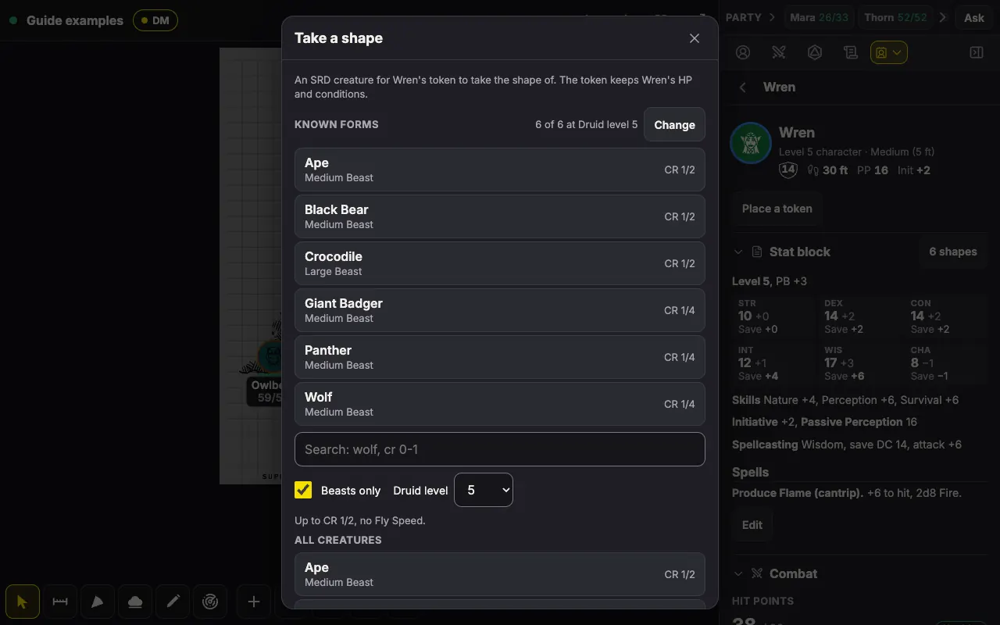

### Class resources and rests

Rage, Channel Divinity, Lay on Hands, Bardic Inspiration: the features a character counts out over a session are its **class resources**. They live in the **Uses** section of the Combat group, on the character's page and in the Token panels of its tokens.

To add them, press **Add a class resource** under **Uses**. **From a class** lists a class's resources at the class level you pick, with their counts filled in from the SRD 5.2.1, such as "Rage: 3 uses. One back on a Short Rest, all on a Long Rest." for a level 5 barbarian. A subclass's resources start unticked, and where a count depends on a modifier the stat block doesn't give, the sheet asks for it. **Your own** adds anything else, such as Superiority Dice or a feat's uses. Give it a name, a count and the rest that brings it back, or tick **Spend an amount** for a pool of points.

Each resource then shows its name with its count: for Rage's 3, three pips at the right end of the line, one filled for each use left, and for a count of more than 6 or a pool of points, words at the same place, such as "25 of 25". Under it come **Use**, **Restore** (which gives one back) and **Edit** (a pencil), to change or remove it. A pool such as Lay on Hands has **Use…** and **Restore…**, which ask how many points. When the character's level goes up, the list asks once for each class whether to update its counts ("Your level went up. Update Barbarian resources?"). Class resources also show in the **Uses** of the character's action bar and tracker row, and on its turn card, so a player can spend Rage without leaving the fight (see [Uses and Legendary Actions](#uses-and-legendary-actions)). Only you and the character's players see them.

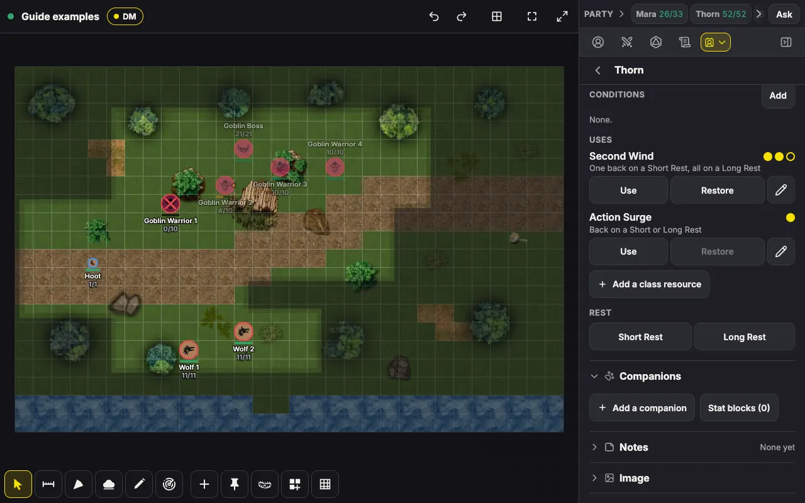

A character from D&D Beyond doesn't need its resources typed in at all. The D&D Beyond import and [Re-sync from D&D Beyond](#re-sync-from-dd-beyond) bring in the limited uses of its classes, species and feats, each with its count, the rest that brings it back, and the uses already spent there. Magic items' charges and spells stay out.

**Rests.** The **Rest** section of the Combat group has **Short Rest** and **Long Rest**. A Short Rest asks for the HP the player rolled on their Hit Point Dice. A Long Rest restores all HP, ends Temporary HP, removes one Exhaustion level and resets Legendary Resistance. Each rest also gives back the class resources and abilities that come back on it: a Short Rest brings back one use of Rage, say, and a Long Rest all of them. Once you pick a rest, it tells you what it will give back before you finish it ("A Short Rest also restores one Rage."). **Long Rest for the party**, at the foot of the **Characters** list, rests everyone at once and restores every class resource too. Spell slots are tracked on the players' own sheets, not here.

### Re-sync from D&D Beyond

Characters level up between sessions, and players keep their sheets in D&D Beyond up to date. **Re-sync from D&D Beyond** brings those changes into the app without throwing away the changes you or the player made here. It sits beside **Edit** once a character has a stat block and a D&D Beyond link, with the date of the last sync under it, and both you and the character's players can use it. As with the first import, the character must be public in D&D Beyond, or you can paste its JSON when the app asks for it.

The app remembers what the last sync brought in, so it can tell a change made in D&D Beyond from one made here. Press **Re-sync from D&D Beyond**, and after a moment the app shows **Check what changes**:

- **Changes from D&D Beyond** lists what changed only in D&D Beyond, such as a higher Wisdom or a new spell. These come in.
- **Also set** lists the level, max HP, AC, Speed and senses, ticked, as they are on an import, and the name, unticked. Untick any line you want to leave as it is. The max HP line also says how many HP the character keeps.
- **Your changes, kept** lists what was changed here since the last sync, such as a druid who casts with Charisma rather than Wisdom, or a weapon the player renamed. Each one stays as it is, with what D&D Beyond says beside it, unless you tick **Overwrite** on it, or press **Overwrite all**. A change made in both places is marked **Also changed in D&D Beyond**, so you can choose between the two. A roll the player deleted stays deleted, with **Add it back** if they want it again.

Class resources come in the same way, each on a line of its own, such as "Updates Rage: 4 uses, now 3" after a level-up. One changed here is kept, with **Overwrite**, like any other change. Spending them, though, is play rather than the sheet. If a player spent a use here that D&D Beyond still shows as unspent, the review lists it unticked under **Also set**, such as "Rage 4 of 4 left, now 3 of 4", so a re-sync never hands back a use spent in a fight. Tick it to take D&D Beyond's count.

Press **Apply** to make the changes. The app tells you how many came in and how many of your changes stayed, and **Undo the re-sync** takes it all back, the exact HP included, until you close the dialog. For you, a re-sync is also a step in **Setup history**, and so is that Undo. If you press **Undo setup** after the dialog's own Undo, it puts the sync back again, which the top bar's **Undo** never does. See [Undo, Redo and Setup history](#undo-redo-and-setup-history).

A few cases work a little differently. A character imported before re-sync existed has no record of its last sync, so the app can't tell whose change is whose. Most of what differs is then listed under **Different from D&D Beyond**, and stays as it is unless you take it. Two things don't wait for you, though. The level, max HP, AC, Speed and senses come in ticked under **Also set**, as they do on an import. And the rolls that came from the earlier import follow D&D Beyond, so they update or go with the sheet, even where someone changed them here. So before the first re-sync of such a character, read both lists, and untick any Also set line you want kept. If D&D Beyond sends a character with something missing, the review says what it could not read, and those parts stay as they are. While the character is in Wild Shape or another shape, its AC and Speed are left out of the comparison, so re-sync again after the shape ends to update them. A re-sync can change the maximum HP, but it never brings a character back from death or knocks one out, and it never changes the character's size.

## Companions

A companion is a token that belongs to a character: a familiar, a summoned spirit, an animal companion, or an effect with no HP such as Spiritual Weapon. Whoever plays the character controls the companion too, moving it and changing its HP and conditions.

**Adding one.** On a character's page in **Characters**, press **Add a companion** and fill in:

- A **Name**, and what **It is**: **A creature** or **An effect**.
- An optional stat block, from **Choose a stat block**: an SRD creature such as an owl or a wolf, one of the character's own saved blocks, or one you paste. A stat block fills in the numbers it knows ("From the block: Speed 5 ft, Fly 60 ft. Darkvision 120 ft."), and the picture too if you haven't chosen one: an SRD creature's default icon, or a saved block's own picture when it has one.
- Its **Turn** (see below), **Size**, **HP** and **AC**.

**Add and place** puts the companion next to the character's token. Players add their own companions the same way. The form is a page of its own. The chevron at the top (**Back to Ivo**, named for the character) or **Cancel** at the foot returns to the character's page, and asks "Discard changes?" first if you typed anything. To turn a token that is already on the map into a companion, use **Make a companion** in its **Token settings**.

**Stat blocks (N)**, on the character's page, opens a page of its own that keeps the character's own companion stat blocks, pasted or typed, up to 100 of them. That way a creature summoned again starts from the same block. An SRD creature doesn't need keeping, since you can simply pick it again.

**Its turn** decides where the companion acts in a fight:

- **On Bree's turn, listed under Bree**: it acts on its character's turn and is listed under that character's row in the order, with its own Reaction and Ready. This is the default for a creature.
- **On Bree's turn, not listed**: it acts on its character's turn and stays out of the order entirely. This is the default for an effect.
- **Its own turn**: it gets a row of its own, with its own Initiative. If you add it during a fight its character is in, it joins straight away, with its Initiative still to roll. Otherwise its player adds it with **Add Hoot** under **Join the fight**, or you add it with **Add to the fight**. **Everyone here** also includes it when you start a fight.

Other players see a companion's token and name, and see its HP as far as "Players see the party's HP" allows. A creature companion lends the party its sight, but an effect doesn't. A companion stays on its scene when the party moves on (see [the travel scenario](#the-party-travels-between-scenes)).

## Ping, Look here and pins

**Ping** (`P`): tap a spot to ping it, with a sound and your color, so everyone looks where you mean. Drag instead for a laser stroke that fades away on its own. With the Select tool, holding a finger still on empty map pings that spot too.

**Look here** is for when pointing isn't enough. Turn it on in the Ping tool's options, and every tap you make also moves every player's view to that spot. They can still pan away afterward. Look here turns itself off when you reload the page.

**Pins** (`M`, behind **Setup** on a phone) mark places on the map. Tap the map to place a pin, and its pane opens. There you set a **Pin label**, a **Linked page** from the Journal, a **Pin color** and **DM only**, and the pane tells you who will see the pin. New pins start DM only, so you can mark your secrets freely. Players see a pin only on their own scene, only where it is out of the fog, and only if they can read its linked page. From the Journal side, a page's **Pin to the map** places a pin linked to that page. With the Select tool, tapping a pin opens its page.

## The table display

If your group plays around a table, a TV can show the players' view of the map, with nothing else on screen. Set it up in the **Table display** section of the **DM** panel:

- **Add a TV** shows a code (such as `K7QH 2MXA 4F`), a link and a QR code. The code works once, for 10 minutes. On the TV's browser, open the Home page, choose **Set up a table display**, and enter the code.
- **Open on this device** opens the display in a new window instead, for a laptop wired to the TV.

The display shows the players' scene the way the players see it: fog, party vision, tokens, shared areas, drawings, pings and rulers, and handouts shown to everyone. On a scene where each player sees for themselves, it shows only what the creatures that share sight with the party see (see [Sight for each player](#sight-for-each-player)). It shows no panels, chat or Initiative strip, unless you tap the display and turn on **Show whose turn it is**. To have the display show what your own screen shows, turn on **Show my view on the table display** in the DM panel, then tap the display and pick **Follow the DM**. The display's menu also has its own **View**, so the TV can show the map in Isometric while your screen stays Top-down, or the other way round (see [The isometric view](#the-isometric-view)). A room can have up to 4 displays.

## The Log and its history

The **Log** keeps everything said and done at the table: chat, whispers, rolls, HP changes, conditions and turns. It opens on the newest lines and follows new ones as they come in while you read at the bottom. The room keeps every line for as long as the room exists, so last month's session is still there.

**Reading back.** Press **Show older** at the top of the Log to bring in the lines before the ones you see. The line you were reading stays where it was, and the older ones go in above it. Keep pressing to go further back, until the Log says "This is the start of the log." To keep a phone quick, the Log holds at most 500 lines at once. Once you go back further than that, the newest lines give way and two buttons appear under the list: **Show newer** reads forward again from where you are, and **Back to latest** returns you to the live Log with the message field ready. Sending a message also takes you back to the latest. Your players read back the same way, and see only what their own Log may show.

**Saving a session.** **Export** at the top of the Log lists your evenings at the table, the newest first, with the time each began and ended and how many lines it holds. A gap of more than 4 hours starts a new evening. The newest 25 show first, and **Older sessions**, under them, adds 25 more. **Everything** saves the whole Log. Each evening's **Export** saves a Markdown file you can open in any text editor or notes app. On a phone it opens the share sheet, so you can save it to Files or send it on. A very long file, over 8 MiB, says "This file is large. Use Download to save it." **Download** then saves it through your browser, which asks the server for it again. Opening the list, each Older sessions and each export or download count toward 10 an hour for each person.

**What a backup carries.** **Download a backup**, in Room settings, saves the whole room to take to another server, but only the Log's newest lines go with it. Export the evenings you want to keep before you move a room. On your own server, its nightly backups keep the whole Log.

## Room settings for fights and maps

Open the Menu, then **Room settings** (DM only). Each switch takes effect at once. These are the settings that shape maps and fights, each with its default in parentheses:

- **Players**: **Who can move any token** (No one), **Who can draw** (Every player), **Players can create their own characters** (on), **Players can apply damage and healing** (off), **Players may type their roll totals** (on), **Players see the party's HP** (on) and **Players see each other's areas** (on).
- **Combat**: **Monsters die at 0 HP** (on), **Healing brings back the dead** (on), **Skip defeated creatures** (on), **Use Initiative scores for monsters** (off), **Reveal hidden combatants on their turn** (on), **Initiative order players see** (**Player characters, the rest on their turn** in a new room), **Critical Hit damage** (**Roll the dice twice**) and **Turn timer** (Off).
- **Grid and distance**: **Feet per square** (5) and **Diagonal moves**, which can be **Every square is 5 ft** (the 2024 rule, and the default), **Alternate 5 ft and 10 ft**, or **True distance**. **Grid on new scenes** (**Squares**) is the shape a new Battle mat or Map image starts with: **Squares**, **Hex rows** or **Hex columns**. See [Hex grids](#hex-grids).
- **Areas of effect**: **Which squares an area covers** (**At least half the square**, the 2024 rule) and **Which creatures an area catches** (**Any square the creature is in**).
- **New scenes**: **Players see on new scenes** (**Explore** in a new room). See [What players see on new scenes](#what-players-see-on-new-scenes).

A few of these deserve a closer look.

**Players may type their roll totals** is on by default, so players can roll real dice and type what they got. If you turn it off, players answer every roll you ask for with **Roll**, and the app rolls for them. A save still offers **Fail without rolling**, for a player who chooses to fail. Totals players typed before you changed the setting still stand.

**Critical Hit damage** picks how every Critical Hit rolls its damage, riders such as Sneak Attack included:

- **Roll the dice twice**: 2d6+3 becomes 4d6+3. This is the 2024 rule, and the default.
- **Max plus a roll**: the dice's maximum plus a normal roll, so 12 + 2d6 + 3.
- **Double the dice rolled**: (2d6 × 2) + 3.
- **Double the total**: (2d6 + 3) × 2, modifier included.

The server uses whichever rule is set at the moment of the roll, and each roll shows how it reached its total, such as "12 max + 2d6+3 (4, 6) = 25".

**Initiative order players see** works separately from **Hidden**. Turning a token's **Hidden** off shows its row only where this setting allows, so in a new room a monster's row still waits for its first turn even after you reveal the monster. See [What players see of the order](#what-players-see-of-the-order).

## Undo, Redo and Setup history

Every DM taps the wrong token now and then, so the app keeps two histories of your changes. They are kept apart on purpose. What happens at the table can be taken back with one tap in the middle of a fight. A change to what a creature or a scene *is* is a different kind of mistake. The app makes you ask for that one deliberately, so you can't undo a stat block by reaching for the button that takes back a hit.

**Play** is the history of the table and the board. The top bar's **Undo** (`Ctrl+Z`) and **Redo** (`Ctrl+Shift+Z`) work on it, with Cmd in place of Ctrl on a Mac. So do the **Undo** and **Redo** buttons in the map builder's row and the Draw tool. Play takes back damage, healing, death saves, rests and conditions, turns and the fight itself, moves, facing and size, carrying and dragging, taking or ending a shape, doors, fog, drawings, areas, everything the builder paints, tokens you place or remove (a whole encounter dropped on the map too), a group save's Apply, a secret or a handout you showed, and switching a scene to another of its prepared phases. A change belongs to the same history in the middle of a fight and on the night before, because starting a fight doesn't change what a change is.

Rest the pointer on a button, and it names the step it would take, such as "Undo your last play or board change: moving Goblin 2". After you press it, the app says what happened once: "Undid moving Goblin 2." Redo says "Redid" the same way. Your other devices and a co-DM hear "The DM undid moving Goblin 2." instead. If Play has nothing to undo, the button does nothing, and the app never reaches into Setup to find something else.

**Setup history** is the history of what things are. Open the Menu and choose **Setup history**. It holds the saved definitions and settings: stat blocks and character sheets (known forms, resources and level included), companions' stat blocks, monsters in your library, saved encounters, a scene's settings, map, grid and sight, the room's settings, journal pages and pins, your library of handouts, and a trap's name, area and rig. Creating or deleting any of these counts too.

The sheet shows the next step to take back, with **Undo setup** beside it, and the next step to put back, with **Redo setup** beside that. While the sheet has focus, and you aren't typing in a text field, `Ctrl+Z` is **Undo setup** and `Ctrl+Shift+Z` is **Redo setup** (Cmd on a Mac). `Escape` closes the sheet and returns you to the button that opened it. When you save in one of those editors, the app tells you where the change went: "Saved. Undo in Setup history." Setup history isn't a backup and doesn't list old versions. It takes back the last thing you saved, then the one before it, and so on. A save too big to keep as a step says "This change is too large to undo." and doesn't promise Setup history.

After the app is updated, a notice on your first visit to a room on each device says "Undo now separates play from setup. Earlier undo history was cleared. Setup history is in the menu." It shows for a few seconds like other messages, and its Setup history button opens that history. It comes once per device and only in the first 14 days. If your browser keeps no site data, it comes once each time the page loads.

Both histories remember your last 50 steps in each direction, on every device you use as the same DM. They live in the server's memory, so a restart of the server clears them. A co-DM has histories of their own.

### Where the line falls

Two things belong to Play even though they look like setup. **Painting a floor or erasing a wall** is undone with the top bar's **Undo**, because a stray stroke needs fixing at once. And **Set maximum HP** in a creature's HP section is Play, since Aid and Life Drain change a maximum during the game. A maximum HP you change by saving a character sheet or a stat block is Setup.

If one save changes both kinds of thing, such as a token's name and its position, the whole save goes to Setup. The app never splits one save between the two histories.

The history leaves some things alone. Dice rolls and chat lines are facts in the Log, and so is a member's name or color, which you change directly in **Members**. Dismissing or withdrawing an ask stays final too.

### A move and a fix of AC

Say you move Goblin 2 into the doorway, and then notice its AC is wrong and fix it in its stat block. Press **Undo** (`Ctrl+Z`). Goblin 2 steps back to where it stood, and it keeps the new AC. Undo gave back only its place, facing and size, so a later fix isn't lost. The AC fix is a Setup step. **Undo setup** in Setup history would take that back, and only that.

### A stat block and a hit

The order of steps matters when two of them touch the same creature. Say you change Bree's Charisma in her stat block, and then hit her for 6 damage. Open **Setup history** and press **Undo setup**. The app won't put her old sheet back over her newer HP, so it keeps the step and says "Undo the play step first: damaging Bree." Then:

1. Close the sheet, and press **Undo** (`Ctrl+Z`) in the top bar. The hit comes off.
2. Open **Setup history** again, and press **Undo setup**. Her Charisma goes back.

The same works the other way around. If you took back a setup step and then a play step, the play step's **Redo** may say "Redo the setup step first: changing Bree's stat block." When the step you need is buried under others, the sentence says so: "Undo the play steps through damaging Bree first." Each time, the app names the newest step in the way and which history it is in. It never takes steps you didn't ask for.

### A step that stays

A step the app can't take right now isn't thrown away, if the thing in its way is another step of your own in the other history. It stays at the top of its history, and its sentence offers **Review step**. Review opens the history's sheet (**Setup history**, or **Play history** for a play step) with **Retry** and **Discard this step**. Take the step the sentence names, then press **Retry**. Press **Discard this step** if you would rather forget the step. It asks "Discard this undo step? The game stays as it is.", and after you confirm, it says "Discarded this step. The game stays as it is." The step goes and nothing in the game changes.

If someone else changed the thing since, such as a co-DM, a player answering a roll or a change that records no step, the app can't tell what you would be undoing. It drops the step and says what changed. Offline, a read-only room or a busy server refuses without touching either history, and **Discard this step** isn't offered, since the step is still good. Try again when the room is back.

### Taking the step you saw

Each press takes the step the button showed. If another device or a co-DM changed that step in the meantime, nothing is undone. The app says "Play history changed. Check the next change." (or "Setup history changed…") and shows the new next step. While the app waits to learn the next step it says "Loading undo history…", and the sheet says "Connect to use history." when you are offline. A second tap in one double tap never takes the step after, and neither does holding a key down. A page that has been open since the app was updated says "Reload to use Undo". Reload it, table displays too.

### Redo

**Redo** (`Ctrl+Shift+Z`) puts back what you took back, in the same history. A new step clears only the Redo of its own history. A move doesn't clear what you can redo in Setup history, and a save doesn't clear what you can redo in Play. A chat line, a die or a player's own change that records no step clears neither.

### What Undo can't give back

If a step would make a player's map forget ground, either history asks first: "Players' remembered map here will be forgotten. Go ahead?" **Forget and undo** (or **Forget and redo**) goes ahead, and **Cancel** keeps the step. Whichever you pick, Undo never brings back a map a player forgot, or something they already read or saw, such as a secret you revealed. See [What players' maps hold](#what-players-maps-hold).

### What your players see

When your Undo or Redo changes something a player can see, such as their hit points, a condition, a shape, an ability score or their own token's place, that player gets one line in their Log, and the app says it once on their screen: "The DM undid a play change." or "The DM undid a setup change to Bree." They never see your wording of the step, a hidden creature, or a number. A change to a wall, fog, a drawing or someone else's token sends no line. You see the exact step in your own Log: "The DM undid setup: changing Bree's stat block." A correction so large that one Log line can't hold every check of who may read it keeps the checks that fit in each player's own copy. If all the checks kept in a player's copy stop allowing them to read it, that copy goes from their Log, while other players' copies stay. It never shows a player something new.

### The HP changes list

**Undo** on a line in the Log or Initiative's **HP changes** takes back that one change, whoever made it, as long as the creature is still as the change left it. That works even when the top bar's Undo would be refused for the same creature, because it checks only that one creature's HP. It has no Redo and no second notice. And it takes back that line only. A condition, another creature hit by the same blow or the note of a damage type stays. To take back a whole group save, with everything it did, use the top bar's **Undo**.

### Re-sync

A re-sync from D&D Beyond is a Setup step, and so is the dialog's **Undo the re-sync**. Pressing **Undo setup** after that Undo puts the sync back, which is the one time Undo setup repeats something. The top bar's **Undo** never touches either. A player who re-syncs their own character has only the dialog's Undo, and it ends when they close the dialog.

# Scenarios

These scenarios follow situations from real sessions, from building the map to running the scene, and name the tools you use at each step. Read one when you are about to run something like it, or skim them all to see how the tools fit together. The screenshots come from a test room with a party of four level 5 characters: Thorn (fighter), Bree (cleric), Mara (rogue) and Ivo (wizard).

## A forest road ambush

Goblins and wolves wait in the trees beside a road, and the party is about to walk right into them.

**Building it**

1. In **Scenes**, under **New scene**, pick **Map image**, choose the forest road image, and press **Upload and create**. If its file name has no size in it, **Line up grid** opens: fit the box over 3 by 3 squares and press **Apply**.
2. In **Encounters**, press **New encounter** and name it "Road ambush". Add Goblin Warrior ×4, Goblin Boss ×1 and Wolf ×2. The XP budget shows how hard the fight is for the party. Press **Save encounter**.
3. In **Place on the map**, tick **Hidden from players**, press **Place where I tap**, and tap the trees north of the road. Then drag the wolves to the south side. Hidden tokens look translucent to you, and they never reach the players.
4. In **Characters**, use **Place a token** to put each character at the west end of the road.
5. Pick the **Fog** tool with **Clear fog** and **Rectangle**, drag over the road, the party and the trees where the goblins wait, and press **Reveal to players**. Clearing the fog doesn't reveal the goblins, because hidden tokens stay hidden even on open ground. You clear their ground now because a token that is revealed later still can't be seen while it stands under fog.
6. In **Scenes**, press **Move players** on the forest road.

**Running it**

1. If the party is surprised, select the four characters (with **Multi-select**), open **Conditions** in the group's bar, and tap **Surprised**. Their Initiative rolls then have Disadvantage, and their rows show **Dis**.
2. In **Initiative**, under **Start a fight with**, press **Everyone here**. Use this rather than "Visible to players", which would leave the hidden goblins out. Their rows start hidden.
3. The players roll their own Initiative. Press **Auto Initiative**: the four goblin warriors share one roll ("By creature"), and so do the two wolves. Then press **Start**.
4. The hidden goblins appear on their first turn, thanks to "Reveal hidden combatants on their turn". If you would rather spring them all at once, select them and press **Hidden** in the group's bar, and their tokens appear together. If one of them has already appeared on its own turn, the first press hides that one again along with the rest, so press **Hidden** a second time to bring them all out. Their rows still join the players' order one by one, on each goblin's first turn, because that is how **Initiative order players see** works in a new room. If you want the rows to appear along with the tokens, set that option to **Everyone** in Room settings before the fight.
5. On a goblin's turn, tap it and press **Roll** to see its roll options. On its Scimitar line ("+4 to hit"), press **Attack** to roll against Thorn's AC, then **Damage**. Tap Thorn, use the **Use 5** chip in his HP entry, and press **Apply**.
6. A wolf hits Mara and knocks her down: open **Conditions** on her token and tap **Prone**.
7. Ivo casts Fireball. His player picks the **Area** tool, searches "fireball", and places the 20 ft Sphere among the goblins. Your screen shows the area, with "In area (4): …" naming who it catches.
8. Press **Save and damage** on the area. The group save fills itself in from Ivo's stat block: "Dexterity save, DC 15 (Ivo's spell save DC), 8d6 Fire, half on a pass." Press the roll button, and the goblins roll on the server. Take Ivo's own damage roll ("Use Ivo's 28") or press **Roll**, check the rows, and press **Apply**. A single undo would take all of it back.
9. Press **Next** through the turns. When the fight ends, press **End the fight** and tap it again to confirm.

## A dungeon crawl in the dark

The party explores a crypt by torchlight, and the players should see only what their characters can see.

**Building it**

1. In **Scenes**, under **New scene**, pick **Builder**, name it "Crypt", and press **Create**. The builder opens.
2. With **Rectangle room** and Stone, drag out an entry hall, a narrow corridor one square wide, and a large crypt chamber. Walls go up around them on their own.
3. With the **Brush**, paint four Pillar squares in the chamber, then some Rubble for a fallen corner of the hall.
4. Pick **Walls/doors**, then **Door**, and tap the edge where the corridor meets the hall. Tap the edge into the chamber for a second door, then tap that door twice more to lock it (it goes closed, open, locked).
5. Pick **Secret door** and **Hidden**, tap an edge of the chamber's east wall, and build a small room behind it.
6. In **Lights**, pick **Torch** and tap the hall. Place two more torches in the chamber to serve as braziers, then tap each one, rename it "Brazier" and set it **Out**. Put a **Candle** in the hidden room.
7. With **Stamp**, place a table, barrels and a chest. Set the chest to **DM only** until the party finds it.
8. In the scene's **What players see** settings, check that **Players see** is on **Explore**, where a new room starts builder scenes, and set **Light** to **Dark**.
9. Place the party in the hall. Thorn has Darkvision out to 60 ft from his senses. To give Mara a torch, tap her token, press **Light**, and pick **Torch**.
10. Place skeletons in the chamber. Under party vision they appear to players only when a character can see them, so they don't need to be hidden.

**Running it**

1. **Move players** to the crypt. To check what they see, tap Mara's token and press **View as** followed by her player's name to see the scene as her player sees it, or turn on **Party sight** in the DM panel: the hall by torchlight, and darkness everywhere else.
2. The players move and see more as they go, and ground they have explored stays on their map, dimmed, as they last saw it. They can open the closed door themselves, by tapping it or with **Open door** in their token's action bar.
3. The chamber door is locked. When Mara picks the lock, use **Select**, tap the door, and press **Unlock**, then **Open**.
4. When a character lights a brazier, go to the builder's **Lights** mode, tap the brazier, and set it **Lit**. The chamber lights up for everyone who can see it.
5. Someone searches the east wall and finds the secret door. Tap it with **Select** and press **Mark found**, and the players now see a door.
6. Once they are in the room with the chest, turn the chest's **DM only** off.

## A fight across heights

A watchtower stands on a rise above a field, and harpies circle overhead.

**Building it**

1. In **Scenes**, under **New scene**, pick **Builder**, and paint Grass over the field with **Rectangle room**. Set **Automatic walls** to **Around floor only** or **Off**, so the field isn't walled in.
2. Pick **Heights/stairs**, then **Height**, set it to 10 ft up, choose **Area**, and drag out the rise. Then set 30 ft up and drag the tower's top onto the rise.
3. Pick **Stairs** with **Auto**, and paint a run of stairs up the rise and another up the tower. Each stair points uphill. Where a "?" shows, pick an arrow and paint that stair again.
4. Place an archer on the tower. A token placed on raised ground stands on top of it.
5. Place the harpies and raise them to 40 ft with **+5** in the action bar, or Page Up. Each shows "↑40", with a shadow on the ground under it.

**Running it**

- With **Walls and ledges block players' moves** on, a character dropped on the tower walks there by the stairs, once the party has seen them. Until then the walk stops at the ledge ("Ledge in the way. No stairs you have seen lead there."). A flier passes over.
- Tap the ground with **Select** to read a height. The Ruler and token distances count height as if it were one more diagonal. Under the default rule (every square 5 ft), the larger of the two distances is what counts. So the Ruler from the archer, 30 ft up, to a goblin on the ground 10 squares (50 ft) away reads 50 ft.
- Ivo casts Fireball on the ground under a harpy flying at 40 ft. The shaded squares include the harpy's square, but "In area" leaves it out, since the Sphere reaches only 20 ft up. To catch the harpy, center the Sphere on its token, or raise **Elevation** under **⋯** before placing it.
- When a harpy is knocked out of the air, lower its elevation to the ground, and apply any falling damage through its HP entry. The **Flying** status is only a reminder for you, and it is separate from the token's elevation.

## A boss with Legendary Actions

The party faces an adult red dragon in its lair. It has Multiattack, Fire Breath (Recharge 5–6), Legendary Resistance and Legendary Actions.

**Setting it up**

1. In **Monsters**, search for "red dragon" and tap **Adult Red Dragon**. On its place card, tick **In its lair**, then press **Place on the map** and tap its spot. In its lair the dragon gets 4 Legendary Actions and 4 Legendary Resistances instead of 3, and its lair XP.
2. Add the dragon to the fight along with the party. It joins with **In lair** on: its tracker row has a "Lair" tag, which the players see too, and "LA 4/4" and "LR 4/4", which only you see. If you forgot to tick **In its lair**, turn on **In lair** in the row's **⋯**, which does the same.

**Its turn**

1. Tap the dragon, then press **Roll** in its bar. The Dice panel shows the dragon's card, with its rolls in folding groups under it. Multiattack is a note at the head of its **Actions**: roll each Rend it names with **Attack** and **Damage**, and apply each hit with the **Use** chip in the target's HP entry.
2. Fire Breath's line in the roll options reads "Recharge 5–6 · DC 21 DEX, half on a pass, 17d6 Fire". Press its **Group save**. The group save opens with "17d6 Fire, half on a pass." Its rows follow what you have selected, so select the characters in the Cone first. Or place a Cone **Area** from the dragon and use its **Save and damage**, which picks them for you. The players are asked to roll. Roll the damage, then press **Apply**. Fire Breath is now marked used, on all your devices, and its row shows a "Fire Breath used" chip.
3. At the start of the dragon's next turn, a card says "Fire Breath can recharge (5–6)." Press **Roll**: on a 5 or 6 the mark clears, and the card says "Rolled 5: Fire Breath is ready." The dragon's turn card lists its Legendary Resistances, counts its Legendary Actions for the other creatures' turns, and shows Fire Breath, ready or used.

**Between turns**

- To take a Legendary Action, tap the dragon and press **Uses** in its action bar, or open its row's **⋯**, and tap the action by name, such as **Fiery Rays**. The count goes down, and Fiery Rays, which the dragon can't take again until its next turn, stays off until then. They all come back at the start of its turn. If you tap the wrong one, **Undo** in the top bar takes it back.
- When the dragon fails a save in a group save, its row offers **Use Legendary Resistance (4 left)** the first time, since the label counts the uses it still has, and a save-ends or Concentration card offers the same. For a save you roll yourself from its roll options, press **Use** beside **Legendary Resistance** in its **Uses**.

## Spirit Guardians and a summoned companion

Bree casts Spirit Guardians and wades into the goblins, while Ivo's owl familiar scouts ahead on its own turn.

**Spirit Guardians**

1. Bree's player picks the **Area** tool. With Bree on the scene, it reads "From Bree". They search for "spirit guardians", which gives a 15 ft Emanation around Bree, attached so it moves with her, with the **Enters**, **Ends turn** and **Once a turn** reminders on. They press **Place**.
2. From Bree's **Conditions**, give her **Concentrating** with the spell "Spirit Guardians".
3. When a goblin moves into the aura, or Bree walks up to one, the log says "Goblin Warrior 1 entered Spirit Guardians." and you get a notice. The same happens when a goblin ends its turn inside.
4. Resolve it. For one goblin, select it, roll its Wisdom save from its roll options, and apply Bree's 3d8 Radiant damage (half on a pass) with the **Use** chip. For several at once, press **Save and damage** on the aura and **Skip** the rows that weren't affected this time.
5. When Bree takes damage, her player gets the Concentration save. If it fails, delete the aura from the **Areas** panel, because areas don't end on their own when Concentration does.

**The familiar**

1. Ivo's player opens **Characters**, which opens straight onto Ivo's page, since Ivo is the only character they play (if they have gone back to the list since they opened the room, they tap Ivo first), and presses **Add a companion**. They name it "Hoot", pick **A creature**, and under **Choose a stat block** pick the SRD Owl. Under the 2024 rules a familiar rolls its own Initiative, so they set **Turn** to **Its own turn**. **Add and place** puts the owl next to Ivo.
2. Since Ivo is in a running fight, Hoot joins it at once, in a row of its own that reads "Companion of Ivo", and its player rolls its Initiative. Outside a fight, it joins with **Add Hoot** under **Join the fight**, or with **Everyone here** when you start one.
3. Under party vision, the owl lends the party its sight, so it can scout a dark room ahead of everyone else.
4. The next time Ivo summons a familiar, his player simply picks the SRD Owl again. A pasted or typed stat block would be kept under **Stat blocks** on Ivo's page instead.

A companion that acts on its character's turn, such as a summoned spirit or a steed, is listed under its character's row with its own Reaction. An effect such as Spiritual Weapon takes **On Bree's turn, not listed**.

## The party travels between scenes

The fight on the road is over, and the party heads for the crypt.

1. **Prepare ahead.** In **Scenes**, tap the crypt's row. You see the crypt, while the players stay on the road. Build it, place monsters and set the fog while they play. The Outliner on the crypt reads as the players will see it once they arrive.
2. **Move the players.** Press **Move players** on the crypt, and every player's view switches to it. Their tokens don't come along, though: they stay on the road. Place each character on the crypt with **Characters**, **Place a token**, or let the players place their own. Their HP and conditions come with them, since characters belong to the room. Delete the old tokens on the road when you're done there.
3. **Bring them to the start.** **Save current view**, in the **Size and view** group of the crypt's settings, sets where the scene opens. Or frame the map yourself and use **Bring everyone here** in the DM panel.
4. **Companions left behind.** Ivo's owl stayed on the road. Open the road scene, press `/`, and type "companion". Once Ivo's token is gone from the road, the owl's row reads "Away from Ivo". Delete its token there, and Ivo's player adds it again on the crypt with **Add a companion** and the Owl.
5. **Monsters left behind** are their own copies, and they stay where they were. If you want a clean copy of a scene to come back to, duplicate it (from its **⋯**, **Duplicate…**) before a fight changes it.

## A secret door and a reveal

The party finds a hidden vault, and you want the reveal to land with a bit of drama.

1. Build the vault behind a **Secret door** set to **Hidden**, and keep it under fog.
2. When the party finds the door, tap it with **Select** and press **Mark found**.
3. Before they open it, go to the **DM** panel and turn on **Black out players' screens**. The players now see "The DM has paused the game."
4. While the screens are dark, reveal the vault with the **Fog** tool, place or unhide its guardian, and switch to a night phase if the map has one.
5. In **Handouts**, use **Show a handout** to show the vault's inscription to **Everyone**.
6. Turn **Black out players' screens** off. The players see the room and the handout together.

## A pit at the crypt's door

The crypt's builders left a pit just inside the chamber's door, and the party is about to find it, one way or another.

**Setting it up**

1. While the players are still on another scene, open the crypt and pick the **Trap** tool. Under **Start from**, pick **Hidden Pit**, and set **Party level** to **Levels 5–10**, which makes it a 30 ft pit that deals 3d6 Bludgeoning damage. Tap the first square inside the chamber's door.
2. In the trap's pane, open **Finding and disarming**. The SRD finds a hidden pit with an Intelligence (Investigation) check, which a character has to ask for. If you want a watchful character to have a chance of noticing it without searching, add a Wisdom (Perception) check too, such as DC 14 for "the seams in the floor", and then tick **Hint when a creature's Passive Perception would notice it**, which stays off on this trap until you do. The app then tells you when someone's Passive Perception would notice it.
3. Close the pane. The pit waits, hatched in red on your map and nowhere on the players'.

**Running it**

1. **Move players** to the crypt. When Mara ends a walk within 10 feet of the pit, her Passive Perception of 14 meets the DC, and you get a toast: "Mara's Passive Perception (14) would notice the seams in the floor of Hidden Pit (DC 14)." If you tell her, press **Mark found**. The players then see the pit's outline and name, and a drag across it warns "Crosses Hidden Pit". If you'd rather keep quiet, simply let the toast go.
2. If you kept quiet, Thorn's player drags him straight into the chamber. The pit stops him once he stands wholly over it, opens, and drops him 30 ft. You get the toast "Hidden Pit went off: Thorn." and the card among your alerts, and his player reads "The floor gives way!"
3. On the card, press **Save and damage**. The Hidden Pit has no save, so the group save opens on "No save: everyone takes it" with 3d6 Bludgeoning for Thorn. Roll the damage and press **Apply**, which also settles the card.
4. **Undo move** leaves Thorn's bar, since the pit has already happened, so a change of heart is your call.
5. Getting out is up to the table, and the trap's note reminds you what it takes. The pit is ground 30 ft down now, with no stairs, so Thorn can't walk out of it on a scene where walls and ledges stop players' moves. When his climb succeeds, or a rope comes down, drag him out yourself, since your own moves are never stopped. The pit stays open afterwards, so the next creature through the door had better go around it.

# Reference

This part is for quick lookups during play, starting with the keys that save a DM the most time.

## Shortcuts

Press `?` (or open the Menu, then **This device**, then **Show the shortcuts**) for the full list of shortcuts for your role. You can also learn them as you go: every button that has a key names it when you rest the pointer on it, as [Where things are](#where-things-are) describes.

These are the keys a DM uses most:

- A tool's key picks it: `V` for Select, `R` for Ruler, `A` for Area, `F` for Fog, `D` for Draw and `P` for Ping. For the setup tools, it is `T` for Add token, `M` for Pin, `X` for Trap, `B` for Map builder and `G` for Line up grid.
- Press a tool's key again while you are using it to move to the next option of its main choice: the next shape for Area, the next drawing tool for Draw, Straight or Walking for the Ruler, Clear fog or Add fog for Fog, the next mode for the Map builder, the next blank token for Add token, and the next zone for Trap. With Shift, a letter key goes back one instead. If the tool's options are hidden, the same press shows them. When the tool has no choice to move at that moment, the press only shows its options: Area while you have a placed area picked, for example. While you drag, or while a change would lose something you started, such as a shape with corners, unfinished text or an area from a spell, the key leaves the choice alone. Select, Ping, Pin and Line up grid have no such choice, so a second press of their key only shows their options.
- `N` moves to the next turn, and starts the fight if it hasn't started yet.
- `H` hides or shows the selected tokens, `L` locks them, and Delete deletes them.
- The arrow keys move the selection a square, or a hex on a hex scene. Page Up raises it 5 ft, and Page Down lowers it 5 ft.
- `/` searches the scene in the Outliner.
- `Ctrl+Z` is Undo, and `Ctrl+Shift+Z` is Redo, for play and board changes (Cmd in place of Ctrl on a Mac). Inside the **Setup history** sheet the same two keys are **Undo setup** and **Redo setup**.
- `0` fits the map to the screen, `+` zooms in and `-` zooms out. `S` hides or shows the side panel, and `O` switches to the other of two panels.
- `I` switches between Top-down and Isometric, `Q` turns the isometric view left and `E` turns it right.
- `W` turns full screen on or off, where the browser allows it.
- Escape closes the newest pop-up, sheet or action bar.
- `Shift+F10` or the `ContextMenu` key, on a focused roll button, opens its one-roll menu. With a mouse, right-click the button, and on a phone hold it.

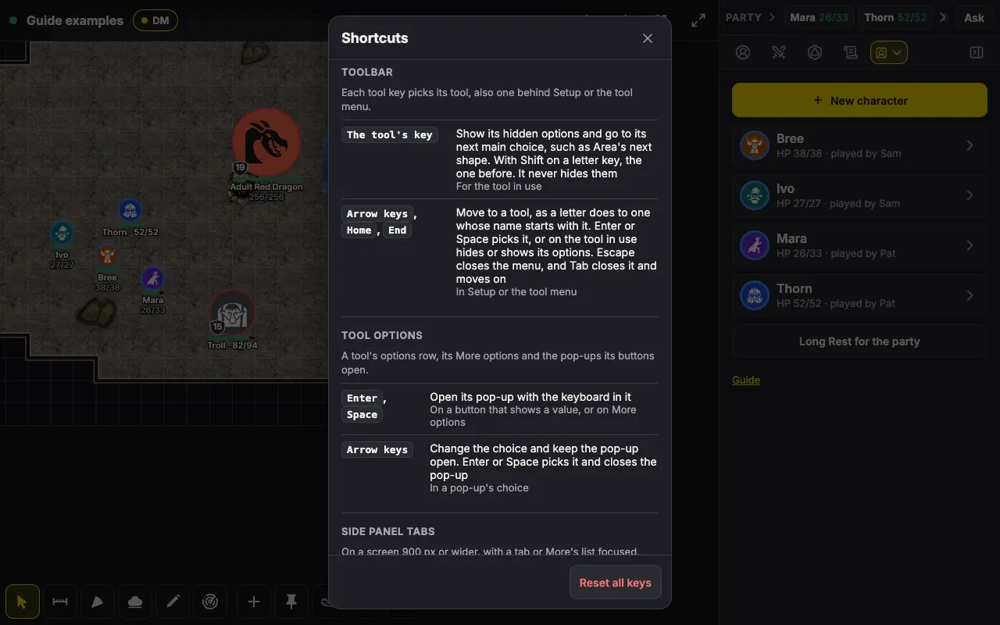

These are the default keys. On any device with a keyboard, you can move a shortcut to another key from the shortcut list: press **Change** beside it, then press the new key. The change stays on that device, so your players keep their own keys, and **Reset all keys** at the bottom of the list brings the defaults back. If a new version of the app gives a shortcut a key you had already given to another one, yours stays where you put it, and the new shortcut shows **No key** until you give it one with **Change**, or press its **Reset** to take that key back.

With a mouse, Shift or Ctrl and a click adds a token to the selection, and Shift or Ctrl and a drag on empty map draws a selection box. To move the map, drag with the right or middle button, or hold Space and drag.
