# DM guide

This guide is for the DM who runs RaccoonVTT for their table. It shows how to build maps and run fights, which tools do what, and how they fit together in real sessions. It covers the parts of the app a DM uses for maps and combat. [FEATURES.md](../FEATURES.md) is the complete list of what the app does, and the in-app shortcut list (`?`) has every key. The app shows this guide too: **Menu**, **DM guide** opens it in a new tab, and each panel it covers ends in a small **Guide** link to its section.

The app does a lot, and you don't need most of it on day one. Read the [Quick start](#quick-start), run a session with it, and come back for the rest as you need it.

## Contents

- [Where things are](#where-things-are)
- [Quick start](#quick-start)
- [What you can ignore at first](#what-you-can-ignore-at-first)
- Making maps
  - [Scenes](#scenes)
  - [Lining up the grid](#lining-up-the-grid)
  - [The map builder](#the-map-builder)
  - [Walls and doors](#walls-and-doors)
  - [Heights and stairs](#heights-and-stairs)
  - [Light and party vision](#light-and-party-vision)
  - [Fog](#fog)
  - [Map phases, imports and exports](#map-phases-imports-and-exports)
- Running fights
  - [Monsters](#monsters)
  - [Encounters](#encounters)
  - [Tokens](#tokens)
  - [HP, damage and conditions](#hp-damage-and-conditions)
  - [Initiative](#initiative)
  - [Dice](#dice)
  - [Asking for rolls](#asking-for-rolls)
  - [Areas](#areas)
  - [The group save](#the-group-save)
  - [Alerts during a fight](#alerts-during-a-fight)
  - [Measuring and movement](#measuring-and-movement)
- Deeper tools
  - [Outliner](#outliner)
  - [DM panel](#dm-panel)
  - [Characters and their stat blocks](#characters-and-their-stat-blocks)
  - [Companions](#companions)
  - [Ping, Look here and pins](#ping-look-here-and-pins)
  - [The table display](#the-table-display)
  - [Room settings for fights and maps](#room-settings-for-fights-and-maps)
- Scenarios
  - [A forest road ambush](#a-forest-road-ambush)
  - [A dungeon crawl in the dark](#a-dungeon-crawl-in-the-dark)
  - [A fight across heights](#a-fight-across-heights)
  - [A boss with legendary actions](#a-boss-with-legendary-actions)
  - [Spirit Guardians and a summoned companion](#spirit-guardians-and-a-summoned-companion)
  - [The party travels between scenes](#the-party-travels-between-scenes)
  - [A secret door and a reveal](#a-secret-door-and-a-reveal)
- [Shortcuts](#shortcuts)

## Where things are

The app has three parts: the **map** in the middle, the **toolbar** under it, and the **panels**.

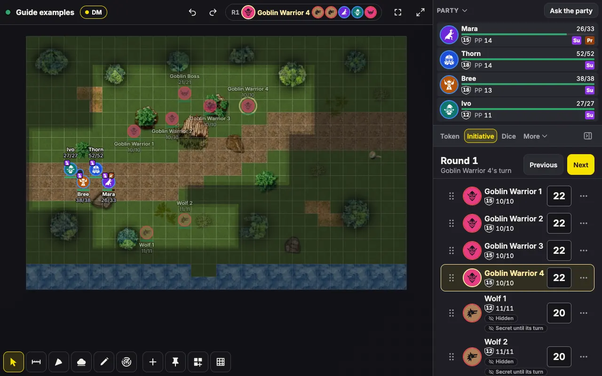

- **On a computer** (a window 900 px wide or more), panels are tabs in the side panel on the right. The most used tabs come first, as many as fit, and **More** lists the rest under **In play** and **Prepare**. **Hide panels** at the end of the tabs, or the `S` key, hides the side panel, and **Panels** in the toolbar brings it back. **Two panels**, at the top of More, shows two panels at once, such as Initiative above a token's stats. Above the tabs, the party bar folds to one line with **Party**: your players' characters with their HP, which scroll sideways when they don't all fit, and **Ask**.
- **On a phone**, **Panels** in the toolbar opens the list of panels, and each one opens as a sheet from the bottom. Swipe a sheet down to close it. Your setup tools (Add token, Pin, Map builder and Line up grid) sit behind **Setup** in the toolbar.

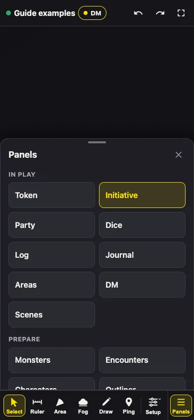

The toolbar holds ten tools. On a computer each has a key:

- **Select** (`V`), **Ruler** (`R`), **Area** (`A`), **Fog** (`F`), **Draw** (`D`) and **Ping** (`P`).
- Your setup tools: **Add token** (`T`), **Pin** (`M`), **Map builder** (`B`) and **Line up grid** (`G`).

A tool's options show in one row above the toolbar. What doesn't fit waits behind **⋯** (More options). Tap the active tool again to hide its options, and again to bring them back.

The top bar holds **Undo** and **Redo** (`Ctrl+Z` and `Ctrl+Shift+Z`, or Cmd on a Mac), which take back your own changes one at a time, and **Fit the map to the screen** (`0`). The **Menu** panel holds the X-card, **Copy player link**, **Members**, **Room settings**, **This device**, **DM guide**, **About** and **Leave room**.

The panels a DM uses most for maps and fights:

- In play: **Token**, **Initiative**, **Dice**, **Log**, **Journal**, **Areas**, **DM** and **Scenes**. On a phone, **Party** is here too.
- Prepare: **Monsters**, **Encounters**, **Characters**, **Outliner** and **Library**.

## Quick start

This gets you through a first session with a handful of tools: one map, a few monsters and one fight.

### Before the session

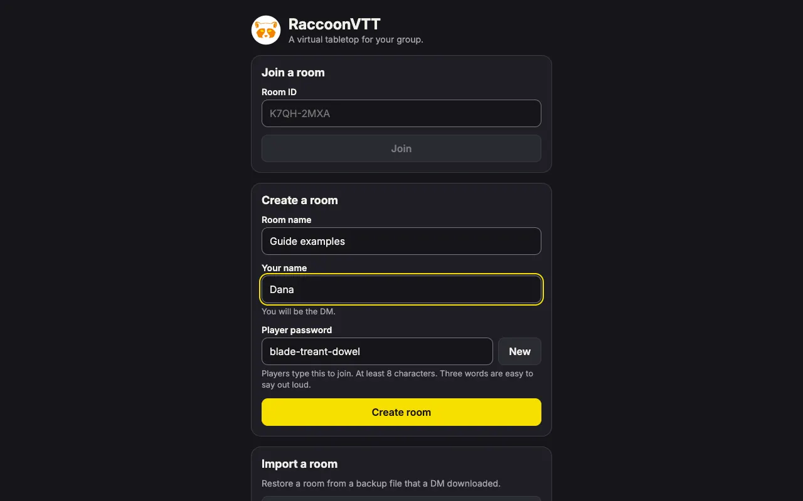

1. On the Home page, fill in **Room name** and **Your name**. Keep the suggested **Player password** or type your own (8 characters or more). Press **Create room**.
2. Save the DM link it shows. It is your way back in as DM on a new device. Tick **I saved my DM link** and press **Continue to the room**.
3. Open **Scenes**. Under **New scene**, pick **Map image**, then **Choose a map image** and **Upload and create**. If the file name holds the size, such as `crypt_30x20.jpg`, the scene is ready. Otherwise the app opens **Line up grid**: see [Lining up the grid](#lining-up-the-grid).
4. Open **Monsters**, search for a monster (`goblin`), tap it, set **How many**, tick **Hidden from players** if they lurk, and press **Place on the map**. Tap the map where they go.
5. Send the players the link: Menu, then **Copy player link**. It carries the password, so they join without typing it. Players make their own characters in the **Characters** panel (new rooms allow it), or you make them with **New character** there.

### At the table

1. Put the party on the map: in **Characters**, open a character and press **Place a token**, then tap the map. Players can place their own on the scene they are on.
2. On a map image, fog starts on, so players see nothing yet. Pick the **Fog** tool and reveal what the party can see (see [Fog](#fog)).
3. In **Scenes**, press **Move players** on your scene if they aren't there already. The scene the players are on is marked **Players here**.
4. Start the fight: in **Initiative**, under **Start a fight with**, press **Everyone here**. Players set their own initiative. Press **Auto initiative** to roll for the monsters, then **Start**.
5. Run turns with **Next** (or the `N` key). Tap a token to open its action bar, type damage such as `-7` in its HP entry and apply it. **Conditions** in the same bar adds Prone, Frightened and the rest.
6. Reveal a hidden monster with **Hidden** in its action bar, or let it appear on its own turn (the room setting "Reveal hidden combatants on their turn" is on by default).
7. When it's over, press **End the fight** in Initiative, and tap again to confirm.

Undo takes back any of your changes, a whole encounter dropped on the map included.

## What you can ignore at first

None of these is needed to run a good session. Each is there when you want it.

- **The map builder.** A map image is enough. Build when you want walls, doors and heights the app understands.
- **Party vision and light.** Fog you reveal by hand works on its own. Party vision adds what characters see by their senses and the light, and it wants walls.
- **Encounters.** Placing monsters from the Monsters panel is fine. Encounters let you prepare fights ahead and check the XP budget.
- **Roll requests, the group save and roll options.** Players can roll their own dice and tell you the total.
- **Areas.** Useful as soon as someone casts Fireball, but you can skip reminders, height and the group save until you need them.
- **Map phases, Universal VTT imports, the Outliner, the table display, pins, handouts and companions.**

# Making maps

## Scenes

A scene is one map: its image or build, its grid, its fog, and the tokens on it. A room holds up to 50 scenes. **Scenes** (DM only) lists them, makes new ones, and holds the settings of the scene you are viewing.

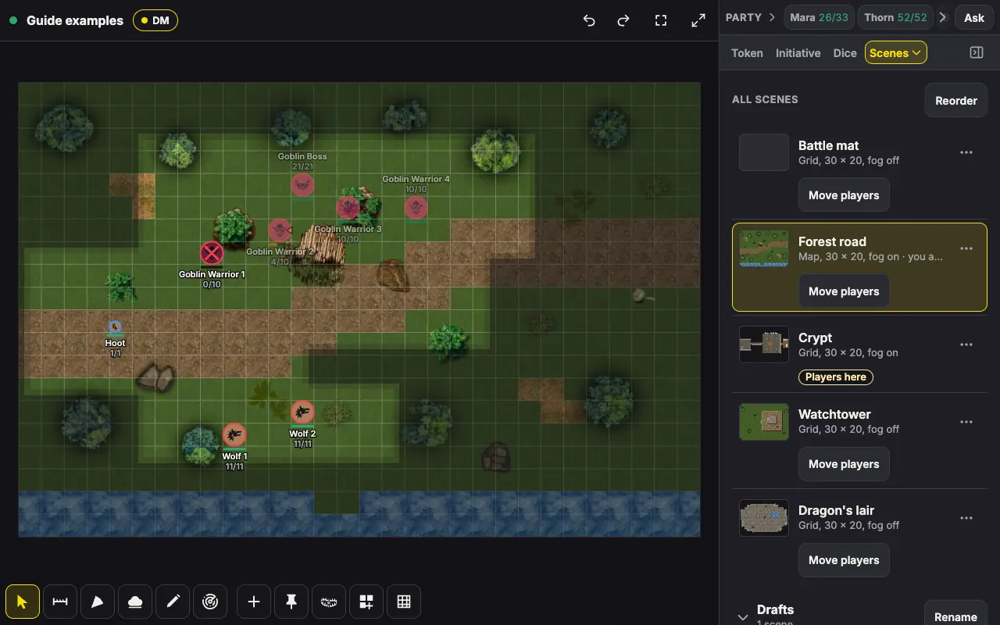

**Viewing and moving.** Tapping a scene's row shows it to you alone. Players stay where they are, so you can prepare the next scene while they play this one. **Move players** under a row sends every player there, and that row then reads **Players here**. Moving players moves their view, not their tokens: place the party's tokens on the new scene with **Place a token** in Characters, or let players place their own. Before the move, the app warns when players would see the whole map (fog off) or nothing (party vision with no character who can see).

### Making a scene

Under **New scene**, pick one:

- **Battle mat**: a blank grid. Set **Squares across** and **Squares down** (30 × 20 by default, up to 200 each) and a background color. Fog starts off.
- **Map image**: pick an image (JPEG, PNG, WebP, GIF or AVIF, up to 32 MB) and press **Upload and create**. Leave the name blank to take it from the file. Fog starts on, and the scene fits the image's whole squares. **Or use a map already uploaded** reuses an image from the room.
- **Builder**: an empty 40 × 30 scene that opens the map builder at once. Fog starts on.
- **From a Universal VTT file**: see [Map phases, imports and exports](#map-phases-imports-and-exports).

A map's file name can set its scale: `crypt_30x20.jpg` makes it 30 by 20 squares. Without that, the app guesses about 30 squares along the long side and opens **Line up grid** so you can fix it.

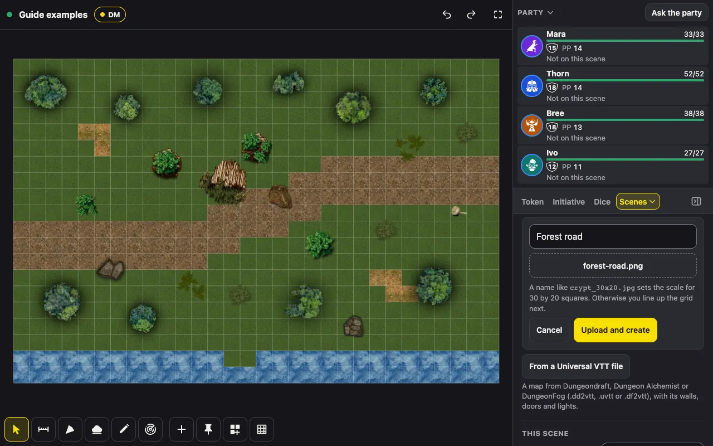

### This scene

The settings under **All scenes** and **New scene** belong to the scene on your screen:

- **This scene**: **Scene name** (players see it), **Map image** (**Add a map image**, **Replace map image**, **Remove map image**), the **Fog** switch, **Starting view** (**Save current view** saves your current framing as where the scene opens for everyone), **Size in squares** and **Background**.
- **Map phases**: other images of the same map. See [Map phases, imports and exports](#map-phases-imports-and-exports).
- **Vision**: **Party vision** and **Light**. See [Light and party vision](#light-and-party-vision).
- **Grid**: **Grid lines**, **Grid color**, **Opacity**, **Line width**, and on a map image **Line up the grid** and **Or count the squares**.
- **Movement**: **Walls and ledges block players' moves**, on for new scenes. A player's drag then stops at walls, closed doors and ledges. Your own moves are never stopped.
- **Map builder**: **Open the builder**, **Clear the build** and **Automatic walls**.
- **Export as image**, and **Delete scene**.

Players see a scene's name, so don't name it after a surprise. Replacing the map image of the scene players are on shows them the new image as soon as it uploads, so the app asks first.

Each scene's **⋯** (More for the scene) holds **Duplicate…**, **Move to folder…** and **Update thumbnail**. Duplicate always copies the map, its phases and the build, and lets you choose **Monsters, NPCs and objects** (on), **Player characters**, **Fog** and **Drawings and placed areas**. Folders fold with a tap, and players never see folders or thumbnails. **Reorder** at the top of the list moves scenes and folders up and down.

Feet per square and the diagonal rule are room settings, not scene settings: Menu, **Room settings**, **Grid and distance**.

## Lining up the grid

Use this when a map image has a grid drawn on it, so tokens, rulers and areas match the drawn squares.

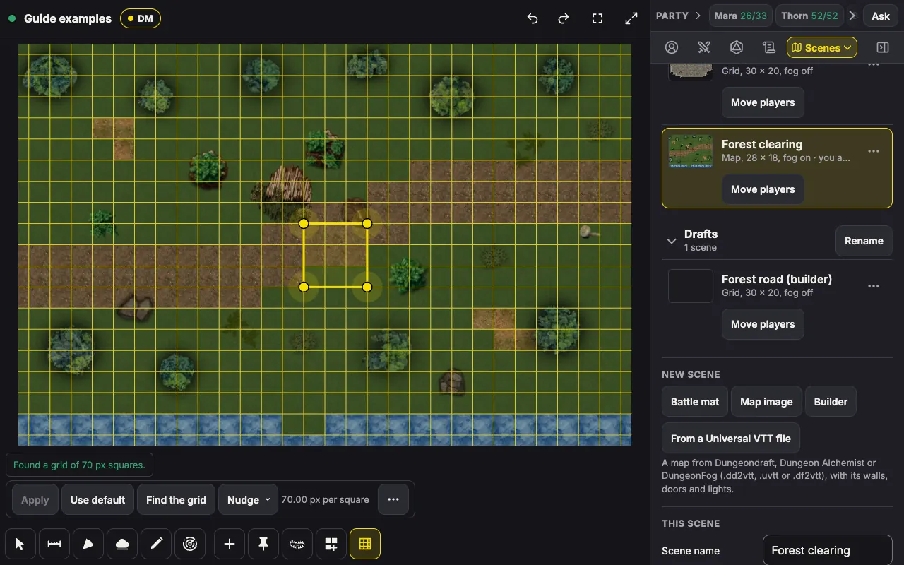

1. Pick **Line up grid** in the toolbar (behind **Setup** on a phone), or **Line up the grid** in the scene's **Grid** settings. A new map scene without a size in its file name opens it for you.
2. Drag a box over 3 by 3 squares of the art. Drag inside the box to move it, or a corner to resize it. A tap moves the box to the squares you tapped. The proposed grid draws over the whole map as you go.
3. Fine-tune with **Nudge**: it moves the box, or makes the squares smaller or larger, a pixel at a time.
4. Press **Apply**. "Grid saved at 70 px per square" confirms it. **Apply** stays off until you change something, so when the first guess is already right, just pick another tool.

Under **⋯**, **Resize scene** (on by default) also sizes the scene to the squares the map covers, and **Grid lines** turns the app's own lines on or off. Turn them off for art that has its own grid. Tokens and rulers still follow the squares.

For art whose squares run edge to edge, you can type the count instead: in the scene's **Grid** settings, **Or count the squares**, enter the squares across and down the image, and press **Apply**.

Apply and the resize are two undo steps.

## The map builder

The **Map builder** tool (`B`, behind **Setup** on a phone) paints a map square by square: floors, walls and doors, heights, labels, lights and stamps. The app understands what you build. Walls block movement, sight and areas, doors open and lock, and raised ground counts for movement, sight and areas. You can build a whole map, or build over a map image to give its walls and cliffs to the app.

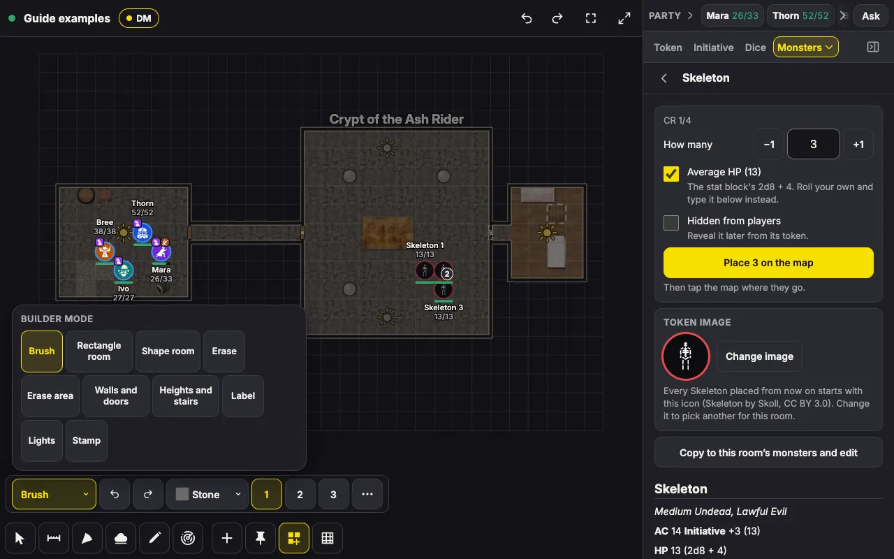

Open it from the toolbar, or with **Open the builder** in the scene's settings. **Builder mode** picks what a tap or drag does:

- **Brush**: drag to paint. **Terrain** picks the floor (Stone, Wood, Grass, Dirt, Cave) or terrain (Water, Difficult, Rubble, Pit, Pillar, Stairs). **Brush size** is 1, 2 or 3 squares.
- **Rectangle room**: drag from corner to corner.
- **Shape room**: tap corners, then tap the first one (or **Close room**) to close it. **Undo corner** takes the last one back.
- **Erase**: drag to clear squares and everything on them: floor, walls, doors, windows, heights, stairs, labels, stamps and lights. **Erase area** clears a rectangle.
- **Walls and doors**: see [Walls and doors](#walls-and-doors).
- **Heights and stairs**: see [Heights and stairs](#heights-and-stairs).
- **Label**: type the text, then tap the map. **Label size** is S, M or L. Tap a label in this mode to edit or delete it, or drag it to move it. With the Select tool, a tap on a label opens it too.
- **Lights**: see [Light and party vision](#light-and-party-vision).
- **Stamp**: **Choose a stamp** picks one of 46 shipped pictures (trees, bushes, rocks, campfires, furniture, barrels) or any token image in the room's library, then tap the map. A placed stamp drags to move, and its handles turn and resize it. With it picked, the row has **Tint**, **Flip**, **Bring to front**, **Duplicate**, **DM only** (hide it from players), **Delete** and **Done**. **Snap** turns in 15° steps and moves in half squares.

**Undo** and **Redo** in the builder's row are the same undo as everywhere else, one step per stroke or room. **Clear build**, under **⋯**, removes the whole build, imported walls and lights included.

Limits per scene: 100 lights, 500 stamps and 500 labels. A scene is at most 200 by 200 squares.

**Rooms that touch merge** into one floor, with no wall between them. To split two rooms, leave a gap and join them with a corridor, or draw a wall or a door on the shared edge.

## Walls and doors

**Automatic walls.** Walls go up on their own around what you paint. The scene's **Automatic walls** setting (in **Scenes**, under **Map builder**) picks:

- **Around every painted cell**: a wall wherever painted ground meets unpainted ground. The default for battle mats and builder scenes.
- **Around floor only**: only stone, wood, grass, dirt and cave get walls. Use it to paint water, rubble or pits over a map image without walling them in. The default for map image scenes.
- **Off**: only the walls and doors you draw. The default for a Universal VTT import, which brings its own.

**Drawing walls, doors and windows.** Pick **Walls and doors**, then an **Edge**:

- **Wall**, **Window**: tap a square's edge, or drag along a grid line for a run. Tap again to take it off. Windows block movement and areas, not sight.
- **Door**: tap an edge for a closed door, or drag for a wide one. Tap a door to step it through closed, open and locked.
- **Secret door**: pick **Hidden** (players see a wall) or **Found** (players see a door), then tap an edge.
- **No wall**: tap or drag along an automatic wall to take it away, for an opening.
- **Remove**: takes off walls, doors, windows and No wall marks. Automatic walls come back.

**During play**, with the **Select** tool, tap a door. Its pill names it ("Locked door", "Closed secret door, hidden") and offers **Open** or **Close**, **Lock** or **Unlock**, and on a secret door **Mark found** or **Hide**.

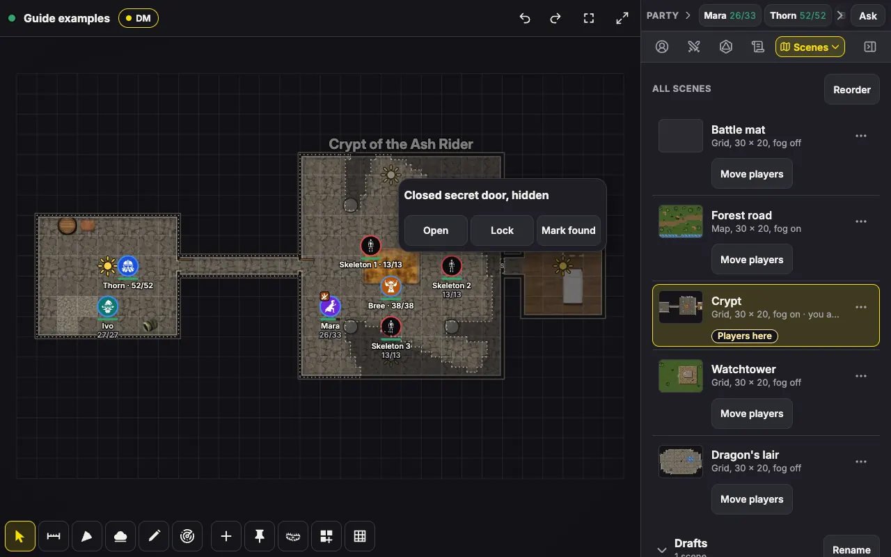

Players open and close unlocked doors their token can reach (5 ft, with a clear line to the door), by tapping it or with **Open door** in their token's action bar. A locked door answers "It's locked."

What blocks what:

- Walls and closed or locked doors block movement, sight and areas.
- Windows block movement and areas, not sight.
- Pillars block movement and sight, not areas.
- A secret door not yet found is a wall to players, even when open.

Movement is blocked only for players, and only with **Walls and ledges block players' moves** on. A player whose drag is stopped can choose **Teleport here** for Misty Step and the like. You get a notice and a log line when they do.

## Heights and stairs

Pick **Heights and stairs** in the builder. **Paint** chooses **Height** or **Stairs**, and **Brush** is 1, 2 or 3 squares, or **Area** for a rectangle.

- **Height**: set it with **5 ft lower** and **5 ft higher** (hold to step quickly), from 20 ft down to 100 ft up. Drag to paint. **Ground (clears)** paints it back to 0. Tokens standing there rise or sink with the ground.
- **Stairs**: **Stairs point** picks **Auto** (each stair points toward its one higher neighbor) or an arrow. Where Auto can't tell, a "?" shows when you zoom in: pick an arrow and paint it again. The Stairs terrain from the Brush is a stair too.

While this mode is open, each raised or lowered area shows its height in a pill ("↑10 ft"). In play, tap ground with **Select** to read its height for a few seconds ("↑10 ft", "Stairs · ↑5 ft"). Raised ground looks lighter and casts a shadow.

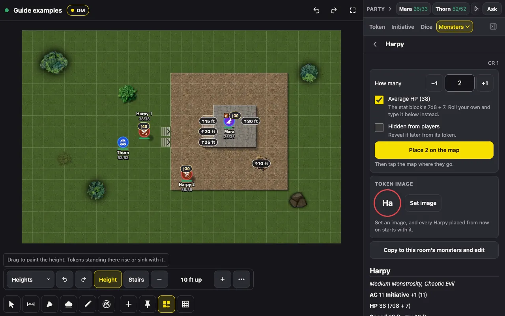

What heights do:

- A walking token crosses a ledge only by a stair, with **Walls and ledges block players' moves** on. A flier above the ledge passes.
- A creature sees over a ledge no higher than its eyes. One in a pit can't see out.
- A token placed, dropped or duplicated on raised ground stands on it.
- Rulers, distances and areas count the height.

Heights go over a map image too, so you can raise the cliff drawn in the art.

## Light and party vision

Fog you reveal by hand shows players whatever you uncover. **Party vision** instead shows players what their characters see, by their senses, the walls and the light. Turn it on in the scene's **Vision** settings.

- **Party vision** on: players see only what their characters see, and remember ground they explored, drawn dimmed and without creatures. Ground never seen stays fogged. It turns fog on too.
- **Light**: **Bright** (lit everywhere, as by day), **Dim** or **Dark**. Light matters only with Party vision on.
- **Who lends the party sight** lists the party's creatures on the scene, with their senses and light. Mark an allied NPC with **Shares sight with the party** in its token's **Sight** section to add it.

Darkvision, blindsight and truesight come from each creature's senses (its stat block, or **Senses** in its Stats). Darkvision shows darkness in gray.

**Lights** come from the builder and from tokens:

- In the builder's **Lights** mode, pick a light in **Light to place** and tap the map: Candle (5 ft bright, dim to 10 ft), Torch (20, dim to 40), Lamp (15, dim to 45), Hooded Lantern (30, dim to 60), Light (20, dim to 40) or Daylight (60, dim to 120). Tap a light to change its reach, turn it **Lit** or **Out**, choose whether **Walls cast shadows**, name it, or delete it. Drag it to move it. Players see the light it gives, never the light itself.
- A token carries a light from **Light** in its action bar, or **Sight** in its panel: Candle, Torch, Lamp, Hooded Lantern, Light or Custom. A scene lights up to 20 token lights.

To check what players see, use **View as a player** or **Party sight** in the [DM panel](#dm-panel). Your own map stays fully lit.

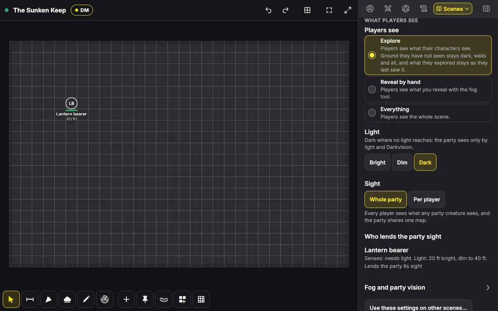

## Fog

A map image or builder scene starts fully fogged. You see the fog as a translucent layer. Players see nothing under it, and tokens, labels and stamps under the fog never reach them.

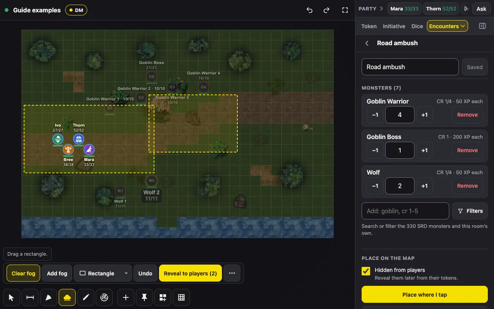

1. Pick the **Fog** tool (`F`).
2. **Clear or add fog**: **Clear fog** to reveal, **Add fog** to hide.
3. **Shape**: **Rectangle** (drag), **Polygon** (tap corners, tap the first to close), **Brush** (drag, 5, 10 or 20 ft wide) or **Builder room** (tap a room made with the map builder to reveal it whole).
4. Your edits are a private draft, drawn as dashed outlines. Press **Reveal to players** (or **Show players the changes**) to publish them. **Undo** takes back the last draft edit, **Discard** throws the draft away.

**When players see edits**: **Draft** (the default) or **Live**, where each edit shows at once. Under **⋯**, **Fog all** and **Reveal all** cover or clear the whole scene for players (tap twice).

With party vision on, players' fog also keeps what the party explored. **Add fog** can't hide explored ground again. Only **Fog all** makes players forget it, and undo doesn't bring that memory back.

Builder room fills everything joined to the room you tap. Only walls, windows and closed doors stop it, so close the doors between rooms first.

## Map phases, imports and exports

**Map phases** are other images of the same map, such as night, or the village on fire. Tokens, fog and the build stay put when the image changes, and players get only the phase showing. A map scene has up to 8.

1. In the scene's **Map phases** section, press **Add a phase** and pick an image the same shape as the map. The current image is the first phase, "Day".
2. With two or more, a row of chips switches the phase with one tap. On a computer, the **Phase** menu in the top bar does the same.
3. **Edit** renames a phase, moves it, or removes it.

A phase can set the scene's light: under **Vision**, **Light with each map phase** picks Bright, Dim, Dark or **Leave the light** for each. Switching to Night can then make the scene dark. It doesn't turn party vision on by itself.

**Universal VTT files.** **From a Universal VTT file** under New scene takes a `.dd2vtt`, `.uvtt` or `.df2vtt` file from Dungeondraft, Dungeon Alchemist or DungeonFog. It reads the file, then shows what it found ("412 walls (380 on the grid, 32 free), 14 doors, 3 windows, 9 lights") before anything is made. Choose:

- **Objects block sight and movement** (when the file has objects).
- **Portals that don't block light import as** **Windows** or **Open doors**.
- **Start under fog**.
- **Light, for party vision**: the app suggests Bright, Dim or Dark from the file. Party vision stays off until you turn it on.

**Create scene** makes it. Keep the page open until the walls are added. One undo takes the whole import back. A phone takes files up to 40 MB, so import large maps on a computer. An imported scene has **Automatic walls** off, since the file brings its own walls.

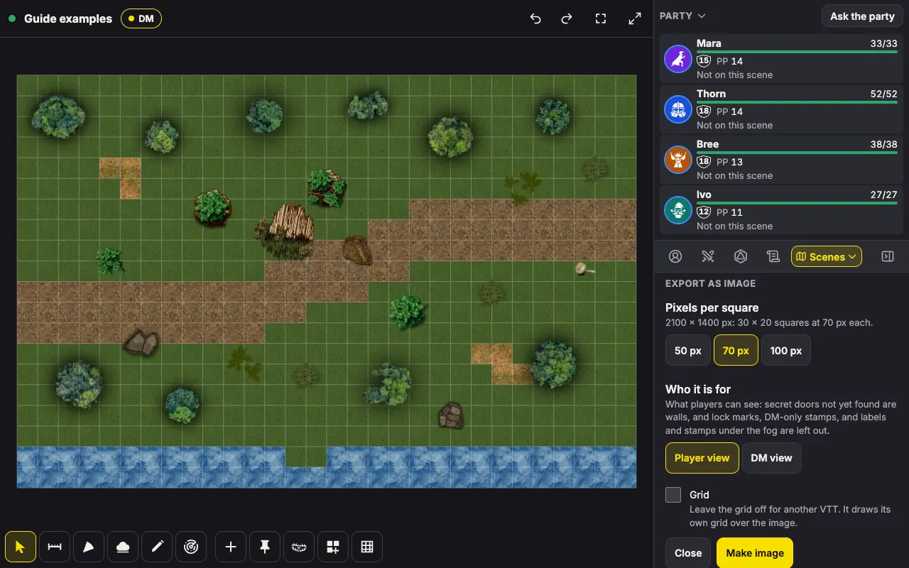

**Export as image** (in the scene's settings) saves the map image and the build as a PNG, without tokens, drawings or fog. Pick **Pixels per square** (50, 70 or 100), **Player view** or **DM view** (the player view draws undiscovered secret doors as walls and leaves out DM-only stamps and lock marks), and **Grid**. Press **Make image**, then **Download**. The file name carries the grid size, such as `crypt-30x20-70px.png`, so other VTTs and this one set the scale on import.

# Running fights

## Monsters

**Monsters** (DM only) holds the 330 monsters of the SRD 5.2.1 and the room's own. Use it to find a stat block and put monsters on the map.

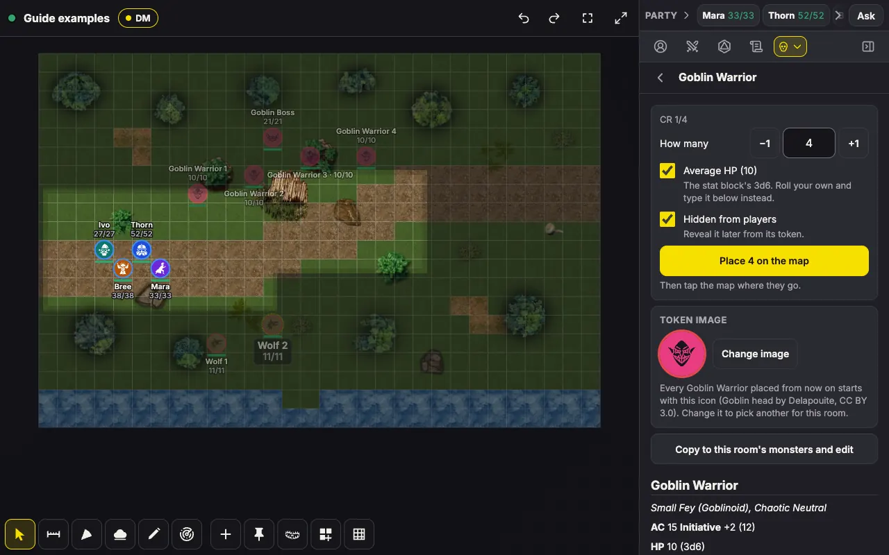

**Finding one.** Type in **Search** (`goblin`, `undead`, `huge`). Words match the name, type or size. Add a challenge rating in the search: `cr 5`, `cr 1-5`, `cr 1/2-3`, `cr 10-`. **Filters** adds challenge rating, creature type, **Legendary**, **Has a lair**, size, immunities, resistances, vulnerabilities, movement, senses and alignment. Filters stay on for this room on this device, and the encounter builder shares them, so clear them when a list looks short. The SRD names are the 2024 ones: "Goblin Warrior", "Goblin Boss", "Bandit", "Wolf".

**Placing it.** Tap a monster to open its page, then on its place card:

1. Set **How many** (1 to 20).
2. Keep **Average HP** or untick it and type **HP for each**. The app doesn't roll HP.
3. Tick **Hidden from players** for an ambush. Players never receive hidden tokens.
4. For a monster with a lair, tick **In its lair** to give it its lair's legendary uses and XP.
5. Press **Place on the map** (or **Place 4 on the map**), then tap the map. The copies spread to the nearest free squares around your tap.

Copies are numbered: "Goblin Warrior 1", "Goblin Warrior 2". Each placed token is its own undo step.

**The room's own monsters.** **New monster** opens the editor, and **Paste a stat block** opens it with a box for text copied from a book the group owns. **Read the stat block** fills the fields from it. It reads the 2024 and 2014 layouts, and lists what it guessed ("No initiative was given, so it is the Dexterity modifier."). Check the fields, then **Save**. Room monsters stay in this room and its backups, and players never see their stat blocks. An SRD monster's page offers **Copy to this room's monsters and edit** to start from it.

For legendary monsters, the editor reads two names: a trait named "Legendary Resistance (3/Day, or 4/Day in Lair)" and a first legendary action named "Legendary Action Uses: 3 (4 in Lair)". Tokens then get those uses. There is no separate lair actions section.

**Token image.** On a monster's page, **Token image** sets the picture every new token of that monster starts with. **Apply to N tokens on this scene** puts it on the ones already there.

## Encounters

**Encounters** (DM only) prepares fights ahead: which monsters, how many, and how hard they are for the party. Players never see encounters, only the tokens you place.

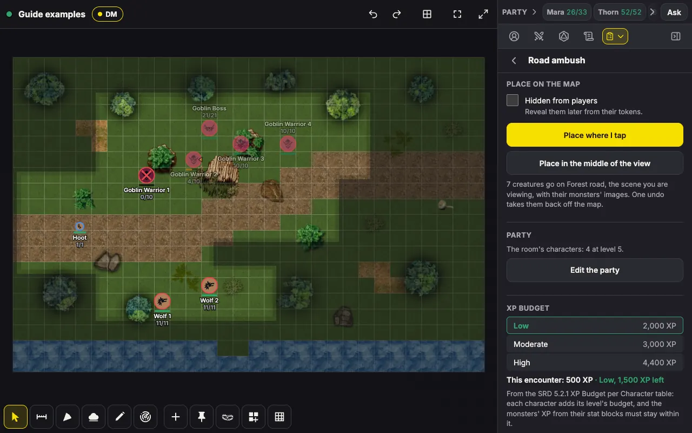

1. Press **New encounter** and type a name ("Ambush at the ford").
2. Search under **Add** (`goblin`, `cr 1-3`) and tap a monster's **+** once for each copy. Each line has a count to change and **Remove**.
3. Read the **XP budget**: **Low**, **Moderate** and **High** for the party, with the row the encounter fits outlined and "This encounter: 1,250 XP · Moderate, 250 XP left". The party is the room's characters, by their levels. **Edit the party** budgets for a different group (rows of "Characters" at "Their level").
4. Press **Save encounter**.

**Placing it.** Open the encounter, then in **Place on the map**:

- Tick **Hidden from players** to place them unseen.
- While a fight runs, **Add them to the fight** (on) gives them rows in the tracker, identical monsters grouped for one initiative.
- **Place where I tap**, then tap the map, or **Place in the middle of the view**.

They go on the scene you are viewing, with average HP and their monsters' images, the biggest nearest the tap. One undo takes them all back off the map. An encounter can hold up to 50 creatures of 20 kinds.

Leaving the editor with unsaved changes asks "Discard changes?" first.

## Tokens

Tap a token with the **Select** tool to open its **action bar**: under the token on a phone held upright, or as a window at the bottom right of the map on a wider screen (drag its header to move it). The **Token** panel shows everything about the selected token.

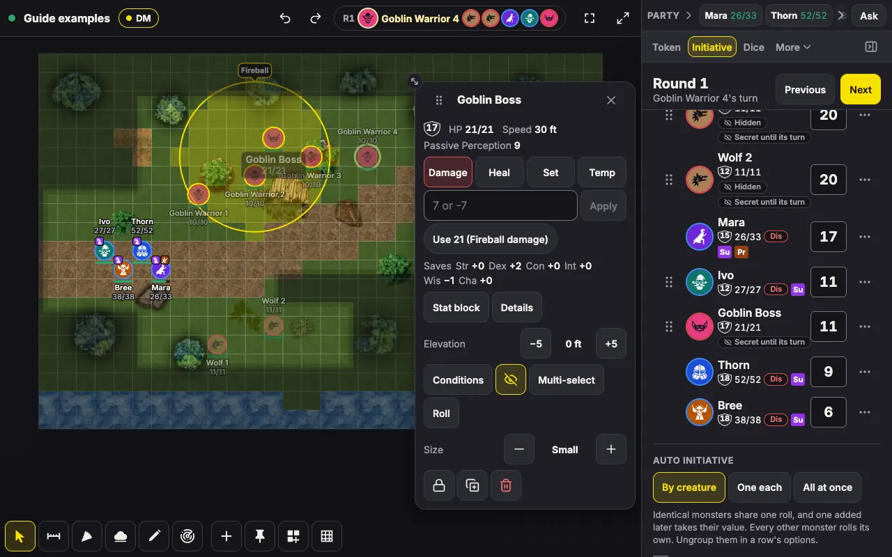

The action bar, top to bottom:

- AC, HP, speed and passive Perception, then the **HP entry**. For a monster or NPC you also see its six saves and its resistances, immunities and vulnerabilities. On a short bar, **More stats** holds the rest.
- **Stat block** opens the full block in the Token panel. **Details** opens the Token panel.
- **Elevation** (**−5** and **+5**, or Page Down and Page Up).
- **Conditions**, **Hidden** (hide it from players), **Multi-select**, **Roll** (its roll options in the Dice panel) and **Light**.
- **Size** steps it a size smaller or larger, for Enlarge, Wild Shape or a polymorph.
- **Locked** (nobody can drag it, you included), **Duplicate** and **Delete**.

`H` hides or shows the selected tokens, `L` locks them, and Delete removes them (Ctrl+Z brings them back). Arrow keys move the selection one square.

The **Token** panel, top to bottom: the name and image, the stat block for a monster or NPC, **Hit points**, **Conditions**, **Position** (elevation and facing), **Range rings** (up to 4, such as 30 and 120 ft), **Notes**, **Rest** and **Sight**. Folded at the foot: **Stats** (size, AC, speeds, initiative bonus, passive Perception, senses), **Token settings** and **Owners**.

**Token settings** (yours alone):

- **Name**, and **Hide the name from players** with a **Name players see** ("Unknown creature").
- **Kind**: Player character, NPC, Monster, or Object or marker. **Ring**: ally, neutral or hostile.
- **Layer**: Creatures, or Objects, under creatures.
- **Players see HP as**: **Nothing**, **Healthy, Bloodied, Dying, Dead**, **A bar** or **Exact numbers**. Monsters start with the labels.
- **Hidden from players**, **Locked**, **Always visible, even under fog**, and **Height** for a creature taller or shorter than its size.
- **Make a companion**: see [Companions](#companions).

**Notes** has three fields: **For everyone** (every player who can see the token), **On the card** (you and the token's owners) and **For DMs only**.

### Several tokens at once

Select several tokens to act on all of them:

- **Multi-select** in a token's action bar, then tap more tokens, or drag a box on empty map.
- With a mouse, Shift or Ctrl and a click adds a token (Cmd on a Mac), and Shift or Ctrl and a drag on empty map draws a box.

Drag any of them to move them all. The group's action bar has one **HP entry** for all of them, **Conditions**, elevation, and for you **Roll**, **Request a roll**, **Hidden**, **Locked**, **Start a fight** or **Add to the fight**, **Delete** and **More** (ring, size, layer, image, what players see, owners). Each change to the group is one undo step. **Done** in the Multi-select bar ends it.

## HP, damage and conditions

**HP.** Type in the HP entry and press **Apply**:

- `-7` deals 7 damage (temporary HP go first), `+5` heals 5, `=20` sets HP to 20, `t5` gives 5 temporary HP. Terms add up: `-7-3` is 10 damage.
- Or pick **Damage**, **Heal**, **Set** or **Temp** and type a plain number.
- After a roll, chips such as **Use 9 (Longsword damage)** fill the entry with the newest damage, yours or a player's.
- With several tokens selected, one entry applies to each of them.

At 0 HP a monster dies ("Monsters die at 0 HP", on by default), and a character starts death saves. Damage that leaves at least the creature's max HP over kills outright. **Critical hit (two failed death saves)** shows in the entry for a creature at 0 HP. A dead creature's bar offers **Revive**, which brings it back with 1 HP, and healing brings the dead back too while "Healing brings back the dead" is on. The Token panel's **Hit points** section has **Revive**, **Stabilize** and **Mark dead**, and the death save pips.

Every HP change goes into the fight's **HP changes** list, where you can take one back. See [Initiative](#initiative).

**Conditions.** **Conditions** in the action bar opens a grid: the 15 conditions of the 2024 rules and other statuses (Concentrating, Hidden, Flying, Dodging, Raging, Blessed, Baned, Hasted, Hunter's Mark, Hexed, Heroic Inspiration, Surprised, Marked, Readied action). One tap adds or removes. Exhaustion goes on at level 1. Don't confuse the **Hidden** status (the creature took the Hide action) with **Hidden** in the bar, which hides the token from players.

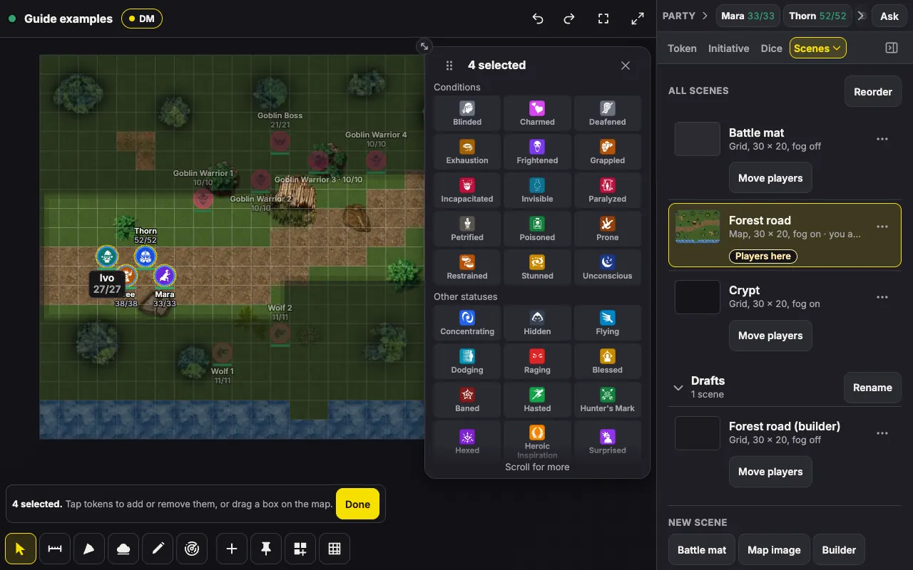

For more, use **Add** in the Token panel's **Conditions** section. Pick a condition to see its rules text, then set:

- **Exhaustion level** (1 to 6) or a **Counter** (rounds or charges left, shown on the icon).
- **Spell** for Concentrating ("Concentrating: Bless").
- **Duration**: a number of rounds, or until the start or end of a chosen creature's next turn. Durations count down with initiative, and everyone is told when one ends.
- **A Wisdom save at the end of each of its turns ends it**, with the save and its DC. See [Alerts during a fight](#alerts-during-a-fight).
- **Hidden from players**: nobody but you sees it, the creature's owner included, and the log keeps it to you.
- **Custom status**: a label, up to 2 characters or an emoji for the icon, and a color.

A creature can carry up to 32 conditions and statuses.

**Concentration.** A concentrating creature that takes damage gets a Constitution save prompt with its DC (the higher of 10 and half the damage, at most 30). The prompt goes to whoever answers for the creature: its player, or you for a creature no player plays.

## Initiative

**Initiative** runs the fight: who is in it, the order, turns and rounds. Players see the order too, without hidden creatures, monsters' dice or anything they can't see. In a new room they see a monster's place in it only once its turn comes (see What players see of the order, below).

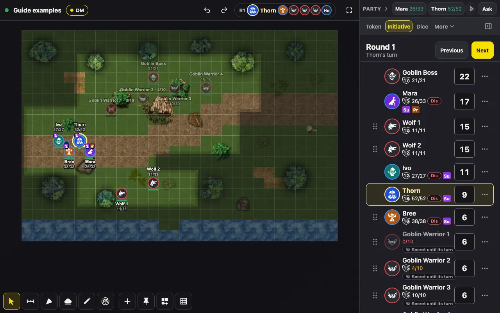

### Starting a fight

With no fight running, **Start a fight with** offers:

- The selected token's name: just that token.
- **Everyone here (N)**: every creature on the scene, hidden ones included (their rows start hidden). Objects, the dead and companions that act on their character's turn stay out. Companions with their own turn come in.
- **Visible to players (N)**: the same, without hidden tokens and anything under fog or out of the party's sight.
- **Nobody yet**: an empty fight to fill later.

With two or more tokens selected on the map, their action bar has **Start a fight**, or **Add to the fight** once one is running. While a fight runs, the panel's **Add to the fight** section has the same three choices. Players add their own creatures with **Join the fight**.

### Initiative values

- A row's box reads **Set** until it has a value. Tap it, type the number, press Enter.
- **Roll +2** on a row rolls its initiative on the server. Players roll for their own rows, and you for the rows no player plays. Where the row is narrow, the roll waits in the row's **⋯**. Once a row has a value, its **⋯** offers "Roll again, replaces 17", so a stray tap never reorders the fight.
- **Auto initiative (N)** rolls for every monster still waiting. **How monsters share rolls** picks **By creature** (identical monsters share one roll, the default), **One each** or **All at once**. **Re-roll monsters that have a value** rolls them again. The dice show to you alone, and players see each visible monster's total once its place in the order is theirs to see.
- **Type several values** opens one box per row for initiatives rolled at the table, Enter moving to the next.
- **Monsters use initiative scores** gives monsters 10 + their Dexterity modifier instead of a roll.

Each roll is a d20 plus the creature's modifier, with advantage or disadvantage from its conditions (Invisible, Surprised, Incapacitated). The row shows an **Adv** or **Dis** badge, and its **⋯** sets the reminder by hand.

The order runs high to low. New rows put characters before monsters on a tie. Tied rows show a drag handle, and their **⋯** has **Move up** and **Move down**, so you settle ties without changing values.

### Running turns

1. Press **Start**. The first creature's row is tinted and its token gets a turn marker.
2. Press **Next** (or `N`) at the end of each turn. **Previous** steps back up to 20 turns, restoring what the turn changed.
3. The round counts up when the order wraps.

On each **Next** the app clears the new creature's **Reaction used**, refills its legendary actions, counts down durations, reveals it if it was hidden (with the room setting on), and raises save-ends reminders for the creature whose turn ended. With "Skip defeated creatures" on, the dead are passed over.

On their own turn a player gets "Your turn" and an **End turn** button. Under the top bar, or as a chip in it on a wide screen, a strip shows whose turn it is, and to you alone who comes next. Tap it to open the tracker. **Camera follows the turn**, under **This device**, pans your map to whoever acts.

**Hidden rows.** Turning a token's **Hidden** off, in its action bar, a group's bar, its panel or with `H`, shows its row to players too. Otherwise a hidden creature's row shows at its first turn (with "Reveal hidden combatants on their turn" on). A row also has its own **Hidden from players** in its **⋯**, which hides the row alone while its token shows. The row then still follows **Initiative order players see** (below): in a new room a monster's row reaches players only from its first turn, so turning **Hidden** off before then shows its token at once and its row on its turn. Pick **Everyone** there for the row to show with the token.

### Rows and what they hold

Tap a row to select its token and open its action bar. A row's **⋯** holds, for you:

- **Hidden from players**, **Reaction used** (clears at the start of its turn) and **In lair** (a "Lair" tag on the row that players see too).
- The Ready controls: type a trigger ("if the door opens") and press **Ready**. The row and token show "Readied" until its next turn. Players see the trigger only for a creature a player plays, or when you turn on **Show the trigger to players**. **It fired: Reaction used** ends it and marks the reaction.
- For a legendary monster, **Legendary actions used** and **Legendary resistances used today** as pips you tap. The row's "LA 3/3" and "LR 2/3" tags show what is left, to you alone.
- **Revive** for a dead creature, which brings it back with 1 HP.
- **Remove from the fight**.

**HP changes**, under the order, lists each HP change of the fight ("Goblin Warrior 2 takes 7 damage, 3/10 left."). **Undo** on a line takes that change back while the creature is still as it left it. **Several at once** turns on multi-select, so one HP entry hits every row you tap.

### What players see of the order

**Initiative order players see**, in Room settings under Combat, decides which rows players hold before those creatures act:

- **Player characters, the rest on their turn**, the default in a new room. Players see the creatures players play from the start: their characters and their companions. A monster or NPC you lend a player shows from the start to that player alone, and to the others on its first turn. Every other creature, your NPCs and allies included, joins their order when its first turn comes, in its place, and stays for the rest of the fight, whatever its value becomes. Before that nothing of it reaches them: no row, value or count, and no initiative roll for it, even one you roll with Secret off.
- **Player characters and allies, the rest on their turn**: the same, and every creature with the Ally ring shows from the start.
- **Everyone**: the whole order from the start, which rooms made before the setting keep.

A creature added mid-fight waits for its own turn, and a dead one that "Skip defeated creatures" passes over never shows. **Previous** back past a creature's first turn takes it out of their order again. A row that is **Hidden from players** stays out whichever you pick. Your tracker tags each row players do not see yet **Secret until its turn**. **View as a player** in the DM panel shows the order as they see it. Players never see who comes next, so the strip gives no creature away.

### Ending it

**Turn timer** (Off, or 30 seconds to 10 minutes) counts each turn down for everyone and nudges whoever acts. It never ends a turn. **End the fight**, tapped twice, ends the fight. Undo brings it back.

## Dice

Every roll in the app happens on the server, so everyone sees the same result. Players can still roll real dice and type totals where the app asks for one, unless you turn off **Players may type their roll totals** in Room settings. The **Dice** panel is for everyone.

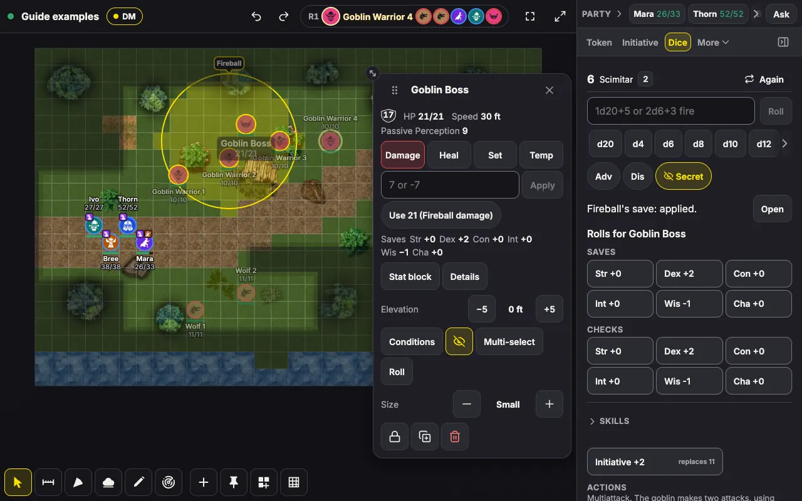

**Typing a roll.** Type a formula in the field and press **Roll** or Enter: `1d20+5`, `2d6+3 fire` (words after the formula are its label), `4d6kh3` (keep the three highest), `4d6dl1` (drop the lowest), `d%`, `1d20+5 Stealth adv`. The line under the field reads the roll and its range before you roll it ("2d6+3, fire: 5 to 15"). The quick dice add a die to the field. Up and Down step through the formulas you rolled.

**Adv**, **Dis** and **Secret** apply to the next roll only, then turn off. A secret roll shows to the DMs in full, and other players read only "Dana rolled in secret." Your rolls for a monster start secret: with a monster selected, a typed formula starts secret too. With nothing selected, or a character, it starts in the open.

The newest roll stays at the top with its dice, and **Again** rolls it once more. **Recent rolls** lists the rolls in the log, newest first. Others' rolls show as short notices while your Dice panel is not on screen (Menu, **This device**, **Show others' rolls as they happen** turns them off).

### Roll options

Select one token, or press **Roll** in its action bar, and the Dice panel lists its rolls from its stat block, under **Rolls for Goblin Warrior 1**:

- **Saves**, **Checks** and **Skills**, each with its bonus. Conditions apply on their own and say so ("Dis: Restrained", "+1d4: Blessed", "Fails: Stunned").
- **Initiative**, which sets its row in a running fight ("Initiative +2, sets its row", or "replaces 14").
- **Death save** while it is dying.
- Its traits, actions, bonus actions, reactions and legendary actions. An attack has **Attack +5** and **Damage 1d6+3**: a natural 20 turns on **Critical** for the damage that follows, which rolls by the room's **Critical hit damage** rule (see [Room settings](#room-settings-for-fights-and-maps)), and riders such as **+3d6 Sneak Attack** are chips to add. A save action has **Group save, DC 13 Dex**, which opens the [group save](#the-group-save). Multiattack is a note at the head of the actions: roll each attack it names.
- An action that recharges shows **Recharge 5–6** and a **Used** switch. Rolling its damage or its group save marks it used. **Recharge 1d6** rolls the recharge, and the app reminds you at the start of the monster's turn. See [Alerts during a fight](#alerts-during-a-fight).
- For a character with a stat block: its weapons and spells, **Spell save DC**, **Spell attack**, and a slot level for spells that scale.

A damage roll offers its total in every HP entry as **Use 9**, so you apply it with one tap.

For a creature a player plays, **Ask Thorn to roll** (on by default) makes a save or check tap open [Request a roll](#asking-for-rolls) for that player instead of rolling it yourself. Turn it off to roll for them.

### Several creatures

With several tokens selected, the Dice panel offers group rolls: one save or check for all of them against an optional **DC** ("Dex save for 4"), **Initiative for the 4 in the fight**, and **Shared attacks**, an attack every selected monster has ("Scimitar for 4") against a **Target's AC**, then **Roll damage for 2 hits**. A group save or check opens the [group save](#the-group-save) page, where monsters roll on the server and players are asked.

## Asking for rolls

**Request a roll** asks players for a saving throw or an ability check. Each player rolls it in the app or types the total they rolled at the table, while **Players may type their roll totals** is on.

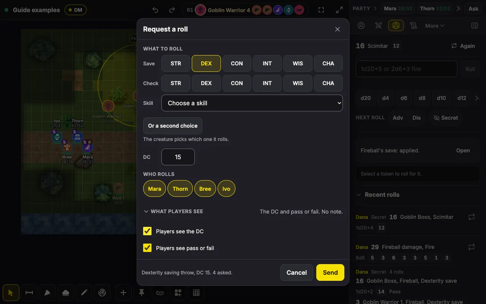

Open it with **Ask the party** in the party bar (above the side panel's tabs on a computer, where it reads **Ask** while the bar is folded, or the **Party** panel on a phone), with **Request a roll** in the action bar of several selected creatures, or from one creature's roll options with **Ask Thorn to roll** on.

1. Pick what to roll: **Save** or **Check** by ability, or a **Skill** (it starts at its usual ability, and **with** changes it). **Or a second choice** lets the creature pick, such as Athletics or Acrobatics.
2. Type the **DC**, or pick a typical one for a check (5 Very easy to 30 Nearly impossible), or leave it empty.
3. Check **Who rolls**. **Ask the party** starts with the characters on the players' scene.
4. Under **What players see**: **Players see the DC**, **Players see pass or fail**, **Against a spell** (for Magic Resistance), and a note ("against the poison").
5. Press **Send**. **Recent** keeps your last three requests, one tap each.

Players get a card with the question, roll with their bonus (conditions and Bless included), or type a total where typed totals are allowed. Your live card, at the right of the map, counts the answers ("2 of 4 answered: 1 pass, 1 fail") and shows each roll. On it you can:

- **Roll +5** for a player who is waiting, such as one who stepped away. It never replaces an answer that came first.
- Mark **Pass** or **Fail** yourself, for a roll with no DC or to overrule one.
- Answer a player's ask, such as "Asks to reroll (Heroic Inspiration)", with **Allow** or **Keep**.
- **Reopen for one more answer**, **Close**, or **Close all answered**.

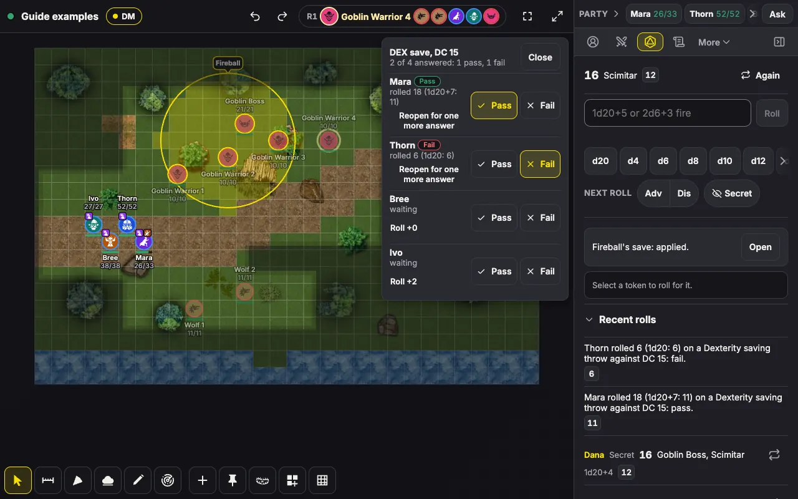

Only you and the creature's player see an answer. Up to 20 requests can be open at once.

## Areas

The **Area** tool (`A`) draws areas of effect: spells, breath weapons, auras. The **Areas** panel lists the ones placed on the scene. An area counts who is in it, in three dimensions, and stops at walls.

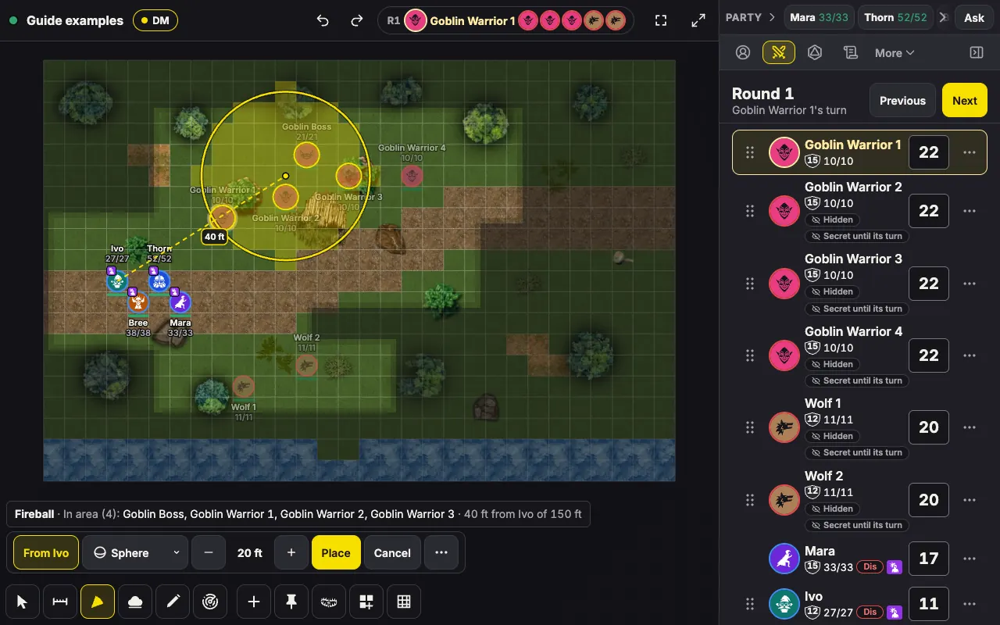

### Placing an area

1. Pick the **Area** tool. Type a spell in **Spell** (`fireball`) and pick it from the list: it sets the shape and size (a 20 ft sphere), and turns on the reminders the spell needs. Or pick a **Shape** (Cone, Sphere, Cylinder, Cube, Line, Emanation) and set **Size** in feet.
2. Tap where it goes. A cone, line, cube or emanation tapped on a token casts from that token: a cone starts at the caster's edge, an emanation surrounds it. A sphere or cylinder tapped on a token sits on that token.
3. Aim a cone, line or cube by dragging anywhere on the map, or by its handle. **Rotation snap** under **⋯** picks 15°, 45° or **Free**. **Aim up or down** tilts a cone or line.
4. Read the line above the options: "Fireball · In area (3): Goblin Warrior 1, Goblin Warrior 2, Thorn (ally)". This preview is yours alone, unless you turn on **Shared**.
5. Press **Place**.

Under **⋯** (More area options) you also find **Elevation** for an area at a free point, **Includes caster** for a cone, cube, line or emanation (a sphere or cylinder always catches a caster inside it), **Moves with token** for an emanation, **Set caster**, **Reminders**, **Color** and **DM only**.

**A caster matters for the group save.** It fills the save's DC from the caster's spell save DC, and the damage from the caster's own spell. A DM's area starts with no caster. To give one, cast a cone, line, cube or emanation from the token. For a sphere, press **Set caster** under **⋯**, then tap the caster's token: the first tap only closes the **⋯** pop-up if it is still open, so tap the token again if the hint still reads "Tap the caster." The hint then reads "Cast by Ivo.", and the row shows **From Ivo**, which drops or restores the caster.

### Placed areas

Placed areas stay until removed. Tap one with the Area tool to pick it, then:

- Drag it to move it. A cone, line or cube cast from a creature turns around it instead.
- Change **Size**, or **Hidden** to hide it from players.
- **Save and damage** opens the [group save](#the-group-save) for everyone in it.
- **Copy** makes a new draft from it. **Delete** removes it. **Done** lets it go.

A placed area can't gain a caster, change its elevation or become DM only. Copy it, fix the copy, place it, and delete the old one.

The **Areas** panel lists every area with who is in it, live, and **Edit**, **Save and damage** and **Delete** on each row. Only you and an area's owner change it. Players see each other's areas unless the room setting "Players see each other's areas" is off.

### Auras

An emanation cast from a token with **Moves with token** on (the default) is attached: it follows the token, and its "In area" list updates as creatures move. Spirit Guardians, a Paladin's aura and the like work this way. An attached area can't be dragged, so move its token.

### Height

Every area is a shape in three dimensions, and each creature has a height from its size. A 20 ft Fireball on the ground misses a Medium creature flying 25 ft up. The squares under the flier are still shaded, so trust the "In area" list, not the shading. To reach a flier, put the sphere on its token, raise **Elevation** before placing, or aim a cone or line up. An area put down on a platform starts at the platform's height.

### Reminders

An area can remind you when a creature enters it, starts its turn in it, or ends its turn in it: **Enters**, **Starts turn** and **Ends turn** under **⋯**, **Reminders**, with **Once a turn** for spells that affect a creature once a turn. Spirit Guardians, Moonbeam, Web, Spike Growth and other presets turn them on as the spell says.

Reminders fire only while a fight's turn is running. Each one is a log line ("Goblin Warrior 1 entered Spirit Guardians.", "Spirit Guardians moved onto Goblin Warrior 1.") and a notice on your screen. The area's owner and the creature's owner get the notice too. Players read the line only for what they could see. A reminder doesn't roll anything: use **Save and damage** or the Dice panel for that.

## The group save

The group save rolls one saving throw for many creatures and applies the damage and conditions to all of them in one step, with one undo. Start it from a placed area's **Save and damage**, or from a save action in the Dice panel's roll options.

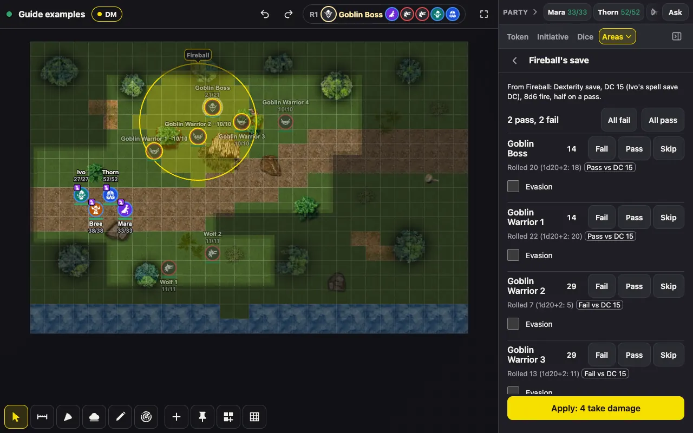

From an area, the page fills itself: "From Fireball: Dexterity save, DC 15 (Ivo's spell save DC), 8d6 fire, half on a pass." Then:

1. Check **What they roll** (**Save**, **Check** or **No save**), **Ability** and **DC**. **Hide the monsters' rolls from players** is on by default. **Against a spell** gives creatures with Magic Resistance their advantage.
2. Check the damage (`8d6 fire`). **On a pass** is **Half** or **None**. **On a fail** adds up to three conditions, with how long they last and an optional save at the end of each turn.
3. Check the rows. Each creature in the area has a row. Monsters roll on the server. Players' creatures are asked, and the player rolls on their own device, or you press **Roll +3** for them. **Fails**, **Ask**, **Server** and **Type** change how one row rolls, and **Fail**, **Pass** and **Skip** decide a row yourself.
4. Press the roll button ("Roll 4 saves", or "Roll 2 saves and ask 2 players"). Each row shows its roll and its result ("Fail vs DC 15"), and its defenses: resistances and immunities from the stat block, **Evasion**, and **Use Legendary Resistance (2 left)** for a legendary monster that failed.
5. Roll the damage: **Roll** beside it, or type a number, or take a player's roll from **Rolled by someone else**. Once the saves are rolled, the damage folds into one line, and **Edit** opens it again. Each row then shows its amount, half on a pass. Tap a row's amount to type another.
6. Press **Apply** ("Apply: 4 take damage"). Temporary HP and concentration checks follow. "Applied to 4. Undo takes it all back."

With **No save** ("No save: everyone takes it"), **Apply** shows at once. The open group save stays on your device through a reload, and the Dice panel's **Open** brings you back to it.

## Alerts during a fight

Cards that need an answer stack at the right of the map, under the top bar: roll requests, concentration checks, save-ends reminders and recharge rolls. Where the screen is short they fold into one row that names the most pressing one.

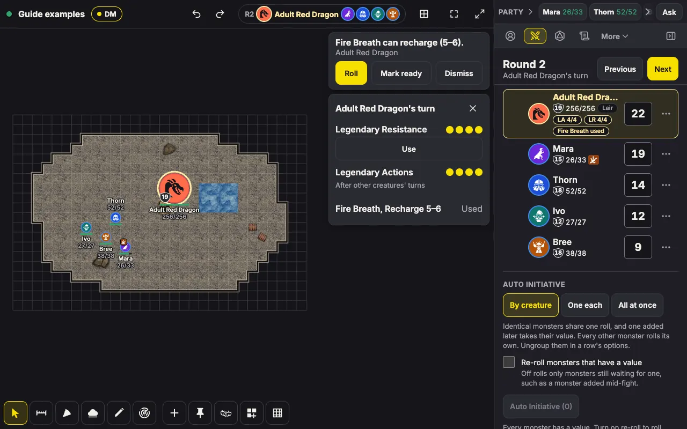

- **Concentration check**: "Bree (Spirit Guardians) took damage. Constitution save, DC 11." with **Roll +5**, **Passed** and **Failed**. A roll decides it ("concentration holds" or "concentration ended"). It goes to the creature's player, or to you for a creature no player plays.
- **Save-ends**: at the end of a creature's turn, for a condition with **A Wisdom save at the end of each of its turns ends it**: "Goblin Warrior 2 ended its turn Frightened. Wisdom save, DC 15, ends it." with **Roll +0**, **Passed**, **Failed** and **Dismiss**, and **Ask Thorn** for a player's creature on the players' scene. A pass ends the condition. Players see which save ends it, never its DC.
- **Recharge**: at the start of a monster's turn, for an action marked **Used** in the Dice panel: "Fire Breath can recharge (5–6)." with **Roll** and **Dismiss**. A success clears Used. The Used mark lives in that browser tab, so roll the breath from the same tab.
- **Legendary Resistance**: on a concentration or save-ends card, a failed roll of a monster with uses left offers **Use Legendary Resistance (2 left)** or **Accept failure**.
- **Time is up**: with a turn timer, the device of whoever acts gets a nudge. It never ends the turn.

## Measuring and movement

**Ruler** (`R`): drag to measure, tap to add waypoints. It reads the total and each leg ("35 ft (15 ft + 20 ft)"). A double tap, or **Keep**, keeps a ruler on the map, and **Kept rulers** lists them to remove. Your ruler is private until you turn on **Shared** (it starts off each time you pick the Ruler). Players' rulers show to everyone in their color. A point on raised ground stands on it, so the distance counts the height.

**Moving a token** measures as you drag: green within its speed, yellow within a Dash, red beyond. A raised flier counts its fly speed. During a fight only the creature whose turn it is gets the colors and its path:

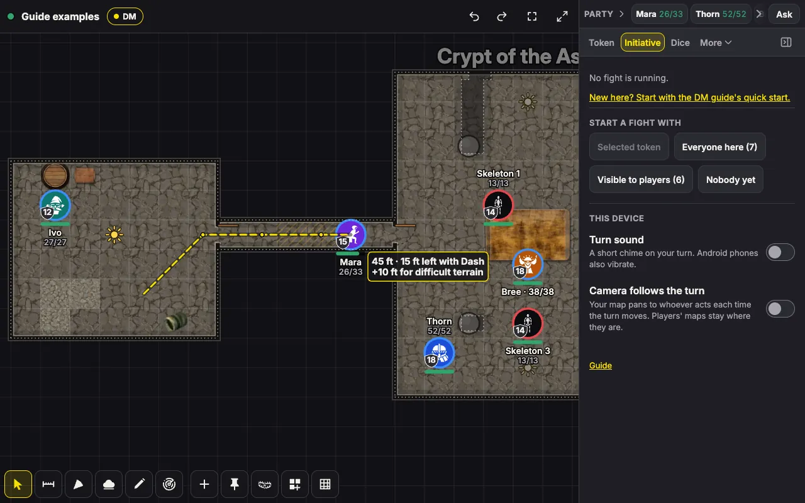

- Each drop adds a leg to the turn's path, drawn with a ring where the turn began. "Moved 20 ft" totals the whole path, which helps the table judge opportunity attacks. Nothing detects them for you.
- **Doesn't count** in the action bar leaves the last leg out of the total, for a shove or a teleport.
- Players get **Undo move** for their own newest move. Yours go through Undo in the top bar.

Distances between tokens count from edge to edge and include height. The room's **Diagonal moves** setting decides the diagonals: every square 5 ft is the 2024 rule and the default.

# Deeper tools

## Outliner

The **Outliner** (DM only) lists everything on the scene you are viewing, and what players get of each. Use it to find a token in a crowd, check what is hidden, and find things you lost. The `/` key opens it with the search ready.

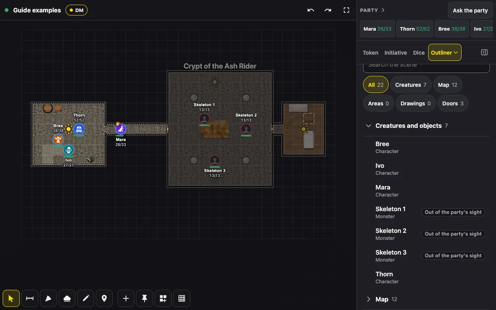

- Groups, each folding: **Creatures and objects**, **Map** (stamps, labels, pins and lights), **Areas**, **Drawings** and **Doors** (windows too). The chips at the top show one group.
- Each row says what players get: **Hidden**, **Under fog**, **Out of the party's sight**, **DM only**, **Only Pat**, **Secret door, hidden** or **Secret door, found**. A scene you are preparing reads as it will once players move there.
- **Search the scene** filters as you type. Every word must match the name or the line under it, so `companion` finds every companion and `secret` finds secret doors. The marks themselves aren't searched, so use the chips and scan for them.
- Tap a row to show it on the map. A token is selected with its action bar open. A label, pin, stamp or light opens in its tool. A drawing, door or window flashes.

A companion whose character has no token on this scene reads **Away from Bree**. See [The party travels between scenes](#the-party-travels-between-scenes).

## DM panel

The **DM** panel holds the tools that act on the players' screens.

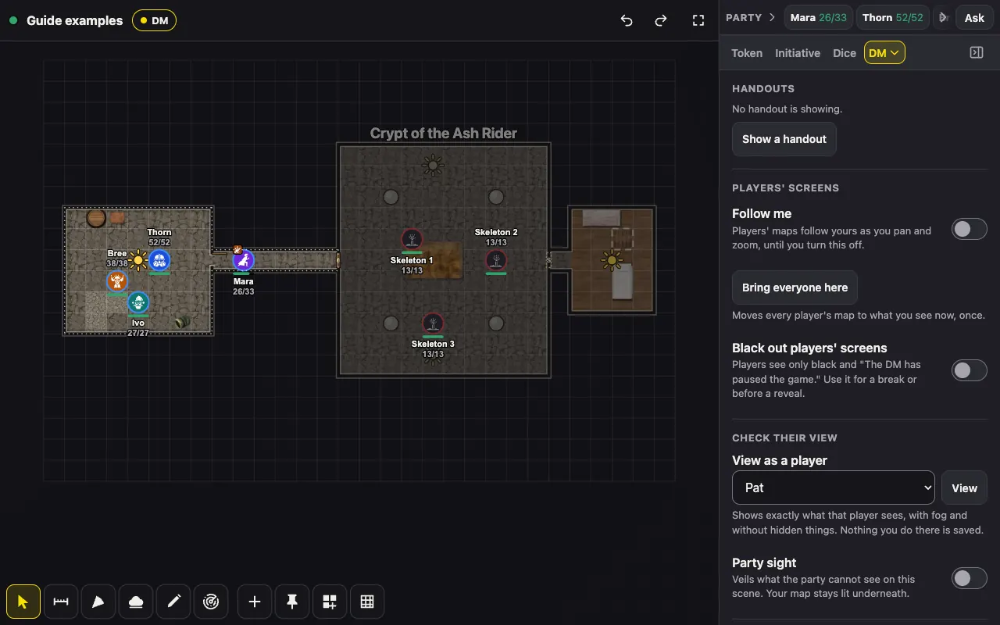

- **Handouts**: **Show a handout** shows an image or a PDF to **Everyone** or **Chosen players** as a popup. Pick **From the library** or **Upload a file**, give it a **Title**, then **Show**. A PDF asks which pages (up to 100). **Showing now** lists what is up, with **Close** to take it down for everyone.
- **Players' screens** work only while you view the players' scene, and the panel says so when you don't.
  - **Follow me**: players' maps follow yours as you pan and zoom, until you turn it off.
  - **Bring everyone here**: moves every player's map to what you see now, once.
  - **Black out players' screens**: players see only black and "The DM has paused the game." Use it for a break or before a reveal. Your top bar shows "Players see black" while it's on.
- **Check their view**: pick a player and press **View** to see exactly what they see, fog and party vision included, without hidden things. Nothing you do there is saved. **Exit** or Escape leaves. On a scene with party vision, **Party sight** shades what the party can't see on your own map.
- **Player link**: **Show the player link** shows the link and its QR code to scan at the table.
- **Table display**: see [The table display](#the-table-display).

## Characters and their stat blocks

The **Characters** panel lists the party. A character belongs to the room, so its HP and conditions follow its tokens to every scene, unlike a monster token, which is its own copy.

- **New character** takes a name, size, max HP, AC, speed, initiative bonus, passive Perception and who plays it (**Played by**). Players make up to 3 of their own while "Players can create their own characters" is on.
- Open a character and press **Place a token**, then tap the map, to put it on the scene you are viewing.
- Its card shows its numbers, its companions and its stat block.

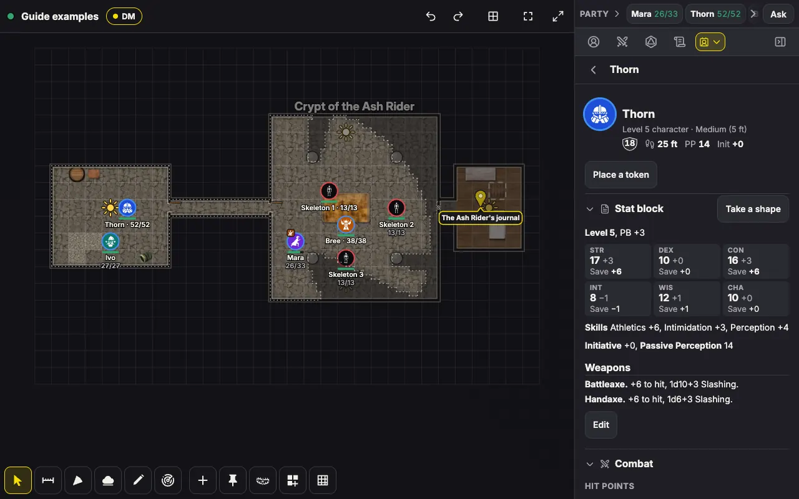

**Stat blocks.** A character can have a stat block: level, ability scores, save and skill proficiencies, spellcasting, defenses, and its weapons, spells and other rolls with riders such as Sneak Attack. The Dice panel then offers its rolls, roll requests know its bonuses, and the group save knows its resistances and Evasion. Only you and the character's own players see the block and get **Add a stat block**, **Edit**, **Take a shape** and **End the shape**. Other players and the table display never see it.

Fill it with **Add a stat block** on the character's card or its token's panel, then in **Fill from**:

- **Paste text**: a stat block copied as text, read on the device. Set the level first.
- **D&D Beyond**: a public character's share link or number (**Get it**), or its JSON pasted (**Paste its JSON instead**). It reads numbers, proficiencies, weapons and spells, never their text.

**Check what was read** lists what to check ("AC 15 was worked out from the armor. Check it.") and what else to set (level, AC, max HP, speed, senses, sheet link, name). **Use it** fills the editor, and **Save** keeps it. Importing again replaces what the last import read and keeps the rolls you added. It is best effort, since D&D Beyond can change its format.

**Take a shape** turns a character into an SRD creature: **Wild Shape** (the druid keeps Intelligence, Wisdom, Charisma and proficiencies) or **Polymorph or another shape** (all of the creature's numbers). The token takes the creature's AC and speeds, HP stay the character's, and the 2024 temporary HP are offered. **End the shape** goes back.

**Rests.** The Token panel's **Rest** section has **Short rest** (add the HP rolled on Hit Point Dice) and **Long rest** (all HP back, temporary HP gone, one less Exhaustion level, Legendary Resistance reset). **Long rest for the party** in Characters rests everyone at once. Spell slots and features stay on the players' sheets.

## Companions

A companion is a token that belongs to a character: a familiar, a summoned spirit, an animal companion, or an effect with no HP such as Spiritual Weapon. Whoever plays the character moves it and changes its HP and conditions.

**Adding one.** On a character's card in **Characters**, **Add a companion** takes a **Name**, **It is** (**A creature** or **An effect**), an optional stat block (**Choose a stat block**: an SRD creature such as an owl or a wolf, one of the character's own blocks, or one you paste), a **Turn**, a **Size**, **HP** and **AC**. A stat block fills in the numbers it knows ("From the block: speed 5 ft, fly 60 ft. Darkvision 120 ft."). **Add and place** puts it next to the character's token. Players add their own the same way. To turn a token already on the map into a companion, use **Make a companion** in its **Token settings**.

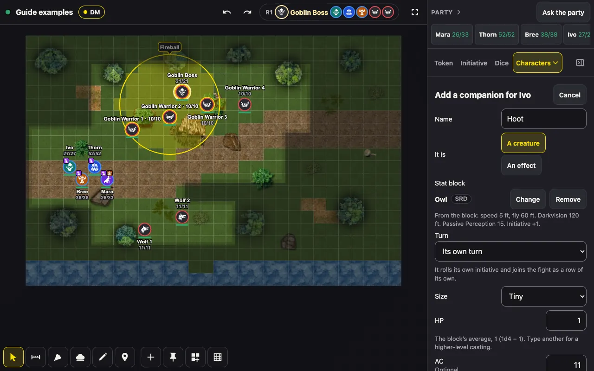

**Stat blocks (N)** on the card keeps the character's own companion blocks, pasted or typed, up to 100, so a summon cast again starts from the same block. An SRD creature needs no keeping: pick it again.

**Its turn** is one of:

- **On Bree's turn, listed under Bree**: it acts on its character's turn and shows under that row in the order, with its own Reaction and Ready. The default for a creature.
- **On Bree's turn, not listed**: it acts on its character's turn and stays out of the order. The default for an effect.
- **Its own turn**: a row of its own with its own initiative. Added during a fight its character is in, it joins at once, with its initiative still to roll. Otherwise its player adds it with **Add Hoot** under **Join the fight**, or you add it with **Add to the fight**. **Everyone here** takes it when you start a fight.

Other players see the companion's token, name and HP as "Players see the party's HP" allows. A creature companion lends the party its sight, an effect doesn't. A companion stays on its scene when the party moves on (see [the travel scenario](#the-party-travels-between-scenes)).

## Ping, Look here and pins

**Ping** (`P`): tap a spot to ping it, with a sound and the pinger's color. Drag for a laser stroke that fades. With the Select tool, a press held still on empty map pings too. For you, **Look here** in the Ping tool's options moves every player's view to the spot you tap. They can pan away after. It turns off on reload.

**Pins** (`M`, behind **Setup** on a phone): tap the map to place a pin. Its pane sets a **Pin label**, a **Linked page** from the Journal, a **Pin color** and **DM only**, and says who will see it. New pins start DM only. Players see a pin only on their scene, out of the fog, when they can read its linked page. In the Journal, a page's **Pin to the map** places a pin linked to it. With the Select tool, a tap on a pin opens its page.

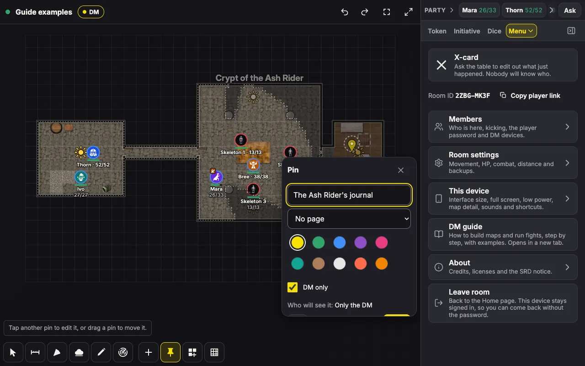

## The table display

A TV at the table can show the players' view of the map, with nothing else on screen. Set it up in the **DM** panel's **Table display** section:

- **Add a TV** shows a code (such as `K7QH 2MXA 4F`), a link and a QR code, good once for 10 minutes. On the TV's browser, **Set up a table display** on the Home page takes the code.
- **Open on this device** opens the display in a new window, for a laptop wired to the TV.

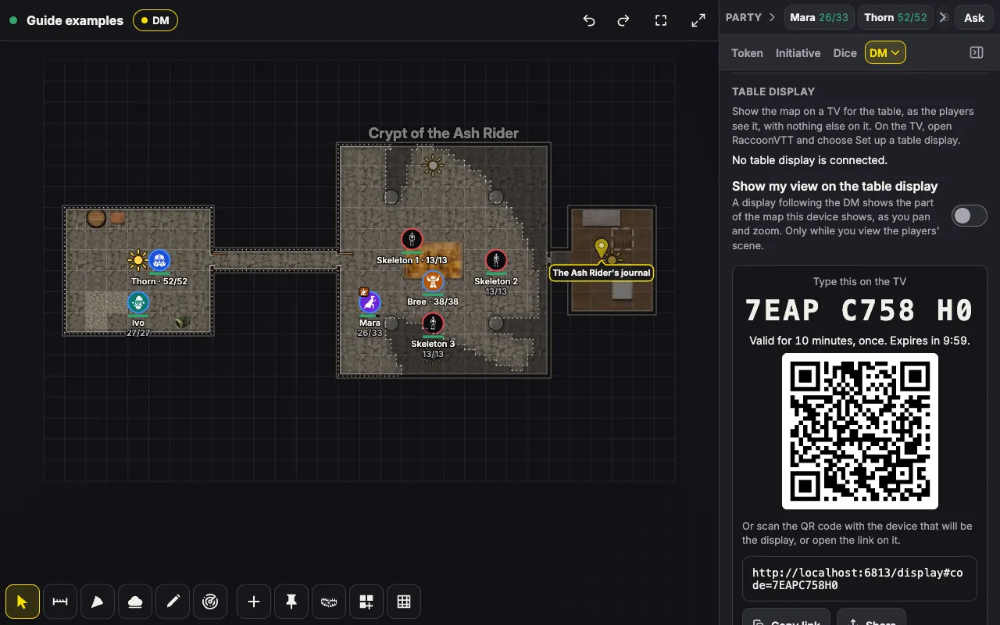

The display shows the players' scene as players see it: fog, party vision, tokens, shared areas, drawings, pings and rulers, and handouts shown to everyone. It shows no panels, chat or initiative strip, unless you tap it and turn on **Show whose turn it is**. Turn on **Show my view on the table display** in the DM panel, and pick **Follow the DM** on the display, to have it show what your screen shows. A room has up to 4 displays.

## Room settings for fights and maps

Menu, **Room settings** (DM only). Switches apply at once.

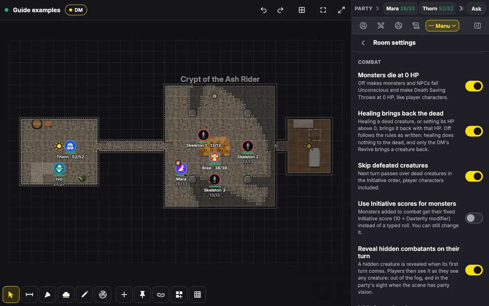

- **Players**: **Who can move any token** (No one), **Who can draw** (Every player), **Players can create their own characters** (on), **Players can apply damage and healing** (off), **Players may type their roll totals** (on), **Players see the party's HP** (on), **Players see each other's areas** (on).
- **Combat**: **Monsters die at 0 HP** (on), **Healing brings back the dead** (on), **Skip defeated creatures** (on), **Use initiative scores for monsters** (off), **Reveal hidden combatants on their turn** (on), **Initiative order players see** (**Player characters, the rest on their turn** in a new room), **Critical hit damage** (**Roll the dice twice**), **Turn timer** (Off).
- **Grid and distance**: **Feet per square** (5) and **Diagonal moves**: **Every square is 5 ft** (the 2024 rule, the default), **Alternate 5 ft and 10 ft**, or **True distance**.
- **Areas of effect**: **Which squares an area covers** (**At least half the square**, the 2024 rule) and **Which creatures an area catches** (**Any square the creature is in**).

**Players may type their roll totals** is on by default. Turn it off and players answer every roll you ask for with **Roll**, and the app rolls for them. They can still fail a save without rolling. Totals they already typed stand.

**Critical hit damage** picks how every critical hit rolls its damage, riders such as Sneak Attack included: **Roll the dice twice** (the 2024 rule and the default), **Max plus a roll**, **Double the dice rolled**, or **Double the total**. The server rolls by the rule standing at the roll, and each roll shows how it reached its total, such as "12 max + 2d6+3 (4, 6) = 25".

**Initiative order players see** is separate from **Hidden**: turning a token's **Hidden** off shows its row only where this setting shows it, so in a new room a monster's row still waits for its first turn. See [What players see of the order](#what-players-see-of-the-order).

# Scenarios

Each scenario walks from building to running, naming the tools at each step. The screenshots come from a test room with a party of four level 5 characters: Thorn (fighter), Bree (cleric), Mara (rogue) and Ivo (wizard).

## A forest road ambush

Goblins and wolves wait in the trees beside a road. The party walks into them.

**Building it**

1. **Scenes**, **New scene**, **Map image**: pick the forest road image and press **Upload and create**. If its file name has no size, **Line up grid** opens: fit the box over 3 by 3 squares and press **Apply**.
2. **Encounters**, **New encounter**, "Road ambush": add Goblin Warrior ×4, Goblin Boss ×1 and Wolf ×2. The XP budget shows where it sits for the party. **Save encounter**.
3. In **Place on the map**, tick **Hidden from players**, press **Place where I tap**, and tap the trees north of the road. Drag the wolves to the south side. Hidden tokens show translucent to you and never reach the players.
4. **Characters**: **Place a token** for each character at the west end of the road.
5. **Fog** tool, **Clear fog**, **Rectangle**: drag over the road, the party and the trees where the goblins wait, then **Reveal to players**. Hidden tokens stay hidden in the open. Once revealed, a token under fog still can't be seen, so clear the ground they stand on.
6. **Scenes**: **Move players** on the forest road.

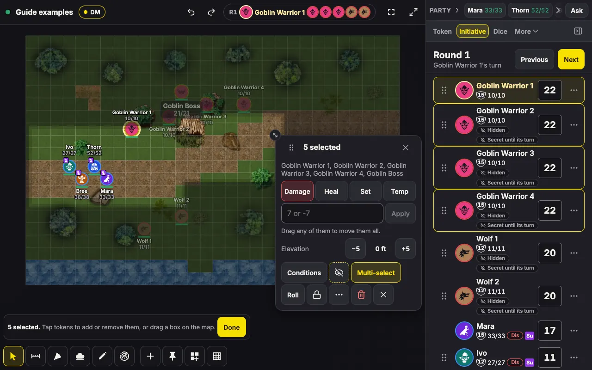

**Running it**

1. If the party is surprised, select the four characters (**Multi-select**), open **Conditions** in the group's bar and tap **Surprised**. Their initiative rolls then have disadvantage, and their rows show **Dis**.
2. **Initiative**, **Start a fight with**, **Everyone here**. Use this, not "Visible to players", which leaves the hidden goblins out. Their rows start hidden.
3. Players roll their own initiative. Press **Auto initiative**: the four goblin warriors share one roll ("By creature"), and so do the wolves. Press **Start**.
4. The hidden goblins appear on their first turn ("Reveal hidden combatants on their turn"). To reveal them all at once instead, select them and press **Hidden** in the group's bar: their tokens show together. Their rows join the players' order on each goblin's first turn, as **Initiative order players see** has it in a new room. For the rows to show with the tokens, set it to **Everyone** in Room settings first.
5. On a goblin's turn, tap it and press **Roll** for its roll options: **Attack +4** with the scimitar against Thorn's AC, then **Damage**. Tap Thorn and use the **Use 5** chip in his HP entry, then **Apply**.
6. A wolf hits Mara and knocks her down: open **Conditions** on her token and tap **Prone**.
7. Ivo casts Fireball. His player picks the **Area** tool, searches "fireball", and places the 20 ft sphere among the goblins. Your screen shows the area and "In area (4): …".
8. Press **Save and damage** on the area. The group save fills from Ivo's stat block: "Dexterity save, DC 15 (Ivo's spell save DC), 8d6 fire, half on a pass." Press the roll button: the goblins roll on the server. Use Ivo's damage roll ("Use Ivo's 28") or **Roll** it, check the rows, and press **Apply**. One undo takes it all back.
9. **Next** through the turns. When it ends, **End the fight**, twice.

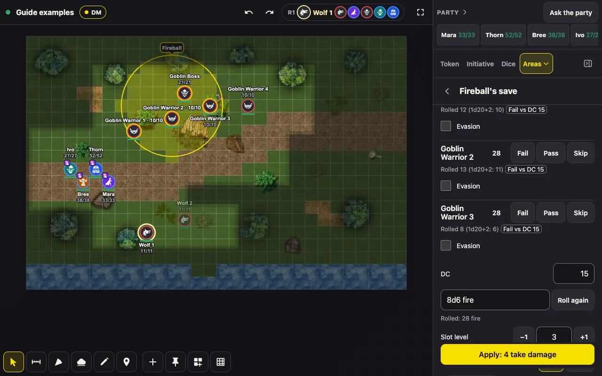

## A dungeon crawl in the dark

The party explores a crypt by torchlight. Players should see only what their characters can see.

**Building it**

1. **Scenes**, **New scene**, **Builder**, "Crypt", **Create**. The builder opens.
2. **Rectangle room**, Stone: drag an entry hall, a narrow corridor one square wide, and a large crypt chamber. Walls go up around them on their own.
3. **Brush**, Pillar: four pillars in the chamber. **Brush**, Rubble: a fallen corner in the hall.
4. **Walls and doors**, **Door**: tap the edge where the corridor meets the hall. Tap the edge into the chamber, then tap that door twice more to lock it (closed, open, locked).
5. **Secret door**, **Hidden**: tap an edge of the chamber's east wall, and build a small room behind it.
6. **Lights**, **Torch**: tap the hall. Place two braziers in the chamber, then tap each, rename it "Brazier" and set it **Out**. **Candle** in the hidden room.
7. **Stamp**: a table, barrels and a chest. Set the chest to **DM only** until it's found.
8. In the scene's settings, **Vision**: turn on **Party vision** and set **Light** to **Dark**.
9. Place the party in the hall. Thorn has darkvision 60 ft from his senses. Give Mara a torch: tap her token, **Light**, **Torch**.
10. Place skeletons in the chamber. Under party vision they appear to players only when a character sees them, so they don't need to be hidden.

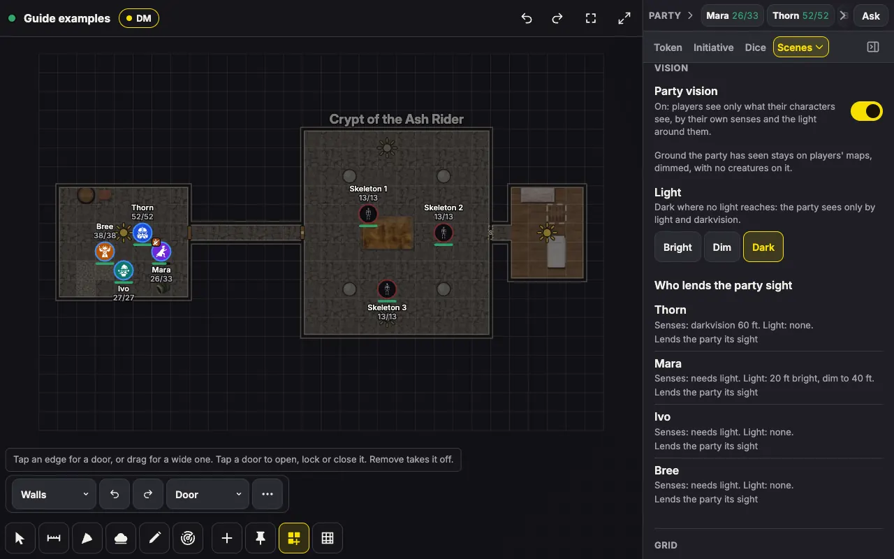

**Running it**

1. **Move players** to the crypt. Use **View as a player** in the DM panel, or **Party sight**, to check what they see: the hall by torchlight, the rest dark.
2. Players move and see as they go. Ground they explored stays drawn, dimmed. Players open the closed door themselves, by tapping it or with **Open door** in their token's action bar.
3. The chamber door is locked. When Mara picks the lock, use **Select**, tap the door, and press **Unlock**, then **Open**.
4. A character lights a brazier: in the builder's **Lights** mode, tap the brazier and set it **Lit**. The chamber lights up for everyone who can see it.
5. Someone searches the east wall and finds the secret door: tap it with **Select** and press **Mark found**. Players now see a door.
6. Turn the chest's **DM only** off once they're in the room.

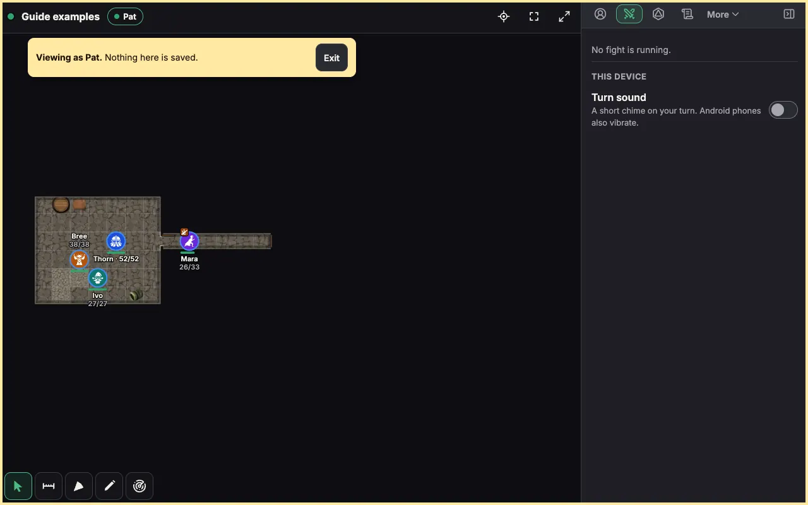

## A fight across heights

A watchtower stands on a rise above a field. Harpies circle overhead.

**Building it**

1. **Scenes**, **New scene**, **Builder**: paint Grass over the field with **Rectangle room**. Set **Automatic walls** to **Around floor only**, or **Off**, so the field isn't walled in.
2. **Heights and stairs**, **Height**, 10 ft up, **Area**: drag a rise. Then 30 ft up: drag the tower's top on the rise.
3. **Stairs**, **Auto**: paint a stair run up the rise and another up the tower. Each stair points uphill. Where a "?" shows, pick an arrow and paint it again.
4. Place an archer on the tower: a token placed on raised ground stands on it.
5. Place the harpies and raise them with **+5** in the action bar, or Page Up, to 40 ft. Each shows "↑40" and a shadow on the ground under it.

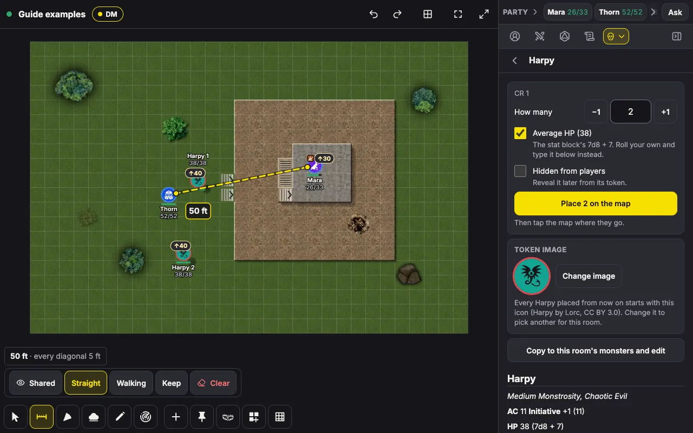

**Running it**

- With **Walls and ledges block players' moves** on, a character walking to the tower stops at the ledge ("Ledge in the way. Take the stairs.") and goes up by the stairs. A flier passes over.
- Tap the ground with **Select** to read a height. The Ruler and token distances count height like one more diagonal. Under the default rule (every square 5 ft), the Ruler from the archer 30 ft up to a goblin 10 squares away on the ground reads 50 ft, since the larger of the two counts.
- Ivo casts Fireball on the ground under a harpy at 40 ft: the shaded squares include its square, but "In area" leaves it out, since the sphere reaches only 20 ft up. To catch the harpy, drop the sphere on its token, or raise **Elevation** under **⋯** before placing.
- A harpy knocked out of the air: lower its elevation to the ground, or let the fall damage go through its HP entry. The **Flying** status is a reminder only, separate from elevation.

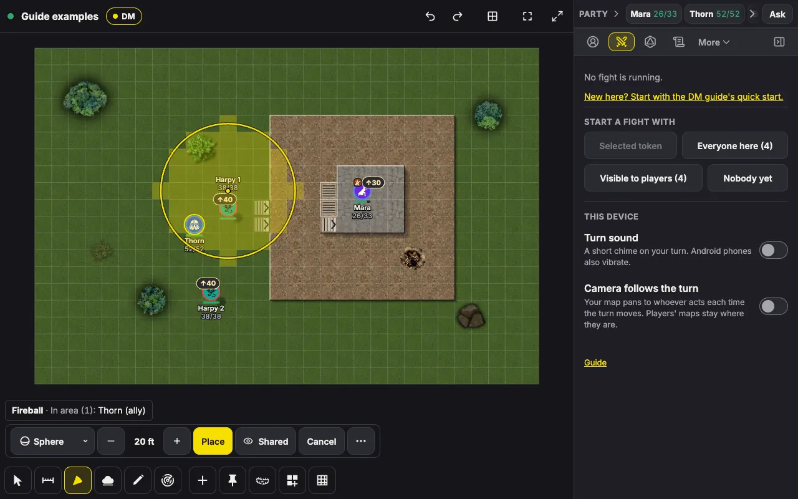

## A boss with legendary actions

An adult red dragon in its lair. It has Multiattack, Fire Breath (Recharge 5–6), Legendary Resistance and legendary actions.

**Setting it up**

1. **Monsters**, search "red dragon", tap **Adult Red Dragon**. On its place card tick **In its lair**: it gets its lair's 4 legendary actions and 4 Legendary Resistances, and its lair XP. This only happens at placement. **Place on the map** and tap its spot.
2. Add it to the fight with the party. Its tracker row shows "LA 4/4" and "LR 4/4" to you alone. **In lair** in the row's **⋯** adds a "Lair" tag the players see too. It changes nothing else.

**Its turn**

1. Tap the dragon, then **Roll** in its bar. **Rolls for Adult Red Dragon** lists its actions. Multiattack is a note at the head of the actions: roll each attack it names with **Attack** and **Damage**, and apply each with the **Use** chip on the target's HP entry.
2. Fire Breath: press **Group save, DC 21 Dex**. The group save opens with "17d6 fire, half on a pass." Its rows follow your selection, so select the characters in the cone first, or place a cone **Area** from the dragon and use its **Save and damage**. The players are asked to roll. Roll the damage, then **Apply**. Fire Breath is now marked **Used**.
3. At the start of the dragon's next turn, a card says "Fire Breath can recharge (5–6)." Press **Roll**. On a 5 or 6 Used clears.

**Between turns**

- Spend a legendary action: in the dragon's row's **⋯**, tap a pip under **Legendary actions used**. They refill at the start of its turn.
- Legendary Resistance: when the dragon fails a save in a group save, its row offers **Use Legendary Resistance (3 left)**. A save-ends or concentration card offers the same. For a save you roll yourself from its options, tap a pip under **Legendary resistances used today** in its row's **⋯**.

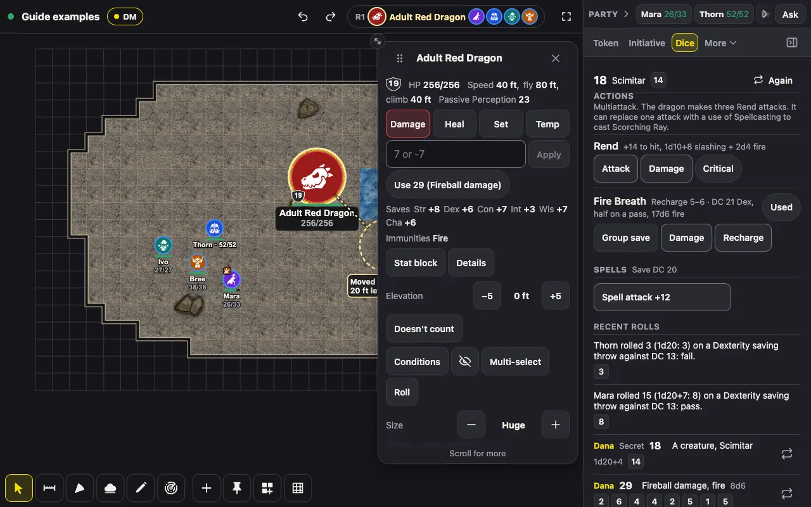

## Spirit Guardians and a summoned companion

Bree casts Spirit Guardians and wades in. Ivo's owl familiar scouts on its own turn.

**Spirit Guardians**

1. Bree's player picks the **Area** tool. With Bree on the scene it reads "From Bree". They search "spirit guardians": a 15 ft emanation that surrounds Bree, attached so it moves with her, with **Enters**, **Ends turn** and **Once a turn** reminders on. **Place**.
2. Give Bree **Concentrating** with the spell "Spirit Guardians" from her **Conditions**.
3. When a goblin moves into the aura, or Bree walks up to it, the log says "Goblin Warrior 1 entered Spirit Guardians." and you get a notice. When one ends its turn inside, the same.
4. Resolve it: for one goblin, select it and roll its Wisdom save from its roll options, then apply Bree's 3d8 radiant (half on a pass) with the **Use** chip. For several at once, press **Save and damage** on the aura and **Skip** the rows that didn't trigger.
5. When Bree takes damage, her player gets the concentration check. If it fails, delete the aura from the **Areas** panel. Areas don't end with concentration on their own.

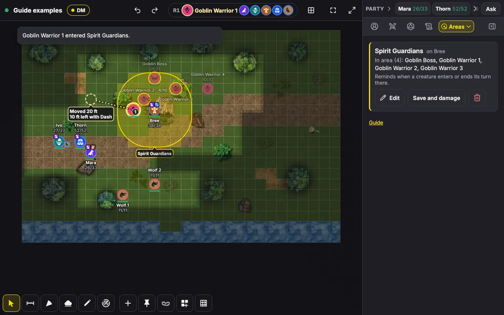

**The familiar**

1. Ivo's player opens **Characters**, Ivo's card, **Add a companion**: "Hoot", **A creature**, **Choose a stat block**, the SRD Owl. In 2024 a familiar rolls its own initiative, so **Turn**: **Its own turn**. **Add and place** puts it next to Ivo.
2. With Ivo in a running fight, Hoot joins it at once in a row of its own that reads "Companion of Ivo". Its player rolls its initiative. Out of a fight, it joins with **Add Hoot** under **Join the fight**, or with **Everyone here** when you start one.
3. The owl lends the party its sight under party vision, so it can scout a dark room ahead of everyone.
4. Ivo's next familiar picks the SRD Owl again. A pasted or typed block is kept under **Stat blocks** on Ivo's card.

A companion that acts on its character's turn (a summoned spirit, a steed) is listed under the character's row with its own Reaction. An effect such as Spiritual Weapon takes **On Bree's turn, not listed**.

## The party travels between scenes

The fight on the road is over, and the party heads for the crypt.

1. **Prepare ahead.** In **Scenes**, tap the crypt's row. You see it, and the players stay on the road. Build, place monsters and set the fog while they play. The Outliner on that scene reads as players will see it once they arrive.
2. **Move the players.** Press **Move players** on the crypt. Every player's view switches. Their tokens don't move: they stay on the road. Place each character on the crypt with **Characters**, **Place a token**, or let players place their own. Their HP and conditions came along, since characters belong to the room. Delete the old tokens on the road when you're done there.
3. **Bring them to the start.** **Save current view** in the crypt's **This scene** settings sets where it opens. Or use **Bring everyone here** in the DM panel once you're framed.
4. **Companions left behind.** Ivo's owl stayed on the road. Open the road scene, press `/`, and type "companion". Once Ivo's token is gone from the road, the owl's row reads "Away from Ivo". Delete its token there, and Ivo's player adds it again on the crypt with **Add a companion**, the Owl.
5. **Monsters left behind** are their own copies and stay where they were. Duplicate a scene (its **⋯**, **Duplicate…**) to keep a clean copy before a fight changes it.

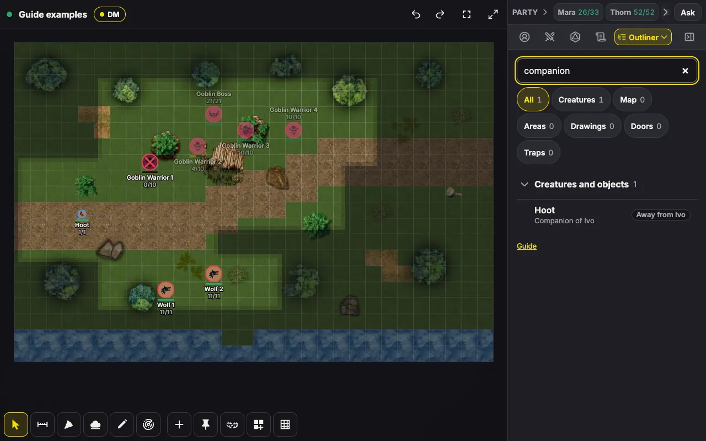

## A secret door and a reveal

The party finds a hidden vault, and you want a dramatic reveal.

1. Build the vault behind a **Secret door** (**Hidden**) and keep it under fog.
2. When they find the door, tap it with **Select** and press **Mark found**.
3. Before they open it, **DM** panel, **Black out players' screens**. Players see "The DM has paused the game."
4. Reveal the vault with the **Fog** tool, place or unhide the guardian, and switch to a night phase if the map has one.
5. In **Handouts**, **Show a handout** with the vault's inscription to **Everyone**.
6. Turn **Black out players' screens** off. The players see the room and the handout together.

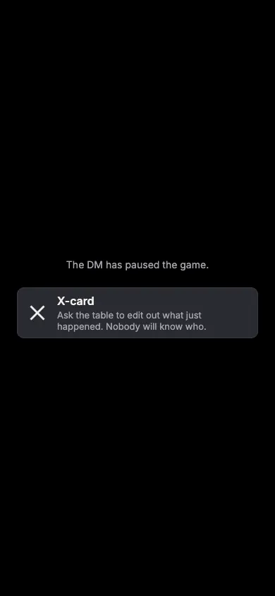

## Shortcuts

Press `?` (or Menu, **This device**, **Show the shortcuts**) for the full list for your role.

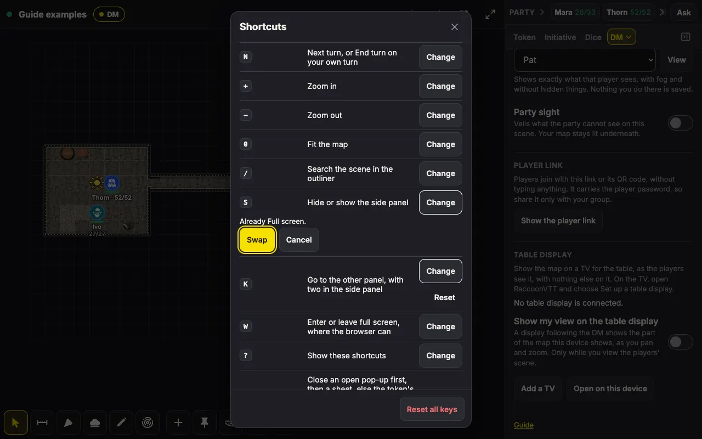

The keys a DM uses most:

- `V`, `R`, `A`, `F`, `D`, `P`: Select, Ruler, Area, Fog, Draw, Ping. `T`, `M`, `B`, `G`: Add token, Pin, Map builder, Line up grid.
- `N`: Next turn (and Start).
- `H`: hide or show the selected tokens. `L`: lock them. Delete: delete them.
- Arrow keys: move the selection a square. Page Up and Page Down: raise or lower it 5 ft.
- `/`: search the scene in the Outliner.
- `Ctrl+Z` and `Ctrl+Shift+Z`: Undo and Redo (Cmd on a Mac).
- `0`: fit the map. `+` and `-`: zoom. `S`: hide or show the side panel. `O`: go to the other of two panels.
- Escape closes the newest pop-up, sheet or action bar.

On a computer, Shift or Ctrl and a click adds a token to the selection, and Shift or Ctrl and a drag on empty map draws a selection box. Drag with the right or middle button, or Space and a drag, to move the map.
