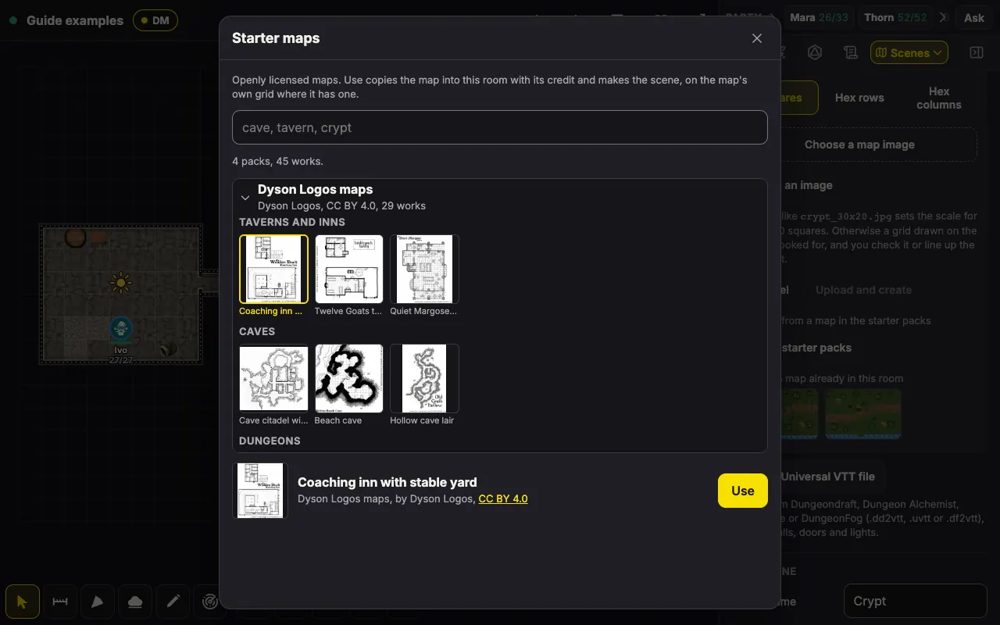
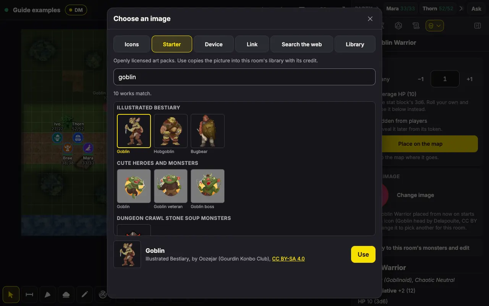
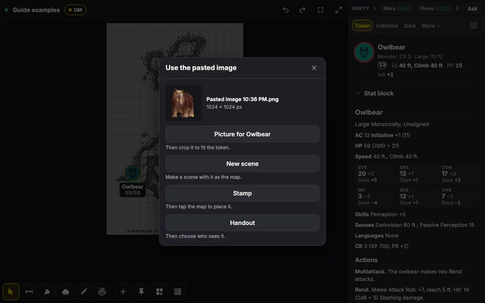
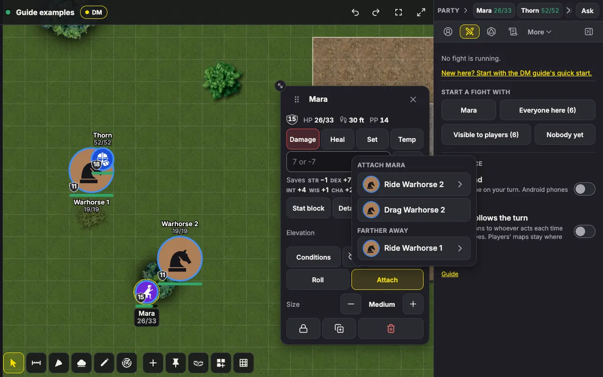
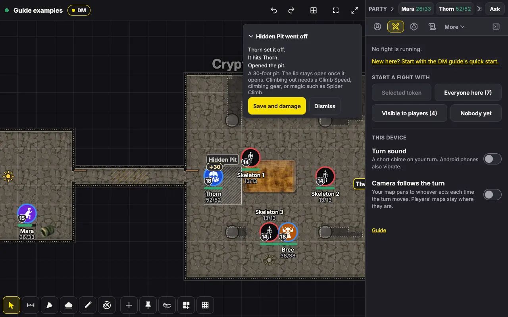

# DM guide

This guide is for the DM who runs RaccoonVTT for their table. It walks you through building maps and running fights: what each tool does, when you would reach for it, and how the tools work together in a real session. It covers the parts of the app a DM uses for maps and combat. For a complete list of everything the app can do, see [FEATURES.md](../FEATURES.md), and for every keyboard shortcut, press `?` in the app.

You can read this guide inside the app as well. Open the **Menu** and choose **DM guide** to open it in a new tab. Each panel the guide covers also ends with a small **Guide** link that takes you straight to the section about that panel.

The app does a lot, and you don't need most of it on day one. Read the [Quick start](#quick-start), run a session with just those tools, and come back for the rest when you want it.

## Contents

- [Where things are](#where-things-are)
- [Quick start](#quick-start)
- [What you can ignore at first](#what-you-can-ignore-at-first)
- Making maps
  - [Scenes](#scenes)
  - [Starter art](#starter-art)
  - [Pasting a picture](#pasting-a-picture)
  - [Lining up the grid](#lining-up-the-grid)
  - [The map builder](#the-map-builder)
  - [Walls and doors](#walls-and-doors)
  - [Heights and stairs](#heights-and-stairs)
  - [Difficult ground](#difficult-ground)
  - [Light and party vision](#light-and-party-vision)
  - [Fog](#fog)
  - [Map phases, imports and exports](#map-phases-imports-and-exports)
- Running fights
  - [Monsters](#monsters)
  - [Encounters](#encounters)
  - [Tokens](#tokens)
  - [HP, damage and conditions](#hp-damage-and-conditions)
  - [Initiative](#initiative)
  - [Dice](#dice)
  - [Asking for rolls](#asking-for-rolls)
  - [Areas](#areas)
  - [The group save](#the-group-save)
  - [Alerts during a fight](#alerts-during-a-fight)
  - [Measuring and movement](#measuring-and-movement)
  - [Mounts, familiars and dragging](#mounts-familiars-and-dragging)
  - [Traps](#traps)
- Deeper tools
  - [Outliner](#outliner)
  - [DM panel](#dm-panel)
  - [Characters and their stat blocks](#characters-and-their-stat-blocks)
  - [Companions](#companions)
  - [Ping, Look here and pins](#ping-look-here-and-pins)
  - [The table display](#the-table-display)
  - [Room settings for fights and maps](#room-settings-for-fights-and-maps)
- Scenarios
  - [A forest road ambush](#a-forest-road-ambush)
  - [A dungeon crawl in the dark](#a-dungeon-crawl-in-the-dark)
  - [A fight across heights](#a-fight-across-heights)
  - [A boss with Legendary Actions](#a-boss-with-legendary-actions)
  - [Spirit Guardians and a summoned companion](#spirit-guardians-and-a-summoned-companion)
  - [The party travels between scenes](#the-party-travels-between-scenes)
  - [A secret door and a reveal](#a-secret-door-and-a-reveal)
  - [A pit at the crypt's door](#a-pit-at-the-crypts-door)
- Reference
  - [Shortcuts](#shortcuts)

## Where things are

The screen has three main parts: the **map** in the middle, the **toolbar** under it, and the **panels**, where most of the app's controls live. Where the panels appear depends on the size of your screen.

**On a computer** (a window 900 px wide or more), the panels are tabs in a side panel on the right. The tabs you use most come first, as many as fit, and **More** lists the rest, grouped under **In play** and **Prepare**. When you want more room for the map, press **Hide panels** at the end of the tabs (or the `S` key), and bring the side panel back with **Panels** in the toolbar. **Two panels**, at the top of the More list, splits the side panel so you can see two panels at once, which is handy for keeping Initiative open above a token's stats.

Above the tabs sits the party bar, which shows your players' characters with their HP. Press **Party** to fold it down to a single line: the characters' names and HP in a strip that scrolls sideways when they don't all fit, followed by **Ask** for [asking the party for a roll](#asking-for-rolls).

**On a phone**, press **Panels** in the toolbar to see the list of panels. Each one opens as a sheet that slides up from the bottom, and you swipe the sheet down to close it. On a tablet held upright, the sheet keeps to the width of a dialog and sits in the middle of the screen. To save room, your setup tools (Add token, Pin, Trap, Map builder and Line up grid) are tucked behind **Setup** in the toolbar.

**The toolbar** holds eleven tools. On a computer, each one but Trap has a key:

- **Select** (`V`), **Ruler** (`R`), **Area** (`A`), **Fog** (`F`), **Draw** (`D`) and **Ping** (`P`).
- Your setup tools: **Add token** (`T`), **Pin** (`M`), **Trap**, **Map builder** (`B`) and **Line up grid** (`G`).

When you pick a tool, its options appear in a row just above the toolbar, and anything that doesn't fit in the row waits behind **⋯** (More options). If the row is in your way, tap the tool you are using again to hide its options. The tool stays in use, and another tap brings the options back.

**The top bar** holds **Undo** and **Redo** (`Ctrl+Z` and `Ctrl+Shift+Z`, or Cmd on a Mac), which take back your own changes one at a time and put them back again. Beside them is **Fit the map to the screen** (`0`), for when you have panned or zoomed the map out of sight. On a computer, the last button in the top bar is **Full screen** (`W`), which gives the whole screen to the room. Press it or `W` again to leave. If the window is too narrow for the button, **This device** in the Menu has the same switch, and that is also where you find it on a tablet or an Android phone.

**The Menu** panel holds the X-card, **Copy player link**, **Members**, **Room settings**, **This device**, **DM guide**, **About** and **Leave room**.

These are the panels a DM uses most for maps and fights:

- Under **In play**: **Token**, **Initiative**, **Dice**, **Log**, **Journal**, **Areas**, **DM** and **Scenes**. On a phone, **Party** is here too.
- Under **Prepare**: **Monsters**, **Encounters**, **Characters**, **Outliner** and **Library**.

## Quick start

This section gets you through a first session with only a handful of tools: one map, a few monsters and one fight.

### Before the session

1. On the Home page, fill in **Room name** and **Your name**. The app suggests a **Player password**, which you can keep or replace with your own (8 characters or more). Then press **Create room**.
2. The app now shows your DM link. Save it somewhere safe, because it is your way back into the room as the DM from a new device. Tick **I saved my DM link** and press **Continue to the room**.
3. Open **Scenes** to add your map. Under **New scene**, pick **Map image**, then **Choose a map image**, then **Upload and create**. If the file name includes the map's size in squares, such as `crypt_30x20.jpg`, the scene is ready to use. If it doesn't, the app opens the **Line up grid** tool so you can match its grid to the one on the map (see [Lining up the grid](#lining-up-the-grid)). No map of your own yet? Press **From starter packs** instead and pick one of the maps that come with the app (see [Starter art](#starter-art)).
4. Open **Monsters** and search for a monster, such as `goblin`. Tap it, set **How many**, and tick **Hidden from players** if the monsters are lying in wait. Press **Place on the map**, then tap the map where they go.
5. Send your players the link: open the **Menu** and choose **Copy player link**. The link carries the password, so players join without typing it. Players can make their own characters in the **Characters** panel (new rooms allow this), or you can make them yourself with **New character** there.

### At the table

1. Put the party on the map. In **Characters**, open a character, press **Place a token**, and tap the map. Players can also place their own tokens on the scene they are on.
2. A map image starts covered in fog, so at first your players see nothing. Pick the **Fog** tool and reveal what the party can see (see [Fog](#fog)).
3. In **Scenes**, press **Move players** on your scene if the players aren't there already. The scene the players are on is marked **Players here**.
4. When the fight begins, open **Initiative** and, under **Start a fight with**, press **Everyone here**. Players set their own Initiative. Press **Auto Initiative** to roll for the monsters, then press **Start**.
5. Press **Next** (or the `N` key) at the end of each turn. When a creature takes damage, tap its token to open its action bar, type the damage with a minus sign, such as `-7`, in its HP entry, and press **Apply**. **Conditions**, in the same bar, adds Prone, Frightened and the rest.
6. You can reveal a hidden monster yourself with **Hidden** in its action bar. Or you can leave it to the app: the room setting "Reveal hidden combatants on their turn", which is on by default, makes a hidden monster appear on its own when its turn comes.
7. When the fight is over, press **End the fight** in Initiative, and tap it again to confirm.

If you make a mistake along the way, **Undo** takes back any of your changes, even a whole encounter you dropped on the map.

## What you can ignore at first

None of these is needed to run a good session. Each one is there for when you want it.

- **The map builder.** A map image is all you need. Build a map when you want walls, doors and heights that the app knows about, so they can block movement and sight.
- **Party vision and light.** Fog that you reveal by hand works perfectly well on its own. Party vision goes a step further: the app works out everything the party's creatures can see, by their senses and the light, and shows that shared view to every player. It needs walls to block that sight, so it pairs with a built or imported map.
- **Encounters.** Placing monsters straight from the Monsters panel works fine. Encounters let you prepare fights ahead of time and check them against the XP budget.
- **Roll requests, the group save and roll options.** Your players can roll their own dice and tell you the total.
- **Areas.** Areas earn their place the first time someone casts Fireball, but you can leave reminders, height and the group save until you need them.
- **Traps.** A hidden monster or a line in your notes can stand in for a trap at your first session. The Trap tool earns its place once you want a pressure plate that goes off by itself when a token walks onto it.
- **Attach.** Until someone rides into battle, you can move a horse and its rider one after the other. Attaching them saves the second drag, and the app then runs the mount's turn by the mounted combat rules.
- **The walking ruler and difficult ground.** Dragging a token already walks it around walls and counts the rubble you painted. Mark more difficult ground, or measure a walk before anyone moves, when your maps call for it.
- **Map phases, Universal VTT imports, the Outliner, the table display, pins, handouts and companions.** Each is worth learning, and each is easy to pick up once the basics feel familiar.

# Making maps

This part covers everything you do to get a map ready before the players see it: scenes, the starter art that comes with the app, the grid, the map builder, walls, heights, difficult ground, light and fog. Read it while you prepare a session, and come back to a section when you want a map to do something new. Traps are part of preparing a map too, but they matter most once they go off, so they have their own section under [Running fights](#traps).

## Scenes

A scene is one map, together with its image or build, its grid, its fog and the tokens on it. A room can hold up to 50 scenes. The **Scenes** panel (DM only) lists them, makes new ones, and holds the settings of the scene you are viewing.

**Viewing a scene and moving the players.** Tapping a scene's row shows that scene to you alone. The players stay where they are, so you can prepare the next scene while they play this one. When you are ready to bring them along, press **Move players** under the scene's row. Every player is sent there, and that row is then marked **Players here**.

Moving the players moves their view, not their tokens. Once they arrive, place the party's tokens on the new scene with **Place a token** in Characters, or let the players place their own. Before the move goes through, the app warns you if the players would see the whole map (because fog is off) or nothing at all (because party vision is on and no character there can see).

### Making a scene

Under **New scene**, pick the kind of scene you want:

- **Battle mat**: a blank grid with a background color. Set **Squares across** and **Squares down** (30 × 20 by default, up to 200 each). Fog starts off.
- **Map image**: pick an image (JPEG, PNG, WebP, GIF or AVIF, up to 32 MB) and press **Upload and create**. If you leave the name blank, the scene takes its name from the file. Fog starts on, and the scene is sized to the whole squares the image covers. To reuse an image already in the room, choose it under **Or use a map already in this room** instead, or press **From starter packs** to start from one of the maps that come with the app (see [Starter art](#starter-art)).
- **Builder**: an empty 40 × 30 scene that opens the map builder straight away. Fog starts on.
- **From a Universal VTT file**: see [Map phases, imports and exports](#map-phases-imports-and-exports).

A map's file name can tell the app its scale. Name the file `crypt_30x20.jpg`, for example, and the scene comes out 30 by 20 squares. Without a size in the name, the app guesses about 30 squares along the image's long side and opens **Line up grid** so you can correct the guess.

### This scene

Below the scene list (**All scenes**) and **New scene**, the panel shows the settings of the scene on your screen, in these sections:

- **This scene**: the **Scene name** (players see it), the **Map image** (**Add a map image**, **Replace map image** and **Remove map image**), the **Fog** switch, the **Starting view**, **Size in squares** and the **Background**. **Save current view**, under Starting view, saves the way the map is framed on your screen right now as the view the scene opens with for everyone.
- **Map phases**: other images of the same map. See [Map phases, imports and exports](#map-phases-imports-and-exports).
- **Vision**: **Party vision** and **Light**. See [Light and party vision](#light-and-party-vision).
- **Grid**: **Grid lines**, **Grid color**, **Opacity** and **Line width**, plus, on a map image, **Line up the grid** and **Or count the squares**.
- **Movement**: **Walls and ledges block players' moves**, which is on for new scenes. While it is on, a player's token walks around walls, closed doors and ledges the party has seen, and stops only where there is no way around. Your own moves are never stopped. See [When walls stop a move](#when-walls-stop-a-move).
- **Map builder**: **Open the builder**, **Clear the build** and **Automatic walls**.
- At the end, **Export as image** and **Delete scene**.

Players can see a scene's name, so don't name a scene after a surprise. And if you replace the map image of the scene the players are on, they see the new image as soon as it uploads, so the app asks you to confirm first.

**Copying and organizing scenes.** Each scene's **⋯** menu (More for the scene) holds **Duplicate…**, **Move to folder…**, **Update thumbnail** and **Delete**. Delete asks you to tap twice: the first tap turns the row red and reads "Tap again to delete", and tapping anywhere else cancels it. It takes the scene's tokens, drawings, build and fog with it, and a room's last scene cannot be deleted. You can't delete the scene your players are on, either: move them somewhere else first, and the scene is yours to remove. Until then, its Delete reads "Move the players to another scene first." An undo or redo that would take the scene away says the same. A duplicate always copies the map, its phases and the build, and lets you choose what else comes along: **Monsters, NPCs and objects** (on to begin with), **Player characters**, **Fog**, and **Drawings and placed areas**. Folders fold away with a tap, and players never see your folders or thumbnails. To change the order of the list, press **Reorder** at the top and move scenes and folders up or down.

Feet per square and the rule for diagonals aren't scene settings: they apply to the whole room. You'll find them under **Menu**, **Room settings**, **Grid and distance**.

## Starter art

You don't need any art of your own to get started. The app comes with **starter packs**: sets of openly licensed art, each made by one artist or project in one style, with maps to play on, tokens and portraits for monsters and characters, pictures to show as handouts, and props for the map builder. Every work in them was released by its author under a license that lets your table use it, and the app keeps each work's credit with it.

- **Maps**: Dyson Logos maps (29 hand-inked maps of inns, caves, dungeons, temples, castles, towns and more), Scarlet Heroes maps (5), Index Card Dungeons (10 small dungeons, each drawn on an index card) and a painted Cavern Battlemap.
- **Tokens and portraits**: Illustrated Bestiary (60 monsters in color), Cute Heroes and Monsters (64), Dungeon Crawl Stone Soup monsters (61, in pixel art), Lemurs Fantasy Portraits (58), Fantasy RPG Portraits (25), Flare Hero Portraits (10), and Historical art's people and creatures.
- **Handouts**: the Illustrated Bestiary, the three portrait packs, and Historical art (47 museum pictures of people, creatures, places, items and documents).
- **Map builder stamps**: Warlock's Gauntlet (40 ruins, wrecks, bones and trees), Poly Haven props (41 pieces of furniture and gear seen from above) and Flat greyscale props (50).

**Where to find it.** Starter art has a place of its own wherever you choose art, so it never gets mixed up with the images you have uploaded yourself:

- In the image picker, for a token, a character's portrait or a monster's token image, open the **Starter** tab.
- In the **Scenes** panel, under **New scene** and **Map image**, press **From starter packs**.
- In the **DM** panel, under **Show a handout**, press **From starter packs**.
- In the map builder's **Stamp** mode, press **Choose a stamp** and open the **Starter** tab.

Each place shows only the packs that suit it, sorted by pack and then by category inside the pack: Dyson's maps by Taverns and inns, Caves or Crypts and tombs, for example, and the Bestiary by Dragons, Undead and so on. The search box looks through names, categories and tags across all the packs on show, so `owlbear`, `crypt` or `elf` takes you straight to what you're after. Tap a picture to see its name, its pack, its author and its license, then press **Use**.

**How a pick joins the room.** When you use a map, a token or a handout, the app copies that picture into your room's library together with its credit, and then carries on just as it would after an upload of your own: a token picture opens in the crop editor, a map becomes a new scene, and a handout is ready to show. From then on it is one of the room's images like any other. It goes into your backups, and it travels with the room if you move it to another server.

Stamps work differently. A starter stamp isn't copied into the room at all: the builder places it straight from the app, the same way it places the stamps that come with the app.

**It doesn't use your storage.** Each room can store only so much, but pictures from the starter packs don't count toward that limit, however many you pick. In the **Library**, they sit after your own images in a folded group called **From starter packs**, so your own maps and tokens stay easy to find. The list of maps under **New scene** and the pictures in **Show a handout** work the same way: your own come first, and the picks follow under their own heading. You can delete a pick you no longer need, just like any other image, and pick it again later if you want it back.

**Maps with a grid.** Most of Dyson's maps and the painted cavern have a grid drawn on them, and for 22 of them the app already knows exactly where it lies. A scene made from one of those starts lined up on its grid, so you can skip [Lining up the grid](#lining-up-the-grid) entirely. For a few more, the app knows how big the squares are but not where they start, so the scene opens on **Line up grid** with the box already the right size, and all you need to do is move it onto the drawn squares. The Scarlet Heroes maps, the Index Card Dungeons and three of Dyson's maps have no drawn grid, so they open on **Line up grid**, just as a map of your own would. Ink maps are black lines on white paper, where the app's usual white grid lines would disappear, so their scenes start with a dark grid instead. The Index Card Dungeons are meant for exploring rather than for fighting square by square, so they work best as a map the party moves across.

**Credits.** A picked image keeps its credit, which you can read in the Library's viewer and in the token panel: who made it, its license, the credit line its author asks for where there is one (such as "Cartography by Dyson Logos"), and what was changed. That is usually only its size and file format, or for the ink maps, a reduction to four shades of gray that keeps every line sharp. The About page credits every pack. If you share a starter map or picture beyond your table, keep its credit with it, since that is what its license asks of you.

Players get the **Starter** tab too, in the image picker for their own characters' tokens, so a player without a portrait can pick one. Maps, handouts and stamps stay yours.

## Pasting a picture

You don't need to save a picture to your computer before you use it. Copy it (on a web page, right-click it and choose **Copy image**, or press and hold it on a phone), then paste it wherever the app asks for an image: in the image picker, in **New scene**, a scene's **Map image** and phases, **Show a handout** and the stamp picker. Press Ctrl+V (Cmd+V on a Mac), or press **Paste an image** (**Paste from the clipboard** in the image picker). A pasted picture goes exactly where a chosen file would: a map is searched for its grid, a token picture opens in the crop editor, and a handout is ready to show.

A phone may ask your permission the first time, or show its own small **Paste** button for you to tap. If it won't let the app read the clipboard, press and hold in the box that appears and tap **Paste** there.

On a computer you can also just press Ctrl+V over the map, and the app asks what the picture is for: a new scene, the selected token's picture, a stamp or a handout. Nothing uploads until you choose. A scene's **Map image** and **Add a phase** take Ctrl+V only while one of their own buttons has focus, and on the players' scene only after you've confirmed, so a stray Ctrl+V never replaces the map your players are looking at. Their **Paste an image** buttons work whenever their other buttons do.

## Lining up the grid

Many map images come with a grid already drawn on them. Lining up the grid makes the app's squares match the drawn ones, so that tokens, rulers and areas land where the art says they should.

1. Pick **Line up grid** in the toolbar (behind **Setup** on a phone), or press **Line up the grid** in the scene's **Grid** settings. When you create a map scene whose file name doesn't give its size, the tool opens on its own.
2. Drag a box over 3 by 3 squares of the art. To adjust it, drag inside the box to move it, or drag a corner to resize it. You can also tap elsewhere on the map to move the box to the squares you tapped. As you work, the app draws the grid the box would make across the whole map, so you can check that it lines up everywhere, not just inside the box.
3. For the last pixel of accuracy, use **Nudge**. It moves the box, or makes its squares smaller or larger, one pixel at a time.
4. Press **Apply**. The app saves the grid and confirms it with a message such as "Grid saved at 70 px per square."

**Apply** only becomes available when there is something to save: either the box differs from the grid the scene already has, or **Resize scene** (below) would change the scene's size. A new scene starts with the app's guess already saved and sized to fit, so if that guess lines up with the art, there is nothing to apply: just pick another tool and carry on.

Two more options wait under **⋯**. **Resize scene** (on by default) makes Apply also resize the scene to the squares the map covers. **Grid lines** turns the app's own grid lines on or off. Turn them off for art that has a grid of its own. Tokens and rulers still follow the squares either way.

**Counting the squares instead.** If the art's squares run all the way to the edges of the image, you can skip the box and simply type the count. In the scene's **Grid** settings, under **Or count the squares**, enter how many squares the image has across and down, then press **Apply**.

> [!NOTE]
> When applying a grid also changes the scene's size, the app saves the two changes as separate undo steps. The first **Undo** takes back the resize, and a second one takes back the grid.

Often you won't need the box at all. When a map's file name gives no size, the app looks for a grid drawn on the map while it uploads: if it's sure of what it found, the scene starts lined up, with **Use default** to go back to the first guess and the scene's earlier size, and if it's less sure, it only places the box on those squares for you to check and **Apply**. On a phone, a large map can take a little longer: the scene opens, and Line up grid says it's still looking until it has an answer. **Find the grid**, in the tool's options or the scene's **Grid** settings, looks again whenever you like, and one undo takes back a grid it applied. If you'd rather not wait for it, just carry on: pressing **Apply** or moving the box stops the search, so it never overwrites what you've done. And if the scene itself changes while it's looking, say someone sets its grid on another device, a grid it then finds isn't applied, and Line up grid tells you so. On a scene from a Universal VTT file, which came with an exact grid of its own, it only places the box, so you can compare the two before you **Apply**, and the same goes for a new image you give that scene.

## The map builder

The **Map builder** tool (`B`, behind **Setup** on a phone) lets you paint a map square by square: floors, walls and doors, heights, labels, lights and stamps. What sets a built map apart from a picture is that the app knows what each part of it is. Walls block movement, sight and areas, doors can be opened, closed and locked, and raised ground counts for movement, sight and areas. You can build a whole map from scratch, or build over a map image to show the app where the walls and cliffs in the art are.

Open the builder from the toolbar, or with **Open the builder** in the scene's settings. Then use **Builder mode** to choose what a tap or a drag does:

- **Brush**: drag to paint. **Terrain** picks a floor (Stone, Wood, Grass, Dirt or Cave) or a terrain (Water, Difficult, Rubble, Pit, Pillar or Stairs), and **Brush size** sets the brush to 1, 2 or 3 squares.
- **Rectangle room**: drag from one corner of the room to the opposite one.
- **Shape room**: tap each corner in turn, then tap the first corner again (or press **Close room**) to finish the room. **Undo corner** takes back the last corner you placed.
- **Erase**: drag across squares to clear them completely, along with any floor, walls, doors, windows, heights, stairs, labels, stamps and lights on them. **Erase area** clears a whole rectangle at once.
- **Walls and doors**: see [Walls and doors](#walls-and-doors).
- **Heights and stairs**: see [Heights and stairs](#heights-and-stairs).
- **Difficult ground**: see [Difficult ground](#difficult-ground).
- **Label**: type the text, then tap the map to place it. **Label size** is S, M or L. To change a label later, tap it in this mode to edit or delete it, or drag it to move it. Tapping a label with the Select tool opens it too.
- **Lights**: see [Light and party vision](#light-and-party-vision).
- **Stamp**: press **Choose a stamp** to pick one of the 46 pictures that come with the app (trees, bushes, rocks, campfires, furniture, barrels and more) or any token image in the room's library, then tap the map to place it. The picker's **Starter** tab holds 131 more props from the starter packs, such as ruins, boats, benches, tables, crates and treasure (see [Starter art](#starter-art)). Drag a placed stamp to move it, and use its handles to turn and resize it. While a stamp is picked, the row offers **Tint**, **Flip**, **Bring to front**, **Duplicate**, **DM only** (to hide it from players), **Delete** and **Done**. With **Snap** on, a stamp turns in 15° steps and moves in half squares, and with it off, it follows your finger freely.

The **Undo** and **Redo** buttons in the builder's row are the same undo as everywhere else, with one step for each stroke or room. **Clear build**, under **⋯**, removes the whole build, including any walls and lights that came from an import.

**Rooms that touch merge** into one floor, with no wall between them. To keep two rooms apart, leave a gap between them and join them with a corridor, or draw a wall or a door along the edge they share.

A scene can hold up to 100 lights, 500 stamps and 500 labels, and it can be at most 200 by 200 squares.

## Walls and doors

**Automatic walls.** As you paint, walls go up on their own around what you have painted, so you rarely need to draw walls by hand. The scene's **Automatic walls** setting (in **Scenes**, under **Map builder**) decides where they go:

- **Around every painted cell**: a wall wherever painted ground meets unpainted ground. This is the default for battle mats and builder scenes.
- **Around floor only**: only floors (stone, wood, grass, dirt and cave) get walls. Use it when you paint water, rubble or pits over a map image and don't want them walled in. This is the default for map image scenes.
- **Off**: no automatic walls, only the walls and doors you draw yourself. This is the default for a Universal VTT import, which brings its own walls.

**Drawing walls, doors and windows.** Pick **Walls and doors**, then choose what to draw under **Edge**:

- **Wall** or **Window**: tap the edge of a square, or drag along a grid line to draw a run of them. Tap one again to take it off. Windows block movement and areas but not sight, so creatures can see through them.
- **Door**: tap an edge for a closed door, or drag along several edges for a wide one. Tapping a door steps it through closed, open and locked.
- **Secret door**: pick **Hidden** (players see a wall) or **Found** (players see a door), then tap an edge.
- **No wall**: tap or drag along an automatic wall to take it away and leave an opening.
- **Remove**: takes off the walls, doors, windows and No wall marks you drew. Where an automatic wall belongs, it comes back once you remove what you drew there.

**During play**, you open and lock doors with the **Select** tool. Tap a door, and a small pill names it ("Locked door", "Closed secret door, hidden") and offers **Open** or **Close**, **Lock** or **Unlock**, and on a secret door, **Mark found** or **Hide**.

Players can open and close unlocked doors themselves, as long as their token can reach the door: within 5 ft, with a clear line to it. They tap the door, or press **Open door** in their token's action bar. A locked door answers "It's locked."

Who opens a door matters when a trap is set on it. A door opened from a token's action bar is opened by that token. When you tap a door, the token you had selected opens it, so to have the goblin open it, select the goblin and then tap the door. With nothing selected, you open it from afar and set off no trap. A player's tap opens it with their selected token when it can reach the door, or else with their nearest token that can.

Here is what blocks what:

- Walls, and closed or locked doors, block movement, sight and areas.
- Windows block movement and areas, but not sight.
- Pillars block movement and sight, but not areas.
- A secret door that hasn't been found is a wall to players, even when it stands open.

Walls and doors shape movement as well. Drop a token on the far side of a wall, and it walks around through the nearest open door, as the creature would. On a scene where walls stop players' moves, a player's token can't pass through a wall at all. [When walls stop a move](#when-walls-stop-a-move) explains what happens then, and what a player can do about it.

## Heights and stairs

Heights let you raise or lower the ground, for a hill, a watchtower or a pit, and stairs are how walking creatures get from one level to another. To paint them, pick **Heights and stairs** in the builder. **Paint** chooses between **Height** and **Stairs**, and **Brush** paints 1, 2 or 3 squares at a time, or a rectangle with **Area**.

- **Height**: set the height with **5 ft lower** and **5 ft higher** (hold a button to step quickly), anywhere from 20 ft down to 100 ft up, then drag to paint it. **Ground (clears)** paints the ground back to 0. Tokens standing on ground you repaint rise or sink with it.
- **Stairs**: **Stairs point** sets which way the stairs climb. **Auto** points each stair toward its one higher neighbor, or you can pick an arrow yourself. Where Auto can't tell which way is up, a "?" shows when you zoom in: pick an arrow and paint over that stair again. The Stairs terrain from the Brush counts as a stair too.

While this mode is open, each raised or lowered area shows its height in a pill, such as "↑10 ft". During play, tap the ground with **Select** to see its height for a few seconds ("↑10 ft", or "Stairs · ↑5 ft" on a stair). Raised ground is also drawn lighter and casts a shadow, so the shape of the land shows at a glance.

Heights change play in several ways:

- With **Walls and ledges block players' moves** on, a walking token can cross a ledge only by a stair. A token dropped on top of a rise walks up by the stairs on its own, as long as the party has seen them. A flying token above the ledge passes over it.
- A creature can see over a ledge that is no higher than its eyes. A creature in a pit can't see out.
- A token you place, drop or duplicate on raised ground stands on top of it.
- Rulers, distances and areas all count the height.

You can paint heights over a map image too, so the cliff drawn in the art can become a real cliff.

## Difficult ground

Some ground is slow going: rubble, thick undergrowth, a slope of loose scree, the furniture of a crowded tavern. In the rules every foot of movement through difficult terrain costs 1 extra foot, so a square of it costs 10 ft to enter instead of 5 ft. The app counts this for you whenever a token is dragged or moved with the arrow keys, and the walking ruler counts it too (see [Measuring and movement](#measuring-and-movement)).

The **Difficult** and **Rubble** terrains from the Brush are difficult terrain. For anything else, pick **Difficult ground** in the builder and **Mark** squares with the brush (1, 2 or 3 squares) or a dragged **Area**. A mark goes over whatever is there, floor or map art, without changing it, and draws as a thin ochre hatch that lets the map show through. **Clear** takes marks off, and Erase takes them along with everything else. Players see the marks with the rest of the map.

A few other things cost extra too, and the app counts them the same way:

- **Water** costs double for a creature without a Swim Speed.
- **Another creature's space** is difficult terrain, unless the creature is an ally or Tiny. On a scene where walls stop moves, a walk never passes through a creature it couldn't pass in the rules (one that isn't Incapacitated and is less than two sizes apart), but it can end there, and the label warns that it would. Where walls don't stop moves, nothing stops a walk, and such a space is just difficult terrain.
- **A Prone creature** crawls, so every foot costs 1 extra.
- **Areas** marked to slow movement, such as Web or Plant Growth (see [Areas that slow movement](#areas-that-slow-movement)).
- **Dragging or carrying a creature** costs 1 extra foot per foot, unless the creature is Tiny or at least two sizes smaller than the one hauling it (see [Mounts, familiars and dragging](#mounts-familiars-and-dragging)).

Difficult terrain isn't cumulative: a square is difficult or it isn't. Plant Growth's 4 ft per foot replaces it rather than adding to it. The other costs do add up, though, so a creature dragging a goblin through rubble pays 3 feet for every foot.

Whenever one of these makes a walk cost more, the label on the drag says what it was, such as "+10 ft for difficult terrain" or "+15 ft for dragging", so nobody has to wonder why a short walk used so much of a turn.

## Light and party vision

There are two ways to decide what your players see. With fog alone, you reveal the map by hand, and players see whatever you uncover. **Party vision** instead works out what the party can actually see, from each creature's senses, the walls and the light. The party shares that sight: every player sees everything any of the party's creatures can see, so when the rogue scouts ahead, the whole table sees what she finds. You turn it on in the scene's **Vision** settings, which hold three things:

- **Party vision**: when it is on, players see only what the party can see together. Ground the party has explored stays on the players' map, dimmed and without creatures, and ground nobody has seen stays fogged. Turning party vision on turns fog on too.
- **Light**: **Bright** (lit everywhere, as by day), **Dim** or **Dark**. The light level matters only while party vision is on.
- **Who lends the party sight**: the party's creatures on the scene, with their senses and lights. To add an allied NPC, so the party sees what it sees, turn on **Shares sight with the party** in the **Sight** section of its token's panel.

Darkvision, Blindsight and Truesight come from each creature's senses (from its stat block, or from **Senses** in its Stats). Darkvision shows darkness in shades of gray.

**Lights** come from two places, the builder and tokens:

- In the builder's **Lights** mode, pick a light under **Light to place** and tap the map. Each light gives Bright Light out to one distance and Dim Light beyond it: a Candle is bright for 5 ft and dim to 10 ft, a Torch 20 ft and dim to 40, a Lamp 15 and 45, a Hooded Lantern 30 and 60, the Light cantrip 20 and 40, and the Daylight spell 60 and 120. Tap a placed light to change its reach, turn it **Lit** or **Out**, choose whether **Walls cast shadows**, give it a name, or delete it. Drag it to move it. Players see the light it gives, but never the light itself.
- A token can carry a light, which you set with **Light** in its action bar or **Sight** in its panel: a Candle, Torch, Lamp, Hooded Lantern, Light, or a Custom one. A scene lights up to 20 token lights.

To check what your players see, use **View as a player** or **Party sight** in the [DM panel](#dm-panel). Your own map always stays fully lit, so you never lose track of anything in the dark.

## Fog

A map image or builder scene starts fully covered in fog. You see the fog as a translucent layer over the map, but players see nothing under it. Tokens, labels and stamps that stand fully under the fog never even reach their devices. The party's own characters are the exception: players always see those.

To reveal part of the map, or to cover it again:

1. Pick the **Fog** tool (`F`).
2. Under **Clear or add fog**, choose **Clear fog** to reveal or **Add fog** to hide.
3. Choose a **Shape**: **Rectangle** (drag), **Polygon** (tap the corners, then tap the first one to close it), **Brush** (drag, 5, 10 or 20 ft wide) or **Builder room** (tap a room made with the map builder to reveal all of it).
4. Your edits start as a private draft, drawn as dashed outlines that only you see. When you are ready, publish them with the button in the row: **Reveal to players**, **Fog for players** or **Show players the changes**, depending on whether the draft clears fog, adds it, or does both. Until then, **Undo** takes back your last edit to the draft, and **Discard** throws the whole draft away.

The draft lets you set up a reveal, check it, and show it all at once. If you would rather players see each edit as you make it, switch **When players see edits** from **Draft** (the default) to **Live**. Under **⋯**, **Fog all** and **Reveal all** cover or clear the whole scene for the players at once (tap twice to confirm).

**Builder room** fills everything joined to the room you tap, and only walls, windows and closed doors stop it. Close the doors between rooms first, or the reveal spills into the next room.

**With party vision on**, the players' fog also remembers what the party has explored, and **Add fog** can't hide explored ground again. Only **Fog all** makes the players forget it. If you undo a Fog all, the ground you had revealed is revealed again, but the party's memory of what it explored doesn't come back, so anything the party had only explored stays fogged until the party sees it again or you reveal it.

## Map phases, imports and exports

**Map phases** are other images of the same map, such as the village at night, or the same village on fire. When you switch phases, the tokens, fog and build stay exactly where they are, and only the picture changes. Players only ever receive the phase that is showing. A map scene can have up to 8 phases, its first image included.

1. In the scene's **Map phases** section, press **Add a phase** and pick an image with the same shape as the map. The current image becomes the first phase, named "Day".
2. Once there are two or more phases, a row of chips switches between them with one tap. On a computer, the **Phase** menu in the top bar does the same.
3. **Edit** lets you rename a phase, move it in the list, or remove it.

A phase can also set the scene's light. Under **Vision**, **Light with each map phase** picks Bright, Dim, Dark or **Leave the light** for each phase, so switching to Night can make the scene dark. It won't turn party vision on by itself, though, and light matters only while party vision is on.

**Universal VTT files.** If you make maps in Dungeondraft, Dungeon Alchemist or DungeonFog, you can bring in a whole map, walls, doors and lights included. Choose **From a Universal VTT file** under New scene and pick a `.dd2vtt`, `.uvtt` or `.df2vtt` file. The app reads the file and shows you what it found ("412 walls (380 on the grid, 32 free), 14 doors, 3 windows, 9 lights") before it makes anything. Then choose:

- **Objects block sight and movement** (offered when the file has objects).
- **Portals that don't block light import as** **Windows** or **Open doors**.
- **Start under fog**.
- **Light, for party vision**: the app suggests Bright, Dim or Dark from the file. Party vision itself stays off until you turn it on.

Press **Create scene** to make it, and keep the page open until the walls have been added. One undo takes the whole import back. An imported scene has **Automatic walls** off, since the file brings its own walls. A phone can only take files up to 40 MB, so import large maps on a computer.

**Exporting a map.** **Export as image**, in the scene's settings, saves the map image and the build as a PNG file, without tokens, drawings or fog. Pick the **Pixels per square** (50, 70 or 100), the **Player view** or the **DM view**, and whether to include the **Grid**. The player view draws secret doors that haven't been found as plain walls, and leaves out DM-only stamps and lock marks. Press **Make image**, then **Download**. The file name carries the grid size, such as `crypt-30x20-70px.png`, so this app and other VTTs can set the scale when you import the image later.

# Running fights

This part covers what you use once the dice come out: monsters and encounters, tokens and their HP, Initiative, rolls, areas of effect, movement, mounts and dragging, and traps. Read the sections for the tools you plan to use before a session, and keep the guide open during play for the details.

## Monsters

The **Monsters** panel (DM only) holds the 330 monsters of the SRD 5.2.1, along with any your room has added. Use it to look up a stat block or to put monsters on the map.

**Finding a monster.** Type in **Search** (`goblin`, `undead`, `huge`), and your words are matched against each monster's name, type and size. You can add a challenge rating to the search as well: `cr 5` for one rating, `cr 1-5` or `cr 1/2-3` for a range, or `cr 10-` for 10 and up. **Filters** narrows the list further by challenge rating, creature type, **Legendary**, **Has a lair**, size, immunities, resistances, vulnerabilities, movement, senses and alignment.

Filters stay on for this room on this device, and the encounter builder shares them, so if a list looks shorter than it should, check whether a filter is still on. The SRD uses the 2024 names, so look for "Goblin Warrior", "Goblin Boss", "Bandit" or "Wolf".

**Placing monsters.** Tap a monster to open its page, then fill in its place card:

1. Set **How many** (1 to 20).
2. Keep **Average HP**, or untick it and type the **HP for each**. The app doesn't roll Hit Points for you.
3. Tick **Hidden from players** for an ambush. Players' devices never receive hidden tokens, so nobody can find them early.
4. For a monster with a lair, tick **In its lair** to give it the extra legendary uses and XP it has in its lair.
5. Press **Place on the map** (or **Place 4 on the map**), then tap the map. The copies spread out to the nearest free squares around your tap.

The copies are numbered for you: "Goblin Warrior 1", "Goblin Warrior 2" and so on. Each token placed is its own undo step.

**Your room's own monsters.** **New monster** opens the editor for a monster of your own. If the monster is in a book your group owns, **Paste a stat block** opens the editor with a box to paste its text into, and **Read the stat block** fills in the fields from it. It reads both the 2024 and 2014 layouts, and lists anything it had to guess ("No Initiative was given, so it is the Dexterity modifier."). Check the fields, then press **Save**. Room monsters stay in this room and its backups, and players never see their stat blocks. To start from an SRD monster instead, open its page and press **Copy to this room's monsters and edit**.

For a legendary monster, the editor looks for two names in particular. A trait named "Legendary Resistance (3/Day, or 4/Day in Lair)" sets its Legendary Resistance, and a first Legendary Action named "Legendary Action Uses: 3 (4 in Lair)" sets its Legendary Actions, so its tokens get the right number of uses. There is no separate section for lair actions.

**Token image.** Every SRD monster comes with a token picture of its own: an icon from game-icons.net on a disk colored by the monster's creature type, such as a wolf's head on brown for a beast or a skeleton on black for the undead, with dragons in their own colors. You can tell a pack of wolves from a band of goblins at a glance before you have chosen a single picture. On a monster's page, **Token image** shows that default with its credit, and **Change image** sets a picture of your own for this room, which every new token of that monster then starts with (the image picker's **Starter** tab is a good place to look). **Use the default icon** goes back to the default. To give the picture to the tokens already on the map too, press **Apply to N tokens on this scene**.

## Encounters

The **Encounters** panel (DM only) lets you prepare fights ahead of time: which monsters, how many, and how hard the fight will be for your party. Players never see your encounters, only the tokens you place from them.

1. Press **New encounter** and give it a name ("Ambush at the ford").
2. Search under **Add** (`goblin`, `cr 1-3`) and tap a monster's **+** once for each copy you want. Each line has a count you can change, and **Remove**.
3. Read the **XP budget**. It shows the **Low**, **Moderate** and **High** budgets for your party, outlines the one your encounter falls into, and sums it up: "This encounter: 1,250 XP · Moderate, 250 XP left". The party is the room's characters at their levels. To budget for a different group, such as a party with a guest, press **Edit the party** and set rows of "Characters" at "Their level".
4. Press **Save encounter**.

If you leave the editor with changes you haven't saved, it asks "Discard changes?" first.

**Placing an encounter.** Open the encounter, then use **Place on the map**:

- Tick **Hidden from players** to place the monsters unseen.
- If a fight is already running, **Add them to the fight** (on to begin with) gives them rows in the Initiative tracker, with identical monsters grouped to share one Initiative.
- Press **Place where I tap** and tap the map, or press **Place in the middle of the view**.

The monsters go on the scene you are viewing, with average HP and their monsters' images, the biggest closest to where you tapped. One undo takes them all off the map again. An encounter can hold up to 50 creatures of up to 20 kinds.

## Tokens

Tap a token with the **Select** tool to open its **action bar**. On a phone held upright, the bar opens under the token. On a wider screen, it opens as a window at the bottom right of the map, which you can drag by its header to move it. For everything about the selected token, open the **Token** panel.

The action bar holds, from top to bottom:

- The token's AC, HP, Speed (after the footprints) and **PP** (Passive Perception), as the Token panel shows them, then its **HP entry**. For a monster or NPC, you also see its six saving throws and its resistances, immunities and vulnerabilities. Where the bar is short, **More stats** holds the rest.
- **Stat block**, which opens the creature's full stat block in the Token panel, and **Details**, which opens the Token panel.
- **Elevation**, with **−5** and **+5** (or Page Down and Page Up).
- **Doesn't count**, on a line of its own once the creature whose turn it is has moved (see [Measuring and movement](#measuring-and-movement)). Players also get **Undo move** there, and **Open door** or **Close door** when their token stands by a door.
- **Conditions**, **Hidden** (an eye struck through, which hides the token from players), **Multi-select**, **Roll** (the creature's roll options in the Dice panel), **Light** and **Attach** (see [Mounts, familiars and dragging](#mounts-familiars-and-dragging)).
- **Size**, whose **−** and **+** step the creature one size smaller or larger, for Enlarge, Wild Shape or a polymorph.
- **Locked** (a padlock: once it is on, nobody can drag the token, you included), **Duplicate** (two pages and a plus) and **Delete** (a trash can, which asks "Sure?" before it deletes anything).

With a mouse, Hidden, Locked and Duplicate show only their icons, to keep the bar small. Hover over one, or reach it with Tab, and its name appears. On a touch screen they keep their words, since there is no hover to show them.

A few keys work on the selected tokens: `H` hides or shows them, `L` locks them, and Delete removes them (Ctrl+Z brings them back). The arrow keys move the selection one square at a time.

**The Token panel** starts with the token's picture and name, and a line that says what it is and how big: "Monster, CR 1/4 · Small (5 ft)", say, or "Companion of Bree" for a companion, whose picture also wears a small portrait of its character. Press "Companion of Bree" to open Bree's page in **Characters**. Under that line sit its quick numbers, the ones you reach for most in a fight: AC, Speed, **PP** (Passive Perception), **Init** (its Initiative bonus), its elevation, and a link to its sheet. A monster or NPC's stat block comes next. Folded, its row names the block, such as "Wolf, CR 1/4".

The rest of the panel is sorted into groups by what you use them for, and each group folds as one, so you can keep open only what matters right now:

- **Combat**: **Hit Points**, **Conditions**, **Range rings** (up to 4 circles, such as 30 and 120 ft, for checking reach and range at a glance) and **Rest**.
- **Notes**: the token's notes (see below).
- **Position**: its elevation and facing, and **Sight**.
- **Image**: change, crop or remove the token's picture, and its other images.

A folded group sums up what it holds on its own line, such as "HP 3/7 · 2 conditions", so you can check on a creature without opening anything. Combat starts open, and your device remembers which groups you open and close. Folded at the foot of the panel are **Stats** (size, AC, Speeds, Initiative bonus, Passive Perception and senses), **Token settings** and **Owners**.

**Token settings** holds the options only you can set:

- **Name**, and **Hide the name from players**, with a **Name players see** in its place ("Unknown creature").
- **Kind**: Player character, NPC, Monster, or Object or marker. **Ring**: ally, neutral or hostile, shown as the color of the ring around the token.
- **Layer**: Creatures, or Objects, which sit under creatures.
- **Players see HP as**: **Nothing**, **Healthy, Bloodied, Dying, Dead**, **A bar** or **Exact numbers**. Monsters start with the labels, so players get a feel for how a fight is going without seeing the numbers.
- **Hidden from players**, **Locked**, **Always visible, even under fog**, and **Height**, for a creature taller or shorter than its size suggests.
- **Make a companion**: see [Companions](#companions).

**Notes** has three fields, each for a different audience: **For everyone** (read by every player who can see the token), **On the card** (for you and the token's owners) and **For DMs only**.

### Several tokens at once

When you want to move, damage or hide a whole group, select them all first. There are two ways:

- Press **Multi-select** in a token's action bar, then tap more tokens, or drag a box across empty map.
- With a mouse, hold Shift or Ctrl (Cmd on a Mac) and click to add a token, or hold Shift or Ctrl and drag across empty map to draw a box.

Drag any one of the selected tokens to move them all. The group gets an action bar of its own with one **HP entry** for all of them, **Conditions** and elevation, and for you, **Roll**, **Request a roll**, **Hidden**, **Locked**, **Start a fight** or **Add to the fight**, **More** (three dots, which hold the ring, size, layer, image, what players see, and owners), **Delete**, and **Clear** (a cross, which lets go of the group without changing anything). Each change to the group is one undo step. Press **Done** in the Multi-select bar when you are finished.

## HP, damage and conditions

**Changing HP.** Type into a creature's HP entry and press **Apply**:

- `-7` deals 7 damage (Temporary HP are used up first), `+5` heals 5, `=20` sets HP to 20, and `t5` gives 5 Temporary HP. You can chain terms together, so `-7-3` deals 10 damage.
- If you'd rather not type the sign, pick **Damage**, **Heal**, **Set** or **Temp** and type a plain number.
- After someone rolls damage, chips such as **Use 9 (Longsword damage)** appear by the entry. Tap one to fill in the newest damage roll, whether it was yours or a player's.
- With several tokens selected, one entry applies to each of them.

**Dropping to 0 HP.** When a monster or NPC reaches 0 HP, it dies, as long as the room setting "Monsters die at 0 HP" is on (it is by default). A player character at 0 HP falls Unconscious and starts making Death Saving Throws instead, and so do monsters and NPCs while that setting is off. If the damage left over after a creature drops to 0 is at least its maximum HP, it dies outright.

Damage to a creature already at 0 HP counts as a failed Death Saving Throw. For a Critical Hit, tick **Critical Hit (two failed Death Saves)**, which appears in the HP entry of a creature at 0 HP. A dead creature's action bar offers **Revive**, which brings it back with 1 HP, and while "Healing brings back the dead" is on, healing brings back the dead too. The Token panel's **Hit Points** section has **Revive**, **Stabilize** and **Mark dead**, along with the Death Save pips.

Every HP change during a fight goes into the fight's **HP changes** list, where you can take back any single change. See [Initiative](#initiative).

**Conditions.** **Conditions**, in the action bar, opens a grid of the 15 conditions of the 2024 rules and other common statuses: Concentrating, Hidden, Flying, Dodging, Raging, Blessed, Baned, Hasted, Hunter's Mark, Hexed, Heroic Inspiration, Surprised, Marked and Readied action. One tap adds a condition or removes it. Exhaustion goes on at level 1.

> [!NOTE]
> The **Hidden** status in this grid means the creature took the Hide action. It is not the same as **Hidden** in the action bar, which hides the token from players.

For more control over a condition, use **Add** in the **Conditions** section of the Token panel. Pick a condition to read its rules text, then set any of these:

- **Exhaustion level** (1 to 6), or a **Counter** for rounds or charges left, shown on the condition's icon.
- **Spell**, for Concentrating ("Concentrating: Bless").
- **Duration**: a number of rounds, or until the start or end of a chosen creature's next turn. Durations count down as Initiative moves, and everyone is told when one ends.
- **A Wisdom save at the end of each of its turns ends it**, with the save and its DC, for conditions such as Hold Person's. See [Alerts during a fight](#alerts-during-a-fight).
- **Hidden from players**: nobody but you sees the condition, not even the creature's owner, and the log shows it to you alone.
- **Custom status**: your own label, an icon of up to 2 characters or an emoji, and a color.

A creature can carry up to 32 conditions and statuses at once.

**Concentration.** When a concentrating creature takes damage, the app prompts a Constitution save with its DC (10 or half the damage, whichever is higher, up to 30). The prompt goes to whoever answers for the creature: its player, or you for a creature no player plays.

## Initiative

The **Initiative** panel runs the fight: who is in it, the order they act in, and the turns and rounds. Players see the order too, but never hidden creatures, monsters' dice or anything else they can't see. In a new room, they don't even see a monster's place in the order until its turn comes (see [What players see of the order](#what-players-see-of-the-order), below).

### Starting a fight

With no fight running, **Start a fight with** offers you a choice of who is in it:

- The selected token's name: just that token.
- **Everyone here (N)**: every creature on the scene, hidden ones included (their rows start hidden). Objects, the dead, and companions that act on their character's turn stay out. Companions that take their own turn come in.
- **Visible to players (N)**: the same, but without hidden tokens or anything under fog or out of the party's sight.
- **Nobody yet**: an empty fight to fill in later.

If you have two or more tokens selected on the map, their action bar also has **Start a fight**, or **Add to the fight** once a fight is running. While a fight runs, the panel's **Add to the fight** section offers the same three choices, so latecomers can join. Players add their own creatures with **Join the fight**.

### Initiative values

Each creature needs an Initiative value before the fight can sort them. There are several ways to fill them in:

- **Type it.** A row's box reads **Set** until it has a value. Tap it, type the number, and press Enter.
- **Roll one row.** **Roll +2** on a row rolls that creature's Initiative on the server. Players roll for their own rows, and you roll for the rows no player plays. Where a row is too narrow for the button, the roll waits in the row's **⋯** instead. Once a row has a value, its **⋯** offers "Roll again, replaces 17", so a stray tap can never reorder the fight.
- **Roll all the monsters.** **Auto Initiative (N)** rolls for every monster that still has no value. **How monsters share rolls** picks **By creature** (identical monsters share one roll, which is the default), **One each** or **All at once**. **Re-roll monsters that have a value** rolls them all again. The dice show to you alone, and players see each visible monster's total once its place in the order is theirs to see.
- **Type a batch.** **Type several values** opens one box per row, for initiatives rolled at the table. Enter moves you to the next box.
- **Skip the rolls.** **Monsters use Initiative scores** gives monsters 10 plus their Dexterity modifier instead of a roll.

Each roll is a d20 plus the creature's modifier, with Advantage or Disadvantage from its conditions (Invisible, Surprised or Incapacitated). The row shows an **Adv** or **Dis** badge as a reminder, which helps most when someone types in a roll made at the table. If a creature has Advantage from something the app doesn't track, such as a barbarian's Feral Instinct, set it by hand in the row's **⋯**, and the app's own rolls for that row follow it too.

The order runs from high to low. When a row's value ties with others, the app slots it in with player characters ahead of everyone else (monsters, NPCs and companions alike), then the higher Initiative bonus first, and leaves alone any order you have already set. Tied rows show a drag handle, and their **⋯** has **Move up** and **Move down** (an up and a down arrow), so you can settle a tie however your table likes without changing anyone's value.

### Running turns

1. Press **Start**. The first creature's row is tinted, and its token gets a turn marker.
2. Press **Next** (or `N`) at the end of each turn. If you move on too soon, **Previous** steps back, up to 20 turns, and restores what each turn changed.
3. The round count goes up each time the order wraps around to the top.

Each **Next** does a little bookkeeping for you. It clears **Reaction used** for the creature whose turn begins, refills its Legendary Actions, counts down durations, reveals it if it was hidden (while the room setting for that is on), and raises save-ends reminders for the creature whose turn just ended. With "Skip defeated creatures" on, the dead are passed over.

When a player's turn comes, they get "Your turn" and an **End turn** button. A strip under the top bar (or a chip in the top bar on a wide screen) shows everyone whose turn it is, and shows you alone who comes next. Tap it to open the tracker. If you'd like your map to pan to whoever is acting, turn on **Camera follows the turn**, in the Initiative panel's **This device** section.

**Hidden creatures in the order.** A hidden monster, such as one waiting in ambush, can be part of the fight from the start without giving itself away: its token and its row both stay hidden from the players. When the time comes, there are two ways to reveal it.

- **Let it reveal itself.** With "Reveal hidden combatants on their turn" on (the default), a hidden creature appears when its first turn comes, as long as the players could see it where it stands. That means it must be on revealed ground, and on a scene with party vision, in the party's sight. If it acts out of their view, players see "Another creature's turn" instead.
- **Reveal it yourself.** Turn off its **Hidden**, in its action bar, a group's bar or its Token panel, or with `H`. That shows its token and its row together, in one undo step.

Revealing a token early doesn't always reveal its row, though. The row still follows the room's **Initiative order players see** setting (described below), and in a new room, players see a monster's row only from its first turn on. So a monster you reveal early shows its token at once, but it joins the players' order on its turn. If you want the row to appear along with the token, set **Initiative order players see** to **Everyone**.

Sometimes you want the opposite: the token in plain sight, but its row kept out of the players' order. For that, turn on **Hidden from players** in the row's **⋯**, which hides the row alone. The creature's owners still learn its turn once it moves on that turn, whoever moves it, since their app then counts how far it has gone.

### Rows and what they hold

Tap a row to select its token and open its action bar. Each row's **⋯** holds a few more controls for you:

- **Hidden from players**, **Reaction used** (which clears at the start of the creature's turn) and **In lair** (a "Lair" tag on the row, which players see too).
- The Ready controls, for a creature that readies an action. Type its trigger ("if the door opens") and press **Ready**. The row and token show "Readied" until its next turn. Players see the trigger only for a creature a player plays, or when you turn on **Show the trigger to players**. When the trigger happens, **It fired: Reaction used** ends the readied action and marks the creature's Reaction as spent.
- For a legendary monster, **Legendary Actions used** and **Legendary Resistances used today**, as pips you tap. The row's "LA 3/3" and "LR 2/3" tags show what is left, to you alone.
- **Revive**, for a dead creature, which brings it back with 1 HP.
- **Remove**, which takes the creature out of the fight. Its token stays on the map.

**HP changes**, under the order, lists every HP change of the fight ("Goblin Warrior 2 takes 7 damage, 3/10 left."). **Undo** (a curved arrow) on a line takes back that one change, as long as the creature is still as that change left it. To damage or heal several creatures from the tracker, turn on **Multi-select** in the **Several at once** section and tap their rows (or their tokens). One HP entry then applies to all of them.

### What players see of the order

The room setting **Initiative order players see** (in Room settings, under Combat) decides which rows the players see before those creatures have acted. It is a way to keep the players from counting the monsters in the order before they know what they're facing. It has three choices:

- **Player characters, the rest on their turn**, the default in a new room. Players see the creatures players play from the start: their characters and their companions. A monster or NPC you lend a player shows from the start to that player alone, and to the others on its first turn. Every other creature, your NPCs and allies included, joins their order when its first turn comes, in its place, and stays there for the rest of the fight, whatever its value becomes. Until then, nothing of it reaches them: no row, no value, no count, and no Initiative roll, not even one you rolled with Secret off.
- **Player characters and allies, the rest on their turn**: the same, except that every creature with the Ally ring shows from the start.
- **Everyone**: the whole order from the start. Rooms made before the setting existed keep this one.

A few more details follow from this. A creature added mid-fight waits for its own turn, and a dead one that "Skip defeated creatures" passes over never shows at all. If you press **Previous** back past a creature's first turn, it leaves the players' order again. A row that is **Hidden from players** stays out whichever choice you pick. In your own tracker, each row the players don't see yet is tagged **Secret until its turn**, beside an eye struck through, the same mark the app uses everywhere for what players can't see, and **View as a player** in the DM panel shows you the order as they see it. Players never see who comes next, so the turn strip can't give a creature away.

### Ending it

**Turn timer** (Off, or from 30 seconds to 10 minutes) counts each turn down for everyone and nudges whoever is acting. It never ends a turn on its own. To end the fight, press **End the fight** and tap it a second time to confirm. If you end it by mistake, Undo brings it back.

## Dice

Every roll in the app happens on the server, so everyone sees the same result and nobody can fake one. Players who prefer real dice can still roll at the table and type their totals wherever the app asks for one, unless you turn off **Players may type their roll totals** in Room settings. The **Dice** panel is open to everyone.

**Typing a roll.** Type a formula in the field and press **Roll** or Enter. A few examples of what it understands:

- `1d20+5`, a plain roll.
- `2d6+3 fire`: any words after the formula become its label.
- `4d6kh3` keeps the three highest dice, and `4d6dl1` drops the lowest.
- `d%` rolls percentile dice.
- `1d20+5 Stealth adv` rolls with Advantage.

The line under the field reads back the roll and its range before you roll it ("2d6+3, fire: 5 to 15"), so you can catch a typo. The quick dice add a die to the field, and the Up and Down keys step back through the formulas you have rolled.

**Adv**, **Dis** and **Secret** apply to the next roll only, then turn themselves off. A secret roll shows in full to the DMs, while the other players read only "Dana rolled in secret." Your rolls for monsters start secret: with a monster selected, even a formula you type starts secret. With nothing selected, or a character selected, it starts in the open.

The newest roll stays at the top of the panel with its dice, and **Again** rolls it once more. This line is the one place in the panel where a result appears, even for a roll you made from a creature's roll options further down, so the panel never grows under your finger as rolls land. An answer you send to a request and a Death Saving Throw show there too, without Again, since neither can be sent again as it was. On a narrow screen the line keeps the total and Again whole, shows as many dice as fit, and counts the rest as "+2". Tap the line to see the whole roll in Recent rolls. **Recent rolls** lists the rolls in the log, newest first. Other people's rolls pop up as short notices while your Dice panel isn't on screen. To turn those off, open the Menu, then **This device**, and turn off **Show others' rolls as they happen**.

**Dice you can watch.** When you roll from the Dice panel, the dice tumble out of the button or field you used and land in a band just under the newest roll, about a second after the server answers. The total appears as they land. The server has already decided the roll by then, so the dice only show what happened: they never change it, and everyone else reads your result in the log straight away. A Natural 20, or a Critical Hit, rings in your color as the die lands, and a Natural 1 is ringed in red. A big roll shows two rows of dice and counts the rest on a "+9" disc.

You never have to wait for them. Tap anywhere in the panel or press any key, and the dice clear and the result shows at once. The tap still does what you meant it to, so you can press **Again**, pick another roll or click into the field in the middle of a throw. Only your own rolls from the Dice panel are thrown. Other people's rolls, the tracker's **Roll**, rolls for several monsters at once and the group save show their results straight away. A notice of someone else's attack or save leads with a small d20 showing the die they rolled, and it rings for a Natural 20.

To choose how your dice look, open the Menu, then **This device**, and pick a set under **Dice**: Ivory, Obsidian, Ruby, Sapphire, Emerald, Amethyst, Gold or Steel. The choice stays on your device, and nobody else sees it. If you'd rather not see the dice at all, turn off **Roll animation** there, or turn on **Low power**, which skips them to save battery. With your device set to reduce motion, the dice appear already at rest and the result shows at once.

### Roll options

Rather than typing a monster's bonuses, let the app read them from its stat block. Select one token, or press **Roll** in its action bar, and the Dice panel lists its rolls under **Rolls for Goblin Warrior 1**:

- **Saves**, **Checks** and **Skills**, each with its bonus. Conditions apply on their own, and the roll says so ("Dis: Restrained", "+1d4: Blessed", "Fails: Stunned").
- **Initiative**, which sets the creature's row in a running fight ("Initiative +2, sets its row", or "replaces 14").
- **Death Save**, while the creature is dying.
- Its traits, actions, Bonus Actions, Reactions and Legendary Actions. Each one reads the way a stat block prints it, such as "Scimitar +4 to hit, 1d6+2 Slashing", with its buttons on the line underneath: **Attack**, **Damage** and **Critical**. A natural 20 on the attack turns on **Critical** for the damage that follows, which then rolls by the room's **Critical Hit damage** rule (see [Room settings](#room-settings-for-fights-and-maps)). Riders such as **Sneak Attack** are chips you can add, and the line above names them with their dice. An action that calls for a saving throw reads like "DC 13 DEX, 2d6 Fire" and has a **Group save** button, which opens the [group save](#the-group-save). Multiattack appears as a note at the head of the actions: roll each attack it names in turn.
- An action that recharges shows **Recharge 5–6** and a **Used** switch. Rolling its damage or its group save marks it used. **Recharge 1d6** rolls the recharge, and the app reminds you at the start of the monster's turn. See [Alerts during a fight](#alerts-during-a-fight).
- For a character with a stat block: its weapons and spells, each save spell with its DC in its line ("DC 14 WIS"), **Spell save DC**, **Spell attack**, and a slot level for spells that scale, which you step with its minus and plus buttons on either side of "Level 2".

Whenever someone rolls damage, its total appears in every HP entry as **Use 9**, so you can apply it with one tap.

For a creature a player plays, **Ask Thorn to roll** (on by default) changes what a tap on a save or check does: instead of rolling it yourself, it opens [Request a roll](#asking-for-rolls) for that player. Turn it off when you would rather roll for them.

### Several creatures

With several tokens selected, the Dice panel offers rolls for the whole group:

- One save or check for all of them, against an optional **DC** ("DEX save for 4").
- **Initiative for the 4 in the fight**.
- **Shared attacks**: an attack every selected monster has ("Scimitar for 4"), rolled against a **Target's AC**, followed by **Roll damage for 2 hits** for the ones that hit.

A group save or check opens the [group save](#the-group-save) page, where monsters roll on the server and players are asked to roll.

## Asking for rolls

**Request a roll** asks players for a saving throw or an ability check. Each player rolls it in the app, or types the total they rolled at the table while **Players may type their roll totals** is on.

There are three ways to open it:

- **Ask the party**, in the party bar. On a computer, the bar sits above the side panel's tabs, where the button reads **Ask** while the bar is folded. On a phone, the bar is the **Party** panel.
- **Request a roll**, in the action bar of several selected creatures.
- A save or check in one creature's roll options, while **Ask Thorn to roll** is on.

Then set up the request:

1. Pick what to roll: a **Save** or **Check** by ability, or a **Skill**. A skill starts at its usual ability, and **with** changes it. **Or a second choice** lets the creature pick between two, such as Athletics or Acrobatics to escape a grapple.
2. Type the **DC**, or pick a typical one for a check (from 5, Very easy, to 30, Nearly impossible), or leave it empty.
3. Check **Who rolls**. **Ask the party** starts with the characters on the players' scene.
4. Under **What players see**, choose whether **Players see the DC** and **Players see pass or fail**, turn on **Against a spell** (for Magic Resistance) if it applies, and add a note if you like ("against the poison").
5. Press **Send**. **Recent** keeps your last three requests, so you can send one again with one tap.

Each player gets a card with the question and rolls it with their bonus (conditions and Bless included), or types a total where typed totals are allowed. Your own live card, at the right of the map, counts the answers as they come in ("2 of 4 answered: 1 pass, 1 fail") and shows each roll. From it you can:

- **Roll +5** for a player who is still waiting, such as one who stepped away from the table. Your roll never replaces an answer that arrived first.
- Mark **Pass** or **Fail** yourself, for a roll with no DC or to overrule one.
- Answer a player's ask, such as "Asks to reroll (Heroic Inspiration)", with **Allow** or **Keep**.
- **Reopen for one more answer**, **Close**, or **Close all answered**.

Only you and the creature's player see an answer. Up to 20 requests can be open at once.

## Areas

The **Area** tool (`A`) draws areas of effect: spells, breath weapons and auras. The **Areas** panel lists the ones placed on the scene. An area works out who is inside it, in three dimensions, and stops at walls, so you don't have to count squares by hand.

### Placing an area

1. Pick the **Area** tool. Type a spell in **Spell** (`fireball`) and pick it from the list. The spell sets the shape and size (a 20 ft Sphere for Fireball) and turns on any reminders it needs. For anything that isn't a spell, pick a **Shape** (Cone, Sphere, Cylinder, Cube, Line or Emanation) and set its **Size** in feet.
2. Tap where the area goes. Tapping on a token matters: a Cone, Line, Cube or Emanation tapped on a token is cast from that token, so a Cone starts at the caster's edge and an Emanation surrounds it. A Sphere or Cylinder tapped on a token is placed on that token.
3. Aim a Cone, Line or Cube by dragging anywhere on the map, or by its handle. **Rotation snap**, under **⋯**, picks 15°, 45° or **Free**, and **Aim up or down** tilts a Cone or Line.
4. Read the line above the options: "Fireball · In area (3): Goblin Warrior 1, Goblin Warrior 2, Thorn (ally)". This preview is yours alone unless you turn on **Shared**, so you can check who a spell would catch without showing your hand.
5. Press **Place**.

Under **⋯** (More area options) you will also find:

- **Elevation**, for an area placed at a free point.
- **Includes caster**, for a Cone, Cube, Line or Emanation. A Sphere or Cylinder always catches a caster inside it.
- **Moves with token**, for an Emanation.
- **Set caster**, **Reminders**, **Movement inside**, **Color** and **DM only**.

**Why the caster matters.** An area with a caster fills in the group save for you: the save's DC comes from the caster's spell save DC, and the damage from the caster's own spell. Your areas start with no caster. The easiest way to give one a caster is to cast a Cone, Line, Cube or Emanation from the caster's token. For a Sphere, press **Set caster** under **⋯**, then tap the caster's token. The hint then reads "Cast by Ivo.", and the row shows **From Ivo**, which you can tap to drop the caster or restore it.

> [!TIP]
> If the hint still reads "Tap the caster." after your tap, the tap only closed the **⋯** pop-up. Tap the token again.

### Placed areas

Placed areas stay on the map until you remove them. To change one, tap it with the Area tool, then:

- Drag it to move it. A Cone, Line or Cube cast from a creature turns around that creature instead.
- Change its **Size**, or turn on **Hidden** to hide it from players.
- Press **Save and damage** to open the [group save](#the-group-save) for everyone inside it.
- Press **Copy** (two pages and a plus) to start a new draft from it, **Delete** (a trash can) to remove it, or **Done** to let it go.

Under **⋯**, you can still change settings such as its aim, reminders and color. A placed area can't gain a caster or change its elevation, though. To change those, press **Copy**, fix the copy, place it, and delete the old one.

The **Areas** panel lists every area along with who is in it, kept up to date as creatures move, and offers **Edit**, **Save and damage** and **Delete** (a trash can) on each row. Only you and an area's owner can change it. Players see each other's areas, unless you turn off the room setting "Players see each other's areas".

Players don't get **Save and damage**. On their own area they get **Ask for saves** instead, which sends the spell to you as an ask (see [the group save](#the-group-save)). While the ask waits, the area reads "Saves asked", and its player can't move it, resize it or delete it, so what you resolve is what they cast. You can still move it yourself.

### Auras

An Emanation cast from a token with **Moves with token** on (the default) is attached to that token. It follows the token around, and its "In area" list updates as creatures move in and out. Spirit Guardians, a Paladin's aura and the like work this way. You can't drag an attached area, so move its token instead.

### Height

Every area is a shape in three dimensions, and every creature has a height that comes from its size. That means a 20 ft Fireball centered on the ground misses a Medium creature flying 25 ft up. The squares under the flier are still shaded, so trust the "In area" list, not the shading. To reach a flier, put the Sphere on its token, raise the **Elevation** before placing, or aim a Cone or Line upward. An area put down on a platform starts at the platform's height.

### Reminders

An area can remind you when a creature enters it, starts its turn in it, or ends its turn in it. Turn these on with **Enters**, **Starts turn** and **Ends turn** under **⋯**, **Reminders**, and add **Once a turn** for spells that affect a creature only once per turn. Spirit Guardians, Moonbeam, Web, Spike Growth and other spell presets turn on the right reminders for you.

Reminders fire only while a fight's turns are running. Each one adds a line to the log ("Goblin Warrior 1 entered Spirit Guardians.", "Spirit Guardians moved onto Goblin Warrior 1.") and shows a notice on your screen. The area's owner and the creature's owner get the notice too, and players read the line only for what they could see. A reminder doesn't roll anything on its own: use **Save and damage** or the Dice panel for that.

### Areas that slow movement

**Movement inside**, under **⋯**, makes walking through an area cost more. **Difficult terrain** costs 1 extra foot for every foot, as Web, Grease, Spike Growth and Entangle do. **4 ft per foot** is Plant Growth's overgrowth. **Half Speed** halves the Speed of a creature standing in it, as Spirit Guardians does. When the area has a caster, **Only the caster's enemies** leaves out the caster and every creature on its side, as Spirit Guardians and Conjure Minor Elementals allow. Spell presets set all of this for you.

Players' routes count an area only as the players see it: a DM-only area never bends a player's walk. If the players can't see who cast an area, it slows everyone for them, so keep the caster in view or turn off **Only the caster's enemies** when that matters.

## The group save

The group save rolls one saving throw for many creatures at once and applies the damage and conditions to all of them in a single step, with a single undo. Start it from a placed area's **Save and damage**, or from a save action in the Dice panel's roll options.

When you start it from an area, the page fills itself in from the spell and its caster: "From Fireball: Dexterity save, DC 15 (Ivo's spell save DC), 8d6 Fire, half on a pass." Then work down the page:

1. Check **What they roll** (**Save**, **Check** or **No save**), the **Ability** and the **DC**. **Hide the monsters' rolls from players** is on by default. **What players see** sums up on one line whether players see the DC and the pass or fail, just as it does in Request a roll. Open it to change either. **Against a spell** gives creatures with Magic Resistance their Advantage.
2. Check the damage (`8d6 Fire`). **On a pass** is **Half** or **None**. **On a fail** can add up to three conditions, with how long they last and an optional save at the end of each turn.
3. Check the rows. Each creature in the area has one. Monsters roll on the server. Players' creatures are asked, so the player rolls on their own device, or you can press **Roll +3** for them. To change how a single row rolls, pick **Ask**, **Server** or **Type** (you type the total), or **Fails**, which is offered when a condition such as Stunned fails the roll outright. To decide a row yourself, pick **Fail**, **Pass** or **Skip**.
4. Press the roll button ("Roll 4 saves", or "Roll 2 saves and ask 2 players"). Each row shows its roll and result ("Fail vs DC 15"), along with its defenses: resistances and immunities from its stat block, **Evasion**, and **Use Legendary Resistance (2 left)** for a legendary monster that failed.
5. Roll the damage: press **Roll** beside it, type a number, or take a player's roll from **Rolled by someone else**. Once the saves are rolled, the damage folds into one line, and **Edit** opens it again. Each row then shows the damage it takes, halved on a pass. Tap a row's amount to type a different one.
6. Press **Apply** ("Apply: 4 take damage"). Temporary HP and Concentration saves are handled for you, and the app confirms: "Applied to 4. Undo takes it all back."

With **No save** ("No save: everyone takes it"), **Apply** shows at once, for damage that everyone in the area simply takes. An open group save stays on your device through a reload, and the Dice panel's **Open** brings you back to it.

**When a player asks for saves.** Players can't run a group save, but they can ask you for one. A player who casts Fireball from an area they placed, or Hold Person on the creatures they selected, presses **Ask for saves** under the spell in their Dice panel, and usually rolls the damage in the same tap. You get a card above the roll requests: "Thorn asks for saves: Fireball, level 4", then their roll ("Thorn rolled 31 Fire"), then who it hits ("In the area: 4", which counts hidden creatures too, or "Targets: Goblin 1, Goblin 2").

Press **Open** to start the group save from it. The page fills itself in from the caster's stat block as you see it, never from anything the player sent, and their roll is already in the damage: "From Thorn's Fireball at level 4: Dexterity save, DC 15 (Thorn's spell save DC), 9d6 Fire, rolled 31 (Thorn's roll), half on a pass." From there it is an ordinary group save, and everything on it is yours to change. **Roll again** or a typed amount replaces their roll, and changing the **Slot level** refills the damage for the new level. If the ask is on a scene you aren't looking at, the button reads **Go to Crypt and open**.

**Apply** resolves the ask, and the caster's player sees "The DM resolved Fireball." When there is nothing to apply, the button reads **Close the ask** instead. Hold Person doesn't fill in Paralyzed for you yet, so add it under **On a fail** before you apply, or the button reads **Close the ask** even for the creatures that failed. **Discard** leaves the ask waiting with its card back. To turn an ask down without a group save, press **Dismiss** on its card.

If the player withdraws the ask while you have it open, the page says so and carries on as a plain group save. If another of your devices already resolved it, **Apply** stays off with the reason, so a spell never lands twice. **Discard** is the way out.

## Alerts during a fight

Some moments in a fight need an answer from you, and the app shows them as cards stacked at the right of the map, under the top bar: roll requests, Concentration saves, save-ends reminders and recharge rolls. Where the screen is short, they fold into one row that names the most pressing one. On a phone, a label's, pin's, light's or trap's pane that opens from the bottom of the screen folds the cards away too, so the pane's header and Close stay in reach, and their row sits on the pane's top edge when the screen has room for it. Tap the row, or close the pane, to bring the cards back. A toast that arrives while the pane is open, such as a trap going off, appears just under the pane's header, so it never hides Close.

- **Concentration save**: "Bree (Spirit Guardians) took damage. Constitution save, DC 11." with **Roll +5**, **Passed** and **Failed**. The result settles it ("Concentration holds" or "Concentration ended"). The card goes to the creature's player, or to you for a creature no player plays.
- **Save-ends**: at the end of a creature's turn, for a condition set to end with **A Wisdom save at the end of each of its turns ends it**: "Goblin Warrior 2 ended its turn Frightened. Wisdom save, DC 15, ends it." with **Roll +0**, **Passed**, **Failed** and **Dismiss**. For a player's creature on the players' scene, **Ask Thorn** asks its player to roll. A pass ends the condition. Players see which save ends it, but never its DC.
- **Recharge**: at the start of a monster's turn, for an action marked **Used** in the Dice panel: "Fire Breath can recharge (5–6)." with **Roll** and **Dismiss**. A success clears Used. The Used mark is kept in the browser tab where you set it, so roll the breath weapon from the same tab you run the fight in.
- **Legendary Resistance**: when a monster with uses left fails a roll on a Concentration or save-ends card, the card offers **Use Legendary Resistance (2 left)** or **Accept failure**.
- **Time is up**: with a turn timer running, the device of whoever is acting gets a nudge. It never ends the turn.
- **A trap went off**: "Hidden Pit went off", with who set it off and who it hits, **Save and damage** and **Dismiss**. It comes in and out of fights alike, and stays until you settle it. See [Traps](#traps).

## Measuring and movement

Most movement in a session is simply dragging tokens, and the app does the counting as you drag: how far the creature walks, what the ground costs it, and how much of its Speed is left. The Ruler measures without moving anything, either in a straight line for range or along the way a creature would actually walk.

### Moving a token

Drag a token and drop it where the creature goes. As you drag, the app draws the way it would walk, and when you know the creature's Speed, it colors the way by it: green within its Speed, yellow within a Dash, and red beyond that. A creature above the ground that has a Fly Speed is measured against that. Outside a fight every drag gets the colors. During a fight only the creature whose turn it is gets them, since that is the move the table is counting.

The token walks the cheapest way to where you drop it. When a wall, a closed door or a ledge is in the way, the line bends along the way the creature would walk, through an open door or up the stairs, with a dot at each corner. The same happens when going around a patch of rubble costs less than wading through it. The label at the end of the line reads what the walk costs, and under that, what cost extra.

In the picture, Mara is dragged from the hall to the far end of the corridor. A straight line would cut through the wall, so the walk bends at the corridor's mouth instead, and the two hatched squares of difficult ground in the corridor add 10 ft. With her 30 ft Speed, the 45 ft walk needs a Dash, so the line is yellow. [Difficult ground](#difficult-ground) lists everything that costs extra.

The label tells you a few more things:

- If the walk would end in another creature's space, the label says so in amber, since a creature can't willingly end its move there. Nothing stops the drop, so the ruling is yours.
- If the walk crosses a trap the players have found, the label warns them, such as "Crosses Hidden Pit". Your own drags warn you about every armed trap.
- On a big map, a long walk can take a moment to work out, and the label reads "Finding the way…" meanwhile. A drop made while it searches waits a moment and then lands, so a token never jumps somewhere you didn't expect.

**A drop says where, not how.** The app always takes the cheapest way. If a player wants their character to wade through the rubble rather than go around it, they drop it in the rubble first and then go on from there. Each drop is its own leg, so splitting a move this way costs nothing extra.

**Arrow keys and groups.** The arrow keys move the selected token one square at a time. They never walk around a wall, but they still count what they cross, so a step into rubble costs 10 ft. When you drag several tokens at once, they move in straight lines without looking for a way around, so drag the creature whose turn it is on its own when its movement matters.

### When walls stop a move

Each scene has a setting, **Walls and ledges block players' moves**, under **Movement** in its settings, and it is on for every new scene. While it is on, a player's token can't pass through walls, closed doors, windows, pillars or ledges. It walks around them instead, and stops only when there is no way around that the party has seen. The token then holds at the last spot it could reach, and a note says why: "Stopped at a wall. There is no way around it that you have seen.", "Ledge in the way. No stairs you have seen lead there.", or, when the player can see a door in the way, "A door is in the way. Tap it to open."

From that note the player can press **Teleport here** to land where they dropped, for Misty Step and the like. A teleport doesn't count against the creature's Speed, and you get a notice and a log line whenever someone uses it.

A player's walk only ever uses ground the party has seen, so a route never leads a character through the dark to somewhere nobody knows about. Your own moves are never stopped: a monster you drop on the far side of a wall walks around it if there is a way, and goes straight through if there isn't. The one exception is a secret door the party hasn't found. It is a wall to every walk, yours included, so that the way a monster moves never gives the door away. To walk a monster through a secret passage, drop it at the door first and then go on.

### Speed and the turn's path

During a fight, the app keeps track of where the creature whose turn it is has gone:

- Each drop adds a leg to the turn's path, which is drawn on the map with a ring where the turn began and bends where the walk went around something. "Moved 20 ft" totals the whole path, which helps the table judge Opportunity Attacks. The app doesn't detect those for you.
- When difficult terrain made the turn cost more than its distance, you and the creature's players read both, "Moved 15 ft, used 20 ft", and what is left of its Speed counts what it used. Other players see only "Moved".
- Inside Spirit Guardians, or any area set to Half Speed that affects it, a creature's Speed is halved, rounded down, so a 25 ft Speed becomes 12 ft. The label says "Half Speed in Spirit Guardians" while the drag would end inside, and the colors count the halved Speed at each step. Leaving the area gives the full Speed back, less what was used.
- **Doesn't count**, in the action bar, leaves the last leg out of the total, for a shove or a teleport.
- Players get **Undo move** for their own newest move. Your own moves are undone with **Undo** in the top bar. A player can't undo a move that a trap cut short or that showed them something, since the trap has already happened (see [Traps](#traps)).

### The Ruler

**The Ruler** (`R`): drag to measure, and tap to add waypoints along the way. It shows the total and each leg ("35 ft (15 ft + 20 ft)"). Double-tap, or press **Keep**, to leave a ruler on the map, and remove kept rulers from the **Kept rulers** list. Your ruler is private until you turn on **Shared**, and Shared turns itself off each time you pick the Ruler again, so measuring to a hidden monster never gives it away. Players' rulers show to everyone, in each player's color. A point on raised ground stands on that ground, so the distance counts the height.

**The walking ruler.** A straight line is the right measure for a spell's range, but not for how far a creature has to walk to get somewhere. For that, pick **Walking** instead of **Straight** in the Ruler's options. Your device remembers the choice. On a narrow phone the two fold into one button that reads **Line** or **Walk**, and a tap on it offers both. A walking ruler measures how far the creature it starts on would walk to each point, or a Medium creature when you start on empty ground. It goes around walls, through open doors and up stairs, and counts difficult terrain, just as dragging the creature there would. The total reads "Walking 40 ft", with "+10 ft for difficult terrain" under it when terrain added any. A leg with no way through draws in red and reads "No way through". On your own ruler it runs straight through the wall, as your own drop would, while a player's ruler, or one you share, stops at the wall, as a player's drag would. Started on the rider of a controlled mount, it measures the mount's walk, since that is how the rider moves.

A walking ruler leaves out other creatures, since they will have moved by the time anyone walks there, and it reads no Swim Speed or crawling, since a ruler has no turn. A shared or kept walking ruler reads the same on every screen, using only what the players have seen. Your own ruler, before you share it, uses everything you know, which makes it the one for planning a monster's route.

Distances between tokens are measured from edge to edge and include height. The room's **Diagonal moves** setting decides how diagonals count. The default, every square 5 ft, is the 2024 rule.

## Mounts, familiars and dragging

Some tokens should go wherever another one goes: a knight on her warhorse, a familiar on a wizard's shoulder, a torch in a fighter's hand, travelers riding in a cart, or a goblin hauled along by the fighter who grappled it. **Attach** links two tokens so that one moves with the other, and the app then follows the rules that go with each kind of link: what it costs to get on a mount, when a mount takes its turn, and how much slower a creature moves while it drags another.

### Attaching

Select the token that gets on, or the one that will carry or drag, and press **Attach** in its action bar. On a computer the list opens as a pop-up beside the button, and on a phone it slides up from the bottom. It shows every token within 5 feet that the selected one can ride, carry or drag, nearest first, each as a sentence that says what will happen:

- **Ride Warhorse** puts a creature on a mount at least one size larger than itself.
- **Perch on Bree** puts a Tiny creature on another creature, the way a familiar sits on a shoulder. A perch is not a mount, so it costs no movement and never shares a turn.
- **Carry Torch** puts an object on the selected token, and **Get on Cart** puts the selected creature on an object. **Carry Kobold** lets a creature carry a smaller one that it has grappled.
- **Drag Goblin 2** pulls a creature along beside the one dragging it.

**Controlled or independent.** Ride asks one more question. A controlled mount, such as a horse trained for battle, moves on its rider's turn as the rider directs it. An independent mount keeps its own turn and goes where it pleases, with its rider along for the ride. Controlled is the default, and you can change it later in the rider's Token panel.

Your list reaches further than your players' lists do: tokens up to 30 feet away appear under **Farther away**, so you can seat your NPCs on their mounts while you set up a scene. A player can drag a creature only when they could move it anyway, or once you have marked it Grappled, and their list tells them so when it is empty. Attach never adds or removes a condition itself, so mark Grappled when the grapple lands, and take it off again when the creature breaks free.

### Moving together

Drag the holder, and everything it carries comes along: the warhorse takes its rider, the cart its passengers, the fighter her torch, and anything those carry in turn. A token on a holder rises and falls with it, so a rider stays in the saddle of a flying mount. A dragged creature walks beside its holder on its own ground, tied to it by a thin dashed line, and comes loose if it ends up out of reach.

Dragging the rider of a controlled mount moves the mount, since that is how the rider steers. The same goes for a rider that covers its whole mount, such as a Small rider on a Medium mastiff, which moves the mount when you drag it and gets off with **Get off**. Any other carried token can be dragged on its own to take it off: drop the torch somewhere else and it has been thrown, or pull the grappled goblin away and it is free. A carried token dropped back on its holder just takes a new seat there. When the holder stands on the ground, a creature dragged off it walks from the ground beside it, as if it had stepped down first, so an independent mount's rider who slides off, or a passenger climbing out of a cart, is measured and priced from the ground rather than from the saddle. Off a holder in the air, such as a flying mount, the walk starts from the seat.

A press in the middle of a holder always takes the holder, so a fighter loaded with a lamp, an owl and a chest still drags as one. To pick up one of the small things she carries, press it nearer her edge.

**Walls.** On a map where walls stop players' moves, a holder's drag looks for a way wide enough for every creature it drags beside it, so a fighter towing a goblin at her side takes the double door rather than the narrow one. Where there is no such way, the drag reads "No way through", the group stops where the holder, or a creature it drags, would meet a wall, and the note names the one that can't follow ("Goblin can't follow through there."). Riders and carried things need no room of their own, since they travel on the holder.

A teleport leaves a dragged creature behind, since nothing walks beside a creature that blinks across the room. Moving a token to another scene takes everything it carries along with it.

### Getting off and letting go

A carried token's action bar shows **Get off** for a creature, **Put down** for an object and **Let go** for a dragged creature. Get off puts the creature on a free spot beside its holder, and when there is none, the button is greyed out with "No room to get off." under it. Put down and Let go leave the token where it stands.

The holder's bar lists what it carries, such as "Carrying Bree, Torch", with **Let go** or **Put down** beside each one, and the carried token's bar names its holder, such as "On Warhorse". A tap on a name there selects that token, which helps when a rider hides its mount or a familiar is too small to tap. A carried creature keeps **Attach** too, so a rider can still pick up a torch or drag a grappled foe, though its list offers only Carry and Drag. To switch mounts, get off first. Players can take back a mistaken Ride, Get off, Put down or Let go with **Undo move**, like any move.

### Mounted combat

The app follows the 2024 rules for mounted combat, and takes care of the bookkeeping that makes it awkward at a table.

- **Getting on or off** a mount on the rider's turn costs half the rider's Speed, and players can mount only on their own turn. A rider who slides off by dragging pays the same as one who presses Get off.
- **A controlled mount takes its rider's Initiative.** When a creature mounts a controlled mount, the mount's Initiative changes to match the rider's, and its row moves to just after the rider's. From then on the mount moves and acts on its rider's turn: its moves count against its own Speed, the movement pill counts the mount's path, with the rider's own movement under it ("Mara: 5 ft, used 15 ft"), and the mount gets its Reaction back when its rider's turn starts.
- **The mount's own row** stays in the tracker, dimmed, so effects that count its turns still tick there, but it has no movement of its own that round. If the mount had already taken its turn this round, the tracker passes over its row until the next round. When the mount's own row is the one acting as a rider mounts it, its row stays put, and its **⋯** offers **Move after Mara** for once its turn is over.
- **The tracker** tags the rider's row "Riding Warhorse 2" and the mount's row "Controlled by Mara", with the three actions a controlled mount may take: Dash, Disengage or Dodge.
- **An independent mount** keeps its own place in the order, and carries its rider along on its own turn.

Here is how that plays out in the picture. On her turn, Mara stands beside a warhorse, presses **Attach**, and picks **Ride Warhorse 2** with **Controlled**. Getting on costs half her 30 ft Speed, and the horse's row moves up to just after hers. Now a drag of Mara moves the horse, at the horse's own 60 ft Speed, and the pill on its path counts the horse's movement, with "Mara: 5 ft, used 15 ft" under it for her step into the saddle. When you press **Next** at the end of Mara's turn, the horse's own row comes up dimmed, since its turn this round went to carrying her, so press **Next** again to move on.

If a rider, or the mount under it, is knocked Prone or Unconscious, you get a reminder that the rider may fall off, with the DC 10 Dexterity save and **Ask for the save** for a player's rider. The app never decides this for you, and nothing falls off by itself.

### Dragging and carrying creatures

Dragging or carrying a creature costs an extra foot for every foot moved, just as difficult terrain does, unless the creature is Tiny or at least two sizes smaller than the one hauling it. The drag's label says so, such as "+15 ft for dragging", and the cost adds to difficult terrain rather than replacing it, so hauling a goblin through rubble costs 3 feet for every foot.

### Secrets stay secret

A hidden token you attach stays hidden: the imp on the villain's shoulder, the assassin hiding in the cart. Your players never learn it's there, not from how the group moves, what a move costs, or why a move was refused. One thing does show, as it would at a real table: a torch held by an invisible creature floats along wherever the creature goes. A rider you hide never shares its mount's turn either, so the tracker gives nothing away.

A token carries at most 8 others, a chain of carried tokens is at most 3 deep, and a group moves at most 20 tokens.

## Traps

A trap is something you build on the map and keep hidden: a pressure plate in a corridor, a trip wire across a doorway, a door that shoots a needle when it opens. When a creature it is set for walks onto it, crosses it or opens its door, the trap goes off by itself, as the SRD's rules for traps describe, and the app tells you what happened so you can resolve it with your table.

### Building a trap

Pick the **Trap** tool. On a computer it sits among your setup tools, after Pin. On a phone it is behind **Setup**. It has no key.

The tool's options choose what your next trap starts from:

- **Start from** offers **Blank**, **Alarm** and the example traps of the SRD: Collapsing Roof, Falling Net, Fire-Casting Statue, Hidden Pit, Poisoned Darts, Poisoned Needle, Rolling Stone and Spiked Pit. **Alarm** does nothing your players can see. It only tells you when someone crosses it, which suits an Alarm spell or a creaking floorboard.
- **Party level** picks the SRD's column for an example trap (levels 1–4, 5–10, 11–16 or 17–20), which sets its save DC, its damage and the depth of its pit.
- **Zone** chooses the trap's shape: **Squares**, a **Trip wire** or a **Door**. An example trap picks its own, and you can change it.

Then draw it on the map. For squares, drag across them, or tap to place the trap at its own size: a Hidden Pit or Spiked Pit covers 2 by 2 squares from the one you tap, and Blank or Alarm a single square. For a trip wire, drag from one end to the other: the ends snap to square corners and the middles of square edges, and a wire is at most 20 squares long. For a door, tap the door. The new trap's pane opens at once, and its first line says where the trap started, such as "From Hidden Pit, levels 1–4".

An example trap is a good place to start even when you have something else in mind, since it comes with its checks, its save and its damage already filled in. For a pit just inside the crypt chamber's door, as in the picture below, pick **Hidden Pit** at your party's level and tap the first square inside the door. The pit covers the 2 by 2 squares anyone coming in must cross, and all that is left to change is the name and the line your players read, if you want them different.

### The trap pane

The pane holds everything about the trap, in sections that fold to one line each, so you can read the whole trap at a glance and open only what you want to change. Every change is saved as you make it. On a computer the pane opens over the map, beside the trap. If the fight's alerts are showing on the right, it stays to their left, and where the screen is too narrow for that, the alerts shrink to a single row at the top right and the pane sits under it. On a phone it slides up from the bottom, and while it is open the fight's alerts fold into a row on its top edge, so the pane's header and Close stay in reach. Either way, tap that row to close the pane and see the alerts. If a trap goes off while the pane is open, its toast appears just under the pane's header. On a small phone held sideways at a large interface size, where the pane wouldn't fit under the top bar, it covers the top bar instead until you close it.

1. **Name**: what your players see once they find it.
2. **Goes off when**: a creature steps onto it, starts or ends its turn on it, or steps off it. A trap has to go off one way at least, so the last one stays ticked. **Add squares** grows a trap of squares with more rectangles. **Who** sets it off: **Party**, **Others** or **Any**, with a line underneath that says which creatures that means (the section's summary spells it out, such as "by party creatures"). **Small or larger only** lets the cat walk over the plate, and **Only creatures on the floor** leaves out fliers, burrowers and riders.
3. **Afterwards**: turn on **Arms again at the start of the next turn** for a trap that resets, or leave it off for one that goes off once. **Uses left** limits how many more times it can go off, and an empty box means no limit. Then whether it stops the creature where it goes off, and whether it marks itself found when the players see it go off. A trap of squares can also open a pit as deep as you choose.
4. **Hits**: the creature that set it off, everyone on the trap, everyone in squares you draw, or everyone in an area, which you place with the Area tool's shapes and save into the trap.
5. **Save and damage**: the group save's fields: a save and its DC, half or none on a pass, damage, and conditions on a fail with how long they last. If the damage dice don't read as a formula, a line under them says so and the trap keeps its last good dice.
6. **Players read**: the line your players see when it goes off, such as "The floor gives way!", and a sound to go with it. A silent trap has no line.
7. **It also**: up to eight things it does to the map. Press **Add an effect**, then tap a door to close, open or lock it, a light to put it out or light it, or a hidden creature or stamp to reveal it. This is how a trap drops a portcullis or springs an ambush.
8. **Finding and disarming**: the checks that find it, such as "Wisdom (Perception) DC 15: the pressure plate", whether to hint when a creature's Passive Perception would notice it, and how it is disarmed.
9. **DM note**: anything you want in front of you when it goes off.

While the pane is open, the squares or the area the trap hits are drawn faintly on the map, so you can check that they cover what you meant. When a section asks for something on the map, such as **Add squares**, the squares a trap hits, or **Add an effect**, the pane steps aside and the Trap tool's options say what to tap. Drag across squares or tap one, or tap the door, light, creature or stamp, then press **Done**. Outside that, a tap on the map away from the open trap closes its pane.

At the foot of the pane, **Armed** and **Found** show the trap's state, and you can change either by hand. **Ask to search** and **Ask to disarm** send a roll request for the trap's checks to the creatures you have selected, or to the whole party. **Set it off** sets the trap off now, by the creatures you have selected or else by those standing on it, for when a character prods the plate with a pole. **Delete** asks for a second tap.

On your map, an armed trap is hatched in red with its name over it, a sprung one turns grey, a disarmed one keeps a grey dashed outline, and an eye marks one the players have found. Zoom far out, to where creatures' names disappear, and traps lose their names too, keeping just their icons, so a crowded map stays readable. Tap a trap with the Trap tool to open its pane again, or find it under **Traps** in the Outliner. A scene holds up to 50 traps.

> [!TIP]
> Build your traps on a scene the players aren't on yet, or while their screens are blacked out. Traps go off by themselves only on the players' scene, and never during a blackout.

### When a trap goes off

A trap goes off when a creature it is set for walks onto it or across its wire, lands on it from the height controls, opens its door, or starts or ends its turn on it. Each trap goes off at most once a move, at the point where the creature first reaches it, so a rogue who dashes across three plates sets off the nearest one first.

If the trap stops creatures, the creature stops where it set the trap off, and anything it carries stops with it. A creature that can't stand on that exact spot, such as a Large creature halfway onto a square, stops at the next spot along its walk where it can. When the player's screen didn't know the trap was there, they see the token settle back to that spot as the server answers. A pit decides where a creature stops a little differently, so that it can fall in (see [Pits](#pits)).

You get a toast, such as "Hidden Pit went off: Thorn.", and a card among your alerts that stays until you deal with it. The card says who set the trap off, who it hits, what it did ("Opened the pit.") and anything it could not do, with your note under them.

- **Save and damage** opens the group save on the creatures the trap hits, as they stood when it went off, already filled with its save, DC and damage. Ask for the saves or roll them as usual, then press **Apply**, which also settles the card. If everyone passes and the trap would change nothing, as when the whole party slips out from under a Falling Net, the button reads **Settle: it changes no one**, and pressing it clears the card all the same. A trap with conditions and no save shows **Apply** instead.
- **Dismiss** sets the card aside without applying anything, for when the dice or the story go another way.

**When you're on another scene.** If you're preparing another scene when a trap goes off on the players' scene, the toast names the scene instead of the creatures, "Hidden Pit went off on Crypt.", and still plays the trap's sound. Press **Show** to go there. Once the scene opens, the toast comes again with the creatures' names and **Save and damage**, and the card waits among your alerts. The Passive Perception hint below works the same way.

Your players read the trap's line in their log, "Thorn: The floor gives way!", and Thorn's player also gets it as a toast, with the trap's sound. A request for a save names the trap only "Trap" until the players have found it, so the name in your notes never gives anything away.

A player can't take back a move with **Undo move** once a trap cut it short or changed something they can see: its line, its outline, a door, a creature it reveals, a pit, or a light within the party's sight. The trap happened, and stepping back would let them walk around it, so **Undo move** leaves their bar for that move, and an undo pressed before the server answered says to ask you. A silent trap nobody has found that stops a creature right where it was going shows nothing, and neither does one whose effects your players can't see, such as a light lit far from the party or a creature revealed under fog. Those moves can still be undone, and the trap's record stays with you. Your own **Undo** can still take the move back, trap and all, if you decide it shouldn't have happened.

**When the players saw nothing.** A creature your players can't see may wander onto a trap during a player's move, such as an invisible imp riding along with the party. The trap then stays armed for the players, since nothing happened that they could see, and your toast ends "The players saw nothing." Its card offers **Do its effects**, to let the trap go off for real, doors, lights, pit and line included, and **Mark sprung**, to count it as spent without showing anything. A hidden creature you move yourself sets a trap off at once, doors and all, but your players read no line.

### Found traps, searching and disarming

Once the players know about a trap, mark it **Found** in its pane, or from the hint's toast below. Unless you turned it off, a trap also marks itself found when the players see it go off. Your players then see the trap's name and its outline, hatched in a warning color, and "Disarmed" once you disarm it, but never whether it is still armed, its DC or what it does. Like yours, their map drops a trap's name when zoomed far out. When a player drags a token across a found trap that is not disarmed, the drag's label warns them: "Crosses Hidden Pit". Your own drags warn you about every armed trap.

To let the players look for traps, open the trap's pane and press **Ask to search**. It asks the selected creatures, or the party, for the trap's find check. **Ask to disarm** does the same with its disarm check. When they succeed, turn off **Armed**, and the trap is disarmed.

**The Passive Perception hint.** When a trap's hint is on, and a party creature ends a walk within 10 feet of it while nobody has found it, and its Passive Perception meets the trap's Perception DC, you get a toast: "Thorn's Passive Perception (16) would notice the pressure plate of Poisoned Darts (DC 15)." with **Mark found**. The app never marks the trap found by itself, so you decide whether to tell the player, and how. It hints once for each trap, until you change the trap's checks. The example traps that have a Perception check start with the hint on. When you add a Perception check yourself, tick **Hint when a creature's Passive Perception would notice it** under **Finding and disarming** as well.

### Pits

A trap of squares can open a pit, as the Hidden Pit and the Spiked Pit do. When it goes off, its squares sink to the pit's floor, and every creature standing on them falls with them, along with whatever it carries.

A creature falls in only when it stands wholly over the opening, so a pit that stops creatures holds a walker at the first spot along its walk where it fits inside the pit, rather than where it first touched the edge. A Large warhorse walking across a pit 10 feet on a side doesn't stop when its front half reaches the edge. It stops once it stands wholly over the opening, and falls to the bottom with its rider. A creature too big for the opening, such as a Huge giant at that same pit, or one whose walk only clips a corner or ends before it is wholly over, never stands wholly over it. It stops at the first spot where it can stand, and stays at the rim while the pit opens beside it.

A creature being dragged along stays on its own ground, and comes loose if its holder falls out of reach. The pit stays open: it is now ground like any you paint, so walking into and out of it follows the usual rules for heights and ledges. Arming the trap again doesn't close it, but your **Undo** of the move that opened it does. Once the pit is open, its pane reads "Opened" with the depth of its floor, and its depth can no longer be changed.

# Deeper tools

This part covers the tools that help a long campaign run smoothly: the Outliner, the DM panel, characters' stat blocks, companions, pins, the table display and the room's settings. Read a section when you want what it offers. None of it is needed for a first session.

## Outliner

The **Outliner** (DM only) lists everything on the scene you are viewing, along with what the players get of each thing. It is the place to find one token in a crowd, check what is still hidden, and track down things you have lost. The `/` key opens it with the search ready to type in.

- Everything is sorted into groups that fold: **Creatures and objects**, **Map** (stamps, labels, pins and lights), **Areas**, **Drawings**, **Doors** (windows too) and **Traps**. The chips at the top show one group at a time.
- Each row says what the players get of it: **Hidden**, **Under fog**, **Out of the party's sight**, **DM only**, **Only Pat** (only that one player gets it, such as a pin linked to a page only Pat can read), **Secret door, hidden** or **Secret door, found**. A trap's row reads **Hidden** until the players have found it and **Found** after, with **Armed**, **Sprung** or **Disarmed** under its name. On a scene you are preparing, the rows read as they will once the players move there, so you can check a scene before anyone arrives.
- **Search the scene** filters the list as you type. Every word must match a row's name or the line under it, so `companion` finds every companion and `secret` finds secret doors. The marks themselves aren't searched, so use the chips and scan the marks to find, say, everything under fog.
- Tap a row to find it on the map. A token is selected, with its action bar open. A label, pin, stamp, light or trap opens in its tool. A drawing, door or window flashes so you can spot it.

A companion whose character has no token on this scene reads **Away from Bree**, which is how you find companions left behind when the party moves on. See [The party travels between scenes](#the-party-travels-between-scenes).

## DM panel

The **DM** panel holds the tools that act on your players' screens.

- **Handouts**: **Show a handout** shows an image or a PDF as a popup, to **Everyone** or to **Chosen players**. Pick **From the library** or **Upload a file**, or press **From starter packs** to choose one of the pictures that come with the app (see [Starter art](#starter-art)). Give it a **Title** (a starter picture fills in its own name if you haven't typed one), then press **Show**. For a PDF, the app asks which pages to include (up to 100). **Showing now** lists what is up, with **Hide** to take a handout down for everyone.
- **Players' screens**:
  - **Follow me**: the players' maps follow yours as you pan and zoom, until you turn it off.
  - **Bring everyone here**: moves every player's map to what you see right now, once.
  - **Black out players' screens**: players see only black and "The DM has paused the game." Use it for a break, or to set up a reveal out of sight. While it is on, your top bar reads "Players see black".
- **Check their view**: pick a player under **View as a player** and press **View** to see exactly what they see, fog and party vision included, without anything hidden. If you are on another scene, this also takes you to the players' scene. Nothing you do there is saved, and **Exit** or Escape brings you back. On a scene with party vision, **Party sight** shades what the party can't see on your own map instead.
- **Player link**: **Show the player link** shows the link and its QR code, for players at the table to scan.
- **Table display**: see [The table display](#the-table-display).

Follow me and Bring everyone here move the players only while you are looking at the players' scene, and the panel tells you when you aren't.

## Characters and their stat blocks

The **Characters** panel lists the party. A character belongs to the room rather than to one map, so its HP and conditions follow its tokens to every scene. A monster token is different: each one is its own copy.

- **New character** takes a name, size, max HP, AC, Speed, Initiative bonus, Passive Perception, and who plays it (**Played by**). While "Players can create their own characters" is on, each player can also make up to 3 of their own.
- To put a character on the scene you are viewing, open it, press **Place a token**, and tap the map.
- Tap a character to open its page. It reads like the Token panel: the picture, name, level and size, the quick numbers and **Place a token**, then the stat block, then **Combat** and **Companions**, open, and **Notes**, **Image**, **Stats** and **Played by**, folded until you need them. Your device remembers which ones you open. **Back to Characters** at the top returns to the list. A player who plays a single character goes straight to its page, until they go back to the list. The list then stays until they leave the room or reload the page.

**Stat blocks.** A character can have a stat block of its own: its level, ability scores, save and skill proficiencies, spellcasting, defenses, and its weapons, spells and other rolls, with riders such as Sneak Attack. A stat block makes the rest of the app smarter about that character. The Dice panel offers its rolls, roll requests know its bonuses, and the group save knows its resistances and Evasion. The block stays between you and the character's own players: only you and those players see it, and only you and they get **Add a stat block**, **Edit**, **Take a shape** and **End the shape**. Other players and the table display never see it. Folded, the **Stat block** row says what it holds, such as "Level 5, PB +3", or "Wild Shape: Brown Bear" while the character is in a shape.

To fill one in, press **Add a stat block** on the character's page or in its token's panel, then choose where it comes from under **Fill from**:

- **Paste text**: a stat block copied as text, read on your device. Set the level first.
- **D&D Beyond**: a public character's share link or number (press **Get it**), or its JSON pasted in (**Paste its JSON instead**). It reads numbers, proficiencies, weapons and spells, but never their descriptions.

**Check what was read** then lists anything to double-check, what comes in, and anything else to set (level, AC, max HP, Speed, senses, sheet link, name), where the AC line reminds you that it was worked out from the armor. When the stat block already holds values of its own, **Replaces your changes** lists each one the import would replace, with **Keep mine** beside it for any you want to keep. **Use it** fills in the editor, and **Save** keeps the result. The D&D Beyond import is best effort, since D&D Beyond can change its format at any time.

When the character changes in D&D Beyond later, such as at a level-up, use [Re-sync from D&D Beyond](#re-sync-from-dd-beyond), which shows what changed on each side before anything comes in.

**Take a shape** turns a character into an SRD creature. A druid's player can set **Druid level** in the picker, beside **Beasts only**, to see just the forms that level allows: nothing above CR 1/4 at levels 2 and 3, CR 1/2 from 4, CR 1 from 8, and no creature with a Fly Speed before 8. The list then runs from the highest CR down. **Any** removes the Druid level filter, which is what Polymorph wants. **Wild Shape** keeps the druid's Intelligence, Wisdom, Charisma and proficiencies, while **Polymorph or another shape** takes all of the creature's numbers. Either way, the token takes the creature's AC and Speeds, the HP stay the character's own, and the app offers the Temporary HP the 2024 rules give. **End the shape** turns the character back.

**Known forms.** A druid knows a handful of Beast forms for Wild Shape: four at level 2, six at level 4 and eight at level 8. In **Take a shape**, the druid's player presses **Choose known forms** (or **Change**, once there are some) and taps each form the druid knows, with the search, **Beasts only** and **Druid level** to narrow the list. From then on those forms sit at the top of **Take a shape**, and as buttons at the top of the **Stat block** section in the token's panel and on the character's page, where one tap takes the form as Wild Shape. While in Wild Shape, a tap on another known form changes to it. With a **Druid level** picked, the app counts the forms against what that level knows and marks any form above its CR limit or with a Fly Speed too soon, but it never stops one: the rules let you allow other Beasts, so the call is yours. It does not track the one form a druid may swap after a Long Rest either. Only you and the character's players see the list. Each device remembers the **Druid level** its player last picked for the character, **Any** included, and the next **Take a shape** starts there. Until a level is picked on a device, a druid with known forms starts at the character's level, so a player who uses Polymorph picks **Any** once, which removes the Druid level filter, and the device keeps it. Wild Shape's Temporary HP follow the picked level, which matters for a druid who has taken levels in another class, and the character's level otherwise.

**Rests.** The Token panel's **Rest** section has **Short Rest**, where you add the HP the player rolled on their Hit Point Dice, and **Long Rest**, which restores all HP, ends Temporary HP, removes one Exhaustion level and resets Legendary Resistance. **Long Rest for the party**, in Characters, rests everyone at once. Spell slots and class features are tracked on the players' own sheets, not here.

### Re-sync from D&D Beyond

Characters level up between sessions, and players keep their sheets in D&D Beyond up to date. **Re-sync from D&D Beyond** brings those changes into the app without throwing away the changes you or the player made here. It sits beside **Edit** once a character has a stat block and a D&D Beyond link, with the date of the last sync under it, and both you and the character's players can use it. As with the first import, the character must be public in D&D Beyond, or you can paste its JSON when the app asks for it.

The app remembers what the last sync brought in, so it can tell a change made in D&D Beyond from one made here. Press **Re-sync from D&D Beyond**, and after a moment the app shows **Check what changes**:

- **Changes from D&D Beyond** lists what changed only in D&D Beyond, such as a higher Wisdom or a new spell. These come in.
- **Also set** lists the level, max HP, AC, Speed and senses, ticked, as they are on an import, and the name, unticked. Untick any line you want to leave as it is. The max HP line also says how many HP the character keeps.
- **Your changes, kept** lists what was changed here since the last sync, such as a druid who casts with Charisma rather than Wisdom, or a weapon the player renamed. Each one stays as it is, with what D&D Beyond says beside it, unless you tick **Overwrite** on it, or press **Overwrite all**. A change made in both places is marked **Also changed in D&D Beyond**, so you can choose between the two. A roll the player deleted stays deleted, with **Add it back** if they want it again.

Press **Apply** to make the changes. The app tells you how many came in and how many of your changes stayed, and **Undo the re-sync** takes it all back, the exact HP included, until you close the dialog.

A few cases work a little differently. A character imported before re-sync existed has no record of its last sync, so the app can't tell whose change is whose. Most of what differs is then listed under **Different from D&D Beyond**, and stays as it is unless you take it. Two things don't wait for you, though. The level, max HP, AC, Speed and senses come in ticked under **Also set**, as they do on an import. And the rolls that came from the earlier import follow D&D Beyond, so they update or go with the sheet, even where someone changed them here. So before the first re-sync of such a character, read both lists, and untick any Also set line you want kept. If D&D Beyond sends a character with something missing, the review says what it could not read, and those parts stay as they are. While the character is in Wild Shape or another shape, its AC and Speed are left out of the comparison, so re-sync again after the shape ends to update them. A re-sync can change the maximum HP, but it never brings a character back from death or knocks one out, and it never changes the character's size.

## Companions

A companion is a token that belongs to a character: a familiar, a summoned spirit, an animal companion, or an effect with no HP such as Spiritual Weapon. Whoever plays the character controls the companion too, moving it and changing its HP and conditions.

**Adding one.** On a character's page in **Characters**, press **Add a companion** and fill in:

- A **Name**, and what **It is**: **A creature** or **An effect**.
- An optional stat block, from **Choose a stat block**: an SRD creature such as an owl or a wolf, one of the character's own saved blocks, or one you paste. A stat block fills in the numbers it knows ("From the block: Speed 5 ft, Fly 60 ft. Darkvision 120 ft."), and the picture too if you haven't chosen one: an SRD creature's default icon, or a saved block's own picture when it has one.
- Its **Turn** (see below), **Size**, **HP** and **AC**.

**Add and place** puts the companion next to the character's token. Players add their own companions the same way. The form is a page of its own. **Back** at the top, named for the character (**Back to Ivo**, say), or **Cancel** at the foot returns to the character's page, and asks "Discard changes?" first if you typed anything. To turn a token that is already on the map into a companion, use **Make a companion** in its **Token settings**.

**Stat blocks (N)**, on the character's page, opens a page of its own that keeps the character's own companion stat blocks, pasted or typed, up to 100 of them. That way a creature summoned again starts from the same block. An SRD creature doesn't need keeping, since you can simply pick it again.

**Its turn** decides where the companion acts in a fight:

- **On Bree's turn, listed under Bree**: it acts on its character's turn and is listed under that character's row in the order, with its own Reaction and Ready. This is the default for a creature.
- **On Bree's turn, not listed**: it acts on its character's turn and stays out of the order entirely. This is the default for an effect.
- **Its own turn**: it gets a row of its own, with its own Initiative. If you add it during a fight its character is in, it joins straight away, with its Initiative still to roll. Otherwise its player adds it with **Add Hoot** under **Join the fight**, or you add it with **Add to the fight**. **Everyone here** also includes it when you start a fight.

Other players see a companion's token and name, and see its HP as far as "Players see the party's HP" allows. A creature companion lends the party its sight, but an effect doesn't. A companion stays on its scene when the party moves on (see [the travel scenario](#the-party-travels-between-scenes)).

## Ping, Look here and pins

**Ping** (`P`): tap a spot to ping it, with a sound and your color, so everyone looks where you mean. Drag instead for a laser stroke that fades away on its own. With the Select tool, holding a finger still on empty map pings that spot too.

**Look here** is for when pointing isn't enough. Turn it on in the Ping tool's options, and every tap you make also moves every player's view to that spot. They can still pan away afterward. Look here turns itself off when you reload the page.

**Pins** (`M`, behind **Setup** on a phone) mark places on the map. Tap the map to place a pin, and its pane opens. There you set a **Pin label**, a **Linked page** from the Journal, a **Pin color** and **DM only**, and the pane tells you who will see the pin. New pins start DM only, so you can mark your secrets freely. Players see a pin only on their own scene, only where it is out of the fog, and only if they can read its linked page. From the Journal side, a page's **Pin to the map** places a pin linked to that page. With the Select tool, tapping a pin opens its page.

## The table display

If your group plays around a table, a TV can show the players' view of the map, with nothing else on screen. Set it up in the **Table display** section of the **DM** panel:

- **Add a TV** shows a code (such as `K7QH 2MXA 4F`), a link and a QR code. The code works once, for 10 minutes. On the TV's browser, open the Home page, choose **Set up a table display**, and enter the code.
- **Open on this device** opens the display in a new window instead, for a laptop wired to the TV.

The display shows the players' scene the way the players see it: fog, party vision, tokens, shared areas, drawings, pings and rulers, and handouts shown to everyone. It shows no panels, chat or Initiative strip, unless you tap the display and turn on **Show whose turn it is**. To have the display show what your own screen shows, turn on **Show my view on the table display** in the DM panel, then tap the display and pick **Follow the DM**. A room can have up to 4 displays.

## Room settings for fights and maps

Open the Menu, then **Room settings** (DM only). Each switch takes effect at once. These are the settings that shape maps and fights, each with its default in parentheses:

- **Players**: **Who can move any token** (No one), **Who can draw** (Every player), **Players can create their own characters** (on), **Players can apply damage and healing** (off), **Players may type their roll totals** (on), **Players see the party's HP** (on) and **Players see each other's areas** (on).
- **Combat**: **Monsters die at 0 HP** (on), **Healing brings back the dead** (on), **Skip defeated creatures** (on), **Use Initiative scores for monsters** (off), **Reveal hidden combatants on their turn** (on), **Initiative order players see** (**Player characters, the rest on their turn** in a new room), **Critical Hit damage** (**Roll the dice twice**) and **Turn timer** (Off).
- **Grid and distance**: **Feet per square** (5) and **Diagonal moves**, which can be **Every square is 5 ft** (the 2024 rule, and the default), **Alternate 5 ft and 10 ft**, or **True distance**.
- **Areas of effect**: **Which squares an area covers** (**At least half the square**, the 2024 rule) and **Which creatures an area catches** (**Any square the creature is in**).

A few of these deserve a closer look.

**Players may type their roll totals** is on by default, so players can roll real dice and type what they got. If you turn it off, players answer every roll you ask for with **Roll**, and the app rolls for them. A save still offers **Fail without rolling**, for a player who chooses to fail. Totals players typed before you changed the setting still stand.

**Critical Hit damage** picks how every Critical Hit rolls its damage, riders such as Sneak Attack included:

- **Roll the dice twice**: 2d6+3 becomes 4d6+3. This is the 2024 rule, and the default.
- **Max plus a roll**: the dice's maximum plus a normal roll, so 12 + 2d6 + 3.
- **Double the dice rolled**: (2d6 × 2) + 3.
- **Double the total**: (2d6 + 3) × 2, modifier included.

The server uses whichever rule is set at the moment of the roll, and each roll shows how it reached its total, such as "12 max + 2d6+3 (4, 6) = 25".

**Initiative order players see** works separately from **Hidden**. Turning a token's **Hidden** off shows its row only where this setting allows, so in a new room a monster's row still waits for its first turn even after you reveal the monster. See [What players see of the order](#what-players-see-of-the-order).

# Scenarios

These scenarios follow situations from real sessions, from building the map to running the scene, and name the tools you use at each step. Read one when you are about to run something like it, or skim them all to see how the tools fit together. The screenshots come from a test room with a party of four level 5 characters: Thorn (fighter), Bree (cleric), Mara (rogue) and Ivo (wizard).

## A forest road ambush

Goblins and wolves wait in the trees beside a road, and the party is about to walk right into them.

**Building it**

1. In **Scenes**, under **New scene**, pick **Map image**, choose the forest road image, and press **Upload and create**. If its file name has no size in it, **Line up grid** opens: fit the box over 3 by 3 squares and press **Apply**.
2. In **Encounters**, press **New encounter** and name it "Road ambush". Add Goblin Warrior ×4, Goblin Boss ×1 and Wolf ×2. The XP budget shows how hard the fight is for the party. Press **Save encounter**.
3. In **Place on the map**, tick **Hidden from players**, press **Place where I tap**, and tap the trees north of the road. Then drag the wolves to the south side. Hidden tokens look translucent to you, and they never reach the players.
4. In **Characters**, use **Place a token** to put each character at the west end of the road.
5. Pick the **Fog** tool with **Clear fog** and **Rectangle**, drag over the road, the party and the trees where the goblins wait, and press **Reveal to players**. Clearing the fog doesn't reveal the goblins, because hidden tokens stay hidden even on open ground. You clear their ground now because a token that is revealed later still can't be seen while it stands under fog.
6. In **Scenes**, press **Move players** on the forest road.

**Running it**

1. If the party is surprised, select the four characters (with **Multi-select**), open **Conditions** in the group's bar, and tap **Surprised**. Their Initiative rolls then have Disadvantage, and their rows show **Dis**.
2. In **Initiative**, under **Start a fight with**, press **Everyone here**. Use this rather than "Visible to players", which would leave the hidden goblins out. Their rows start hidden.
3. The players roll their own Initiative. Press **Auto Initiative**: the four goblin warriors share one roll ("By creature"), and so do the two wolves. Then press **Start**.
4. The hidden goblins appear on their first turn, thanks to "Reveal hidden combatants on their turn". If you would rather spring them all at once, select them and press **Hidden** in the group's bar, and their tokens appear together. If one of them has already appeared on its own turn, the first press hides that one again along with the rest, so press **Hidden** a second time to bring them all out. Their rows still join the players' order one by one, on each goblin's first turn, because that is how **Initiative order players see** works in a new room. If you want the rows to appear along with the tokens, set that option to **Everyone** in Room settings before the fight.
5. On a goblin's turn, tap it and press **Roll** to see its roll options. On its Scimitar line ("+4 to hit"), press **Attack** to roll against Thorn's AC, then **Damage**. Tap Thorn, use the **Use 5** chip in his HP entry, and press **Apply**.
6. A wolf hits Mara and knocks her down: open **Conditions** on her token and tap **Prone**.
7. Ivo casts Fireball. His player picks the **Area** tool, searches "fireball", and places the 20 ft Sphere among the goblins. Your screen shows the area, with "In area (4): …" naming who it catches.
8. Press **Save and damage** on the area. The group save fills itself in from Ivo's stat block: "Dexterity save, DC 15 (Ivo's spell save DC), 8d6 Fire, half on a pass." Press the roll button, and the goblins roll on the server. Take Ivo's own damage roll ("Use Ivo's 28") or press **Roll**, check the rows, and press **Apply**. A single undo would take all of it back.
9. Press **Next** through the turns. When the fight ends, press **End the fight** and tap it again to confirm.

## A dungeon crawl in the dark

The party explores a crypt by torchlight, and the players should see only what their characters can see.

**Building it**

1. In **Scenes**, under **New scene**, pick **Builder**, name it "Crypt", and press **Create**. The builder opens.
2. With **Rectangle room** and Stone, drag out an entry hall, a narrow corridor one square wide, and a large crypt chamber. Walls go up around them on their own.
3. With the **Brush**, paint four Pillar squares in the chamber, then some Rubble for a fallen corner of the hall.
4. Pick **Walls and doors**, then **Door**, and tap the edge where the corridor meets the hall. Tap the edge into the chamber for a second door, then tap that door twice more to lock it (it goes closed, open, locked).
5. Pick **Secret door** and **Hidden**, tap an edge of the chamber's east wall, and build a small room behind it.
6. In **Lights**, pick **Torch** and tap the hall. Place two more torches in the chamber to serve as braziers, then tap each one, rename it "Brazier" and set it **Out**. Put a **Candle** in the hidden room.
7. With **Stamp**, place a table, barrels and a chest. Set the chest to **DM only** until the party finds it.
8. In the scene's **Vision** settings, turn on **Party vision** and set **Light** to **Dark**.
9. Place the party in the hall. Thorn has Darkvision out to 60 ft from his senses. To give Mara a torch, tap her token, press **Light**, and pick **Torch**.
10. Place skeletons in the chamber. Under party vision they appear to players only when a character can see them, so they don't need to be hidden.

**Running it**

1. **Move players** to the crypt. Use **View as a player** in the DM panel, or **Party sight**, to check what they see: the hall by torchlight, and darkness everywhere else.
2. The players move and see more as they go, and ground they have explored stays on their map, dimmed. They can open the closed door themselves, by tapping it or with **Open door** in their token's action bar.
3. The chamber door is locked. When Mara picks the lock, use **Select**, tap the door, and press **Unlock**, then **Open**.
4. When a character lights a brazier, go to the builder's **Lights** mode, tap the brazier, and set it **Lit**. The chamber lights up for everyone who can see it.
5. Someone searches the east wall and finds the secret door. Tap it with **Select** and press **Mark found**, and the players now see a door.
6. Once they are in the room with the chest, turn the chest's **DM only** off.

## A fight across heights

A watchtower stands on a rise above a field, and harpies circle overhead.

**Building it**

1. In **Scenes**, under **New scene**, pick **Builder**, and paint Grass over the field with **Rectangle room**. Set **Automatic walls** to **Around floor only** or **Off**, so the field isn't walled in.
2. Pick **Heights and stairs**, then **Height**, set it to 10 ft up, choose **Area**, and drag out the rise. Then set 30 ft up and drag the tower's top onto the rise.
3. Pick **Stairs** with **Auto**, and paint a run of stairs up the rise and another up the tower. Each stair points uphill. Where a "?" shows, pick an arrow and paint that stair again.
4. Place an archer on the tower. A token placed on raised ground stands on top of it.
5. Place the harpies and raise them to 40 ft with **+5** in the action bar, or Page Up. Each shows "↑40", with a shadow on the ground under it.

**Running it**

- With **Walls and ledges block players' moves** on, a character dropped on the tower walks there by the stairs, once the party has seen them. Until then the walk stops at the ledge ("Ledge in the way. No stairs you have seen lead there."). A flier passes over.
- Tap the ground with **Select** to read a height. The Ruler and token distances count height as if it were one more diagonal. Under the default rule (every square 5 ft), the larger of the two distances is what counts. So the Ruler from the archer, 30 ft up, to a goblin on the ground 10 squares (50 ft) away reads 50 ft.
- Ivo casts Fireball on the ground under a harpy flying at 40 ft. The shaded squares include the harpy's square, but "In area" leaves it out, since the Sphere reaches only 20 ft up. To catch the harpy, center the Sphere on its token, or raise **Elevation** under **⋯** before placing it.
- When a harpy is knocked out of the air, lower its elevation to the ground, and apply any falling damage through its HP entry. The **Flying** status is only a reminder for you, and it is separate from the token's elevation.

## A boss with Legendary Actions

The party faces an adult red dragon in its lair. It has Multiattack, Fire Breath (Recharge 5–6), Legendary Resistance and Legendary Actions.

**Setting it up**

1. In **Monsters**, search for "red dragon" and tap **Adult Red Dragon**. On its place card, tick **In its lair**: in its lair it gets 4 Legendary Actions, 4 Legendary Resistances and its lair XP. This only happens when you place it, so tick it before you press **Place on the map** and tap its spot.
2. Add the dragon to the fight along with the party. Its tracker row shows "LA 4/4" and "LR 4/4", to you alone. **In lair**, in the row's **⋯**, adds a "Lair" tag that the players see too, and changes nothing else.

**Its turn**

1. Tap the dragon, then press **Roll** in its bar. **Rolls for Adult Red Dragon** lists its actions. Multiattack is a note at the head of the actions: roll each attack it names with **Attack** and **Damage**, and apply each hit with the **Use** chip in the target's HP entry.
2. Fire Breath's line in the roll options reads "Recharge 5–6 · DC 21 DEX, half on a pass, 17d6 Fire". Press its **Group save**. The group save opens with "17d6 Fire, half on a pass." Its rows follow what you have selected, so select the characters in the Cone first. Or place a Cone **Area** from the dragon and use its **Save and damage**, which picks them for you. The players are asked to roll. Roll the damage, then press **Apply**. Fire Breath is now marked **Used**.
3. At the start of the dragon's next turn, a card says "Fire Breath can recharge (5–6)." Press **Roll**, and on a 5 or 6, Used clears.

**Between turns**

- To spend a Legendary Action, open the dragon's row's **⋯** and tap a pip under **Legendary Actions used**. They refill at the start of its turn.
- When the dragon fails a save in a group save, its row offers **Use Legendary Resistance (4 left)** the first time, since the label counts the uses it still has, and a save-ends or Concentration card offers the same. For a save you roll yourself from its roll options, tap a pip under **Legendary Resistances used today** in its row's **⋯**.

## Spirit Guardians and a summoned companion

Bree casts Spirit Guardians and wades into the goblins, while Ivo's owl familiar scouts ahead on its own turn.

**Spirit Guardians**

1. Bree's player picks the **Area** tool. With Bree on the scene, it reads "From Bree". They search for "spirit guardians", which gives a 15 ft Emanation around Bree, attached so it moves with her, with the **Enters**, **Ends turn** and **Once a turn** reminders on. They press **Place**.
2. From Bree's **Conditions**, give her **Concentrating** with the spell "Spirit Guardians".
3. When a goblin moves into the aura, or Bree walks up to one, the log says "Goblin Warrior 1 entered Spirit Guardians." and you get a notice. The same happens when a goblin ends its turn inside.
4. Resolve it. For one goblin, select it, roll its Wisdom save from its roll options, and apply Bree's 3d8 Radiant damage (half on a pass) with the **Use** chip. For several at once, press **Save and damage** on the aura and **Skip** the rows that weren't affected this time.
5. When Bree takes damage, her player gets the Concentration save. If it fails, delete the aura from the **Areas** panel, because areas don't end on their own when Concentration does.

**The familiar**

1. Ivo's player opens **Characters**, which opens straight onto Ivo's page, since Ivo is the only character they play (if they have gone back to the list since they opened the room, they tap Ivo first), and presses **Add a companion**. They name it "Hoot", pick **A creature**, and under **Choose a stat block** pick the SRD Owl. Under the 2024 rules a familiar rolls its own Initiative, so they set **Turn** to **Its own turn**. **Add and place** puts the owl next to Ivo.
2. Since Ivo is in a running fight, Hoot joins it at once, in a row of its own that reads "Companion of Ivo", and its player rolls its Initiative. Outside a fight, it joins with **Add Hoot** under **Join the fight**, or with **Everyone here** when you start one.
3. Under party vision, the owl lends the party its sight, so it can scout a dark room ahead of everyone else.
4. The next time Ivo summons a familiar, his player simply picks the SRD Owl again. A pasted or typed stat block would be kept under **Stat blocks** on Ivo's page instead.

A companion that acts on its character's turn, such as a summoned spirit or a steed, is listed under its character's row with its own Reaction. An effect such as Spiritual Weapon takes **On Bree's turn, not listed**.

## The party travels between scenes

The fight on the road is over, and the party heads for the crypt.

1. **Prepare ahead.** In **Scenes**, tap the crypt's row. You see the crypt, while the players stay on the road. Build it, place monsters and set the fog while they play. The Outliner on the crypt reads as the players will see it once they arrive.
2. **Move the players.** Press **Move players** on the crypt, and every player's view switches to it. Their tokens don't come along, though: they stay on the road. Place each character on the crypt with **Characters**, **Place a token**, or let the players place their own. Their HP and conditions come with them, since characters belong to the room. Delete the old tokens on the road when you're done there.
3. **Bring them to the start.** **Save current view**, in the crypt's **This scene** settings, sets where the scene opens. Or frame the map yourself and use **Bring everyone here** in the DM panel.
4. **Companions left behind.** Ivo's owl stayed on the road. Open the road scene, press `/`, and type "companion". Once Ivo's token is gone from the road, the owl's row reads "Away from Ivo". Delete its token there, and Ivo's player adds it again on the crypt with **Add a companion** and the Owl.
5. **Monsters left behind** are their own copies, and they stay where they were. If you want a clean copy of a scene to come back to, duplicate it (from its **⋯**, **Duplicate…**) before a fight changes it.

## A secret door and a reveal

The party finds a hidden vault, and you want the reveal to land with a bit of drama.

1. Build the vault behind a **Secret door** set to **Hidden**, and keep it under fog.
2. When the party finds the door, tap it with **Select** and press **Mark found**.
3. Before they open it, go to the **DM** panel and turn on **Black out players' screens**. The players now see "The DM has paused the game."
4. While the screens are dark, reveal the vault with the **Fog** tool, place or unhide its guardian, and switch to a night phase if the map has one.
5. In **Handouts**, use **Show a handout** to show the vault's inscription to **Everyone**.
6. Turn **Black out players' screens** off. The players see the room and the handout together.

## A pit at the crypt's door

The crypt's builders left a pit just inside the chamber's door, and the party is about to find it, one way or another.

**Setting it up**

1. While the players are still on another scene, open the crypt and pick the **Trap** tool. Under **Start from**, pick **Hidden Pit**, and set **Party level** to **Levels 5–10**, which makes it a 30 ft pit that deals 3d6 Bludgeoning damage. Tap the first square inside the chamber's door.
2. In the trap's pane, open **Finding and disarming**. The SRD finds a hidden pit with an Intelligence (Investigation) check, which a character has to ask for. If you want a watchful character to have a chance of noticing it without searching, add a Wisdom (Perception) check too, such as DC 14 for "the seams in the floor", and then tick **Hint when a creature's Passive Perception would notice it**, which stays off on this trap until you do. The app then tells you when someone's Passive Perception would notice it.
3. Close the pane. The pit waits, hatched in red on your map and nowhere on the players'.

**Running it**

1. **Move players** to the crypt. When Mara ends a walk within 10 feet of the pit, her Passive Perception of 14 meets the DC, and you get a toast: "Mara's Passive Perception (14) would notice the seams in the floor of Hidden Pit (DC 14)." If you tell her, press **Mark found**. The players then see the pit's outline and name, and a drag across it warns "Crosses Hidden Pit". If you'd rather keep quiet, simply let the toast go.
2. If you kept quiet, Thorn's player drags him straight into the chamber. The pit stops him once he stands wholly over it, opens, and drops him 30 ft. You get the toast "Hidden Pit went off: Thorn." and the card among your alerts, and his player reads "The floor gives way!"
3. On the card, press **Save and damage**. The Hidden Pit has no save, so the group save opens on "No save: everyone takes it" with 3d6 Bludgeoning for Thorn. Roll the damage and press **Apply**, which also settles the card.
4. **Undo move** leaves Thorn's bar, since the pit has already happened, so a change of heart is your call.
5. Getting out is up to the table, and the trap's note reminds you what it takes. The pit is ground 30 ft down now, with no stairs, so Thorn can't walk out of it on a scene where walls and ledges stop players' moves. When his climb succeeds, or a rope comes down, drag him out yourself, since your own moves are never stopped. The pit stays open afterwards, so the next creature through the door had better go around it.

# Reference

This part is for quick lookups during play, starting with the keys that save a DM the most time.

## Shortcuts

Press `?` (or open the Menu, then **This device**, then **Show the shortcuts**) for the full list of shortcuts for your role.

These are the keys a DM uses most:

- `V`, `R`, `A`, `F`, `D` and `P` pick Select, Ruler, Area, Fog, Draw and Ping. `T`, `M`, `B` and `G` pick Add token, Pin, Map builder and Line up grid.
- `N` moves to the next turn, and starts the fight if it hasn't started yet.
- `H` hides or shows the selected tokens, `L` locks them, and Delete deletes them.
- The arrow keys move the selection a square. Page Up and Page Down raise or lower it 5 ft.
- `/` searches the scene in the Outliner.
- `Ctrl+Z` and `Ctrl+Shift+Z` are Undo and Redo (Cmd on a Mac).
- `0` fits the map to the screen, and `+` and `-` zoom. `S` hides or shows the side panel, and `O` switches to the other of two panels.
- `W` turns full screen on or off, where the browser allows it.
- Escape closes the newest pop-up, sheet or action bar.

These are the default keys. On any device with a keyboard, you can move a shortcut to another key from the shortcut list: press **Change** beside it, then press the new key. The change stays on that device, so your players keep their own keys, and **Reset all keys** at the bottom of the list brings the defaults back.

With a mouse, Shift or Ctrl and a click adds a token to the selection, and Shift or Ctrl and a drag on empty map draws a selection box. To move the map, drag with the right or middle button, or hold Space and drag.
